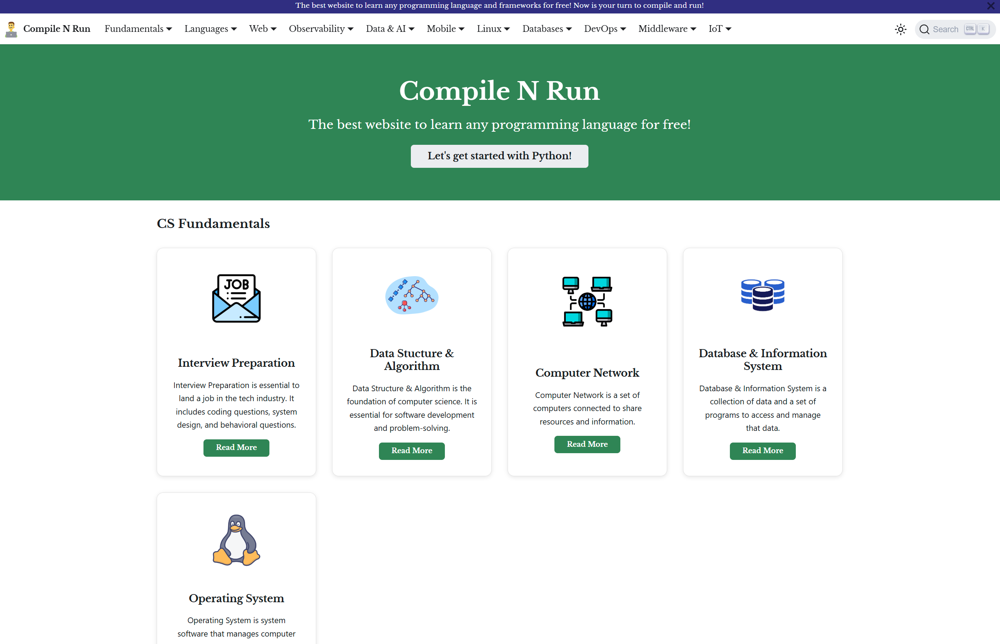

# Compile N Run




- https://www.compilenrun.com/

**Compile N Run** is a comprehensive learning platform designed for developers and computer science enthusiasts. Whether you're preparing for technical interviews, strengthening your programming fundamentals, or exploring new technologies, our platform provides curated resources across the entire software development stack.


## What You'll Find Here

Our content spans essential areas of software development:

**📚 CS Fundamentals**
- Data Structures & Algorithms
- Computer Networks
- Database & Information Systems
- Interview preparation materials

**💻 Programming Languages**
- JavaScript, C, C++, Kotlin
- Language-specific tutorials and best practices

**🚀 Modern Frameworks**
- Web frameworks: Django, FastAPI, Next.js, Angular
- Enterprise platforms: .NET
- Complete development guides and examples

**📊 Observability & Monitoring**
- Grafana for visualization
- Prometheus for monitoring and alerting

**🔧 Developer Tools & Libraries**
- Data analysis with Pandas
- Middleware solutions: Nginx, Kong, Redis

**🛠️ DevOps & Infrastructure**
- CI/CD best practices
- Containerization with Docker
- Orchestration with Kubernetes
- Version control with Git
- Automation with Ansible
- Linux/Ubuntu system administration

## Perfect For

- **Job seekers** preparing for technical interviews
- **Students** learning computer science fundamentals
- **Developers** exploring new technologies and frameworks
- **DevOps engineers** implementing modern infrastructure practices

---

*Start your journey in software development with practical, hands-on learning materials designed for real-world applications.*

### Production site and learning tools

The production site uses Hugo. Tutorials are authored in `docs/`; `hugo/scripts/convert.py` generates the Hugo content tree. Use the Hugo, Node.js, and Python versions specified in `.github/workflows/hugo.yml`, with PyYAML installed.

```sh
hugo/scripts/build.sh
python3 -m http.server 8000 --bind 127.0.0.1 --directory hugo/public
```

Open `http://127.0.0.1:8000/`. The complete build includes the Pagefind index, so filtered search works in this preview. `/learn/` provides browser-local progress, bookmarks, notes, and JSON backups. `/playground/` provides HTML/CSS/JavaScript projects; supported lesson examples also open a practice panel. HTML and CSS render automatically, while JavaScript uses Run or the explicit Auto-run JavaScript option. Drafts and learning records stay in the browser unless exported or explicitly saved to a signed-in account. Optional Google or verified email/password sign-in uses the existing Cloudflare Worker and D1, with Brevo for verification and password resets. `/profile/` provides profile and security settings; see [account deployment and OAuth setup](worker/ask-ai/README.md). Account saves are manual snapshots with revision checks; another device can preview and merge a saved snapshot.

The publishing workflow requires content-quality checks and built-site browser tests before deployment. See [the quality-check guide](tests/content-quality/README.md) for commands, review metadata, and the boundary of legacy-content validation. To run application tests after building:

```sh
npm ci --prefix tests/content-quality
npx --prefix tests/content-quality playwright install chromium
npx --prefix tests/content-quality playwright test --config=tests/content-quality/application.config.mjs
```

Generated Hugo content and public output should not be committed. The following Docusaurus commands remain available for the legacy build.

### Legacy Docusaurus installation

```
$ yarn
```

### Local Development

```
$ yarn start
```

This command starts a local development server and opens up a browser window. Most changes are reflected live without having to restart the server.

### Build

```
$ yarn build
```

This command generates static content into the `build` directory and can be served using any static contents hosting service.

### Deployment

Using SSH:

```
$ USE_SSH=true yarn deploy
```

Not using SSH:

```
$ GIT_USER=<Your GitHub username> yarn deploy
```

If you are using GitHub pages for hosting, this command is a convenient way to build the website and push to the `gh-pages` branch.

