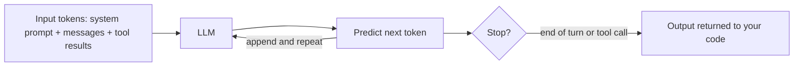

# LLM Basics for Agent Builders

## Introduction

Every AI agent has a large language model (LLM) at its center. You do not need to know how to train one, but you do need a clear picture of how one *behaves*, because almost every agent bug traces back to a misunderstanding about the model:

- "Why did the agent forget what the user said earlier?" (The model is stateless.)
- "Why does the same input give different answers?" (Generation is probabilistic.)
- "Why did my bill jump when the agent ran 30 steps?" (Tokens accumulate in a loop.)
- "Why did it invent an order number?" (Models generate plausible text, not verified facts.)

This page covers the LLM concepts that matter for agents, with no math. Think of the model as a very well-read new colleague who has no memory between conversations, cannot see your systems unless you show them, and sometimes answers confidently when they should say "I don't know." Your job as an agent builder is to design around those traits.

## What an LLM Actually Does

An LLM takes text in and produces text out. Under the hood it predicts the next small piece of text, called a **token**, over and over, until it decides to stop.



Two consequences follow:

1. **Everything the model knows about the current task must be in its input.** If a fact is not in the prompt and not in the model's training data, the model does not know it.
2. **The output is generated, not looked up.** The model produces the most plausible continuation. Usually that is correct. Sometimes it is a confident fabrication, often called a **hallucination**.

## Tokens

A token is a chunk of text, often a word or part of a word. "Agent" might be one token. "Unbelievably" might be three. Code, JSON, and non-English text often use more tokens per character than plain English prose.

Tokens matter for three reasons:

| Why tokens matter | What it means for agents |
|-------------------|--------------------------|
| **Cost** | Providers charge per input token and per output token, usually with output tokens costing more. |
| **Limits** | Each model has a maximum context window (input plus output) and a maximum output length. |
| **Latency** | More output tokens means a longer wait. Input tokens are processed faster but still add time. |

A quick rule of thumb for English prose is roughly four characters per token, but it varies by model and language. For accurate numbers, use the provider's token counting endpoint, covered in [Tokens and Context Windows](../1-agents-llm-apis/8-agents-tokens-and-context.mdx).

```python
def rough_token_estimate(text: str) -> int:
    """Very rough estimate: about 4 characters per token for English prose."""
    return max(1, len(text) // 4)

samples = {
    "short question": "What is the status of order A-1001?",
    "tool result": '{"order_id": "A-1001", "status": "in_transit", "carrier": "UPS", "eta": "2026-10-14"}',
    "long document": "Lorem ipsum dolor sit amet. " * 200,
}
for name, text in samples.items():
    print(f"{name:15} chars={len(text):5}  ~tokens={rough_token_estimate(text)}")
```

Output:

```text
short question  chars=   35  ~tokens=8
tool result     chars=   85  ~tokens=21
long document   chars= 5600  ~tokens=1400
```

:::tip
Tool results are often the biggest source of tokens in an agent. A tool that returns a 50 KB JSON blob when the model only needs three fields wastes money on every step. Design tools to return only what the model needs.
:::

## The Context Window

The **context window** is the maximum number of tokens the model can consider in one request. It includes the system prompt, tool definitions, every message in the conversation, every tool result, and the model's output.

Modern models have large windows, often hundreds of thousands of tokens or more. That sounds like plenty, but agents fill it quickly because every step adds the model's tool call *and* the tool's result. Also, a bigger context is not free: you pay for every token on every call, and models can pay less attention to details buried in a very long context.

Managing what goes into the window is so important that it has its own name, **context engineering**, and its own section: [Context Engineering](../4-agents-memory-and-context/0-agents-context-engineering.mdx).

## LLMs Are Stateless

This is the single most important fact for agent builders. **The model remembers nothing between API calls.** Each request is independent. A "conversation" exists only because your code sends the full history every time.

```python
from anthropic import Anthropic

client = Anthropic()
MODEL = "claude-opus-5-5"


def text_of(response) -> str:
    """Join the text blocks of a response (it can also contain other block types)."""
    return "".join(b.text for b in response.content if b.type == "text")


# Call 1
messages = [{"role": "user", "content": "My name is Priya. Remember it."}]
r1 = client.messages.create(model=MODEL, max_tokens=200, messages=messages)
print("Call 1:", text_of(r1))

# Call 2 WITHOUT history: the model has no idea who you are.
r2 = client.messages.create(
    model=MODEL,
    max_tokens=200,
    messages=[{"role": "user", "content": "What is my name?"}],
)
print("Call 2 (no history):", text_of(r2))

# Call 3 WITH history: we resend everything, so the model "remembers".
messages.append({"role": "assistant", "content": r1.content})
messages.append({"role": "user", "content": "What is my name?"})
r3 = client.messages.create(model=MODEL, max_tokens=200, messages=messages)
print("Call 3 (with history):", text_of(r3))
```

Example output:

```text
Call 1: Got it, Priya! I'll use your name for the rest of our conversation.
Call 2 (no history): I don't know your name. You haven't told me in this conversation.
Call 3 (with history): Your name is Priya.
```

For agents, this means:

- **Your code owns memory.** The `messages` list is the agent's short-term memory. Long-term memory is a database or files that your code reads and injects. See [Short-Term Memory](../4-agents-memory-and-context/1-agents-short-term-memory.mdx).
- **Each step re-sends everything.** Step 20 of an agent run sends steps 1 to 19 again. This drives cost, which we look at below.
- **You can edit history.** Because you build the input, you can summarize old steps, drop stale tool results, or inject reminders.

## Messages, Roles, and System Prompts

Chat-style LLM APIs organize input into **messages** with **roles**:

| Part | Purpose | Example |
|------|---------|---------|
| System prompt | Instructions, persona, rules that apply to the whole conversation | "You are a support agent for Acme. Never promise refunds over $50." |
| `user` messages | What the user said, and also tool results returned by your code | "Where is my order?" |
| `assistant` messages | What the model said, including its requests to call tools | "Let me look that up." plus a tool call |

Agents put a lot of weight on the system prompt: it describes the goal, the tools, the rules, and when to stop. See [System Prompts](../1-agents-llm-apis/3-agents-system-prompts.mdx) and [Designing Agent System Prompts](../3-agents-prompt-engineering/0-agents-system-prompt-design.mdx).

## Tool Calling: How a Model "Acts"

An LLM cannot run code or call APIs by itself. It can only produce output. **Tool calling** (also called function calling) is a convention where:

1. You describe tools to the model: a name, a description, and a JSON Schema for the inputs.
2. When the model wants to use one, it outputs a structured request instead of (or along with) text.
3. **Your code** runs the tool and sends the result back as a new message.

A tool call from the model looks roughly like this in the Anthropic API (other providers use a similar shape):

```json
{
  "type": "tool_use",
  "id": "toolu_01A",
  "name": "get_order_status",
  "input": { "order_id": "A-1001" }
}
```

And your code replies with a matching result:

```json
{
  "type": "tool_result",
  "tool_use_id": "toolu_01A",
  "content": "{\"status\": \"in_transit\", \"eta\": \"2026-10-14\"}"
}
```

The response also carries a **stop reason** that tells your code why the model stopped. The two you will see most are `end_turn` (the model is done) and `tool_use` (the model wants a tool run). An agent loop is basically "while the stop reason is `tool_use`, run the tools and call the model again." You will build that loop in [Building a Manual Agent Loop](../2-agents-tool-use/3-agents-manual-agent-loop.mdx).

:::note
The model decides *whether* and *which* tool to call, and fills in the arguments. Your code decides whether to *actually run* it. That split is your main safety control. You can validate arguments, ask a human, or refuse.
:::

## Non-Determinism

Send the same request twice and you may get different answers. Generation involves sampling among likely next tokens, and providers can change infrastructure behind the scenes. Some APIs expose sampling settings such as `temperature`. Some newer models restrict or ignore these settings, so check the model's documentation.

For agents, small differences early in a run can lead to a completely different path later: a different first tool call leads to different results, which lead to different decisions. Practical consequences:

- **Test with many runs, not one.** A single success proves little. See [Agent Evaluation Introduction](../11-agents-evaluation-and-testing/0-agents-evaluation-introduction.mdx).
- **Make your code deterministic where it can be.** Validation, permissions, and routing logic should be plain code, not model judgment.
- **Use structured outputs** when you need a predictable format. See [Structured Outputs](../1-agents-llm-apis/6-agents-structured-outputs.mdx).

## Knowledge Cutoff and Hallucination

A model's built-in knowledge stops at its training cutoff and never includes your private data. When it lacks information, it may still produce a confident answer. For agents, the fix is the same idea every time: **give the model a way to look things up, and tell it to use that instead of guessing.**

| Problem | Agent-side fix |
|---------|----------------|
| Model does not know recent events | A web search tool |
| Model does not know your company's data | Retrieval (RAG) or database tools |
| Model invents IDs or numbers | Tools that return real IDs; validate arguments in code |
| Model claims it did something it did not | Check tool results in code; never trust the model's summary alone |

## Reasoning, Thinking, and Effort

Many current models can "think" before they answer: they generate internal reasoning that improves results on hard, multi-step problems. On the Anthropic API, current models use **adaptive thinking**, where the model decides how much to think, and you steer depth and token use with an **effort** setting (`low`, `medium`, `high`, `xhigh`, `max`). Other providers have similar controls under different names.

```python
from anthropic import Anthropic

client = Anthropic()

response = client.messages.create(
    model="claude-opus-5-5",
    max_tokens=16000,
    thinking={"type": "adaptive"},
    output_config={"effort": "low"},  # quick, cheap answers for simple tasks
    messages=[{"role": "user", "content": "Classify this ticket: 'My package never arrived.'"}],
)
for block in response.content:
    if block.type == "text":
        print(block.text)
```

Example output:

```text
Category: shipping / missing delivery
```

Higher effort usually means better results on hard tasks and more tokens, cost, and latency. See [Reasoning, Thinking and Effort](../1-agents-llm-apis/7-agents-thinking-and-effort.mdx).

## How Cost Grows in an Agent Loop

Because each step re-sends the whole history, input tokens grow with every step. This small simulation shows the effect. No API is called.

```python
SYSTEM_AND_TOOLS = 2_000   # tokens for system prompt + tool definitions
TOKENS_PER_STEP = 800      # model's tool call + tool result added each step

def total_input_tokens(steps: int) -> int:
    total = 0
    history = 0
    for _ in range(steps):
        total += SYSTEM_AND_TOOLS + history  # what we send on this call
        history += TOKENS_PER_STEP           # this step adds to the history
    return total

for steps in (1, 5, 10, 20, 40):
    print(f"{steps:3} steps -> {total_input_tokens(steps):9,} input tokens")
```

Output:

```text
  1 steps ->     2,000 input tokens
  5 steps ->    18,000 input tokens
 10 steps ->    56,000 input tokens
 20 steps ->   192,000 input tokens
 40 steps ->   704,000 input tokens
```

Doubling the steps from 20 to 40 nearly quadruples the input tokens. This is why agents need step limits, why trimming tool results matters, and why **prompt caching** (which makes re-sent prefixes much cheaper) is so valuable. See [Prompt Caching](../4-agents-memory-and-context/4-agents-prompt-caching.mdx) and [Understanding API Costs](../1-agents-llm-apis/11-agents-api-cost-basics.mdx).

## Model Sizes and Tiers

Providers usually offer a family of models at different sizes. Larger models are more capable on long, ambiguous, multi-step work. Smaller models are faster and cheaper. Agents often use more than one:

| Role in an agent | Typical model choice | Why |
|------------------|----------------------|-----|
| Main agent loop on hard tasks | Largest or mid-tier model | Planning, tool choice, and recovery from errors need strong reasoning |
| Classification or routing | Small, fast model | Simple decision, high volume, low latency |
| Summarizing tool output | Small or mid-tier model | Straightforward compression task |
| Grading outputs in evaluations | Mid-tier or large model | Judgment quality matters |

As of this writing, Anthropic's lineup includes Opus (most capable of the commonly used tiers), Sonnet (balanced), and Haiku (fast and low-cost). Other providers have similar tiers. Names and prices change, so always check the current model list. See [Choosing the Right Model](../1-agents-llm-apis/10-agents-model-selection.mdx).

## Beyond Text: Images and Documents

Many current models accept images and PDFs as input, not just text. For agents, this means a tool can return a screenshot, a chart, or a scanned document, and the model can read it. This is what makes **computer use** and document-processing agents possible. Images and documents also consume tokens, often many of them, so the same advice applies: send only what the model needs.

## Latency Basics

Users feel latency more than cost. In an agent, total time is roughly the sum of every model call plus every tool call:

- **Time to first token** depends on input size and model load.
- **Generation time** grows with the number of output tokens, including thinking.
- **Tool time** depends on your APIs and databases.

Streaming the model's output and showing progress ("Searching orders...") makes long agent runs feel much faster. See [Streaming Responses](../1-agents-llm-apis/5-agents-streaming.mdx) and [Latency Optimization](../13-agents-production/3-agents-latency-optimization.mdx).

## Real-World Scenario

Your team is building an internal agent that answers questions about deployment status. It has two tools: `list_deployments` and `get_deploy_logs`. In testing, three problems show up:

1. A teammate asks "What about the second one?" and the agent has no idea what "second one" means.
2. Some runs cost ten times more than others.
3. Once, the agent reported a deploy as "succeeded" when the logs said it failed.

Each problem maps to an LLM basic:

| Symptom | Root cause | Fix |
|---------|------------|-----|
| Forgets the earlier question | Stateless model; the web handler created a fresh `messages` list per request | Store the conversation per session and resend it ([Session Persistence](../4-agents-memory-and-context/10-agents-session-persistence.mdx)) |
| Some runs are very expensive | `get_deploy_logs` returns entire log files; history grows every step | Return only the last 50 lines plus error lines; add a step limit; enable prompt caching |
| Wrong status reported | Model summarized a long log and hallucinated | Add a `status` field to the tool result computed by code, and instruct the model to quote it |

The fixed tool returns a compact, code-computed result:

```python
def get_deploy_logs(deploy_id: str, max_lines: int = 50) -> dict:
    """Return a compact summary the model can rely on."""
    lines = load_log_lines(deploy_id)  # your existing function
    errors = [ln for ln in lines if "ERROR" in ln]
    return {
        "deploy_id": deploy_id,
        "status": "failed" if errors else "succeeded",  # decided by code, not the model
        "error_lines": errors[:10],
        "tail": lines[-max_lines:],
    }
```

### Why this approach

It moves facts the model is bad at (exact status, long logs) into code, and keeps the model doing what it is good at: understanding the question and explaining the answer. It also shrinks the context so every step is cheaper.

### When to use it and when not to

Compute facts in code whenever the rule is clear ("any ERROR line means failed"). Leave interpretation to the model when the rule is fuzzy ("is this warning worth worrying about?"). Do not over-trim: if the model needs full logs to diagnose a new kind of failure, give it a separate `search_logs` tool instead of hiding the data.

### Alternatives and trade-offs

| Approach | Pros | Cons | Best for |
|----------|------|------|----------|
| Return raw logs | Model sees everything | Expensive, slow, easy to misread | One-off debugging |
| Code-computed summary | Cheap, accurate key facts | Can hide unexpected details | Status checks, dashboards |
| Search tool over logs | Model fetches only what it needs | More tool calls per task | Open-ended diagnosis |
| Bigger context window | No code changes | Higher cost; attention can still miss details | Short-term workaround |

## Common Mistakes

- **Assuming the model remembers.** It never does. Your code must resend or inject everything.
- **Trusting the model's description of tool results.** Check important facts in code.
- **Ignoring token growth.** An agent that is cheap at 3 steps can be expensive at 30.
- **Testing once.** Non-determinism means you need many runs to know how reliable something is.
- **Putting secrets in the prompt.** Anything in the context could appear in output. Keep keys in your tool code, not in messages.

## Summary

- An LLM predicts tokens one at a time. It knows only its training data plus what is in the current input.
- Tokens drive cost, limits, and latency. Tool results are often the largest token source in an agent.
- The model is stateless. Your code owns the conversation history and all memory.
- Tool calling lets the model *request* actions. Your code runs them and decides whether to allow them.
- Outputs are non-deterministic and can be wrong, so validate in code and test many runs.
- In an agent loop, input tokens grow faster than the number of steps, so limit steps and trim context.

## Further Learning

Exercises:

1. Change `TOKENS_PER_STEP` in the cost simulation to 200 and then to 3,000. How does the 40-step total change? What does that tell you about tool result size?
2. Write a function that takes a `messages` list and returns a new list that keeps the first user message and only the last 6 messages. What could go wrong with this simple approach?
3. Think of a tool your team might expose to an agent. List which fields should be computed by code and which can be left to the model to interpret.

Related pages:

- [What Is an AI Agent?](./2-agents-what-is-an-agent.mdx)
- [Your First LLM API Call](../1-agents-llm-apis/1-agents-first-api-call.mdx)
- [Messages and Roles](../1-agents-llm-apis/2-agents-messages-and-roles.mdx)
- [Tool Use Introduction](../2-agents-tool-use/0-agents-tool-use-introduction.mdx)
