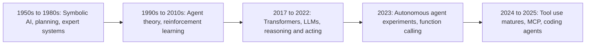

# A Brief History of AI Agents

## Introduction

AI agents feel brand new, but the idea is as old as the field of AI itself. Researchers have been building systems that perceive, decide, and act for more than half a century. What changed recently is the "brain" in the middle: large language models made it possible to give agents goals in plain language and let them use general-purpose tools.

Why learn the history? Because many of today's problems are old problems in new clothes. Classical planners struggled when the world did not match their model. Expert systems were brittle outside their rules. Early LLM agents looped and burned money. Each era teaches a lesson that still applies when you design an agent today.

Think of it as reading the maintenance log of a car before you buy it. You learn what tends to break.

## The Big Picture



## Era 1: Symbolic AI and Planning (1950s to 1980s)

The 1956 Dartmouth workshop is usually treated as the founding of AI as a field. Early researchers believed intelligence could be built from symbols and logical rules.

- **Shakey the robot** (SRI International, roughly 1966 to 1972) was one of the first mobile robots that could reason about its actions. It perceived its environment with a camera and sensors, planned a sequence of actions, and executed them.
- The **STRIPS** planner (1971), developed for Shakey, represented the world as facts and actions as preconditions and effects. Planning meant searching for a sequence of actions that reached the goal state.
- **Expert systems** in the 1970s and 1980s, such as MYCIN for diagnosing infections, encoded specialist knowledge as if-then rules.

**Lesson for today:** these systems worked well inside their models and failed outside them. If the world changed in a way the rules did not anticipate, they had no way to adapt. Modern agents are more flexible, but the same issue appears when your tools or instructions do not cover a situation. Environment feedback, which Shakey's designers also cared about, remains the key to recovering.

## Era 2: Agent Theory and Learning (1990s to 2010s)

In the 1990s, "agent" became a central organizing idea in AI.

- The textbook *Artificial Intelligence: A Modern Approach* by Stuart Russell and Peter Norvig (first edition 1995) framed the entire field around **rational agents**: systems that perceive their environment and act to achieve the best expected outcome.
- **BDI (belief-desire-intention)** architectures modeled agents as having beliefs about the world, desires (goals), and intentions (committed plans).
- **Multi-agent systems** research studied how independent agents coordinate, negotiate, and compete.
- **Reinforcement learning** produced agents that learned behavior from rewards rather than rules, leading to milestones such as DeepMind's Atari-playing agents (2013 to 2015) and AlphaGo (2016).

The classic textbook categories still help describe modern systems:

```python
# Classic agent types from the AI textbook tradition, as tiny examples.

def simple_reflex_agent(temperature: float) -> str:
    """Acts only on the current percept, using fixed rules."""
    return "heat_on" if temperature < 19 else "heat_off"


def goal_based_agent(position: int, goal: int) -> str:
    """Chooses actions that move toward a goal."""
    if position == goal:
        return "stop"
    return "move_right" if position < goal else "move_left"


print(simple_reflex_agent(17.5), simple_reflex_agent(21.0))
print([goal_based_agent(p, 3) for p in (0, 3, 5)])
```

Output:

```text
heat_on heat_off
['move_right', 'stop', 'move_left']
```

An LLM agent is a goal-based agent in this vocabulary, with the model replacing hand-written decision rules.

**Lesson for today:** separating beliefs (what the agent knows), goals, and plans is still good design. In LLM agents, these map to context and memory, the task in the prompt, and an explicit plan or to-do list.

## Era 3: Transformers and Language Models (2017 to 2022)

- The **transformer** architecture (2017, "Attention Is All You Need") made it practical to train very large language models.
- **GPT-3** (2020) showed that a single large model could perform many tasks from instructions and a few examples in the prompt.
- **WebGPT** (OpenAI, late 2021) trained a model to use a text-based web browser to answer questions with citations, an early example of an LLM using a tool.
- **Chain-of-thought prompting** (2022) showed that asking models to reason step by step improved results on multi-step problems.
- **ReAct** (Yao et al., 2022) combined reasoning and acting in a single loop: the model writes a *thought*, chooses an *action* such as a search, reads the *observation*, and repeats. This is the direct ancestor of the agent loop in this tutorial. See [The ReAct Pattern](../6-agents-planning-and-reasoning/3-agents-react-pattern.mdx).
- **ChatGPT** (November 2022) brought conversational LLMs to a mass audience.

**Lesson for today:** reasoning and acting work better together. Letting the model think about an observation before choosing the next action is still the core of most agents.

## Era 4: The Autonomous Agent Boom (2023)

2023 was the year agents went viral.

- **Toolformer** (Meta, early 2023) showed models could learn when to call APIs such as calculators and search.
- **AutoGPT** (released March 30, 2023) and **BabyAGI** were open-source projects that put an LLM in a loop with a goal, a task list, and tools, then let it run. They attracted huge attention on GitHub.
- They also exposed the limits: runs often got stuck in loops, forgot what they had done, made up facts, and ran up API costs.
- **Function calling** arrived in major APIs. OpenAI announced function calling in June 2023, letting developers describe functions with JSON Schema and receive structured calls back. Other providers followed with their own tool-use APIs.
- Frameworks such as LangChain grew rapidly, providing building blocks for chains and agents.

**Lesson for today:** autonomy without structure does not work well. The 2023 experiments showed that agents need clear tools, budgets, memory management, and evaluation. Many of the failure modes in [Agent Limitations and Failure Modes](./9-agents-limitations.mdx) were first widely seen here.

### A closer look: why task-list agents ran away

AutoGPT and BabyAGI-style agents kept a **task list**. After each task, the model was asked to add new tasks that would help reach the goal. Without strong limits, the list could grow faster than tasks were completed. This toy simulation shows the dynamic: when each completed task adds, on average, more than one new task, the list never empties.

```python
import random

random.seed(9)


def run_task_list_agent(new_tasks_per_task: tuple, max_steps: int) -> None:
    queue = ["research the goal"]
    done = 0
    for step in range(max_steps):
        if not queue:
            print(f"Finished in {step} steps")
            return
        queue.pop(0)
        done += 1
        queue.extend(f"subtask {done}.{i}" for i in range(random.randint(*new_tasks_per_task)))
    print(f"Stopped at step limit: {done} done, {len(queue)} still queued")


run_task_list_agent(new_tasks_per_task=(0, 1), max_steps=50)   # tends to converge
run_task_list_agent(new_tasks_per_task=(1, 3), max_steps=50)   # always adds work: explodes
```

Example output (exact numbers depend on the random seed):

```text
Finished in 4 steps
Stopped at step limit: 50 done, 47 still queued
```

Modern agents avoid this with clearer goals, a definition of "done", explicit budgets, and models that are better at judging when a task is complete.

## Era 5: Tool Use Matures (2024 to 2025)

Agents moved from experiments to products.

- **Native tool use** became a standard, generally available feature across major model APIs, and models were trained specifically to use tools well.
- **Computer use** (Anthropic, October 2024) let a model operate a desktop through screenshots, mouse, and keyboard.
- The **Model Context Protocol (MCP)** (Anthropic, November 2024) introduced an open standard for connecting models to tools and data sources. It was widely adopted by other vendors and tools. In December 2025, Anthropic donated MCP to the newly formed **Agentic AI Foundation** under the Linux Foundation. See [MCP Introduction](../7-agents-mcp/0-agents-mcp-introduction.mdx).
- Anthropic's [Building effective agents](https://www.anthropic.com/engineering/building-effective-agents) (December 2024) gave the field a shared vocabulary: workflows vs agents, the augmented LLM, and the advice to start simple.
- **Coding agents** that read repositories, edit files, and run tests in a loop became one of the most widely used agent categories.
- **Agent SDKs** from model providers (for example the OpenAI Agents SDK and the Claude Agent SDK, both in 2025) packaged agent loops, tools, and guardrails. See [Agent Framework Landscape](../9-agents-frameworks/0-agents-framework-landscape.mdx).
- The **Agent2Agent (A2A)** protocol (Google, 2025) proposed a standard for agents to communicate with each other. See [Agent-to-Agent (A2A) Protocol](../7-agents-mcp/10-agents-a2a-protocol.mdx).

**Lesson for today:** the winning pattern is not maximum autonomy, but a capable model in a well-engineered harness: good tools, managed context, clear stopping conditions, and humans in the loop where it matters.

:::note
This field moves fast. Products, versions, and leaders change month to month. For the current state, check official sources such as provider documentation and engineering blogs rather than relying on any history page, including this one.
:::

## How Tool Calling Evolved: From Parsing Text to Native Calls

The biggest practical change between the 2022 ReAct experiments and today's agents is *how* the model asks for an action.

### 2022 to early 2023: parse the model's text

Early ReAct-style agents asked the model to write its reasoning and actions in a text format, then used string parsing to find the action. The prompt looked something like this:

```text
Answer the question. Use this format:
Thought: your reasoning
Action: search[query] or finish[answer]
Observation: (filled in by the system)
```

And the harness parsed the output with regular expressions:

```python
import re

model_output = """Thought: I need the population of Lyon.
Action: search[population of Lyon 2024]"""

match = re.search(r"Action:\s*(\w+)\[(.*?)\]", model_output)
if match:
    tool, argument = match.group(1), match.group(2)
    print(f"tool={tool!r} argument={argument!r}")
else:
    print("Could not parse an action. Ask the model to try again.")

# A small formatting slip breaks the parser:
bad_output = "Thought: Let me search.\nAction: Search (population of Lyon)"
print(bool(re.search(r"Action:\s*(\w+)\[(.*?)\]", bad_output)))
```

Output:

```text
tool='search' argument='population of Lyon 2024'
False
```

This worked surprisingly well, but it was fragile. The model might use different brackets, add extra text, invent a tool name, or produce arguments that were not valid. Every agent framework of that era spent a lot of code on output parsing and retries.

### Mid-2023 onward: structured tool calls

Native function calling and tool use moved this into the API. You describe tools with JSON Schema, and the model returns a structured tool call with a name, an ID, and JSON arguments. Models were also trained specifically to produce these calls reliably.

```json
{
  "type": "tool_use",
  "id": "toolu_01",
  "name": "search",
  "input": {"query": "population of Lyon 2024"}
}
```

| Aspect | Text-parsing ReAct (2022) | Native tool calling (2023 onward) |
|--------|---------------------------|-----------------------------------|
| How actions are expressed | Free text in a convention | Structured blocks defined by the API |
| Argument format | Strings you parse yourself | JSON validated against a schema |
| Multiple actions per turn | Awkward | Supported (parallel tool calls) |
| Failure mode | Parse errors, invented formats | Wrong tool choice or wrong argument values |
| Code needed | Parsers, retries, format reminders | A loop that dispatches tool calls |

The *idea* of ReAct (think, act, observe) survived. The *mechanism* became much more robust.

## What Changed Technically

| Then | Now | Effect on agent design |
|------|-----|------------------------|
| Context windows of a few thousand tokens | Context windows of hundreds of thousands of tokens or more | Longer tasks, but context engineering still matters for cost and focus |
| Text-parsed actions | Native, schema-based tool calls | Fewer format errors; focus moves to tool design |
| Reasoning only when prompted ("think step by step") | Built-in thinking with adjustable effort | Better planning and recovery between tool calls |
| Every integration custom-built | Standard protocols such as MCP | Reusable tool servers across applications |
| Agents as research demos | SDKs, managed platforms, observability tools | Agents become ordinary software to build, test, and operate |

## Themes That Repeat Across Eras

Some problems never go away. They show up in every generation of agents in a new form:

| Recurring theme | Classical AI | 2023 LLM agents | Today's answer |
|-----------------|--------------|-----------------|----------------|
| The world differs from the model | Planners failed when facts changed | Agents acted on stale or invented facts | Ground every step in tool results; verify |
| Knowing when to stop | Search could explode combinatorially | Agents looped endlessly | Budgets, stopping conditions, loop detection |
| Brittleness at the edges | Expert systems failed outside their rules | Prompt-only agents broke on unusual inputs | Evaluation sets that include edge cases |
| Trust and oversight | Expert system recommendations needed review | Autonomous agents took surprising actions | Autonomy levels, approval gates, audit logs |

## Timeline Summary

| Year | Milestone | Why it matters |
|------|-----------|----------------|
| 1956 | Dartmouth workshop | AI becomes a field |
| 1966 to 1972 | Shakey the robot | Early perceive-plan-act agent |
| 1971 | STRIPS planner | Classical planning with actions and goals |
| 1970s to 1980s | Expert systems | Rule-based reasoning; brittleness outside the rules |
| 1995 | *AI: A Modern Approach* | AI framed as the study of rational agents |
| 2017 | Transformer architecture | Foundation for LLMs |
| 2020 | GPT-3 | Instruction-following from prompts |
| 2022 | Chain-of-thought, ReAct, ChatGPT | Reasoning plus acting; mass adoption of chat |
| 2023 | Toolformer, AutoGPT, function calling | Agent boom; lessons about loops and cost |
| 2024 | Computer use, MCP, Building effective agents | Standards and design guidance |
| 2025 | Coding agents, agent SDKs, A2A, Agentic AI Foundation | Agents in mainstream products |

## What This Means for You

- When you read about a "new" agent technique, ask which older problem it addresses: stopping, grounding, brittleness, or oversight.
- Prefer designs that have survived several eras: explicit goals, feedback from the environment, bounded loops, and human review for high-stakes actions.
- Expect the specific tools to change. Invest in understanding the loop, tool design, and evaluation, because those carry over.

Agents are not a fad that appeared overnight, and they are not finished. They are the latest step in a long line of work, and the engineering habits that worked before still work now.

## Key Papers and Posts

If you want to go to the primary sources, these are good starting points:

| Year | Source | What to look for |
|------|--------|------------------|
| 1971 | Fikes and Nilsson, "STRIPS" | How classical planners represented actions and goals |
| 1995 | Russell and Norvig, *Artificial Intelligence: A Modern Approach* | The rational agent framing and agent types |
| 2022 | Wei et al., "Chain-of-Thought Prompting" | Why step-by-step reasoning helps |
| 2022 | Yao et al., "ReAct" (arXiv 2210.03629) | Interleaving thoughts, actions, and observations |
| 2023 | Schick et al., "Toolformer" | Models learning when to call tools |
| 2024 | Anthropic, [Building effective agents](https://www.anthropic.com/engineering/building-effective-agents) | Workflows vs agents, the augmented LLM, starting simple |
| 2024 | [Model Context Protocol](https://modelcontextprotocol.io/) specification | A standard interface for tools and data |
| 2025 | Feng, McDonald, and Zhang, [Levels of Autonomy for AI Agents](https://arxiv.org/abs/2506.12469) | Autonomy as a design choice |

## Frequently Asked Questions

**Were early agents useless?**
No. They were important experiments that showed what was possible and what was missing. Many ideas from them, such as task lists, scratchpads, and reflection, appear in modern agents in more controlled forms.

**Is reinforcement learning still part of LLM agents?**
Yes, indirectly. Model providers use reinforcement learning during training to make models better at multi-step tasks and tool use. As an agent builder you usually do not run it yourself.

**Will the next era make this tutorial obsolete?**
Specific APIs will change. The core ideas, such as the loop, tools, context, evaluation, and oversight, have lasted across every era on this page.

## Real-World Scenario

Your CTO forwards a vendor pitch: "Our fully autonomous AI agents will replace your operations team. Just give them a goal." She asks you for a short, grounded opinion.

You use history to structure your answer:

1. **2023 already tried "just give it a goal."** AutoGPT-style agents with broad autonomy and no structure looped, hallucinated, and wasted money. Ask the vendor what is different: how do they handle stopping, budgets, and verification?
2. **Expert systems were brittle outside their rules.** Ask how the agent behaves on situations it was not designed for, and how it escalates to humans.
3. **The successful pattern since 2024 is structured.** Ask what tools it uses, what permissions it has, how its decisions are logged, and how they evaluate it.

You write back a recommendation: run a time-boxed pilot on read-only incident triage, measure diagnosis accuracy against the last 50 incidents, and do not grant any write access until the results are in.

### Why this approach

History gives you concrete questions instead of vague skepticism. It also keeps you from dismissing real progress: modern tool use, MCP, and better models genuinely make agents useful when they are engineered carefully.

### When to use it and when not to

Use this lens whenever you evaluate agent claims or plan a new agent. Do not use history as a reason to avoid agents altogether. The failures of 2023 were mostly design failures, and many have well-understood fixes today.

### Alternatives and trade-offs

| Response to the pitch | Pros | Cons | Best for |
|-----------------------|------|------|----------|
| Buy and deploy broadly | Fast | High risk; no evidence | Rarely appropriate |
| Reject outright | No risk | May miss real value | When the use case clearly does not fit |
| Time-boxed read-only pilot with metrics | Evidence-based, low risk | Takes a few weeks | Most evaluations |
| Build a small in-house prototype to compare | Deep understanding | Engineering time | Teams that will own agents long term |

## Common Mistakes

- **Thinking agents are a 2023 invention.** The core ideas are decades old, and older research still offers useful designs.
- **Repeating the AutoGPT mistakes.** Unbounded loops, no memory management, and no evaluation still fail.
- **Treating any single product as the definition of an agent.** The concepts outlast the tools.
- **Assuming today's limits are permanent, or that they are already solved.** Both are common errors. Measure for your own use case.

## Summary

- Agents have been a core AI idea since the 1950s: perceive, decide, act.
- Classical planning and expert systems showed the power and brittleness of fixed models and rules.
- Agent theory and reinforcement learning formalized goals, beliefs, and learning from feedback.
- LLMs plus the ReAct pattern created today's agent loop; 2023's autonomous experiments showed the need for structure.
- 2024 and 2025 brought mature tool use, MCP, design guidance, and production agents such as coding assistants.

## Further Learning

Exercises:

1. Write a "model-based reflex agent" for the thermostat: it remembers the last three temperatures and turns the heat on early if the temperature is falling. How is that memory similar to an LLM agent's message history?
2. Read the abstract of the ReAct paper (arXiv 2210.03629). Identify the thought, action, and observation in one of its examples, and map them to perceive, think, act, observe.
3. List three failure stories from 2023-era autonomous agents. For each, name the defense from this tutorial that addresses it.
4. Modify the task-list simulation so the agent stops adding subtasks after 10 completed tasks. Does it finish? What does that suggest about budgets for planning, not just for actions?

Related pages:

- [The Agent Loop](./4-agents-agent-loop.mdx)
- [Agent Terminology Cheat Sheet](./11-agents-terminology.mdx)
- [The ReAct Pattern](../6-agents-planning-and-reasoning/3-agents-react-pattern.mdx)
- [The MCP Ecosystem](../7-agents-mcp/9-agents-mcp-ecosystem.mdx)
