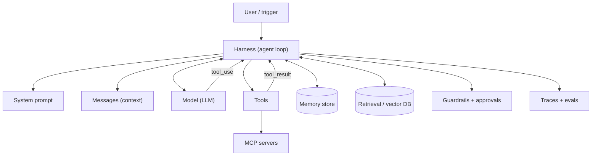

# Agent Terminology Cheat Sheet

## Introduction

The agent field has a lot of jargon, and the same word can mean different things in different documents. "Agent", "tool", "memory", and "orchestration" all have several meanings depending on who is talking. This cheat sheet gives you short, practical definitions as they are used in this tutorial, grouped by topic, with links to the pages that explain each term in depth.

Use it like a phrasebook when traveling. You do not need to memorize it before you start. Keep it open, look things up as you go, and you will find the vocabulary sticks after a few sections.

:::tip
Bookmark this page. When a later section uses a term you do not recognize, come back here first, then follow the link to the page that teaches it in depth.
:::

Terms are grouped by topic, roughly in the order the tutorial introduces them.

## How the Terms Fit Together



## Core Concepts

| Term | Definition | Learn more |
|------|------------|------------|
| **AI agent** | A system where an LLM repeatedly chooses actions, observes results, and decides what to do next until it reaches a goal or a stop condition | [What Is an AI Agent?](./2-agents-what-is-an-agent.mdx) |
| **Agentic system** | Any system that uses LLMs with tools or multi-step logic; includes both workflows and agents | [Agents vs Workflows](./3-agents-vs-workflows.mdx) |
| **Workflow** | LLMs and tools orchestrated through predefined code paths | [Agents vs Workflows](./3-agents-vs-workflows.mdx) |
| **Augmented LLM** | A model enhanced with retrieval, tools, and memory; the basic building block of agentic systems | [What Is an AI Agent?](./2-agents-what-is-an-agent.mdx) |
| **Agent loop** | The repeated cycle of perceive, think, act, observe | [The Agent Loop](./4-agents-agent-loop.mdx) |
| **Harness** | The code around the model that runs the loop, executes tools, and enforces limits | [Core Components of an Agent](./5-agents-core-components.mdx) |
| **Autonomy level** | How much the agent does without human involvement, often set per action | [Levels of Agent Autonomy](./6-agents-autonomy-levels.mdx) |
| **Trajectory** | The full sequence of model outputs, tool calls, and results in one agent run | [Evaluating Agent Trajectories](../11-agents-evaluation-and-testing/3-agents-trajectory-evaluation.mdx) |

## Models and APIs

| Term | Definition | Learn more |
|------|------------|------------|
| **LLM** | Large language model; predicts text one token at a time | [LLM Basics for Agent Builders](./1-agents-llm-basics.mdx) |
| **Token** | A chunk of text the model processes; the unit for pricing and limits | [Tokens and Context Windows](../1-agents-llm-apis/8-agents-tokens-and-context.mdx) |
| **Context window** | Maximum tokens the model can consider in one request, including output | [Tokens and Context Windows](../1-agents-llm-apis/8-agents-tokens-and-context.mdx) |
| **System prompt** | Instructions that apply to the whole conversation: role, rules, goals | [System Prompts](../1-agents-llm-apis/3-agents-system-prompts.mdx) |
| **Messages / roles** | The conversation sent to the model, as `user` and `assistant` turns | [Messages and Roles](../1-agents-llm-apis/2-agents-messages-and-roles.mdx) |
| **Stop reason** | Why the model stopped generating, such as `end_turn`, `tool_use`, `max_tokens`, `pause_turn`, `refusal` | [The Agent Loop](./4-agents-agent-loop.mdx) |
| **Streaming** | Receiving output incrementally as it is generated | [Streaming Responses](../1-agents-llm-apis/5-agents-streaming.mdx) |
| **Structured outputs** | Constraining the model's output to a JSON schema | [Structured Outputs](../1-agents-llm-apis/6-agents-structured-outputs.mdx) |
| **Thinking / reasoning** | Internal reasoning the model does before answering; improves hard tasks | [Reasoning, Thinking and Effort](../1-agents-llm-apis/7-agents-thinking-and-effort.mdx) |
| **Effort** | A setting that trades depth and token use against speed and cost | [Reasoning, Thinking and Effort](../1-agents-llm-apis/7-agents-thinking-and-effort.mdx) |
| **Hallucination** | Plausible but false output presented as fact | [Agent Limitations and Failure Modes](./9-agents-limitations.mdx) |
| **Knowledge cutoff** | The date after which the model has no training data | [LLM Basics for Agent Builders](./1-agents-llm-basics.mdx) |

### Request settings you will see often

| Setting | What it controls | Notes |
|---------|------------------|-------|
| `model` | Which model handles the request | Use exact IDs from the provider's model list |
| `max_tokens` | Upper limit on output tokens for one response | If hit, the stop reason is `max_tokens` |
| `system` | The system prompt | Stable content here caches well |
| `tools` | Tool definitions available for this request | Each definition costs input tokens |
| `tool_choice` | Whether and how the model may call tools | Leave it on `auto` for agents; on some current models forcing a specific tool is not supported |
| `thinking` / `effort` | Reasoning mode and depth | Higher effort usually means better results on hard tasks and more tokens |
| `temperature` | Sampling randomness | Some newer models restrict sampling parameters; check the docs |
| `stream` | Whether output arrives incrementally | Use for long outputs and user-facing apps |

## Tools

| Term | Definition | Learn more |
|------|------------|------------|
| **Tool / function calling** | The model requests a named function with JSON arguments; your code runs it | [Tool Use Introduction](../2-agents-tool-use/0-agents-tool-use-introduction.mdx) |
| **Tool definition** | Name, description, and input schema that tell the model how to use a tool | [Defining Tools](../2-agents-tool-use/1-agents-defining-tools.mdx) |
| **Input schema** | JSON Schema describing a tool's parameters | [Tool Input Schemas](../2-agents-tool-use/2-agents-tool-input-schemas.mdx) |
| **`tool_use` block** | The model's structured request to call a tool, with an ID | [Building a Manual Agent Loop](../2-agents-tool-use/3-agents-manual-agent-loop.mdx) |
| **`tool_result` block** | Your reply to a tool call, matched by ID; can be marked as an error | [Handling Tool Errors](../2-agents-tool-use/6-agents-tool-errors.mdx) |
| **Tool runner** | SDK helper that runs the agent loop for you | [Using an SDK Tool Runner](../2-agents-tool-use/4-agents-tool-runner.mdx) |
| **Parallel tool calls** | Several tool requests in one model turn | [Parallel Tool Calls](../2-agents-tool-use/5-agents-parallel-tool-calls.mdx) |
| **Client-side tool** | A tool your code executes | [Tool Use Introduction](../2-agents-tool-use/0-agents-tool-use-introduction.mdx) |
| **Server-side tool** | A tool the model provider executes, such as web search or code execution | [Server-Side Tools](../2-agents-tool-use/8-agents-server-tools.mdx) |
| **ACI (agent-computer interface)** | The design of tools from the model's point of view; deserves as much care as a UI | [Tool Design Principles](../2-agents-tool-use/7-agents-tool-design-principles.mdx) |
| **Computer use** | Operating a GUI through screenshots, mouse, and keyboard | [Project: Browser Automation Agent](../14-agents-projects/8-agents-project-browser-automation.mdx) |

Here is what the two tool blocks look like together in a conversation history:

```json
[
  {"role": "user", "content": "Is order A-1001 late?"},
  {"role": "assistant", "content": [
    {"type": "text", "text": "Let me check."},
    {"type": "tool_use", "id": "toolu_01", "name": "get_order", "input": {"order_id": "A-1001"}}
  ]},
  {"role": "user", "content": [
    {"type": "tool_result", "tool_use_id": "toolu_01", "content": "{\"status\": \"late\", \"eta\": \"2026-10-14\"}"}
  ]},
  {"role": "assistant", "content": [
    {"type": "text", "text": "Yes. It is late and now expected on October 14."}
  ]}
]
```

## Context and Memory

| Term | Definition | Learn more |
|------|------------|------------|
| **Context engineering** | Choosing what information goes into the model's context at each step | [Context Engineering](../4-agents-memory-and-context/0-agents-context-engineering.mdx) |
| **Short-term memory** | The current conversation history | [Short-Term Memory](../4-agents-memory-and-context/1-agents-short-term-memory.mdx) |
| **Long-term memory** | Information persisted across sessions | [Long-Term Memory](../4-agents-memory-and-context/5-agents-long-term-memory.mdx) |
| **Compaction** | Summarizing older context to free space | [Compaction and Summarization](../4-agents-memory-and-context/2-agents-compaction-and-summarization.mdx) |
| **Context editing** | Removing stale content such as old tool results | [Context Editing](../4-agents-memory-and-context/3-agents-context-editing.mdx) |
| **Prompt caching** | Reusing a processed prompt prefix to cut cost and latency | [Prompt Caching](../4-agents-memory-and-context/4-agents-prompt-caching.mdx) |
| **Episodic / semantic / procedural memory** | Memories of events, facts, and how-to knowledge | [Episodic, Semantic and Procedural Memory](../4-agents-memory-and-context/8-agents-memory-types.mdx) |
| **RAG** | Retrieval-augmented generation: fetch relevant documents and add them to the prompt | [RAG Introduction](../5-agents-rag/0-agents-rag-introduction.mdx) |
| **Embedding** | A vector of numbers representing meaning, used for similarity search | [Embeddings](../5-agents-rag/1-agents-embeddings.mdx) |
| **Vector database** | A store optimized for searching embeddings | [Vector Databases](../5-agents-rag/2-agents-vector-databases.mdx) |
| **Agentic RAG** | An agent that decides when and what to retrieve | [Agentic RAG](../5-agents-rag/6-agents-agentic-rag.mdx) |
| **Grounding / citations** | Tying answers to specific source passages | [Citations and Grounding](../5-agents-rag/7-agents-citations-and-grounding.mdx) |

## Patterns

| Term | Definition | Learn more |
|------|------------|------------|
| **Prompt chaining** | Fixed sequence of LLM calls, each using the last output | [Prompt Chaining](../6-agents-planning-and-reasoning/1-agents-prompt-chaining.mdx) |
| **Routing** | Classify an input and send it to a specialized handler | [Routing](../6-agents-planning-and-reasoning/2-agents-routing.mdx) |
| **Parallelization** | Run subtasks at once (sectioning) or repeat for votes | [Parallel Agents](../8-agents-multi-agent-systems/4-agents-parallel-agents.mdx) |
| **ReAct** | Interleaving reasoning (thought) and acting (action, observation) | [The ReAct Pattern](../6-agents-planning-and-reasoning/3-agents-react-pattern.mdx) |
| **Plan-and-execute** | Write a plan first, then carry it out, replanning as needed | [Plan-and-Execute](../6-agents-planning-and-reasoning/4-agents-plan-and-execute.mdx) |
| **Reflection** | The model critiques and improves its own output | [Reflection and Self-Critique](../6-agents-planning-and-reasoning/6-agents-reflection.mdx) |
| **Evaluator-optimizer** | One LLM generates, another evaluates, in a loop | [Evaluator-Optimizer Loops](../6-agents-planning-and-reasoning/7-agents-evaluator-optimizer.mdx) |
| **Human-in-the-loop (HITL)** | A person reviews, approves, or corrects during the run | [Human-in-the-Loop](../6-agents-planning-and-reasoning/9-agents-human-in-the-loop.mdx) |
| **Stopping condition / budget** | Limits on steps, tokens, time, or cost that end a run | [Stopping Conditions and Budgets](../6-agents-planning-and-reasoning/10-agents-stopping-conditions.mdx) |

## Multi-Agent Systems

| Term | Definition | Learn more |
|------|------------|------------|
| **Multi-agent system** | Several agents with separate contexts or roles working on one task | [Multi-Agent Systems Introduction](../8-agents-multi-agent-systems/0-agents-multi-agent-introduction.mdx) |
| **Orchestrator-workers** | A lead LLM splits work at runtime and delegates to workers | [Orchestrator-Workers Pattern](../8-agents-multi-agent-systems/1-agents-orchestrator-workers.mdx) |
| **Supervisor** | An agent that routes work to specialist agents and reviews results | [Supervisor Pattern](../8-agents-multi-agent-systems/2-agents-supervisor-pattern.mdx) |
| **Handoff** | Transferring control of a conversation from one agent to another | [Agent Handoffs](../8-agents-multi-agent-systems/3-agents-handoffs.mdx) |
| **Subagent** | A helper agent with its own fresh context, returning a summary | [Subagents and Context Isolation](../8-agents-multi-agent-systems/8-agents-subagents-and-context-isolation.mdx) |

## Protocols and Frameworks

| Term | Definition | Learn more |
|------|------------|------------|
| **MCP (Model Context Protocol)** | Open standard for connecting AI apps to tools, resources, and prompts | [MCP Introduction](../7-agents-mcp/0-agents-mcp-introduction.mdx) |
| **MCP server / client / host** | Server exposes capabilities; client connects to one server; host is the app running clients | [MCP Architecture](../7-agents-mcp/1-agents-mcp-architecture.mdx) |
| **Transport** | How MCP messages travel, such as stdio or HTTP | [MCP Transports](../7-agents-mcp/5-agents-mcp-transports.mdx) |
| **A2A (Agent2Agent)** | A protocol for agents to communicate and delegate to each other | [Agent-to-Agent (A2A) Protocol](../7-agents-mcp/10-agents-a2a-protocol.mdx) |
| **Agent framework** | A library providing loops, tools, memory, and orchestration | [Agent Framework Landscape](../9-agents-frameworks/0-agents-framework-landscape.mdx) |
| **Managed agent platform** | A hosted service that runs agents and their sandboxes for you | [Managed Agent Platforms](../9-agents-frameworks/9-agents-managed-agent-platforms.mdx) |

## Evaluation and Observability

| Term | Definition | Learn more |
|------|------------|------------|
| **Eval** | A repeatable test of agent quality over a dataset | [Agent Evaluation Introduction](../11-agents-evaluation-and-testing/0-agents-evaluation-introduction.mdx) |
| **Golden dataset** | Curated inputs with expected outcomes | [Building Evaluation Datasets](../11-agents-evaluation-and-testing/1-agents-building-eval-sets.mdx) |
| **LLM-as-a-judge** | Using a model to grade outputs against a rubric | [Grading Methods](../11-agents-evaluation-and-testing/2-agents-grading-methods.mdx) |
| **Trace / span** | A record of one run (trace) made of timed operations (spans) | [Tracing Agent Runs](../11-agents-evaluation-and-testing/8-agents-tracing.mdx) |
| **Benchmark** | A public, standardized evaluation used to compare systems | [Agent Benchmarks](../11-agents-evaluation-and-testing/7-agents-benchmarks.mdx) |
| **Regression test** | Re-running evals to catch quality drops after changes | [Regression Testing for Agents](../11-agents-evaluation-and-testing/6-agents-regression-testing.mdx) |

## Safety and Production

| Term | Definition | Learn more |
|------|------------|------------|
| **Prompt injection** | Untrusted content containing instructions the model may follow | [Prompt Injection](../12-agents-safety-and-security/1-agents-prompt-injection.mdx) |
| **Guardrail** | A check on inputs, outputs, or actions that does not rely on the model | [Input and Output Guardrails](../12-agents-safety-and-security/6-agents-guardrails.mdx) |
| **Least privilege** | Giving tools only the minimum access needed | [Least Privilege for Agent Tools](../12-agents-safety-and-security/2-agents-least-privilege.mdx) |
| **Sandbox** | An isolated environment for running agent actions safely | [Sandboxing Agent Execution](../12-agents-safety-and-security/3-agents-sandboxing.mdx) |
| **Approval gate** | A required human confirmation before a risky action | [Human Approval Gates](../12-agents-safety-and-security/7-agents-approval-gates.mdx) |
| **Red teaming** | Deliberately attacking your agent to find weaknesses | [Red Teaming Agents](../12-agents-safety-and-security/10-agents-red-teaming.mdx) |
| **Fallback** | An alternative model or path used when the primary one fails | [Reliability and Fallbacks](../13-agents-production/5-agents-reliability-and-fallbacks.mdx) |
| **AgentOps** | Practices for operating agents: versioning, monitoring, incidents | [AgentOps Best Practices](../13-agents-production/10-agents-agentops-best-practices.mdx) |

## Integration and Operations

| Term | Definition | Learn more |
|------|------------|------------|
| **Trigger** | What starts an agent run: a user message, webhook, schedule, or queue message | [Event-Driven Agents and Webhooks](../10-agents-integration/4-agents-event-driven.mdx) |
| **Background job** | An agent run that happens outside the request/response cycle | [Running Agents as Background Jobs](../10-agents-integration/3-agents-background-jobs.mdx) |
| **Server-sent events (SSE)** | A simple way to stream agent output to a browser | [Streaming Agent Output to a Frontend](../10-agents-integration/2-agents-streaming-to-frontend.mdx) |
| **Time to first token (TTFT)** | Delay before the first output token arrives | [Latency Optimization](../13-agents-production/3-agents-latency-optimization.mdx) |
| **Rate limit** | Provider cap on requests or tokens per minute | [Error Handling and Retries](../1-agents-llm-apis/9-agents-api-error-handling.mdx) |
| **Exponential backoff** | Waiting longer after each failed retry | [Error Handling and Retries](../1-agents-llm-apis/9-agents-api-error-handling.mdx) |
| **Concurrency** | Running many agent sessions at once | [Scaling and Concurrency](../13-agents-production/2-agents-scaling.mdx) |
| **Model migration** | Moving an agent to a new model version safely | [Migrating to a New Model](../13-agents-production/8-agents-model-migration.mdx) |
| **Prompt versioning** | Tracking prompt changes like code | [Versioning and Managing Prompts](../3-agents-prompt-engineering/8-agents-prompt-versioning.mdx) |
| **Session** | One user's ongoing interaction, possibly spanning many runs | [Session Persistence](../4-agents-memory-and-context/10-agents-session-persistence.mdx) |

## Commonly Confused Pairs

| Pair | The difference |
|------|----------------|
| **Agent vs workflow** | In an agent the model directs the steps; in a workflow your code does |
| **Context vs memory** | Context is what the model sees in this request; memory is what your system stores and chooses to load into context |
| **Tool use vs MCP** | Tool use is the model calling functions; MCP is a protocol for packaging and serving tools and data to AI applications |
| **RAG vs long context** | RAG retrieves selected passages; long context sends whole documents. See [RAG vs Long Context](../5-agents-rag/9-agents-rag-vs-long-context.mdx) |
| **Guardrail vs instruction** | An instruction asks the model to behave; a guardrail enforces it in code |
| **Thinking vs output** | Thinking is the model's internal reasoning before answering; output is the text and tool calls it returns |
| **Evaluation vs monitoring** | Evaluation tests quality on a fixed dataset before release; monitoring watches real traffic after release |
| **Subagent vs handoff** | A subagent does a task and reports back; a handoff transfers the conversation to another agent |
| **Framework vs SDK** | An SDK is a client for one provider's API; a framework adds abstractions for agents, often across providers |

## Acronyms

| Acronym | Stands for |
|---------|------------|
| LLM | Large language model |
| RAG | Retrieval-augmented generation |
| MCP | Model Context Protocol |
| A2A | Agent2Agent protocol |
| ACI | Agent-computer interface |
| HITL | Human-in-the-loop |
| ReAct | Reasoning and acting |
| CoT | Chain of thought |
| PII | Personally identifiable information |
| OTel | OpenTelemetry |
| RPA | Robotic process automation |
| SDK | Software development kit |

## Terms in Action: An Annotated Run

Here is one short agent run, with the vocabulary from this page attached to each moment:

| Moment in the run | Terms involved |
|-------------------|----------------|
| A webhook fires when a new support ticket arrives | Trigger, event-driven agent |
| The harness builds the request: system prompt, tool definitions, the ticket text | Harness, system prompt, tool definition, context |
| The model thinks and returns a `tool_use` block for `get_order` | Thinking, tool calling, stop reason `tool_use` |
| Your code checks the policy, runs the tool, and sends a `tool_result` | Guardrail, autonomy level, client-side tool |
| The model searches the help center through an MCP server | MCP, retrieval |
| The model drafts a refund, which needs approval | Approval gate, human-in-the-loop |
| The run ends with `end_turn`; the trace is stored | Stop reason, trace, observability |
| Weekly, the team scores 100 stored runs | Eval, LLM-as-a-judge, regression test |

## A Searchable Glossary in Code

If your team keeps its own glossary (a good idea for internal agent projects), a tiny helper lets you search it from a script or a Slack bot.

```python
GLOSSARY = {
    "agent": "An LLM that chooses actions, observes results, and decides what to do next until done.",
    "workflow": "LLMs and tools orchestrated through predefined code paths.",
    "augmented llm": "A model enhanced with retrieval, tools, and memory.",
    "tool_result": "Your reply to a tool call, matched by tool_use_id; can be marked as an error.",
    "compaction": "Summarizing older context to free space in the context window.",
    "prompt injection": "Untrusted content containing instructions the model may follow.",
}


def lookup(query: str) -> list:
    q = query.lower()
    return [(term, text) for term, text in GLOSSARY.items() if q in term or q in text.lower()]


for term, text in lookup("context"):
    print(f"{term}: {text}")
```

Output:

```text
compaction: Summarizing older context to free space in the context window.
```

## Frequently Asked Questions

**Why do different docs define "agent" differently?**
Some define it by capability (can it act?), others by control flow (who decides the steps?). This tutorial uses control flow, following Anthropic's workflow vs agent distinction, because it best predicts cost, testing needs, and risk.

**Is "agentic" the same as "agent"?**
"Agentic" is an adjective for systems that show agent-like behavior to some degree. An agentic system can be a workflow with one model-driven decision.

**Do I need to know every term before starting?**
No. Learn the core concepts and tools sections first. The rest will make sense as you reach each section.

## Real-World Scenario

Your team of eight is starting its first agent project. In the first design review, people talk past each other: one engineer says "agent" and means a prompt chain, the PM says "memory" and means the user's saved preferences, and the security lead says "tools" and means the whole external API surface. Decisions get made on different assumptions.

You add a short **Glossary** section to the design doc, copying the relevant rows from this cheat sheet and adding project-specific terms:

| Term | Meaning in this project |
|------|-------------------------|
| Agent | The ticket resolver loop only. The intake router is a workflow. |
| Memory | Conversation history (short-term) and the `customer_notes` table (long-term) |
| Tool | One of the five functions in `tools.py`. Nothing else is callable. |
| Approval | A Slack button an on-shift human must click before a refund runs |
| Done | The ticket is closed with a reply sent, or handed to a human with a reason |

### Why this approach

Shared, written definitions prevent expensive misunderstandings, especially about scope ("what can the agent touch?") and success ("what counts as done?"). Linking to tutorial pages gives new team members a path to learn each concept in depth.

### When to use it and when not to

A project glossary is worth it for any team larger than two or any project that involves security, product, and engineering stakeholders. For a solo prototype, the cheat sheet alone is enough.

### Alternatives and trade-offs

| Approach | Pros | Cons | Best for |
|----------|------|------|----------|
| No glossary | Zero effort | Misunderstandings in reviews | Solo experiments |
| Link to this cheat sheet | Quick, consistent | Not project-specific | Small teams |
| Project glossary in design doc | Precise scope and success terms | Must be kept up to date | Most team projects |
| Org-wide glossary | Consistent across teams | Needs an owner | Larger organizations with many agents |

## Common Mistakes

- **Using "agent" for every LLM feature.** Say "workflow" when the code controls the steps.
- **Confusing memory with context.** Context is what the model sees now; memory is what you store and choose to load.
- **Confusing MCP with tool use.** Tool use is the model calling functions. MCP is a protocol for *providing* tools and data to AI applications.
- **Assuming terms mean the same thing across frameworks.** Check each framework's definitions of "agent", "chain", "graph", and "crew".

## Summary

- Agent vocabulary falls into a few groups: core concepts, models and APIs, tools, context and memory, patterns, multi-agent systems, protocols, evaluation, and safety.
- The most important distinctions are agent vs workflow, context vs memory, and tool use vs MCP.
- Use this page as a reference and follow the links for depth.
- Write a short glossary for each team project to align on scope and success.

## Further Learning

Exercises:

1. Add ten terms from this page to the `GLOSSARY` dictionary, and change `lookup` to rank exact term matches first.
2. Write a one-sentence definition, in your own words, for agent, workflow, tool, context, and guardrail. Compare them with the tables above.
3. Draft a five-row project glossary for an agent idea of your own, using the scenario's table as a template.
4. Pick five rows from "Commonly Confused Pairs" and explain each difference to a teammate in one sentence, without looking.


Next steps:

- Start writing code in [Setting Up Your Agent Development Environment](../1-agents-llm-apis/0-agents-environment-setup.mdx).
- Return to the [AI Agents Introduction](./0-agents-introduction.mdx) for the full roadmap.
