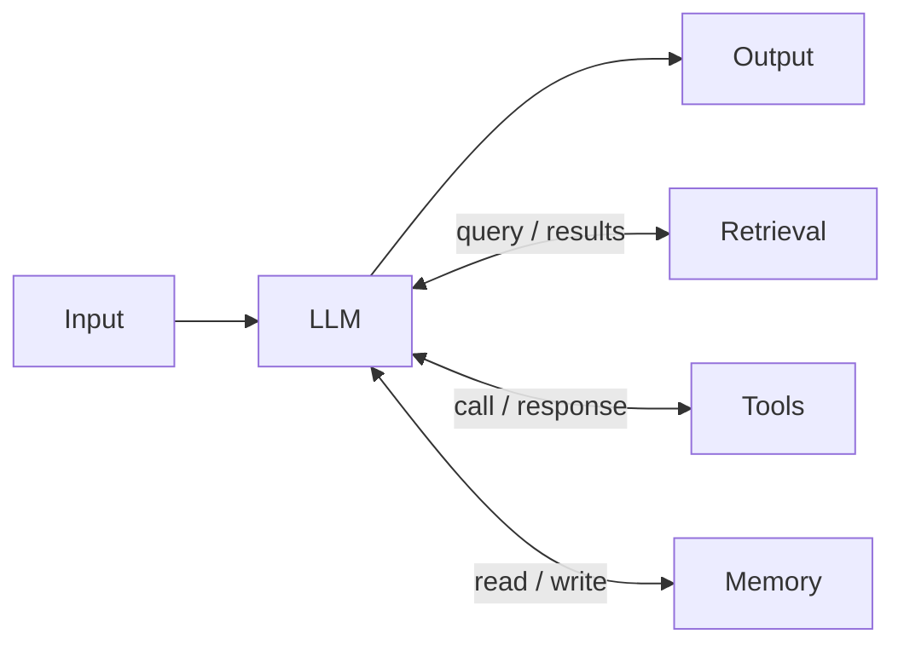
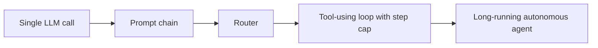

# What Is an AI Agent?

## Introduction

"Agent" is one of the most overloaded words in software right now. Vendors call chatbots agents. Scripts with one LLM call get called agents. Meanwhile, researchers have used the word since long before LLMs existed. If your team cannot agree on what an agent is, you cannot agree on what to build, how to test it, or how much risk you are taking on.

This page gives you a practical definition you can use in design reviews, shows the building block that every agent is made from (the **augmented LLM**), and walks through a minimal agent you can run.

A useful analogy is the difference between a **vending machine** and a **personal assistant**. A vending machine follows fixed rules: press B4, get chips. A personal assistant receives a goal ("book me a flight to Denver next Tuesday, under $400"), decides what to check, reacts to what they find, and comes back when the job is done or when they need your input. Agents sit closer to the assistant end.

## Definitions You Will Encounter

Different sources define agents at different levels of strictness. Knowing all three helps you read documentation and vendor claims.

| Source | Definition (paraphrased) | Emphasis |
|--------|--------------------------|----------|
| Classic AI textbooks (Russell and Norvig) | Anything that **perceives** its environment through sensors and **acts** on it through actuators | Very broad: a thermostat qualifies |
| Anthropic, [Building effective agents](https://www.anthropic.com/engineering/building-effective-agents) (Dec 2024) | Systems where **LLMs dynamically direct their own processes and tool usage**, keeping control over how they accomplish tasks | Who decides the control flow |
| OpenAI, *A practical guide to building agents* (2025) | Systems that **independently accomplish tasks** on the user's behalf, built from a **model**, **tools**, and **instructions** | Independence and components |

This tutorial uses a working definition that combines them:

:::info Working definition
An **AI agent** is a system in which an LLM, given a goal, **repeatedly chooses actions** (usually tool calls), **observes the results**, and **decides what to do next**, until it reaches the goal or a stopping condition.
:::

The key phrase is *decides what to do next*. If your code decides every step and the LLM only fills in text, you have a **workflow**, not an agent. That distinction is important enough to get its own page: [Agents vs Workflows](./3-agents-vs-workflows.mdx).

## The Augmented LLM: The Building Block

Anthropic's guide describes the basic building block of all agentic systems as the **augmented LLM**: a model enhanced with **retrieval**, **tools**, and **memory**. The model can write its own search queries, choose which tools to call, and decide what information to keep.



An augmented LLM on its own is not yet an agent. It becomes one when you put it in a **loop** and let it decide how many times to go around.

| Building block | Example | Covered in |
|----------------|---------|------------|
| Retrieval | Search a help center or vector database | [RAG Introduction](../5-agents-rag/0-agents-rag-introduction.mdx) |
| Tools | `get_order`, `run_tests`, `send_email` | [Tool Use Introduction](../2-agents-tool-use/0-agents-tool-use-introduction.mdx) |
| Memory | Conversation history, user preferences, notes files | [Long-Term Memory](../4-agents-memory-and-context/5-agents-long-term-memory.mdx) |

## Five Properties of an Agent

When you look at a system and ask "is this an agent?", check for these properties:

1. **Goal-directed.** It is given an outcome to achieve ("resolve this ticket"), not a fixed script.
2. **Model-driven control flow.** The LLM chooses the next action. The number and order of steps are not hardcoded.
3. **Acts through tools.** It can affect or query the world beyond generating text.
4. **Uses feedback from the environment.** It reads tool results, errors, and test output, and adjusts. Anthropic's guide stresses getting "ground truth" from the environment at each step.
5. **Knows when to stop.** It ends when the goal is met, asks a human when stuck, or hits a budget.

Systems vary in how strongly they show each property, so "agentic" is better thought of as a spectrum than a yes/no label. A router that picks one of three prompts is a little agentic. A coding assistant that explores a repository, edits files, and runs tests for 40 steps is very agentic.



Left to right: more autonomy, more flexibility, and more cost, latency, and risk.

## What Is *Not* an Agent

These are useful and common, but they are not agents by our definition:

- **A chatbot with no tools.** It responds to messages but cannot act or observe anything new.
- **A single LLM call that summarizes a document.** Fixed input, fixed output, no loop.
- **A prompt chain** (outline, then draft, then proofread). The code decides the sequence.
- **An RPA bot** that clicks through a UI with fixed rules. No LLM decision-making.

Calling these "workflows" or "LLM features" is not a downgrade. They are often the better engineering choice.

### Quick quiz: agent or workflow?

| System | Verdict | Reason |
|--------|---------|--------|
| Email summarizer that runs one LLM call per email | Workflow | Fixed single step |
| Bot that classifies a ticket, then calls one of three fixed prompts | Workflow (routing) | Code decides the path after classification |
| Assistant that searches docs, reads pages, and searches again until it can answer | Agent | Model decides how many searches and which pages |
| Coding tool that edits files and re-runs tests until they pass | Agent | Model reacts to test output to choose the next edit |
| Nightly job that extracts fields from invoices with structured outputs | Workflow | Same steps for every invoice |

## A Minimal Agent in Python

Here is the smallest real agent worth writing. It has one tool, a calculator, and a loop that keeps calling the model while the model asks for tools. It uses the Anthropic Python SDK. The same structure works with other providers' tool-calling APIs.

```python
import json
from anthropic import Anthropic

client = Anthropic()  # reads ANTHROPIC_API_KEY from the environment
MODEL = "claude-opus-5-5"

tools = [
    {
        "name": "calculate",
        "description": "Evaluate a basic arithmetic expression with + - * / and parentheses. "
                       "Use this for any arithmetic instead of doing math in your head.",
        "input_schema": {
            "type": "object",
            "properties": {
                "expression": {"type": "string", "description": "For example: (12.5 * 4) - 3"}
            },
            "required": ["expression"],
        },
    }
]


def calculate(expression: str) -> str:
    allowed = set("0123456789+-*/(). ")
    if not set(expression) <= allowed:
        raise ValueError("Only numbers and + - * / ( ) are allowed")
    return str(eval(expression, {"__builtins__": {}}))  # input is restricted above


def run_agent(goal: str, max_steps: int = 10) -> str:
    messages = [{"role": "user", "content": goal}]
    for step in range(max_steps):
        response = client.messages.create(
            model=MODEL, max_tokens=4096, tools=tools, messages=messages
        )
        if response.stop_reason != "tool_use":
            return "".join(b.text for b in response.content if b.type == "text")

        # The model asked for one or more tools. Keep its full turn in the history.
        messages.append({"role": "assistant", "content": response.content})
        results = []
        for block in response.content:
            if block.type == "tool_use":
                print(f"step {step + 1}: {block.name}({json.dumps(block.input)})")
                try:
                    output, is_error = calculate(**block.input), False
                except Exception as exc:
                    output, is_error = f"Error: {exc}", True
                results.append({
                    "type": "tool_result",
                    "tool_use_id": block.id,
                    "content": output,
                    "is_error": is_error,
                })
        messages.append({"role": "user", "content": results})  # all results in one message
    return "Stopped: step limit reached."


print(run_agent("A team of 7 splits a $1,284.50 dinner bill and adds a 15% tip. "
                "How much does each person pay?"))
```

Example output:

```text
step 1: calculate({"expression": "1284.50 * 1.15 / 7"})
Each person pays about $211.02 (the total with tip is $1,477.18, split 7 ways).
```

Notice what makes this an agent and not just a function:

- The model decided to use the tool, wrote the expression, and decided when it was done.
- If the first expression had an error, the error would go back as a `tool_result` with `is_error`, and the model could fix it and try again.
- The loop has a hard limit (`max_steps`), so it cannot run forever.

:::caution
This example uses a restricted `eval` to stay short. In real code, use a proper expression parser. Never pass model-generated strings to `eval`, `exec`, or a shell without strict validation and sandboxing. See [Tool Security Basics](../2-agents-tool-use/11-agents-tool-security-basics.mdx).
:::

The production-quality version of this loop (handling `max_tokens`, `pause_turn`, refusals, and parallel tools) is built in [Building a Manual Agent Loop](../2-agents-tool-use/3-agents-manual-agent-loop.mdx).

## From Minimal Agent to Production Agent

The minimal agent is about 50 lines. A production agent has the same loop at its core, but surrounds it with much more. This table previews what the rest of the tutorial adds, and why:

| Missing from the minimal agent | Why it matters | Where you learn it |
|--------------------------------|----------------|--------------------|
| System prompt with rules and a role | Shapes behavior, sets limits, defines "done" | [Designing Agent System Prompts](../3-agents-prompt-engineering/0-agents-system-prompt-design.mdx) |
| Handling every stop reason | Avoids silent truncation and crashes | [The Agent Loop](./4-agents-agent-loop.mdx) |
| Token and cost budgets | Prevents runaway bills | [Stopping Conditions and Budgets](../6-agents-planning-and-reasoning/10-agents-stopping-conditions.mdx) |
| Context management | Keeps long runs within limits and focused | [Context Engineering](../4-agents-memory-and-context/0-agents-context-engineering.mdx) |
| Retries and error handling for the API | Survives rate limits and network issues | [Error Handling and Retries](../1-agents-llm-apis/9-agents-api-error-handling.mdx) |
| Permissions and approvals | Limits damage from mistakes or attacks | [Least Privilege for Agent Tools](../12-agents-safety-and-security/2-agents-least-privilege.mdx) |
| Tracing and logging | Lets you debug and improve | [Tracing Agent Runs](../11-agents-evaluation-and-testing/8-agents-tracing.mdx) |
| Evaluation | Tells you if a change made it better or worse | [Agent Evaluation Introduction](../11-agents-evaluation-and-testing/0-agents-evaluation-introduction.mdx) |

None of these change the definition of an agent. They are what makes an agent trustworthy enough to use.

## Anatomy of One Agent Run

It helps to see a run as the model sees it. Here is the conversation history after the bill-splitting run above, simplified to plain data. Each pair of entries after the first is one trip around the loop.

```json
[
  {"role": "user", "content": "A team of 7 splits a $1,284.50 dinner bill and adds a 15% tip. How much does each person pay?"},
  {"role": "assistant", "content": [
    {"type": "text", "text": "I'll calculate the total with tip, divided by 7."},
    {"type": "tool_use", "id": "toolu_01", "name": "calculate", "input": {"expression": "1284.50 * 1.15 / 7"}}
  ]},
  {"role": "user", "content": [
    {"type": "tool_result", "tool_use_id": "toolu_01", "content": "211.025", "is_error": false}
  ]}
]
```

On the next call, the model reads all three entries and writes the final answer. Three things to notice:

1. **Tool results travel in a `user` message.** From the model's point of view, the environment "speaks" in the user turn.
2. **IDs link requests to results.** `tool_use_id` must match the `id` of the request. With several tool calls in one turn, this is how the model knows which result belongs to which call.
3. **The history is the agent's working memory.** If you trimmed the first message, the model would no longer know what question it was answering.

## The Same Idea Across Providers

Every major LLM provider supports this pattern. The names differ, but the shape is the same: describe tools, receive structured calls, return results, repeat.

| Concept | Anthropic Messages API | Other providers (general shape) |
|---------|------------------------|---------------------------------|
| Tool description | `tools` list with `name`, `description`, `input_schema` | Function or tool declarations with a JSON Schema for parameters |
| Model asks for a tool | `tool_use` content block, `stop_reason: "tool_use"` | A tool or function call item in the response, with a finish reason indicating tool calls |
| You return the result | `tool_result` block in a `user` message | A tool or function result message linked by a call ID |
| Final answer | `stop_reason: "end_turn"` | A normal text response |

Because the pattern is shared, the concepts in this tutorial transfer between providers and frameworks. Check each provider's documentation for exact field names.

## Frequently Asked Questions

**Is a chatbot with web search an agent?**
It is an augmented LLM. If it decides on its own to search several times, read results, and search again before answering, it is behaving agentically. If it always runs exactly one search, it is closer to a workflow.

**Does an agent need memory across sessions?**
No. Many useful agents only have the current conversation. Long-term memory is an add-on you introduce when a task benefits from it.

**Does an agent have to use a large model?**
No. Small models can run simple agents with a few clear tools. Larger models are generally better at long, ambiguous tasks and at recovering from errors.

## A Quick Agent Checklist in Code

When reviewing a design, it can help to make the properties explicit. This tiny helper scores a system description so your team discusses the same things.

```python
from dataclasses import dataclass


@dataclass
class SystemDesign:
    name: str
    has_goal_not_script: bool
    model_chooses_next_step: bool
    can_call_tools: bool
    reads_environment_feedback: bool
    has_stop_condition: bool


def agentic_score(d: SystemDesign) -> str:
    checks = [
        d.has_goal_not_script,
        d.model_chooses_next_step,
        d.can_call_tools,
        d.reads_environment_feedback,
        d.has_stop_condition,
    ]
    score = sum(checks)
    if not d.model_chooses_next_step:
        return f"{d.name}: {score}/5 -> workflow (code controls the steps)"
    return f"{d.name}: {score}/5 -> agent"


designs = [
    SystemDesign("FAQ bot", False, False, False, False, True),
    SystemDesign("Blog post pipeline", True, False, False, False, True),
    SystemDesign("Support resolver", True, True, True, True, True),
]
for d in designs:
    print(agentic_score(d))
```

Output:

```text
FAQ bot: 1/5 -> workflow (code controls the steps)
Blog post pipeline: 2/5 -> workflow (code controls the steps)
Support resolver: 5/5 -> agent
```

## Real-World Scenario

Your company is evaluating two vendor products, and both are marketed as "AI agents for IT support." You are asked to compare them. Demos look similar: an employee types "I can't access the VPN" and gets a helpful answer.

You ask each vendor the same questions, based on the five properties:

| Question | Vendor A | Vendor B |
|----------|----------|----------|
| What happens after the user's message? | Classifies the issue, picks one of 40 scripted answers, fills in details with an LLM | LLM chooses from tools: check account status, reset MFA, read VPN logs, open ticket |
| Can it take actions? | No, it only replies | Yes, through an approved tool list |
| Does it check results? | No | Reads tool output and retries or escalates |
| How does it stop? | After one reply | When resolved, after 15 steps, or by handing off to a human |

Vendor A is a **workflow** (routing plus generation). Vendor B is an **agent**.

### Why this approach

Asking about control flow, actions, feedback, and stopping cuts through marketing language. It tells you what you are actually buying: how it can fail, what it can break, and what you need to test.

### When to use each

Vendor A is the safer choice if most tickets match the 40 scripts. It is cheaper, faster, and easier to audit. Vendor B is worth its extra cost and risk only if many tickets need investigation across systems, and only if your team can review its permissions and logs.

### Alternatives and trade-offs

| Approach | Pros | Cons | Best for |
|----------|------|------|----------|
| Scripted answers plus LLM wording (workflow) | Predictable, cheap, easy to audit | Cannot investigate or act | Common, well-understood issues |
| Agent with read-only tools | Can investigate; low risk of damage | Still needs a human to fix things | Diagnosis and triage |
| Agent with write tools and approval gates | Resolves issues end to end | Highest risk; needs security review | Mature teams with good observability |
| Human-only support | Full judgment | Slow, does not scale | Sensitive or rare cases |

## Common Mistakes

- **Using "agent" as a synonym for "uses an LLM."** Be precise. It changes how you test and secure the system.
- **Forgetting the stop condition.** Every agent needs a step limit, a budget, or both.
- **Letting the model's text be the only proof of success.** Check tool results in code.
- **Starting with write access.** Begin with read-only tools and add actions behind approval gates.
- **Treating the agent as a person.** It has no memory, accountability, or common sense beyond what you provide. Design the guardrails.

## Summary

- An AI agent is an LLM that repeatedly chooses actions, observes results, and decides what to do next, until it reaches a goal or a stop condition.
- The building block is the **augmented LLM**: a model with retrieval, tools, and memory.
- Five properties: goal-directed, model-driven control flow, tool use, environment feedback, and a stop condition.
- "Agentic" is a spectrum. Many useful LLM systems are workflows, and that is often the better choice.
- A minimal agent is a loop around a tool-calling API with a step limit.

## Further Learning

Exercises:

1. Add a second tool, `convert_currency(amount, from_code, to_code)`, using a hardcoded rate table, to the minimal agent. Ask a question that needs both tools.
2. Change `max_steps` to 1 and ask a question that needs two calculations. What happens? How would you tell the user?
3. Pick an "AI agent" product you have seen advertised. Score it with the five properties. Is it an agent or a workflow?

Related pages:

- [Agents vs Workflows](./3-agents-vs-workflows.mdx)
- [The Agent Loop](./4-agents-agent-loop.mdx)
- [Core Components of an Agent](./5-agents-core-components.mdx)
- [Defining Tools](../2-agents-tool-use/1-agents-defining-tools.mdx)
