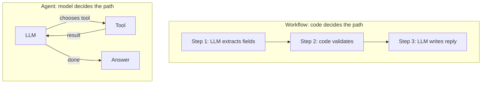
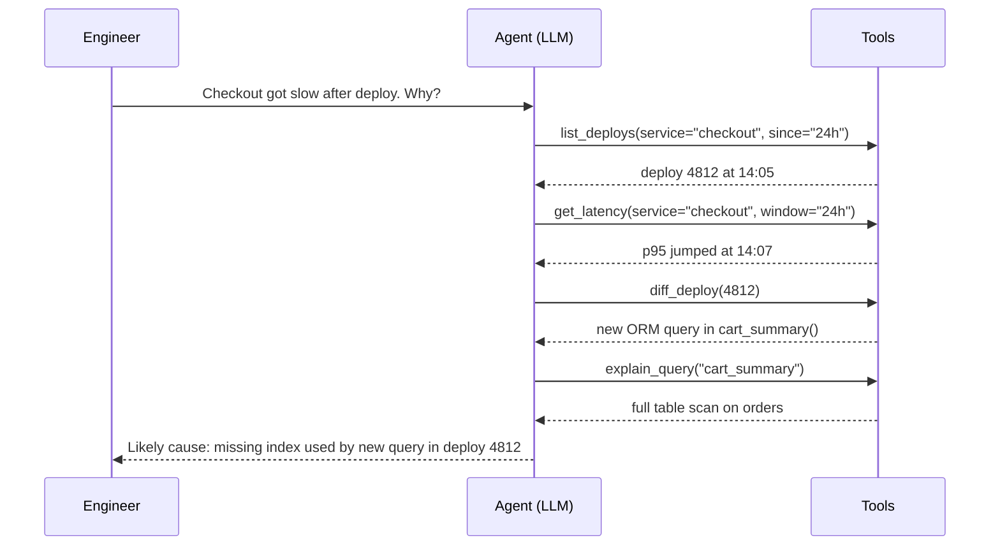
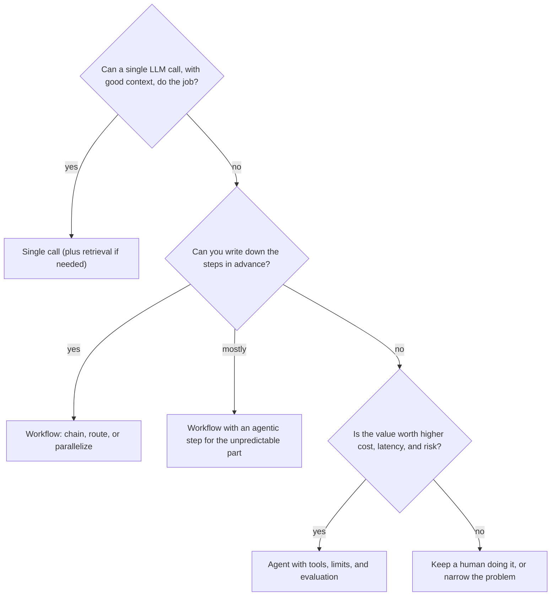
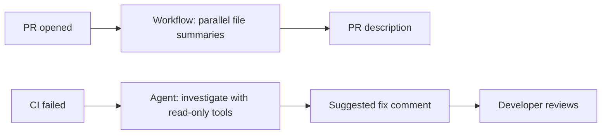

# Agents vs Workflows

## Introduction

When people say "we built an AI agent", they often mean one of two very different things:

- A **workflow**: the steps are fixed in code. The LLM does the language work inside each step.
- An **agent**: the LLM decides which steps to take, in what order, and when it is done.

Anthropic's [Building effective agents](https://www.anthropic.com/engineering/building-effective-agents) guide puts it this way: **workflows** are systems where LLMs and tools are orchestrated through **predefined code paths**, while **agents** are systems where LLMs **dynamically direct their own processes and tool usage**. Both are called *agentic systems*.

An analogy: a workflow is a **train**. It runs on tracks you laid down, stops at known stations, and arrives on a schedule. An agent is a **taxi driver**. You give a destination, and the driver picks the route, reacts to traffic, and might take a detour. The taxi can go places the train cannot, but you cannot print its timetable in advance.

The guide's central advice is to find the **simplest solution possible** and add complexity only when it is needed. Often that means a single well-designed LLM call. Sometimes a workflow. Less often, a full agent. This page shows you how to tell which.

## Side by Side



| Dimension | Workflow | Agent |
|-----------|----------|-------|
| Who controls the steps | Your code | The model |
| Number of LLM calls | Known in advance | Varies per task |
| Cost and latency | Predictable | Variable, sometimes much higher |
| Testing | Test each step like normal code | Need evaluations over many runs and trajectories |
| Debugging | Find the failing step | Read the full trace to see where reasoning went wrong |
| Handles surprises | Only the cases you designed | Can adapt to new situations |
| Best for | Well-defined, repeatable tasks | Open-ended tasks with unpredictable steps |

## The Five Workflow Patterns

Anthropic's guide describes five common workflow patterns. You will study each in depth in [Agent Patterns Overview](../6-agents-planning-and-reasoning/0-agents-patterns-overview.mdx). Here is the short version so you can recognize them.

| Pattern | What it does | Use when |
|---------|--------------|----------|
| **Prompt chaining** | Splits a task into a fixed sequence of LLM calls; each step uses the previous output, with optional code checks ("gates") between them | The task breaks cleanly into fixed subtasks, and you will trade latency for accuracy |
| **Routing** | Classifies the input, then sends it to a specialized prompt, tool, or model | Inputs fall into distinct categories that are better handled separately |
| **Parallelization** | Runs subtasks at the same time (sectioning) or runs the same task several times and compares (voting) | Subtasks are independent, or you want several opinions for confidence |
| **Orchestrator-workers** | A central LLM breaks a task into subtasks at runtime and delegates them to worker LLMs | You cannot predict the subtasks in advance, like edits across many files |
| **Evaluator-optimizer** | One LLM generates, another critiques, and they loop | There are clear evaluation criteria and iteration measurably helps |

Orchestrator-workers and evaluator-optimizer start to blur into agents, because the model influences the path. That is fine. These are points on a spectrum, not strict boxes.

To keep the examples short, they use a small helper around the Anthropic API:

```python
from anthropic import Anthropic

client = Anthropic()
MODEL = "claude-opus-5-5"


def llm(prompt: str, system: str = "", max_tokens: int = 2048) -> str:
    """One LLM call, returns the text."""
    response = client.messages.create(
        model=MODEL,
        max_tokens=max_tokens,
        system=system,
        messages=[{"role": "user", "content": prompt}],
    )
    return "".join(b.text for b in response.content if b.type == "text")
```

### Prompt chaining example

A chain that turns raw release notes into a customer email. Each step is fixed. A code "gate" checks the intermediate result.

```python
def release_email(raw_notes: str) -> str:
    # Step 1: extract user-facing changes
    changes = llm(
        "List only user-facing changes from these release notes, one per line, "
        f"starting with '- '.\n\n{raw_notes}"
    )
    # Gate: plain code check, no LLM judgment needed
    bullet_lines = [ln for ln in changes.splitlines() if ln.startswith("- ")]
    if not bullet_lines:
        raise ValueError("No user-facing changes found; nothing to announce.")

    # Step 2: write the email
    return llm(
        "Write a short, friendly customer email announcing these changes. "
        f"Do not add features that are not listed.\n\n{chr(10).join(bullet_lines)}"
    )
```

### Routing example

A router sends each support message to the right handler. The classification uses a cheap, fast model. The handlers are ordinary functions.

```python
ROUTES = {"billing", "shipping", "technical", "other"}


def classify(message: str) -> str:
    response = client.messages.create(
        model="claude-haiku-5-5",  # small, fast model for classification
        max_tokens=1024,
        output_config={"effort": "low"},  # simple task, keep it quick
        system="Reply with exactly one word: billing, shipping, technical, or other.",
        messages=[{"role": "user", "content": message}],
    )
    label = "".join(b.text for b in response.content if b.type == "text").strip().lower()
    return label if label in ROUTES else "other"  # code enforces valid output


def handle(message: str) -> str:
    route = classify(message)
    handlers = {
        "billing": lambda m: llm(m, system="You are a billing specialist. Be precise about amounts."),
        "shipping": lambda m: llm(m, system="You are a shipping specialist."),
        "technical": lambda m: llm(m, system="You are a technical support engineer."),
        "other": lambda m: "Thanks! A team member will reply within one business day.",
    }
    return handlers[route](message)
```

Notice that the code, not the model, decides what happens after classification. That makes routing easy to test: you can build a table of messages and expected routes and check the classifier's accuracy.

:::tip
For classification you can make the output even more reliable with [Structured Outputs](../1-agents-llm-apis/6-agents-structured-outputs.mdx), which constrain the model to a JSON schema such as an enum of route names.
:::

### Parallelization example

Sectioning splits independent work and runs it at the same time. Here, three reviewers check a pull request diff for different concerns in parallel, and code merges the results. The `llm` helper makes blocking network calls, so threads are a simple way to run them concurrently.

```python
from concurrent.futures import ThreadPoolExecutor

CHECKS = {
    "security": "List any security problems in this diff (injection, secrets, auth). Reply 'none' if none.",
    "performance": "List any obvious performance problems in this diff. Reply 'none' if none.",
    "tests": "List behavior changes in this diff that lack tests. Reply 'none' if none.",
}


def review(diff: str) -> dict:
    with ThreadPoolExecutor(max_workers=len(CHECKS)) as pool:
        futures = {name: pool.submit(llm, f"{instruction}\n\n{diff}") for name, instruction in CHECKS.items()}
        return {name: future.result() for name, future in futures.items()}
```

Each check is a focused prompt, which often works better than one prompt asking for everything. The cost is three calls instead of one, but total latency stays close to that of a single call.

### Evaluator-optimizer sketch

One call writes, another grades against clear criteria, and the loop stops when the grade passes or after a fixed number of rounds. The loop count is fixed in code, so this is still a workflow, even though it iterates.

```python
def write_with_feedback(task: str, criteria: str, max_rounds: int = 3) -> str:
    draft = llm(task)
    for _ in range(max_rounds):
        verdict = llm(
            f"Criteria:\n{criteria}\n\nDraft:\n{draft}\n\n"
            "If the draft meets every criterion, reply exactly PASS. "
            "Otherwise list the specific problems."
        )
        if verdict.strip() == "PASS":
            break
        draft = llm(f"Task: {task}\n\nPrevious draft:\n{draft}\n\nFix these problems:\n{verdict}")
    return draft
```

### Hybrid: a workflow as an agent's tool

Workflows and agents compose well. A common design gives an agent a tool that runs a deterministic workflow. The agent decides *whether* to run it, and the workflow guarantees *how* it runs.

```python
def refund_workflow(order_id: str) -> str:
    """Deterministic steps: check eligibility, then queue for approval. No LLM inside."""
    order = {"A-1001": {"days_since_delivery": 12, "total": 42.0}}.get(order_id)
    if order is None:
        return "Order not found."
    if order["days_since_delivery"] > 30:
        return "Not eligible: outside the 30-day window."
    return f"Refund of ${order['total']:.2f} queued for human approval."


print(refund_workflow("A-1001"))
print(refund_workflow("Z-9"))
```

Output:

```text
Refund of $42.00 queued for human approval.
Order not found.
```

Exposed as a tool named `start_refund`, this gives the agent flexibility in the conversation while keeping the refund rules in testable code.

## When the Path Cannot Be Known: Agents

Now consider a request like: "Our checkout page got slow after yesterday's deploy. Find out why." You cannot write the steps in advance. The investigation might need to look at deploy history, then metrics, then a specific query plan, then a config diff. Or it might be a third-party API outage found on the first step. This is where an agent fits.



The number of steps, and which tools to use, came from the model reacting to what it found. A workflow cannot do that unless you design every branch.

The agent's skeleton is the same loop you saw in [What Is an AI Agent?](./2-agents-what-is-an-agent.mdx):

```python
def run_agent(goal: str, tools: list, execute_tool, max_steps: int = 15) -> str:
    messages = [{"role": "user", "content": goal}]
    for _ in range(max_steps):
        response = client.messages.create(
            model=MODEL, max_tokens=8000, tools=tools, messages=messages
        )
        if response.stop_reason != "tool_use":
            return "".join(b.text for b in response.content if b.type == "text")
        messages.append({"role": "assistant", "content": response.content})
        results = [
            {"type": "tool_result", "tool_use_id": b.id, "content": execute_tool(b.name, b.input)}
            for b in response.content
            if b.type == "tool_use"
        ]
        messages.append({"role": "user", "content": results})
    return "Stopped after reaching the step limit."
```

## Choosing Between Them

Use this decision flow as a starting point:



Some practical rules:

- **If you can draw the flowchart, build the flowchart.** Code paths are cheaper, faster, and easier to test than model decisions.
- **Mix them.** Most real systems are workflows with one agentic step, or agents that call deterministic workflows as tools.
- **Promote, do not start, with agents.** Begin with a workflow. When you find that a step needs more and more branches, that step may be a good candidate to become an agent.

[When Should You Build an Agent?](./7-agents-when-to-build.mdx) turns these rules into a full checklist.

## Frequently Asked Questions

**Is a router an agent?**
A router lets the model make one decision, so it is slightly agentic. But code still controls what happens after that decision, so it is usually classed as a workflow.

**Can a workflow contain an agent?**
Yes. A very common design is a workflow where one step (often the "unusual case" branch) hands off to an agent with a step budget.

**Can an agent call a workflow?**
Yes. Wrap the workflow as a tool. The agent decides when to start it, and the workflow runs its fixed steps.

**Which is easier to evaluate?**
Workflows. You can test each step separately with ordinary unit tests and small eval sets. Agents need trajectory-level evaluation over many runs. See [Evaluating Agent Trajectories](../11-agents-evaluation-and-testing/3-agents-trajectory-evaluation.mdx).

## Real-World Scenario

Your team maintains a large Python monorepo. Developers want an AI helper for pull requests. Two requests come in:

1. "Write a PR description from the diff."
2. "When CI fails, figure out why and suggest a fix."

**Request 1 is a workflow.** The input (a diff) and output (a description) are known. A prompt chain works well: summarize each changed file in parallel, then combine the summaries into a description with a fixed template. It runs in seconds, costs a predictable amount, and is easy to test against past PRs.

**Request 2 is a good agent candidate.** CI can fail for many reasons: a flaky test, a real bug, a dependency change, a lint rule, an infrastructure issue. The helper needs to read logs, open files, maybe re-run a single test, and decide what to look at next. You give it read-only tools (`read_ci_log`, `read_file`, `search_code`, `run_single_test` in a sandbox) and a 20-step budget. It posts a suggested fix as a PR comment for a human to accept.



### Why this approach

Each request gets the least complex design that can do it well. The PR description runs on every PR, so its cost and reliability matter most, and a workflow gives both. CI failures are less frequent but open-ended, so spending more per run on an agent is justified.

### When to use it and when not to

If 90% of your CI failures were the same lint error, a workflow ("run the formatter and push") would beat an agent. If the repository were small and CI rarely failed, neither would be worth building. Use the agent when failures are varied and expensive in developer time.

### Alternatives and trade-offs

| Approach | Pros | Cons | Best for |
|----------|------|------|----------|
| Single LLM call on the log | Simple, cheap | Cannot look at code or re-run tests | Short, obvious failures |
| Routing workflow (lint, test, infra branches) | Predictable, testable per branch | Misses new failure types | Repos with a few common failure modes |
| Agent with read-only tools | Handles varied failures | Variable cost and latency; needs evaluation | Large repos with diverse failures |
| Agent that pushes fixes automatically | Fastest resolution | Risk of bad commits; needs strong tests and review | Mature teams, low-risk fix types like formatting |

## Common Mistakes

- **Building an agent for a fixed process.** If the steps never change, the agent only adds cost and randomness.
- **Building a giant workflow for an open-ended problem.** Hundreds of branches become unmaintainable. That is a sign that one part should be an agent.
- **Letting the model enforce rules that code can enforce.** Validate outputs, permissions, and formats in code, even inside an agent.
- **Assuming frameworks decide this for you.** A framework can build either. The choice is a design decision.
- **Forgetting that "agentic" is a spectrum.** You can add a little autonomy, such as a routing decision, without handing over the whole process.

## Summary

- **Workflows** use predefined code paths. **Agents** let the LLM direct its own process and tool use.
- The five common workflow patterns are prompt chaining, routing, parallelization, orchestrator-workers, and evaluator-optimizer.
- Workflows are more predictable, cheaper, and easier to test. Agents handle open-ended tasks where steps cannot be known in advance.
- Start with the simplest solution: a single call, then a workflow, then an agent only if it clearly earns its cost.
- Real systems usually mix both.

## Further Learning

Exercises:

1. Take the `release_email` chain and add a third step that checks the email for any feature not in the bullet list. Is that check better done by code or by an LLM? Why?
2. Write five test messages for the router and the route you expect for each. How would you measure the classifier's accuracy over 200 messages?
3. Describe a task from your own work. Draw it first as a workflow. Where does the flowchart get too complicated? That point is where an agent might help.

Related pages:

- [The Agent Loop](./4-agents-agent-loop.mdx)
- [When Should You Build an Agent?](./7-agents-when-to-build.mdx)
- [Prompt Chaining](../6-agents-planning-and-reasoning/1-agents-prompt-chaining.mdx)
- [Routing](../6-agents-planning-and-reasoning/2-agents-routing.mdx)
- [Orchestrator-Workers Pattern](../8-agents-multi-agent-systems/1-agents-orchestrator-workers.mdx)
