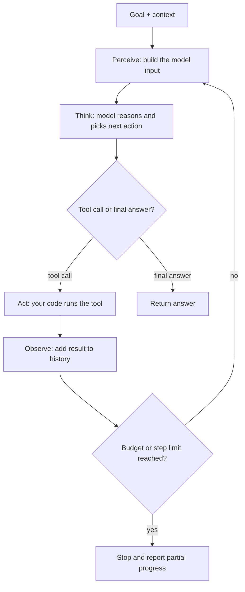
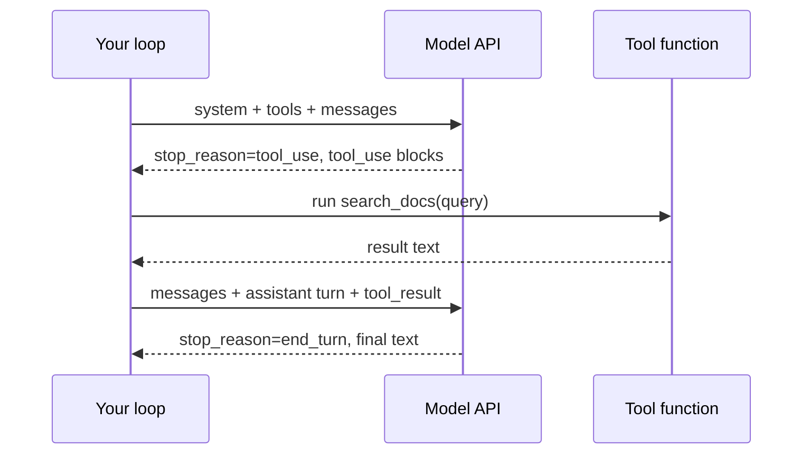
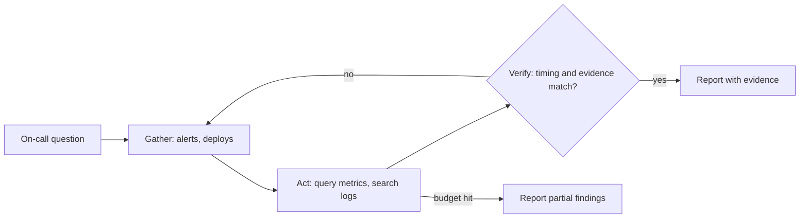

# The Agent Loop

## Introduction

Every agent, from a 30-line script to a coding assistant that works for an hour, runs the same basic cycle:

1. **Perceive**: take in the goal and everything known so far.
2. **Think**: decide what to do next.
3. **Act**: call a tool (or answer).
4. **Observe**: read the result of the action.

Then repeat, until the goal is reached or something tells the loop to stop.

A good analogy is a doctor seeing a patient. They listen to symptoms (perceive), form a hypothesis (think), order a test (act), read the results (observe), and then either diagnose or order another test. They do not decide all the tests before the patient walks in, and they stop when they have enough evidence, not when they run out of tests.

The loop is simple to describe, but the details decide whether your agent is reliable: what goes into each "perceive" step, how tool errors are observed, and especially **how the loop ends**. This page covers all of that.

## The Loop as a Diagram



Different sources use slightly different names for the same cycle:

| Source | Names for the steps |
|--------|---------------------|
| Classic AI | Sense, plan, act |
| ReAct paper (Yao et al., 2022) | Thought, action, observation |
| Anthropic's Claude Agent SDK guidance (2025) | Gather context, take action, verify work, repeat |
| This tutorial | Perceive, think, act, observe |

The Anthropic framing adds an important idea: **verify work**. A strong agent does not just observe a tool result. It checks whether its work is actually correct, for example by running tests, linting output, or comparing against rules. Agents that can verify their own work are much more reliable.

## Mapping the Loop to API Calls

With a tool-calling LLM API, each phase maps to something concrete in your code:

| Phase | What happens in code |
|-------|----------------------|
| Perceive | You assemble `system`, `tools`, and the `messages` history and send the request |
| Think | The model generates (optionally with internal thinking) and returns content blocks |
| Act | If `stop_reason == "tool_use"`, your code executes each `tool_use` block |
| Observe | Your code appends the assistant turn, then a user turn containing all `tool_result` blocks |
| Stop | `stop_reason == "end_turn"`, or your step, time, or cost budget runs out |



## A Loop You Can Run Without an API Key

To see the mechanics clearly, here is the loop with a scripted fake model. It mimics the shape of real responses: a `stop_reason` and a list of content blocks.

```python
from dataclasses import dataclass, field


@dataclass
class Block:
    type: str
    text: str = ""
    name: str = ""
    input: dict = field(default_factory=dict)
    id: str = ""


@dataclass
class Response:
    stop_reason: str
    content: list


SCRIPT = [
    Response("tool_use", [Block("text", text="I'll check the docs."),
                          Block("tool_use", name="search_docs", input={"query": "rate limits"}, id="t1")]),
    Response("tool_use", [Block("tool_use", name="read_page", input={"page": "limits.md"}, id="t2")]),
    Response("end_turn", [Block("text", text="The API allows 50 requests per minute on the free tier.")]),
]


def fake_model(messages, step):
    return SCRIPT[step]


def run_tool(name, args):
    if name == "search_docs":
        return "Found: limits.md, quotas.md"
    if name == "read_page":
        return "Free tier: 50 requests per minute."
    raise KeyError(name)


messages = [{"role": "user", "content": "What is the free tier rate limit?"}]
for step in range(10):
    response = fake_model(messages, step)                          # perceive + think
    print(f"[step {step + 1}] stop_reason={response.stop_reason}")
    if response.stop_reason != "tool_use":
        print("FINAL:", response.content[0].text)
        break
    messages.append({"role": "assistant", "content": response.content})
    results = []
    for block in response.content:
        if block.type == "tool_use":
            output = run_tool(block.name, block.input)                # act
            print(f"   act: {block.name}({block.input}) -> {output}")
            results.append({"type": "tool_result", "tool_use_id": block.id, "content": output})
    messages.append({"role": "user", "content": results})          # observe
print("messages in history:", len(messages))
```

Output:

```text
[step 1] stop_reason=tool_use
   act: search_docs({'query': 'rate limits'}) -> Found: limits.md, quotas.md
[step 2] stop_reason=tool_use
   act: read_page({'page': 'limits.md'}) -> Free tier: 50 requests per minute.
[step 3] stop_reason=end_turn
FINAL: The API allows 50 requests per minute on the free tier.
messages in history: 5
```

The history now holds the original question plus two assistant/tool-result pairs. On every step, the model sees all of it. That growing history is the agent's working memory.

## How the Loop Ends

A loop that cannot stop is a bug, and an expensive one. Agents need **several** stop conditions, because no single one is enough:

| Stop condition | Who triggers it | Why you need it |
|----------------|-----------------|-----------------|
| Model returns a final answer (`end_turn`) | Model | The normal, successful ending |
| Step limit | Your code | Stops loops where the model keeps calling tools |
| Token or cost budget | Your code | Stops runs that are technically progressing but too expensive |
| Wall-clock timeout | Your code | Keeps user-facing requests responsive |
| Repeated identical action | Your code | Detects the agent calling the same tool with the same input again and again |
| Human handoff | Model or code | The agent is stuck, unsure, or about to do something risky |
| Refusal or safety stop | Model | The model declines; your code must handle this cleanly |

Stop conditions get a full page in [Stopping Conditions and Budgets](../6-agents-planning-and-reasoning/10-agents-stopping-conditions.mdx).

### Every stop reason needs a branch

On the Anthropic API, a response's `stop_reason` can be more than just `end_turn` or `tool_use`. A robust loop handles each one:

| `stop_reason` | Meaning | What your loop should do |
|---------------|---------|--------------------------|
| `end_turn` | The model finished its turn | Return the final text |
| `tool_use` | The model wants tools run | Run them, append results, continue |
| `max_tokens` | Output hit your `max_tokens` limit | Return the partial output or retry with a higher limit. Do not append it and resend: a trailing assistant turn counts as prefill, which current models reject |
| `pause_turn` | A long server-side tool turn was paused | Send the conversation back so the model can resume |
| `refusal` | The model declined for safety reasons | Stop and show a safe message; do not retry blindly |

Other providers have equivalent signals with different names, such as a `finish_reason` field.

## A Robust Loop with the Anthropic SDK

This version adds the pieces a real agent needs: a system prompt, error results, all stop reasons, a step limit, and a simple repeated-action check.

```python
import json
import anthropic
from anthropic import Anthropic

client = Anthropic()
MODEL = "claude-opus-5-5"

SYSTEM = (
    "You answer questions about our product docs. Use search_docs first, then read_page. "
    "If the docs do not contain the answer, say so instead of guessing."
)

TOOLS = [
    {
        "name": "search_docs",
        "description": "Search product docs. Returns matching page names.",
        "input_schema": {
            "type": "object",
            "properties": {"query": {"type": "string"}},
            "required": ["query"],
        },
    },
    {
        "name": "read_page",
        "description": "Read one docs page by name, as returned by search_docs.",
        "input_schema": {
            "type": "object",
            "properties": {"page": {"type": "string"}},
            "required": ["page"],
        },
    },
]

DOCS = {"limits.md": "Free tier: 50 requests per minute. Pro tier: 1000 per minute."}


def execute_tool(name: str, args: dict) -> str:
    if name == "search_docs":
        hits = [p for p, text in DOCS.items() if args["query"].lower() in (p + text).lower()]
        return json.dumps(hits or ["no results"])
    if name == "read_page":
        return DOCS[args["page"]]  # KeyError becomes an error result below
    raise ValueError(f"Unknown tool: {name}")


def text_of(response) -> str:
    return "".join(b.text for b in response.content if b.type == "text")


def run_agent(question: str, max_steps: int = 12) -> str:
    messages = [{"role": "user", "content": question}]
    seen_calls = set()

    for step in range(max_steps):
        try:
            response = client.messages.create(
                model=MODEL, max_tokens=16000, system=SYSTEM, tools=TOOLS, messages=messages
            )
        except anthropic.RateLimitError:
            return "The service is busy. Please try again shortly."
        except anthropic.APIStatusError as exc:
            return f"API error {exc.status_code}."
        except anthropic.APIConnectionError:
            return "Could not reach the model API."

        if response.stop_reason == "end_turn":
            return text_of(response)
        if response.stop_reason == "refusal":
            return "I can't help with that request."
        if response.stop_reason == "max_tokens":
            # Output was cut off. Do not resend a trailing assistant turn (that is prefill,
            # which current models reject). Return what we have; raise max_tokens if this happens often.
            return text_of(response) + "\n[Response truncated: output limit reached.]"
        if response.stop_reason == "pause_turn":
            # A server-side tool paused a long turn. Send it back so the model can resume.
            messages.append({"role": "assistant", "content": response.content})
            continue

        # stop_reason == "tool_use"
        messages.append({"role": "assistant", "content": response.content})
        results = []
        for block in response.content:
            if block.type != "tool_use":
                continue
            key = (block.name, json.dumps(block.input, sort_keys=True))
            if key in seen_calls:
                output, is_error = "You already made this exact call. Try something different.", True
            else:
                seen_calls.add(key)
                try:
                    output, is_error = execute_tool(block.name, block.input), False
                except Exception as exc:
                    output, is_error = f"{type(exc).__name__}: {exc}", True
            results.append({
                "type": "tool_result",
                "tool_use_id": block.id,
                "content": output,
                "is_error": is_error,
            })
        messages.append({"role": "user", "content": results})

    return "I couldn't finish within the step limit. Here is what I found so far: " + text_of(response)


print(run_agent("What's the rate limit on the free tier?"))
```

Example output:

```text
The free tier allows 50 requests per minute (the Pro tier allows 1,000 per minute).
```

:::note
You do not always need to write this loop yourself. SDKs and frameworks provide "tool runners" that run it for you. See [Using an SDK Tool Runner](../2-agents-tool-use/4-agents-tool-runner.mdx). Writing it once by hand, though, makes every framework easier to understand and debug.
:::

## What Happens Inside "Think"

The think phase is where reasoning patterns live. The model can:

- **React step by step**, deciding one action at a time from the latest observation. This is the [ReAct pattern](../6-agents-planning-and-reasoning/3-agents-react-pattern.mdx), and it is the default behavior of the loop above.
- **Plan first**, writing a list of steps and then executing them, revising when something changes. See [Plan-and-Execute](../6-agents-planning-and-reasoning/4-agents-plan-and-execute.mdx).
- **Reflect**, checking its own output before finishing. See [Reflection and Self-Critique](../6-agents-planning-and-reasoning/6-agents-reflection.mdx).

Modern models with adaptive thinking can also reason between tool calls, which helps them interpret tool results before acting again.

## Real-World Scenario

Your platform team wants an agent that answers on-call questions like "Why is the `payments` service returning 502s?" It has read-only tools: `get_recent_alerts`, `query_metrics`, `search_logs`, and `get_recent_deploys`.

During testing, three loop problems show up:

1. On a quiet day, the agent kept calling `search_logs` with slightly different queries for 40 steps and cost far more than expected.
2. When `query_metrics` timed out, the Python exception crashed the whole run.
3. The agent sometimes declared "root cause found" without checking that the error rate actually matched the suspected deploy's timing.

You fix each one in the loop design:

| Problem | Loop fix |
|---------|----------|
| Endless searching | Step limit of 15, a token budget, and a rule in the system prompt: "If three searches find nothing new, report what you know." |
| Tool exception crashed the run | Catch exceptions per tool and return them as `tool_result` with `is_error: True`, so the model can retry or try another tool |
| Unverified conclusions | Add a **verify** step: the system prompt requires checking that the metric change happens after the deploy time, and the final answer must cite the evidence |



### Why this approach

The loop itself is where reliability comes from. Budgets cap the worst case. Error results let the model recover instead of crashing. A verify step turns "plausible story" into "checked conclusion," which is what an on-call engineer actually needs.

### When to use it and when not to

This loop fits investigations where the next step depends on what the last one found. If the team only ever asks "What's the error rate right now?", a single tool call behind a slash command is better. Do not let this agent take actions such as rollbacks until you have evaluated its diagnoses on many past incidents.

### Alternatives and trade-offs

| Approach | Pros | Cons | Best for |
|----------|------|------|----------|
| Fixed runbook workflow | Predictable, cheap, auditable | Cannot handle new failure types | Known, frequent incidents |
| Open ReAct loop, no budget | Maximum flexibility | Runaway cost, can loop forever | Never in production |
| ReAct loop with budgets and verification | Flexible and bounded | More engineering; still needs evaluation | Most investigation agents |
| Plan-and-execute loop | Clear, reviewable plan up front | Plans can be wrong; needs replanning logic | Longer tasks where users want to see a plan |

## Common Mistakes

- **No step limit.** Always cap steps, tokens, and time.
- **Dropping the assistant turn.** Append the model's full `response.content` (including the `tool_use` blocks) before adding tool results, or the API will reject the next request.
- **Sending tool results one per message.** Return all `tool_result` blocks for a turn in a single user message.
- **Raising exceptions out of the loop.** Turn tool failures into error results the model can see.
- **Only handling `end_turn` and `tool_use`.** Handle `max_tokens`, `pause_turn`, and `refusal` too.
- **Trusting "done" without verification.** Build checks into the loop or the system prompt.

## Summary

- The agent loop is perceive, think, act, observe, repeated until a stop condition.
- In code, it is "call the model; while it asks for tools, run them and send results back."
- Robust loops handle every stop reason, turn tool errors into observations, and enforce step, token, and time budgets.
- Adding a **verify** phase makes agents much more reliable.
- Reasoning strategies such as ReAct, plan-and-execute, and reflection all live inside the "think" phase.

## Further Learning

Exercises:

1. In the fake-model loop, add a fourth scripted response that calls `search_docs` with the same input as step 1. Add a repeated-call check that returns an error result instead of running it.
2. Add a `max_total_tokens` budget to `run_agent` using `response.usage.input_tokens` and `response.usage.output_tokens`. Stop with a partial answer when it is exceeded.
3. Change `read_page` so it raises an exception for unknown pages. Ask a question about a page that does not exist. Does the model recover?

Related pages:

- [Core Components of an Agent](./5-agents-core-components.mdx)
- [Building a Manual Agent Loop](../2-agents-tool-use/3-agents-manual-agent-loop.mdx)
- [Handling Tool Errors](../2-agents-tool-use/6-agents-tool-errors.mdx)
- [The ReAct Pattern](../6-agents-planning-and-reasoning/3-agents-react-pattern.mdx)
- [Stopping Conditions and Budgets](../6-agents-planning-and-reasoning/10-agents-stopping-conditions.mdx)
