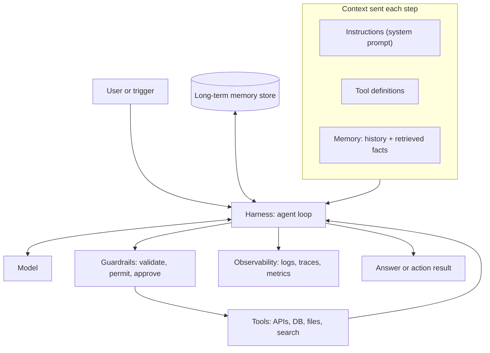

# Core Components of an Agent

## Introduction

When you look at a working agent, it is tempting to think of it as "the model." In practice, the model is one part of a larger system, and most of the engineering happens around it. A useful analogy is a car: the engine (the model) matters a lot, but you also need steering (instructions), wheels (tools), a fuel gauge (budgets), brakes (guardrails), a dashboard (observability), and a driver's seat for when a human needs to take over.

OpenAI's agent guide names three core components: **model**, **tools**, and **instructions**. Anthropic's guide builds on the **augmented LLM**: a model plus retrieval, tools, and memory. Both are right, and both leave out the parts that make an agent safe and operable in production. This page uses a slightly larger list so nothing important is forgotten:

| Component | One-line role |
|-----------|---------------|
| **Model** | Reasons, decides the next action, writes the answer |
| **Instructions** | The system prompt: goal, rules, style, when to stop |
| **Tools** | Functions the agent can call to read or change the world |
| **Memory and context** | What the model sees on each step, and what persists between runs |
| **Harness (the loop)** | Code that calls the model, runs tools, and enforces limits |
| **Guardrails** | Validation, permissions, approvals, and safety checks |
| **Observability** | Logs, traces, and metrics so you can see what happened |

## How the Components Fit Together



The **harness** is the hub. The model never talks to tools directly. Everything flows through your code, which is where you get control.

## 1. The Model

The model provides the reasoning: understanding the goal, choosing tools, interpreting results, and writing the answer. Key decisions:

- **Capability vs cost.** Larger models handle long, ambiguous tasks better. Smaller models are faster and cheaper for narrow steps such as classification.
- **One model or several.** A common design uses a capable model for the main loop and a small model for subtasks or grading.
- **Reasoning depth.** Thinking and effort settings trade tokens for quality.

See [Choosing the Right Model](../1-agents-llm-apis/10-agents-model-selection.mdx). Model names and prices change frequently, so check the provider's current model list.

## 2. Instructions

The system prompt tells the agent who it is working for, what the goal is, which rules it must follow, how to use its tools, and when to stop or ask for help. Good agent instructions are specific about **behavior under uncertainty**:

```text
You are a support agent for Acme Store.
Goal: resolve the customer's issue or hand it to a human.
Rules:
- Look up the order with get_order before answering any order question.
- Never promise a refund. You may offer store credit up to $20 with issue_credit.
- If the customer is angry, or the issue involves payment details, call handoff_to_human.
- When you are done, reply to the customer in under 120 words.
```

See [Designing Agent System Prompts](../3-agents-prompt-engineering/0-agents-system-prompt-design.mdx).

## 3. Tools

Tools are how the agent acts. Each tool has a **name**, a **description** the model reads, an **input schema**, and **your implementation**. Anthropic calls the tool surface the **agent-computer interface (ACI)** and recommends putting as much care into it as you would into a user interface: clear names, good descriptions, examples, and inputs designed to make mistakes hard.

| Tool type | Examples | Risk level |
|-----------|----------|-----------|
| Read-only lookups | `get_order`, `search_docs`, `query_metrics` | Low |
| Computation | `calculate`, `run_sql_readonly`, code execution in a sandbox | Low to medium |
| Writes with limits | `issue_credit(max=20)`, `create_ticket` | Medium |
| Broad or irreversible | `run_shell`, `send_email`, `delete_record`, payments | High: gate behind approval |

See [Tool Design Principles](../2-agents-tool-use/7-agents-tool-design-principles.mdx).

## 4. Memory and Context

Because the model is stateless, your code decides what it "remembers":

- **Short-term memory**: the `messages` history for the current task.
- **Retrieved knowledge**: documents or records pulled in for this step (RAG).
- **Long-term memory**: facts saved across sessions, such as user preferences or notes from earlier tasks.

The engineering challenge is choosing the *smallest* set of information that lets the model do the job well. This is **context engineering**, covered in [Context Engineering](../4-agents-memory-and-context/0-agents-context-engineering.mdx).

## 5. The Harness

The harness is the code that runs the loop. It is ordinary software and is where most reliability comes from:

- Calls the model and handles every stop reason.
- Dispatches tool calls to implementations.
- Turns exceptions into error results the model can read.
- Enforces step, token, cost, and time budgets.
- Persists state so a run can resume.

You can write a harness yourself (about 50 to 150 lines for a basic one) or use one from an SDK or framework. See [Building Agents Without a Framework](../9-agents-frameworks/1-agents-no-framework.mdx) and [Agent Framework Landscape](../9-agents-frameworks/0-agents-framework-landscape.mdx).

## 6. Guardrails

Guardrails are checks that do not depend on the model behaving well:

- **Input validation**: check tool arguments against rules in code (amount limits, allowed IDs).
- **Permissions**: the agent acts with the *user's* permissions, never more.
- **Approval gates**: a human confirms risky actions before they run.
- **Output checks**: scan final answers for leaked secrets or personal data.

See [Input and Output Guardrails](../12-agents-safety-and-security/6-agents-guardrails.mdx) and [Human Approval Gates](../12-agents-safety-and-security/7-agents-approval-gates.mdx).

## 7. Observability

You cannot improve what you cannot see. Record every model call, tool call, argument, result, token count, and latency. When an agent gives a wrong answer, the trace shows whether the problem was the prompt, a tool, missing context, or the model's reasoning. See [Tracing Agent Runs](../11-agents-evaluation-and-testing/8-agents-tracing.mdx).

## Putting the Components into Code

Here is a small, framework-free design where each component is an explicit, swappable piece. The model is passed in as a function, so you can test the harness without an API key.

```python
import json
import time
from dataclasses import dataclass, field
from typing import Callable


@dataclass
class Tool:
    name: str
    description: str
    input_schema: dict
    fn: Callable[..., str]
    needs_approval: bool = False

    def definition(self) -> dict:
        return {"name": self.name, "description": self.description, "input_schema": self.input_schema}


@dataclass
class Agent:
    model: Callable            # (system, tools, messages) -> response
    instructions: str
    tools: list
    max_steps: int = 10
    approve: Callable = lambda name, args: False   # guardrail: deny risky actions by default
    log: list = field(default_factory=list)        # observability

    def _run_tool(self, name: str, args: dict):
        tool = next((t for t in self.tools if t.name == name), None)
        if tool is None:
            return f"Unknown tool: {name}", True
        if tool.needs_approval and not self.approve(name, args):
            return "Action not approved by a human. Choose another approach.", True
        try:
            return tool.fn(**args), False
        except Exception as exc:
            return f"{type(exc).__name__}: {exc}", True

    def run(self, goal: str) -> str:
        messages = [{"role": "user", "content": goal}]   # short-term memory
        defs = [t.definition() for t in self.tools]
        for step in range(self.max_steps):
            start = time.perf_counter()
            response = self.model(self.instructions, defs, messages)
            self.log.append({"step": step, "event": "model", "stop": response["stop_reason"],
                             "ms": round((time.perf_counter() - start) * 1000)})
            if response["stop_reason"] != "tool_use":
                return response["text"]
            messages.append({"role": "assistant", "content": response["content"]})
            results = []
            for call in response["content"]:
                if call["type"] != "tool_use":
                    continue
                output, is_error = self._run_tool(call["name"], call["input"])
                self.log.append({"step": step, "event": "tool", "name": call["name"],
                                 "args": call["input"], "error": is_error})
                results.append({"type": "tool_result", "tool_use_id": call["id"],
                                "content": output, "is_error": is_error})
            messages.append({"role": "user", "content": results})
        return "Step limit reached."
```

Now wire it up with two tools and a scripted model to see every component working:

```python
ORDERS = {"A-1001": {"status": "late", "total": 42.00}}

get_order = Tool(
    name="get_order",
    description="Look up an order by ID. Returns status and total.",
    input_schema={"type": "object", "properties": {"order_id": {"type": "string"}}, "required": ["order_id"]},
    fn=lambda order_id: json.dumps(ORDERS[order_id]),
)
issue_credit = Tool(
    name="issue_credit",
    description="Issue store credit. Requires human approval.",
    input_schema={"type": "object",
                  "properties": {"order_id": {"type": "string"}, "amount": {"type": "number"}},
                  "required": ["order_id", "amount"]},
    fn=lambda order_id, amount: f"Credited ${amount:.2f} to {order_id}",
    needs_approval=True,
)

script = iter([
    {"stop_reason": "tool_use", "content": [
        {"type": "tool_use", "id": "1", "name": "get_order", "input": {"order_id": "A-1001"}}]},
    {"stop_reason": "tool_use", "content": [
        {"type": "tool_use", "id": "2", "name": "issue_credit", "input": {"order_id": "A-1001", "amount": 10}}]},
    {"stop_reason": "end_turn", "text": "Your order is late. I've issued a $10.00 credit."},
])

agent = Agent(
    model=lambda system, tools, messages: next(script),
    instructions="You are a support agent...",
    tools=[get_order, issue_credit],
    approve=lambda name, args: args.get("amount", 0) <= 20,   # auto-approve small credits only
)
print(agent.run("My order A-1001 is late!"))
for entry in agent.log:
    print(entry)
```

Example output (timings vary):

```text
Your order is late. I've issued a $10.00 credit.
{'step': 0, 'event': 'model', 'stop': 'tool_use', 'ms': 0}
{'step': 0, 'event': 'tool', 'name': 'get_order', 'args': {'order_id': 'A-1001'}, 'error': False}
{'step': 1, 'event': 'model', 'stop': 'tool_use', 'ms': 0}
{'step': 1, 'event': 'tool', 'name': 'issue_credit', 'args': {'order_id': 'A-1001', 'amount': 10}, 'error': False}
{'step': 2, 'event': 'model', 'stop': 'end_turn', 'ms': 0}
```

To use a real model, replace the lambda with a function that calls `client.messages.create(model=..., system=system, tools=tools, messages=messages)` and converts the response. Every other component stays the same. That separation is the point: you can test guardrails and tools with no model at all.

## Connecting a Real Model

The `Agent` class expects a `model` function that returns a plain dictionary. This adapter wraps the Anthropic SDK so the harness does not depend on any one provider. To switch providers, you write a different adapter and leave the rest of the agent unchanged.

```python
from anthropic import Anthropic

client = Anthropic()


def claude_model(system: str, tools: list, messages: list) -> dict:
    response = client.messages.create(
        model="claude-opus-5-5",
        max_tokens=16000,
        system=system,
        tools=tools,
        messages=messages,
    )
    if response.stop_reason == "tool_use":
        # Convert every block (text, thinking, tool_use) to a plain dict. The harness
        # appends the whole list as the assistant turn, so nothing is lost when it is sent back.
        content = [b.model_dump(exclude_none=True) for b in response.content]
        return {"stop_reason": "tool_use", "content": content}
    text = "".join(b.text for b in response.content if b.type == "text")
    return {"stop_reason": response.stop_reason, "text": text}
```

Pass it in with `Agent(model=claude_model, ...)`. The harness only looks at blocks whose `type` is `tool_use`, but it keeps the full assistant turn in the history, which the API needs (for example, thinking blocks must be sent back with tool results). The point of the adapter is the boundary: **provider-specific code lives in one function**.

## A Design Review Checklist

Before building, answer one question per component. If you cannot answer one, that is the next thing to design.

| Component | Question to answer |
|-----------|--------------------|
| Model | Which model runs the loop, and which (if any) handle cheap subtasks? |
| Instructions | What is the goal, what are the hard rules, and what does "done" mean? |
| Tools | What is the smallest tool set that can do the job? Which tools write or spend? |
| Memory | What must the agent see each step? What persists after the run? |
| Harness | What are the step, token, time, and cost limits? How are errors handled? |
| Guardrails | Which actions need approval? What is validated in code? What permissions does the agent run with? |
| Observability | What is logged per step? Where can someone read a full trace? |

## Frequently Asked Questions

**Do I need all seven components for a prototype?**
You need a model, instructions, tools, and a minimal harness with a step limit. Add guardrails and observability before anyone other than you uses it.

**Should the harness or the model decide when to stop?**
Both. The model decides when the task is done. The harness enforces hard limits in case it never decides.

## Real-World Scenario

Your analytics team wants a "data analyst" agent that answers questions like "Which product category grew fastest last quarter?" from the company's PostgreSQL warehouse. You plan each component explicitly before writing code:

| Component | Decision | Reason |
|-----------|----------|--------|
| Model | Capable model for the main loop; small model to name charts | SQL reasoning is hard; naming is easy |
| Instructions | Describe key tables, business definitions ("revenue excludes refunds"), and "always show the SQL you ran" | Prevents wrong metrics; builds trust |
| Tools | `list_tables`, `describe_table`, `run_sql` (read-only role, 10 s timeout, 1,000-row cap) | Enough to explore and query; cannot change data |
| Memory | History for the session; a saved glossary of metric definitions loaded each time | Consistent definitions across users |
| Harness | 12-step limit, token budget, retries on database timeouts | Bounded cost |
| Guardrails | SQL parsed in code to allow only `SELECT`; database user has read-only grants | Two independent layers |
| Observability | Log each SQL query, row count, and duration; trace per question | Debug wrong answers; spot slow queries |

### Why this approach

Listing the components forces the team to answer the hard questions up front: what can this agent touch, what does it know, how much can it spend, and how will we know when it is wrong? The read-only database role is a guardrail that holds even if the prompt is ignored or attacked.

### When to use it and when not to

This design suits exploratory questions across many tables. If 80% of questions are the same ten metrics, build a dashboard or a routing workflow with pre-written queries instead. Do not give this agent write access to production data.

### Alternatives and trade-offs

| Approach | Pros | Cons | Best for |
|----------|------|------|----------|
| Pre-built dashboards | Fast, exact, no LLM cost | Only answers anticipated questions | Recurring KPIs |
| Text-to-SQL single call | Simple, one model call | No exploration; fails on unfamiliar schemas | Small, well-documented schemas |
| Agent with read-only SQL tools | Explores schema, fixes its own query errors | Higher cost; needs evaluation | Ad hoc questions across many tables |
| Semantic layer plus agent | Consistent metric definitions | Extra system to maintain | Larger orgs with shared metrics |

The full build is in [Project: SQL Data Analyst Agent](../14-agents-projects/3-agents-project-sql-analyst.mdx).

## Common Mistakes

- **Treating the model as the whole agent.** Most failures come from tools, context, and harness gaps.
- **Relying on instructions as the only guardrail.** Prompts can be ignored or attacked. Enforce limits in code and in permissions.
- **Mixing components together.** Keep tool code, prompts, and loop logic separate so each can be tested and versioned.
- **Skipping observability until production.** Add logging from the first prototype. You will need it immediately.
- **Too many tools.** Each tool definition costs tokens and adds a choice the model can get wrong. Start small.

## Summary

- An agent is more than a model. It combines a model, instructions, tools, memory, a harness, guardrails, and observability.
- The harness sits in the middle and controls every interaction between the model and the world.
- Instructions guide behavior; guardrails enforce it in code.
- Design each component explicitly and keep them separate so they can be tested and changed independently.

## Further Learning

Exercises:

1. Add a `max_cost_tokens` budget to the `Agent` class and log a warning when 80% is used.
2. Change the approval rule so credits over $20 return an error result. Script the fake model to request $50 and confirm the agent receives the denial.
3. For an agent idea of your own, fill in the seven-row component table from the scenario.

Related pages:

- [Levels of Agent Autonomy](./6-agents-autonomy-levels.mdx)
- [Defining Tools](../2-agents-tool-use/1-agents-defining-tools.mdx)
- [Short-Term Memory](../4-agents-memory-and-context/1-agents-short-term-memory.mdx)
- [Least Privilege for Agent Tools](../12-agents-safety-and-security/2-agents-least-privilege.mdx)
