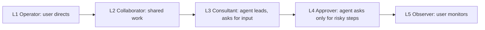
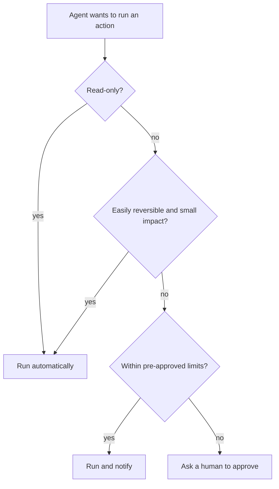

# Levels of Agent Autonomy

## Introduction

"How much should the agent be allowed to do on its own?" is one of the most important design questions you will answer. Too little autonomy and the agent is a slow chatbot that asks permission for everything. Too much and it can send the wrong email to 5,000 customers before anyone notices.

The key insight is that **autonomy is a design choice, not a property of the model**. A very capable model can still run with low autonomy, asking before each action. A weaker model in a tightly scoped task can safely run with high autonomy. You choose the level, and you can choose differently for different actions.

A helpful analogy is a new employee. In week one, they draft emails and you send them. After a month, they send routine emails and ask about unusual ones. After a year, they handle the account and you review a weekly summary. Trust grows with evidence. Agents should work the same way.

## The Five Levels

A 2025 paper from the University of Washington, [Levels of Autonomy for AI Agents](https://arxiv.org/abs/2506.12469) (Feng, McDonald, and Zhang), defines five levels by **the role the user plays**. This framing is practical because it describes what the human does at each level.

| Level | User's role | What the agent does | What the user does |
|-------|-------------|---------------------|--------------------|
| **L1** | Operator | Carries out commands it is given | Directs every step and makes the decisions |
| **L2** | Collaborator | Plans and executes together with the user | Shares planning, delegation, and execution |
| **L3** | Consultant | Takes the lead | Provides expertise or preferences when consulted |
| **L4** | Approver | Works independently | Is brought in only for risky or pre-specified situations |
| **L5** | Observer | Operates with full autonomy | Monitors, and can intervene or stop it |



As you move right, the agent saves more human time but each mistake is more likely to reach the real world before someone sees it.

You may also see vendor or blog frameworks with different names or numbers of levels, sometimes inspired by the SAE levels for self-driving cars. The exact labels matter less than the habit of **naming the level explicitly** for your system.

### Examples at each level

| Level | Coding assistant | Support agent | Ops agent |
|-------|------------------|---------------|-----------|
| L1 | Suggests a line; developer accepts or rejects | Suggests reply snippets to a human agent | Answers "what is the CPU on host X?" |
| L2 | Pair programs; developer and agent take turns | Drafts full replies, human edits and sends | Proposes a diagnosis, engineer runs commands |
| L3 | Implements a feature, asks about unclear requirements | Resolves tickets, asks the human about policy edge cases | Runs diagnostic queries, asks before changing anything |
| L4 | Edits and tests freely, asks before pushing or deleting | Sends replies and small credits, asks before refunds | Restarts pods automatically, asks before rollbacks |
| L5 | Opens and merges PRs, team reviews a daily log | Handles tickets end to end, team audits samples | Auto-remediates known incidents, pages humans on anomalies |

## Autonomy Is Per Action, Not Per Agent

Real systems rarely run at a single level. The same agent can be L5 for reading data and L2 for spending money. The most useful way to think about it is a **policy table**: for each action, what level applies?

Good criteria for setting the level of an action:

- **Reversibility.** Can it be undone easily? Editing a draft is reversible. Sending an email is not.
- **Blast radius.** How many people or records does a mistake affect?
- **Cost.** Does it spend money or significant resources?
- **Confidence evidence.** Have evaluations shown the agent does this correctly?
- **Regulation and policy.** Some actions legally require a human decision.



## Enforcing Autonomy in Code

Autonomy levels only mean something if your harness enforces them. Do not rely on the system prompt saying "ask before refunds." Put the rule in code, between the model's tool request and the tool's execution.

```python
from dataclasses import dataclass
from enum import Enum


class Mode(Enum):
    AUTO = "auto"            # run without asking
    NOTIFY = "notify"        # run, then tell the human
    APPROVE = "approve"      # ask first
    DENY = "deny"            # never allowed


@dataclass
class ActionPolicy:
    tool: str
    mode: Mode
    limit: float | None = None   # optional numeric limit for AUTO/NOTIFY


POLICIES = {
    "search_tickets": ActionPolicy("search_tickets", Mode.AUTO),
    "send_reply": ActionPolicy("send_reply", Mode.NOTIFY),
    "issue_credit": ActionPolicy("issue_credit", Mode.NOTIFY, limit=20.0),
    "issue_refund": ActionPolicy("issue_refund", Mode.APPROVE),
    "delete_account": ActionPolicy("delete_account", Mode.DENY),
}


def decide(tool: str, args: dict) -> Mode:
    policy = POLICIES.get(tool)
    if policy is None:
        return Mode.DENY                      # unknown tools are never allowed
    amount = args.get("amount")
    if policy.limit is not None and amount is not None and amount > policy.limit:
        return Mode.APPROVE                   # over the limit: escalate to a human
    return policy.mode


requests = [
    ("search_tickets", {"query": "late delivery"}),
    ("issue_credit", {"amount": 15}),
    ("issue_credit", {"amount": 75}),
    ("issue_refund", {"amount": 30}),
    ("delete_account", {"user_id": "u_9"}),
    ("drop_database", {}),
]
for tool, args in requests:
    print(f"{tool:15} {str(args):28} -> {decide(tool, args).value}")
```

Output:

```text
search_tickets  {'query': 'late delivery'}   -> auto
issue_credit    {'amount': 15}               -> notify
issue_credit    {'amount': 75}               -> approve
issue_refund    {'amount': 30}               -> approve
delete_account  {'user_id': 'u_9'}           -> deny
drop_database   {}                           -> deny
```

In the agent loop, `decide` runs before every tool. For `APPROVE`, your app pauses the run and shows the request to a human (in a UI, Slack message, or ticket). For `DENY`, you return an error `tool_result` so the model can choose another path. Implementation patterns for pausing and resuming runs are in [Human-in-the-Loop](../6-agents-planning-and-reasoning/9-agents-human-in-the-loop.mdx) and [Human Approval Gates](../12-agents-safety-and-security/7-agents-approval-gates.mdx).

:::tip
Default to **deny** for unknown tools and **approve** for anything new. You can always loosen a policy after you have evidence. Tightening it after an incident is much more painful.
:::

## Wiring the Policy into the Loop

Here is how `decide` plugs into tool execution. Approval requests go into a queue, and the tool call returns a result telling the model the action is waiting. In a real application, the queue would be a database table and a UI or chat message. This version keeps everything in memory so you can run it.

```python
import uuid

PENDING = {}   # approval_id -> (tool, args)
NOTIFICATIONS = []


def execute(tool: str, args: dict) -> str:
    """Pretend implementations of the real tools."""
    return f"{tool} done with {args}"


def guarded_call(tool: str, args: dict) -> tuple:
    """Returns (content, is_error) for a tool_result block."""
    mode = decide(tool, args)
    if mode is Mode.DENY:
        return f"'{tool}' is not permitted for this agent.", True
    if mode is Mode.APPROVE:
        approval_id = str(uuid.uuid4())[:8]
        PENDING[approval_id] = (tool, args)
        return (f"Waiting for human approval (id {approval_id}). "
                "Tell the user the request is pending; do not retry."), False
    result = execute(tool, args)
    if mode is Mode.NOTIFY:
        NOTIFICATIONS.append(f"Agent ran {tool} {args}")
    return result, False


for tool, args in [("issue_credit", {"amount": 15}), ("issue_refund", {"amount": 30}), ("delete_account", {})]:
    print(guarded_call(tool, args))
print("pending approvals:", len(PENDING))
print("notifications:", NOTIFICATIONS)
```

Example output (the approval ID is random):

```text
("issue_credit done with {'amount': 15}", False)
('Waiting for human approval (id 3f9c2a1b). Tell the user the request is pending; do not retry.', False)
("'delete_account' is not permitted for this agent.", True)
pending approvals: 1
notifications: ["Agent ran issue_credit {'amount': 15}"]
```

When a human approves, your application runs the stored call and either resumes the agent with the result or reports back to the user directly. Note the message text for pending approvals: it tells the model what to do next, which prevents it from retrying the same call over and over.

## Signs Your Autonomy Level Is Wrong

| Symptom | Likely problem | Adjustment |
|---------|----------------|------------|
| Reviewers approve nearly everything without reading | Too low for that action, or too many trivial approvals | Raise low-risk actions to NOTIFY; batch approvals |
| Users wait hours for routine actions | Too low | Pre-approve actions within limits |
| Mistakes are discovered by customers, not by your team | Too high, or not enough monitoring | Lower the level; add audits and alerts |
| Agent works around a denied tool using another tool | Policies are inconsistent | Review the whole tool set, not single tools |
| Nobody can explain what the agent did last week | Too high for your observability | Add action logs before raising further |

## Autonomy in Multi-Agent Systems

When agents delegate to other agents, autonomy can quietly grow. A subagent spawned by an orchestrator should never have more permissions than the orchestrator, and ideally has fewer: a research subagent needs search tools, not the ability to send email. Apply the same policy table to every agent in the system, and log which agent requested each action. See [Multi-Agent Systems Introduction](../8-agents-multi-agent-systems/0-agents-multi-agent-introduction.mdx).

## Raising Autonomy Safely

Treat higher autonomy as something an agent **earns** through evidence:

1. **Start low.** Launch at L1 or L2 for the actions that matter.
2. **Log human decisions.** Record when humans approve, edit, or reject the agent's proposals.
3. **Measure.** If humans approve 98% of `issue_credit` proposals under $20 without changes over several hundred cases, that is evidence for raising that action to NOTIFY.
4. **Raise one action at a time.** Never jump the whole agent from L2 to L5.
5. **Keep an off switch.** Even at L5, humans must be able to stop the agent and roll back.

```python
from collections import Counter


def approval_rate(decisions: list) -> float:
    counts = Counter(decisions)
    total = sum(counts.values())
    return counts["approved_unchanged"] / total if total else 0.0


history = ["approved_unchanged"] * 291 + ["edited"] * 6 + ["rejected"] * 3
rate = approval_rate(history)
print(f"{len(history)} decisions, {rate:.1%} approved unchanged")
if len(history) >= 200 and rate >= 0.97:
    print("Candidate for promotion: APPROVE -> NOTIFY (review with the team first)")
```

Output:

```text
300 decisions, 97.0% approved unchanged
Candidate for promotion: APPROVE -> NOTIFY (review with the team first)
```

The thresholds here are examples. Choose yours based on the cost of a mistake for that action.

## Tell the Model About Its Autonomy Too

Enforcement belongs in code, but the model works better when it *knows* the rules. If the instructions explain what needs approval, the agent can plan around it, for example by gathering all the evidence before requesting a refund, and by telling the user what will happen next.

```text
Autonomy rules:
- You may search tickets and orders freely.
- You may send replies and issue store credit up to $20 without asking.
- Refunds always require human approval. Request one with issue_refund and tell the
  customer a team member will confirm within one business day.
- You cannot delete accounts. If asked, explain that the customer must contact privacy@acme.example.
```

The prompt and the policy table must agree. If they drift apart, the agent will keep requesting actions that are denied, which wastes steps and confuses users. A good practice is to generate this part of the prompt from the same `POLICIES` data the harness uses.

## The Off Switch

Every agent, at every level, needs a way for humans to stop it immediately. The simplest version is a flag that the loop checks before each step and before each tool call.

```python
import threading


class KillSwitch:
    def __init__(self):
        self._stopped = threading.Event()
        self.reason = ""

    def stop(self, reason: str):
        self.reason = reason
        self._stopped.set()

    def check(self):
        if self._stopped.is_set():
            raise RuntimeError(f"Agent stopped by operator: {self.reason}")


switch = KillSwitch()
for step in range(5):
    try:
        switch.check()
    except RuntimeError as exc:
        print(exc)
        break
    print(f"step {step} running")
    if step == 1:
        switch.stop("unexpected bulk emails reported")
```

Output:

```text
step 0 running
step 1 running
Agent stopped by operator: unexpected bulk emails reported
```

In production, the flag usually lives in shared storage (a database row or feature flag service) so an operator can flip it for every running instance at once. See [Incident Response for Agents](../13-agents-production/9-agents-incident-response.mdx).

## Frequently Asked Questions

**Is L5 ever appropriate?**
For narrow, reversible, well-monitored tasks, yes: for example, auto-labeling tickets or restarting a stateless service with a known runbook. Rarely for anything that spends money, deletes data, or speaks for your company in new situations.

**Who decides the autonomy level?**
The team that owns the outcome, with input from security and, where relevant, legal or compliance. Write the decision down with the evidence behind it.

## Real-World Scenario

Your company is rolling out a coding agent to a 40-person engineering team. Leadership wants "an AI that fixes bugs on its own." The security team wants "nothing that touches production." You propose a staged autonomy plan instead of a single setting.

| Phase | Level | What the agent may do on its own | Human role |
|-------|-------|----------------------------------|------------|
| Weeks 1 to 4 | L2 Collaborator | Read code, run tests in a sandbox, propose diffs | Developer reviews every change before it is applied |
| Weeks 5 to 8 | L3 Consultant | Edit files and run tests in a branch | Developer answers questions and reviews the PR |
| Later, for selected repos | L4 Approver | Open PRs for low-risk fixes (lint, dependency patches) | Approves merges; asked about anything touching auth or billing code |
| Not planned | L5 | Merge to main or deploy | Not offered |

You measure each phase: percentage of agent PRs merged without changes, test pass rate, and how often developers had to undo agent edits.

### Why this approach

It gives leadership a path to real productivity gains and gives security clear boundaries. Each phase produces evidence for the next decision. It also keeps different autonomy for different code: low-risk repos move faster than auth or billing code.

### When to use it and when not to

Staged autonomy suits any agent that takes actions with consequences. For a purely read-only agent (answering questions about the codebase), you can start much higher, because the worst case is a wrong answer. For regulated actions, such as approving loans or medical decisions, a human must stay the decision-maker regardless of measured accuracy.

### Alternatives and trade-offs

| Approach | Pros | Cons | Best for |
|----------|------|------|----------|
| Fixed low autonomy (L1 to L2) | Safest; easy to approve | Limited time savings; reviewers get fatigued | High-risk domains, early pilots |
| Fixed high autonomy (L4 to L5) | Maximum speed | Mistakes reach the world before review | Narrow, reversible, well-tested tasks |
| Per-action policy | Matches risk to each action | More design and code | Most production agents |
| Staged rollout with metrics | Builds trust with evidence | Slower to reach full value | Organization-wide adoption |

## Common Mistakes

- **Enforcing autonomy only in the prompt.** "Ask before refunding" in a system prompt is a suggestion. Enforce it in the harness.
- **One level for everything.** Reading and deleting do not deserve the same autonomy.
- **Approval fatigue.** If humans approve 200 trivial requests a day, they stop reading them. Keep approvals for actions that matter.
- **No audit trail.** Log what the agent did automatically, so humans at L4 and L5 can actually observe.
- **Confusing capability with permission.** A model that *can* do something well still should not do it unsupervised until you have evidence in your own setting.

## Summary

- Autonomy is a design choice, separate from model capability.
- A practical five-level scale defines the user's role: operator, collaborator, consultant, approver, observer.
- Set autonomy per action, based on reversibility, blast radius, cost, evidence, and regulation.
- Enforce autonomy in code with a policy that runs before each tool call. Deny unknown tools by default.
- Raise autonomy gradually, using logged human decisions as evidence.

## Further Learning

Exercises:

1. Add a `send_bulk_email` tool to `POLICIES`. Which mode should it have when the recipient count is under 10? Over 10? Implement it.
2. Extend `decide` to return `APPROVE` for any tool call made outside business hours. What are the trade-offs?
3. For an agent you might build, write a policy table listing each tool, its mode, and the evidence you would need to raise it one level.

Related pages:

- [When Should You Build an Agent?](./7-agents-when-to-build.mdx)
- [Human-in-the-Loop](../6-agents-planning-and-reasoning/9-agents-human-in-the-loop.mdx)
- [Human Approval Gates](../12-agents-safety-and-security/7-agents-approval-gates.mdx)
- [Least Privilege for Agent Tools](../12-agents-safety-and-security/2-agents-least-privilege.mdx)
