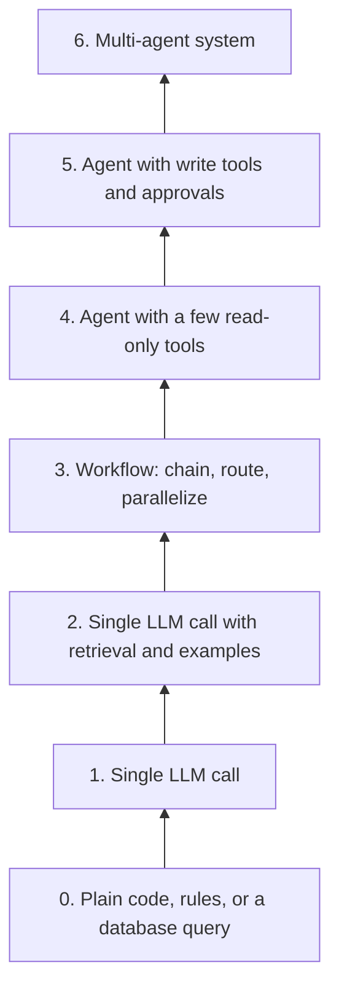
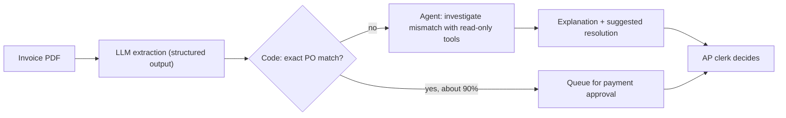

# When Should You Build an Agent?

## Introduction

Agents are exciting, and that is exactly why teams build them when they should not. An agent is usually the **most expensive, slowest, and least predictable** way to solve a problem with an LLM. Sometimes it is also the only way that works. Your job is to tell those cases apart.

Anthropic's [Building effective agents](https://www.anthropic.com/engineering/building-effective-agents) puts it plainly: find the simplest solution possible, and only increase complexity when needed. That might mean not building an agentic system at all. Agentic systems trade **latency and cost** for **better task performance**, and you should only make that trade when it is worth it. For many applications, a single LLM call with retrieval and good examples is enough.

Think of it like hiring. You do not hire a senior consultant to stamp envelopes, even though they could. You hire them when the problem is ambiguous, high value, and needs judgment. An agent is the consultant. A workflow is the well-run mailroom. Plain code is the stamping machine.

## The Ladder of Complexity

Climb only as high as you need:



Each rung adds capability, cost, latency, and things that can go wrong. Before moving up a rung, you should be able to say *specifically* what the lower rung failed to do, ideally with evaluation results.

## Four Questions to Ask

Before building an agent, answer these four questions honestly.

### 1. Is the task open-ended?

Can you write down the steps in advance? If yes, build a workflow. Agents are for tasks where **the next step depends on what the previous step found**, and the number of steps is hard to predict.

| Open-ended (agent candidate) | Fixed (workflow candidate) |
|------------------------------|----------------------------|
| "Find why this test fails" | "Run the formatter on every PR" |
| "Research competitors' pricing changes" | "Translate this page into Spanish" |
| "Resolve this unusual customer issue" | "Extract invoice number, date, and total" |

### 2. Is the task valuable enough?

Agents can use many model calls per task. The value of completing the task must clearly exceed the cost of running the agent plus the cost of its mistakes. High-volume, low-value tasks (tagging millions of support emails) are usually better served by a single cheap call per item.

### 3. Can the model actually do every part?

Agents fail if even one required step is beyond the model or its tools. Check that:

- Every piece of information it needs is reachable through a tool or the prompt.
- Every action it must take has a tool.
- You can describe "done" clearly enough for the model to recognize it.

Prototype the hardest step first. If the model cannot do that step reliably with a single call and good context, an agent loop will not fix it.

### 4. What does an error cost, and how fast will you notice?

This is the question teams most often skip.

| Error cost | Error discovery | Verdict |
|------------|-----------------|---------|
| Low (wrong draft) | Fast (human reads it) | Good fit for agents |
| Low | Slow | Acceptable with audits |
| High (money, data, safety) | Fast (tests, approvals) | Possible with approval gates |
| High | Slow (found weeks later) | Avoid agents, or keep a human decision-maker |

Coding is a strong agent domain partly because errors are found quickly: tests fail, the code does not compile, a reviewer reads the diff. Anthropic's guide highlights coding and customer support as good fits because both combine conversation with action, have clear success criteria, provide feedback loops, and allow meaningful human oversight.

## A Decision Helper

This helper turns the four questions into a recommendation you can discuss with your team. It is not a substitute for judgment, but it makes the reasoning visible.

```python
from dataclasses import dataclass


@dataclass
class TaskProfile:
    name: str
    steps_known_in_advance: bool
    single_call_good_enough: bool
    value_per_task_usd: float
    est_agent_cost_usd: float
    model_can_do_hardest_step: bool
    error_cost: str        # "low" or "high"
    errors_found_fast: bool


def recommend(t: TaskProfile) -> str:
    if t.single_call_good_enough:
        return "Single LLM call (add retrieval/examples if needed)"
    if t.steps_known_in_advance:
        return "Workflow (prompt chain / routing / parallelization)"
    if not t.model_can_do_hardest_step:
        return "Not yet: prototype the hardest step or keep it human"
    if t.value_per_task_usd < 5 * t.est_agent_cost_usd:
        return "Not worth it: value is too close to agent cost"
    if t.error_cost == "high" and not t.errors_found_fast:
        return "Agent only as a drafting assistant, human decides"
    if t.error_cost == "high":
        return "Agent with approval gates on risky actions"
    return "Agent with read-only tools first, then expand"


tasks = [
    TaskProfile("Summarize meeting notes", True, True, 2.0, 0.05, True, "low", True),
    TaskProfile("Extract invoice fields", True, False, 1.0, 0.10, True, "high", True),
    TaskProfile("Diagnose failing CI build", False, False, 40.0, 0.80, True, "low", True),
    TaskProfile("Approve insurance claims", False, False, 60.0, 1.00, True, "high", False),
    TaskProfile("Tag 1M support emails", True, True, 0.01, 0.002, True, "low", True),
]
for t in tasks:
    print(f"{t.name:28} -> {recommend(t)}")
```

Output:

```text
Summarize meeting notes      -> Single LLM call (add retrieval/examples if needed)
Extract invoice fields       -> Workflow (prompt chain / routing / parallelization)
Diagnose failing CI build    -> Agent with read-only tools first, then expand
Approve insurance claims     -> Agent only as a drafting assistant, human decides
Tag 1M support emails        -> Single LLM call (add retrieval/examples if needed)
```

:::caution
The cost numbers above are made-up examples to show the logic. Real costs depend on the model, the number of steps, and the size of tool results, and prices change over time. Measure your own prototype's token usage and check current pricing. See [Understanding API Costs](../1-agents-llm-apis/11-agents-api-cost-basics.mdx).
:::

## Estimating Agent Cost Before You Build

You can make a rough estimate from a prototype run. Measure the average number of steps and tokens, then multiply by expected volume.

```python
def monthly_cost(tasks_per_month: int, avg_input_tokens: int, avg_output_tokens: int,
                 input_price_per_mtok: float, output_price_per_mtok: float) -> float:
    per_task = (avg_input_tokens * input_price_per_mtok + avg_output_tokens * output_price_per_mtok) / 1_000_000
    return tasks_per_month * per_task


# Example numbers from a hypothetical prototype; replace with your own measurements and current prices.
estimate = monthly_cost(
    tasks_per_month=3_000,
    avg_input_tokens=120_000,   # summed across all steps of one run
    avg_output_tokens=6_000,
    input_price_per_mtok=4.0,
    output_price_per_mtok=20.0,
)
print(f"Estimated model cost: ${estimate:,.2f} per month")
```

Output:

```text
Estimated model cost: $1,800.00 per month
```

Compare that to the value created, and remember the hidden costs: engineering time, evaluation, monitoring, and the cost of mistakes. Prompt caching and smaller models for sub-steps can reduce the bill a lot. See [Cost Optimization](../13-agents-production/4-agents-cost-optimization.mdx).

## Prove It with a Baseline

The most reliable way to decide is to **measure**. Build the simplest version first, collect a small set of real examples with known good outcomes, and score each approach on the same set. Only move up the ladder when the numbers say the simpler rung is not good enough.

This harness compares any number of approaches. Each approach is a function from input to output, so a single LLM call, a workflow, and an agent can all be plugged in. The stand-in functions here let you run it without an API key.

```python
import time
from statistics import mean

# A tiny labeled dataset. In practice: 50 to 200 real, anonymized examples.
DATASET = [
    {"input": "Where is order A-1?", "expected": "shipping"},
    {"input": "I was charged twice", "expected": "billing"},
    {"input": "App crashes on login", "expected": "technical"},
    {"input": "Refund for order B-7 please", "expected": "billing"},
]


def single_call(text: str) -> str:          # stand-in for one LLM call
    return "billing" if "charge" in text or "Refund" in text else "shipping"


def agent(text: str) -> str:                # stand-in for a multi-step agent
    time.sleep(0.01)                         # agents are slower
    if "crash" in text:
        return "technical"
    return single_call(text)


def evaluate(name, fn, cost_per_run):
    correct, latencies = 0, []
    for case in DATASET:
        start = time.perf_counter()
        output = fn(case["input"])
        latencies.append(time.perf_counter() - start)
        correct += output == case["expected"]
    accuracy = correct / len(DATASET)
    print(f"{name:12} accuracy={accuracy:.0%}  avg_latency={mean(latencies) * 1000:.0f}ms  "
          f"cost/run=${cost_per_run:.3f}")


evaluate("single_call", single_call, cost_per_run=0.002)
evaluate("agent", agent, cost_per_run=0.040)
```

Example output (latencies vary):

```text
single_call  accuracy=75%  avg_latency=0ms  cost/run=$0.002
agent        accuracy=100%  avg_latency=10ms  cost/run=$0.040
```

Now the decision is concrete: is a 25-point accuracy gain worth 20 times the cost and the extra latency *for this task*? Sometimes yes, sometimes no. Often a better prompt or a few examples closes most of the gap at the single-call rung. Without a baseline you would never know. Section 11 builds proper evaluation sets and graders: [Building Evaluation Datasets](../11-agents-evaluation-and-testing/1-agents-building-eval-sets.mdx).

## Questions to Ask Stakeholders

Before writing code, a short conversation with the people who own the process saves weeks:

| Question | Why it matters |
|----------|----------------|
| How is this task done today, step by step? | Reveals whether steps are fixed (workflow) or variable (agent) |
| How long does it take a person, and how often does it happen? | Sets the value ceiling |
| What does a mistake look like, and who notices? | Sets error cost and discovery time |
| Which systems does it touch, and do they have APIs? | Determines feasibility |
| What must a human always decide? | Sets the autonomy limit |
| How will we know the agent is working? | Defines the success metric before you build |

## Define Kill Criteria Up Front

Agent projects can drift for months on "almost working." Agree in advance on what would make you **stop or step down a rung**:

- Accuracy on the evaluation set does not beat the simpler baseline by a meaningful margin after a fixed number of weeks.
- Cost per successful task exceeds an agreed limit.
- A safety or privacy issue appears that cannot be fixed architecturally.
- Users do not adopt it, even when it works.

Stopping is not failure. Discovering that a workflow is enough is a good engineering outcome.

## Strong Signals For and Against

| Signals an agent may fit | Signals to avoid an agent |
|--------------------------|---------------------------|
| Steps vary a lot between tasks | Steps are the same every time |
| Requires exploring data or code to find the answer | All needed information fits in one prompt |
| Clear way to verify success (tests, checks, a reviewer) | No reliable way to tell right from wrong |
| Mistakes are cheap or caught quickly | Mistakes are costly and found late |
| A human currently spends significant time on each case | The task takes a human seconds |
| Rules change often or are hard to write down | Strict regulatory rules require deterministic, explainable decisions |
| Latency of tens of seconds or minutes is acceptable | Users need a response in under a second |

## When Not to Build an Agent: A Short List

If any of these describe your situation, choose a simpler design, or wait:

- **The answer must be exactly reproducible and explainable**, for example a credit decision or a tax calculation. Use rules and code; an LLM can help write explanations.
- **Latency must be very low**, such as autocomplete or in-game responses. A multi-step loop cannot meet it.
- **The volume is huge and the value per item is tiny.** Use a single cheap call per item, or batch processing.
- **You have no way to check whether the output is right.** Without evaluation, you cannot tell if the agent is helping.
- **The required data or actions are not available through APIs** and screen automation is too fragile.
- **Nobody owns it.** Agents need ongoing monitoring, prompt updates, and model migrations. An unowned agent decays.
- **The real problem is a missing process or bad data.** An agent will not fix an unclear policy or an inconsistent database; it will amplify it.

:::tip
"Not an agent" rarely means "no AI." A single structured-output call, a classifier, or a summarizer often delivers most of the value with a fraction of the risk.
:::

## Frequently Asked Questions

**Won't better models make agents the right choice for everything?**
Better models make agents more reliable, and the line will keep moving. But a fixed process is still cheaper, faster, and easier to audit as code, no matter how good the model is.

**Should I wait for models to improve before building?**
Build the simplest useful version now, with an evaluation set. When a new model arrives, re-run the evaluation. That tells you exactly when to move up a rung. See [Migrating to a New Model](../13-agents-production/8-agents-model-migration.mdx).

**Our leadership wants "an agent." What do I do?**
Show the ladder and the baseline numbers. Most stakeholders care about the outcome, not the architecture label.

## Real-World Scenario

Your finance team processes about 2,000 supplier invoices a month. A vendor pitches an "autonomous AP agent" that reads invoices, matches them to purchase orders, and schedules payments. Your manager asks whether to build or buy something like it.

You break the process down:

1. **Extract fields** (supplier, invoice number, amount, line items). Fixed input and output: a **single LLM call** with structured outputs, or a document-extraction service.
2. **Match to a purchase order.** For 90% of invoices, an exact match on PO number and amount works: **plain code**.
3. **Investigate mismatches** (partial shipments, price changes, missing PO numbers). The steps vary and require looking through emails, POs, and receipts: an **agent candidate**.
4. **Schedule payment.** High error cost, regulatory controls: **humans decide**, always.



The agent handles about 200 mismatches a month, each of which used to take a clerk 20 to 30 minutes of searching. It never pays anything; it writes an explanation with links to the evidence.

### Why this approach

The expensive, unpredictable part of the job (investigating mismatches) gets the flexible tool. The high-volume, predictable part uses cheap, testable code. The highest-risk action (payment) stays with a person, which also satisfies audit requirements.

### When to use it and when not to

If mismatches were rare, the agent would not be worth building; the clerk could keep doing them. If your ERP system already flags mismatch reasons well, a workflow that formats that output may be enough. An agent that *pays* invoices would only make sense with strong controls and a long track record, and many organizations will never want that.

### Alternatives and trade-offs

| Approach | Pros | Cons | Best for |
|----------|------|------|----------|
| Fully manual | Full control, no AI risk | Slow and costly at volume | Very low volume |
| Rules plus OCR | Predictable, cheap | Breaks on unusual formats and mismatches | Standardized suppliers |
| LLM extraction plus code matching | Handles varied formats; mostly deterministic | Mismatches still manual | Most AP teams as a first step |
| Hybrid with investigation agent | Saves time on the hardest cases | More to build and evaluate | Teams with many mismatches |
| "Autonomous" end-to-end agent | Maximum automation on paper | Payment risk, audit concerns, hard to verify | Rarely appropriate |

## Common Mistakes

- **Starting from the technology.** "We need an agent" is not a requirement. Start from the task and its failure costs.
- **Skipping the single-call baseline.** Always try the simplest version first and measure it. You need the baseline to prove the agent is better.
- **Ignoring error discovery.** An agent that is right 95% of the time is dangerous if the 5% goes unnoticed for months.
- **Underestimating total cost.** Model cost is often smaller than the engineering, evaluation, and support cost.
- **Automating the decision instead of the research.** Often the best agent gathers evidence and lets a human decide.

## Summary

- Use the simplest approach that works: plain code, then a single LLM call, then a workflow, and only then an agent.
- Build an agent when the task is open-ended, valuable, doable by the model, and when errors are cheap or caught quickly.
- Estimate cost from a prototype and compare against value, including hidden engineering and risk costs.
- Most real systems are hybrids: code and workflows for the predictable parts, an agent for the unpredictable part, and humans for high-stakes decisions.

## Further Learning

Exercises:

1. Add a `latency_budget_seconds` field to `TaskProfile` and make `recommend` avoid agents when the budget is under 5 seconds.
2. Revisit the task list you wrote in [AI Agents Introduction](./0-agents-introduction.mdx). Run each task through the four questions. Which, if any, deserve an agent?
3. Use `monthly_cost` with your own estimates for a task idea, then halve the input tokens (simulating prompt caching or smaller tool results). How much does the decision change?

Related pages:

- [Agents vs Workflows](./3-agents-vs-workflows.mdx)
- [Real-World Agent Use Cases](./8-agents-use-cases.mdx)
- [Agent Limitations and Failure Modes](./9-agents-limitations.mdx)
- [Incrementally Adding AI to a Product](../10-agents-integration/10-agents-incremental-adoption.mdx)
