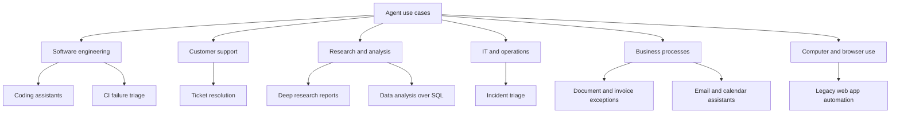

# Real-World Agent Use Cases

## Introduction

Knowing what an agent *is* matters less than knowing where agents actually *help*. This page tours the use cases where agents have proven useful in practice, explains why each one fits the agent pattern, and shows the tools, autonomy level, and risks involved. It ends with a method for picking your team's first agent project.

The common thread is this: agents do well where a skilled person would otherwise spend time **looking things up, trying something, checking the result, and adjusting**. If a task is mostly that loop, an agent may fit. If a task is mostly one well-defined transformation, it probably does not need one.

Think of agents as **junior colleagues with unlimited patience and no context**. They are good at legwork: searching, reading, cross-checking, drafting, re-running. They need clear goals, the right access, and a reviewer.

## A Map of Use Cases



## Software Engineering

**Coding agents** are the most widely adopted agent category today. Tools in this space read a repository, edit files, run tests and commands, and iterate until tests pass. They work in a terminal, an IDE, or as a bot that opens pull requests.

Why it fits:

- The environment gives fast, objective feedback: tests, compilers, linters, type checkers.
- Tasks are open-ended: finding where a bug lives cannot be scripted in advance.
- Humans already review code, so oversight fits naturally into the existing PR process.

| Aspect | Typical choice |
|--------|----------------|
| Tools | `read_file`, `edit_file`, `search_code`, `run_command` or bash in a sandbox, `run_tests` |
| Autonomy | L3 to L4: edits freely in a branch; humans review merges |
| Main risks | Running destructive commands, leaking secrets from the environment, plausible but wrong fixes, tests edited to pass |
| Build it | [Project: Coding Agent](../14-agents-projects/2-agents-project-coding-agent.mdx) |

## Customer Support

Support combines conversation with action: the agent talks to the customer *and* looks up orders, checks policies, and performs limited actions. Anthropic's guide calls out support as a natural fit because success is measurable (was the issue resolved?) and tool integrations are clear.

| Aspect | Typical choice |
|--------|----------------|
| Tools | `get_customer`, `get_order`, `search_help_center`, `create_ticket`, `issue_credit` (limited), `handoff_to_human` |
| Autonomy | L4 for lookups and small actions; approval for refunds and account changes |
| Main risks | Prompt injection in customer messages, wrong policy promises, privacy leaks |
| Build it | [Project: Customer Support Agent](../14-agents-projects/0-agents-project-customer-support.mdx) |

A typical tool set for a support agent, defined in the provider-neutral JSON Schema style:

```python
SUPPORT_TOOLS = [
    {
        "name": "get_order",
        "description": "Get an order's status, items, and shipping details by order ID. "
                       "Use before answering any question about a specific order.",
        "input_schema": {
            "type": "object",
            "properties": {"order_id": {"type": "string", "description": "Like A-1001"}},
            "required": ["order_id"],
        },
    },
    {
        "name": "search_help_center",
        "description": "Search public help-center articles. Returns titles and short excerpts.",
        "input_schema": {
            "type": "object",
            "properties": {"query": {"type": "string"}},
            "required": ["query"],
        },
    },
    {
        "name": "handoff_to_human",
        "description": "Transfer the conversation to a human agent. Use when the customer asks for a person, "
                       "is upset, or the issue involves payment details or legal questions.",
        "input_schema": {
            "type": "object",
            "properties": {"reason": {"type": "string"}},
            "required": ["reason"],
        },
    },
]
print([t["name"] for t in SUPPORT_TOOLS])
```

Output:

```text
['get_order', 'search_help_center', 'handoff_to_human']
```

Notice that the descriptions say *when* to use each tool. That guidance matters as much as the schema.

## Research and Analysis

**Research agents** take a question, search many sources, read the promising ones, follow leads, and write a report with citations. This is a good fit because the path depends on what the agent finds, and parallel searching benefits from [multi-agent](../8-agents-multi-agent-systems/0-agents-multi-agent-introduction.mdx) designs where subagents explore different angles.

**Data analysis agents** answer questions against databases or spreadsheets by exploring schemas, writing queries, fixing errors, and summarizing results.

| Aspect | Research agent | Data analyst agent |
|--------|----------------|--------------------|
| Tools | Web search, fetch page, internal doc search | `list_tables`, `describe_table`, `run_sql` (read-only), charting |
| Autonomy | High (read-only work) | High for reads; never write access |
| Main risks | Unreliable sources, hallucinated citations, prompt injection in web pages | Wrong metric definitions, expensive queries, data exposure |
| Build it | [Project: Research Assistant Agent](../14-agents-projects/1-agents-project-research-assistant.mdx) | [Project: SQL Data Analyst Agent](../14-agents-projects/3-agents-project-sql-analyst.mdx) |

## IT and Operations

**Incident triage agents** gather evidence when alerts fire: recent deploys, metrics, logs, and similar past incidents. They post a summary for the on-call engineer. This can save much of the time at the start of an incident that is usually spent just collecting context.

| Aspect | Typical choice |
|--------|----------------|
| Tools | `get_alerts`, `query_metrics`, `search_logs`, `list_deploys`, `search_runbooks` |
| Autonomy | Read-only investigation at L4 to L5; remediation actions require approval |
| Main risks | Confident wrong diagnoses during a stressful incident; access to sensitive logs |
| Build it | [Project: DevOps Incident Triage Agent](../14-agents-projects/5-agents-project-devops-triage.mdx) |

## Business Processes

Agents work well on the **exceptions** in business processes: the 10% of invoices that do not match, the contract with unusual clauses, the expense report that needs context. The predictable 90% stays in ordinary software or simple LLM workflows.

**Email and calendar assistants** draft replies, find meeting times, and summarize threads. They are useful but sensitive, because they read private data and can send messages on someone's behalf. See [Project: Email and Calendar Assistant](../14-agents-projects/6-agents-project-personal-assistant.mdx).

## Computer and Browser Use

Some systems have no API: legacy internal tools, vendor portals, or websites. **Computer use** and **browser automation** agents operate these through screenshots, clicks, and typing. They are slower and less reliable than API-based tools, so use them when there is genuinely no API, and prefer narrow, well-tested tasks. See [Project: Browser Automation Agent](../14-agents-projects/8-agents-project-browser-automation.mdx).

## Knowledge Assistants and Document Q&A

Many companies start with an assistant that answers questions over internal documents: policies, runbooks, product specs, contracts. A basic version is a **workflow** (retrieve, then answer). It becomes **agentic** when the model decides to search again with a better query, open a related document, or ask a clarifying question.

| Aspect | Typical choice |
|--------|----------------|
| Tools | `search_docs` (hybrid keyword and vector search), `read_document`, `list_related` |
| Autonomy | High (read-only), but answers must cite sources |
| Main risks | Out-of-date documents, answering from the wrong version, leaking documents a user should not see |
| Build it | [Project: Document Q&A Agent](../14-agents-projects/4-agents-project-document-qa.mdx) and [Agentic RAG](../5-agents-rag/6-agents-agentic-rag.mdx) |

The most common bug here is a permissions bug: the search tool returns documents the asking user is not allowed to read. The tool must filter by the *user's* access, not the agent's. See [User Authentication and Agent Permissions](../10-agents-integration/5-agents-auth-and-permissions.mdx).

## Security Operations

Security teams receive far more alerts than they can investigate. Agents can enrich an alert before a human looks at it: look up the IP address, check the user's recent logins, find related alerts, and summarize. This is the same pattern as incident triage, with stricter requirements.

| Aspect | Typical choice |
|--------|----------------|
| Tools | Threat-intel lookup, SIEM search, identity provider queries, ticket creation |
| Autonomy | Read-only enrichment; containment actions (disable account, isolate host) require approval |
| Main risks | Attackers can plant prompt injection in logs or emails the agent reads; false negatives |

## Sales and Customer Success

Agents can prepare account briefs before meetings (recent tickets, usage trends, news about the company), update CRM fields from call notes, and draft follow-up emails. The research part is a good fit. Sending emails automatically is risky because it speaks for your company. Most teams keep a human sending the final message.

## Where Agents Usually Disappoint

Being honest about weak spots saves wasted projects:

| Situation | Why agents struggle | Better option |
|-----------|---------------------|---------------|
| High-volume, simple transformations | Paying for a loop where one call works | Single call or batch processing |
| Strict real-time requirements | Multi-step loops take seconds to minutes | Precomputed results, rules, or a single fast call |
| Tasks with no ground truth | No way to verify or evaluate | Human work, or narrow the task until it is checkable |
| Unstable UIs without APIs | Screen automation breaks on layout changes | Ask for an API, or use a tested RPA script |
| Decisions requiring accountability | Agents cannot be held responsible | Agent as researcher; human decides |

## A Use Case Canvas

Before proposing a project, fill in a one-page canvas. It forces the questions from [When Should You Build an Agent?](./7-agents-when-to-build.mdx) to be answered in writing. Storing it as YAML next to the code keeps it versioned.

```yaml
name: CI failure triage bot
problem: Developers spend significant time reading CI logs to find why builds fail.
users: All engineers opening pull requests
trigger: CI job fails on a pull request
goal: Post a comment explaining the likely cause and a suggested fix
tools:
  - read_ci_log        # read-only
  - read_file          # read-only, repository files only
  - search_code        # read-only
  - run_single_test    # sandboxed, no network
autonomy: Comment only; never pushes commits
success_metric: Share of comments developers mark as helpful; time to green build
error_cost: Low - a wrong comment is ignored
budget: 20 steps, token limit per run, 5 minute timeout
owner: Developer productivity team
```

A few lines of Python can check that every proposal answers the essential questions before it reaches a review meeting:

```python
REQUIRED = ["problem", "trigger", "goal", "tools", "autonomy", "success_metric", "error_cost", "budget", "owner"]
WRITE_WORDS = ("send", "delete", "update", "create", "push", "pay", "refund")


def review_canvas(canvas: dict) -> list:
    issues = [f"missing: {field}" for field in REQUIRED if not canvas.get(field)]
    for tool in canvas.get("tools", []):
        if any(word in tool for word in WRITE_WORDS) and "approval" not in canvas.get("autonomy", ""):
            issues.append(f"write tool '{tool}' without an approval rule")
    return issues


proposal = {
    "name": "Support auto-responder",
    "problem": "Slow first response times",
    "trigger": "New ticket",
    "goal": "Resolve simple tickets",
    "tools": ["get_order", "send_reply", "issue_refund"],
    "autonomy": "Fully automatic",
    "success_metric": "",
    "budget": "10 steps",
}
for issue in review_canvas(proposal):
    print("-", issue)
```

Output:

```text
- missing: success_metric
- missing: error_cost
- missing: owner
- write tool 'send_reply' without an approval rule
- write tool 'issue_refund' without an approval rule
```

The checker is deliberately simple. Its job is to start the right conversation, not to approve projects.

## Comparing the Use Cases

| Use case | Feedback quality | Typical autonomy | Error cost | Good first project? |
|----------|------------------|------------------|------------|---------------------|
| Coding assistant | Excellent (tests) | L3 to L4 | Low to medium (review catches it) | Yes, if you have good tests |
| Support resolution | Good (resolution, CSAT) | L3 to L4 | Medium | Yes, start with drafts |
| Research reports | Medium (hard to verify) | L4 to L5 (read-only) | Low to medium | Yes |
| SQL data analyst | Good (queries run or fail) | L4 (read-only) | Medium (wrong numbers) | Yes, with a metric glossary |
| Incident triage | Good (evidence in data) | L4 read, L2 act | Medium to high | After observability is solid |
| Invoice exceptions | Medium | L2 to L3 | High (money) | Only as a research assistant |
| Browser automation | Poor to medium | L2 to L3 | Varies | Only when no API exists |

## Frequently Asked Questions

**What is the most common first agent project?**
Read-only assistants: internal knowledge Q&A, research, and triage. They deliver value while the worst case is a wrong answer, not a wrong action.

**Should we buy or build?**
Buy for generic needs where a product already integrates with your tools (for example, coding assistants). Build when the value comes from your own data, tools, and workflows. Section 9 covers frameworks and [Managed Agent Platforms](../9-agents-frameworks/9-agents-managed-agent-platforms.mdx) that sit in between.

## Real-World Scenario

You lead engineering at a 60-person SaaS company. The CEO wants "an agent project this quarter." Four teams propose ideas. You need to pick one and justify it.

You score each idea from 1 (poor) to 5 (strong) on five criteria: **value** (time saved or revenue), **feedback** (how well success can be verified), **safety** (how low the error cost is), **data readiness** (are the APIs and data available), and **effort** (5 means easiest).

```python
CRITERIA = ["value", "feedback", "safety", "data_ready", "effort"]
WEIGHTS = {"value": 3, "feedback": 2, "safety": 2, "data_ready": 2, "effort": 1}

ideas = {
    "CI failure triage bot":        {"value": 4, "feedback": 5, "safety": 5, "data_ready": 4, "effort": 4},
    "Support reply drafts":         {"value": 5, "feedback": 4, "safety": 4, "data_ready": 3, "effort": 3},
    "Autonomous billing fixes":     {"value": 4, "feedback": 2, "safety": 1, "data_ready": 2, "effort": 2},
    "Sales research briefs":        {"value": 3, "feedback": 2, "safety": 4, "data_ready": 3, "effort": 4},
}


def score(idea: dict) -> int:
    return sum(idea[c] * WEIGHTS[c] for c in CRITERIA)


max_score = sum(5 * w for w in WEIGHTS.values())
for name, idea in sorted(ideas.items(), key=lambda kv: score(kv[1]), reverse=True):
    print(f"{name:26} {score(idea):3} / {max_score}")
```

Output:

```text
CI failure triage bot       44 / 50
Support reply drafts        40 / 50
Sales research briefs       31 / 50
Autonomous billing fixes    24 / 50
```

You pick the **CI failure triage bot** as the first project, with support reply drafts as the second. The weights are a team judgment, not a formula from a textbook, so you agree on them with the team before scoring.

### Why this approach

The CI bot has excellent feedback (did the suggested fix make CI pass?), almost no risk (it only comments on PRs), and data is already available through the CI system's API. It lets the team learn agent engineering, evaluation, and observability on a safe problem. Support drafts deliver more business value but need more integration work and privacy review, so they make a good second project once the team has experience.

### When to use it and when not to

A scoring exercise is useful when several ideas compete and you want an explicit discussion. It is not useful if one idea is obviously dominant or if the numbers are invented to justify a decision already made. Revisit scores after a two-week prototype; real data beats estimates.

### Alternatives and trade-offs

| Approach | Pros | Cons | Best for |
|----------|------|------|----------|
| Pick the highest-value idea | Biggest potential payoff | Often the riskiest; team learns on a hard problem | Experienced teams |
| Pick the safest idea | Fast learning, low risk | May not impress stakeholders | First agent project |
| Weighted scoring | Transparent, discussable | Scores can be gamed or guessed | Several competing ideas |
| Time-boxed prototypes of the top two | Real evidence | Costs more upfront | When scores are close |

## Common Mistakes

- **Choosing the flashiest use case first.** Start where feedback is strong and risk is low.
- **Ignoring data readiness.** An agent cannot use a system that has no API or has messy data.
- **Copying a demo.** Demos show the best run. Your use case needs evaluation on your own data.
- **Automating the whole process.** Agents usually work best on the exception path, with humans and workflows handling the rest.
- **Forgetting the users.** Ask the people who do the work today what would actually save them time.

## Summary

- Agents fit tasks with a "look up, try, check, adjust" shape: coding, support, research, data analysis, and incident triage are common examples.
- Strong use cases have good feedback signals, manageable error costs, and available data and APIs.
- Business processes benefit most when agents handle the exceptions, not the routine path.
- Choose a first project that is safe and measurable, then expand.

## Further Learning

Exercises:

1. Add a sixth criterion, `privacy`, to the scoring code and rescore. Does the ranking change?
2. Write the tool list (names and one-line descriptions) for an incident triage agent at your company. Mark each tool as read-only or write.
3. Pick one use case from this page and list three ways it could fail in production. Then read [Agent Limitations and Failure Modes](./9-agents-limitations.mdx) and compare.
4. Fill in the YAML canvas for your own agent idea and run it through `review_canvas`. Fix every issue it reports.

Related pages:

- [When Should You Build an Agent?](./7-agents-when-to-build.mdx)
- [Agent Limitations and Failure Modes](./9-agents-limitations.mdx)
- [Integrating Agents into Existing Applications](../10-agents-integration/0-agents-integration-overview.mdx)
- [Project: Adding an Agent Feature to a SaaS App](../14-agents-projects/9-agents-project-saas-feature.mdx)
