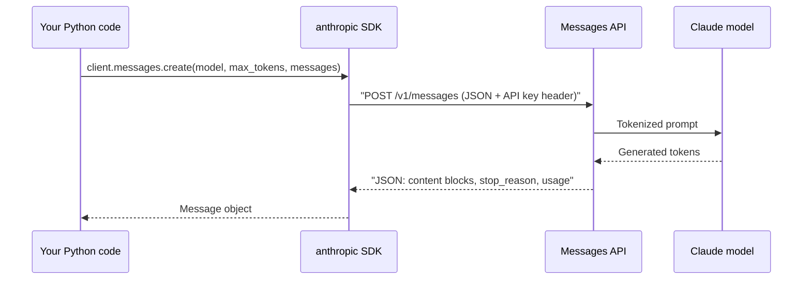

# Your First LLM API Call

## Introduction

Every agent, no matter how sophisticated, is built from one primitive: **send some messages to a model, get a message back.** Tool use, memory, planning, and multi-agent systems are all patterns layered on top of that one HTTP request.

So it is worth understanding this request thoroughly. When an agent misbehaves in production, the root cause is often visible right here: a response that was cut off because `max_tokens` was too small, a content block the code did not expect, or a `stop_reason` nobody checked.

An analogy: calling an LLM API is like sending a letter to a very fast, very well-read consultant who has **no memory of you**. Each letter must contain everything they need. They reply with a letter of their own, plus a receipt saying how much reading and writing they did (token usage) and why they stopped writing (the stop reason).

This page assumes you completed [Setting Up Your Agent Development Environment](./0-agents-environment-setup.mdx).

## The Request/Response Cycle



The SDK handles authentication headers, JSON serialization, retries on transient errors, and turning the JSON into typed Python objects. You could do all of it by hand with `curl` (shown later), but the SDK saves you a lot of boilerplate.

## The Smallest Useful Program

```python
from anthropic import Anthropic

client = Anthropic()  # reads ANTHROPIC_API_KEY from the environment

response = client.messages.create(
    model="claude-opus-5-5",
    max_tokens=1024,
    messages=[
        {"role": "user", "content": "In two sentences, what is an AI agent?"}
    ],
)

for block in response.content:
    if block.type == "text":
        print(block.text)
```

Example output:

```text
An AI agent is a system that uses a language model to decide which actions to take, such as calling tools or APIs, in a loop until it achieves a goal. Unlike a single prompt-and-response, an agent observes the results of its actions and adapts its next step.
```

Three parameters are required on every call:

| Parameter | What it is | Notes |
| --- | --- | --- |
| `model` | Which model to run | A model ID string such as `claude-opus-5-5`. See [Choosing the Right Model](./10-agents-model-selection.mdx). |
| `max_tokens` | The maximum number of tokens the model may generate | A hard ceiling, not a target. Thinking tokens count toward it. |
| `messages` | The conversation so far | A list of `user` and `assistant` messages. Must start with `user`. |

You will meet many optional parameters later: `system` ([System Prompts](./3-agents-system-prompts.mdx)), `output_config` ([Structured Outputs](./6-agents-structured-outputs.mdx) and [effort](./7-agents-thinking-and-effort.mdx)), `tools` ([Tool Use Introduction](../2-agents-tool-use/0-agents-tool-use-introduction.mdx)), and `stream` ([Streaming Responses](./5-agents-streaming.mdx)).

## Anatomy of the Response

The SDK returns a `Message` object. Let's look at all of it, not just the text:

```python
from anthropic import Anthropic

client = Anthropic()

response = client.messages.create(
    model="claude-opus-5-5",
    max_tokens=1024,
    messages=[{"role": "user", "content": "Name three HTTP methods. Be brief."}],
)

print(response.to_json())
```

Example output (abbreviated):

```json
{
  "id": "msg_01XFDUDYJgAACzvnptvVoYEL",
  "type": "message",
  "role": "assistant",
  "model": "claude-opus-5-5",
  "content": [
    {
      "type": "thinking",
      "thinking": "",
      "signature": "EqQBCgIYAhIM..."
    },
    {
      "type": "text",
      "text": "GET, POST, and DELETE."
    }
  ],
  "stop_reason": "end_turn",
  "stop_sequence": null,
  "usage": {
    "input_tokens": 16,
    "output_tokens": 58
  }
}
```

Field by field:

- **`id`**: A unique message ID. Log it when debugging.
- **`role`**: Always `assistant` for a response.
- **`model`**: The model that actually answered.
- **`content`**: A **list of content blocks**, not a string. This is the single most important thing to internalize. A response can contain several blocks of different types:
  - `text`: The answer you show the user.
  - `thinking`: The model's internal reasoning. Current Claude models think adaptively, and by default the thinking text itself is omitted (empty string) while the block and its signature are still returned. See [Reasoning, Thinking and Effort](./7-agents-thinking-and-effort.mdx).
  - `tool_use`: A request to call one of your tools. See [Tool Use Introduction](../2-agents-tool-use/0-agents-tool-use-introduction.mdx).
- **`stop_reason`**: Why generation ended. Your code must check this.
- **`usage`**: Token counts, which determine cost. Thinking tokens are included in `output_tokens`, which is why 58 output tokens produced a five-word answer.

:::caution
Code like `response.content[0].text` is fragile. The first block might be a `thinking` block (which has no `.text`), or a `tool_use` block. Always select blocks by `type`.
:::

A small helper you will reuse throughout the tutorial:

```python
from anthropic.types import Message


def get_text(message: Message) -> str:
    """Join all text blocks in a response. Ignores thinking and tool_use blocks."""
    return "".join(block.text for block in message.content if block.type == "text")
```

## Stop Reasons: Why the Model Stopped

The `stop_reason` tells you whether the answer is complete. Ignoring it is one of the most common bugs in LLM applications.

| `stop_reason` | Meaning | What your code should do |
| --- | --- | --- |
| `end_turn` | The model finished naturally | Use the answer |
| `max_tokens` | Hit your `max_tokens` ceiling | The answer is truncated. Raise the limit or stream. Do not treat it as complete. |
| `stop_sequence` | Hit one of your custom `stop_sequences` | Expected if you set them |
| `tool_use` | The model wants to call a tool | Run the tool and continue (an agent loop) |
| `pause_turn` | A long server-side tool turn was paused | Send the conversation back to let it continue |
| `refusal` | The model declined for safety reasons | Show a graceful message. Check `stop_details` for the category. |
| `model_context_window_exceeded` | The conversation filled the context window | Shorten or compact the history. See [Tokens and Context Windows](./8-agents-tokens-and-context.mdx). |

Here is the habit to build from day one:

```python
from anthropic import Anthropic

client = Anthropic()


def ask(question: str, max_tokens: int = 1024) -> str:
    response = client.messages.create(
        model="claude-opus-5-5",
        max_tokens=max_tokens,
        messages=[{"role": "user", "content": question}],
    )

    if response.stop_reason == "max_tokens":
        raise RuntimeError(
            f"Response truncated at {max_tokens} tokens. Increase max_tokens or stream."
        )
    if response.stop_reason == "refusal":
        return "Sorry, I can't help with that request."

    return "".join(b.text for b in response.content if b.type == "text")


print(ask("Write a haiku about unit tests."))
```

Example output:

```text
Red, then green, then calm—
small promises kept in code,
the build sleeps soundly.
```

Try calling `ask("Explain TCP in depth.", max_tokens=50)` and you will see the truncation error. That is exactly what you want: a loud failure instead of silently showing users half an answer.

## Choosing `max_tokens`

`max_tokens` is a safety ceiling, not a length instruction. The model does not see it and will not "write to fit". If the ceiling is hit, the response is cut off mid-sentence.

- For short answers and classifications, 1,024 to 4,096 is plenty.
- For general use on current models, around 16,000 leaves room for thinking plus a full answer.
- For long outputs (reports, code files, agent turns), use larger values such as 64,000 **with streaming**. The SDK refuses non-streaming requests it estimates could take longer than about ten minutes. See [Streaming Responses](./5-agents-streaming.mdx).

To make answers *shorter*, say so in the prompt ("answer in one sentence"), not by shrinking `max_tokens`.

## The Same Call Without the SDK

Seeing the raw HTTP request demystifies what the SDK does. This is the equivalent `curl` call:

```bash
curl https://api.anthropic.com/v1/messages \
  -H "x-api-key: $ANTHROPIC_API_KEY" \
  -H "anthropic-version: 2023-06-01" \
  -H "content-type: application/json" \
  -d '{
    "model": "claude-opus-5-5",
    "max_tokens": 1024,
    "messages": [
      {"role": "user", "content": "In two sentences, what is an AI agent?"}
    ]
  }'
```

The headers are worth knowing:

- `x-api-key`: your API key (the SDK adds this from the environment).
- `anthropic-version`: the API version. Pinning it means the response format will not change under you.
- `content-type`: the body is JSON.

The JSON that comes back is the same structure you saw from `response.to_json()`.

## Async Calls

Web servers and agents that run several requests at once should use the async client so one slow request does not block others:

```python
import asyncio

from anthropic import AsyncAnthropic

client = AsyncAnthropic()


async def summarize(topic: str) -> str:
    response = await client.messages.create(
        model="claude-opus-5-5",
        max_tokens=1024,
        messages=[{"role": "user", "content": f"One sentence on {topic}."}],
    )
    return "".join(b.text for b in response.content if b.type == "text")


async def main() -> None:
    topics = ["DNS", "TLS", "HTTP/3"]
    results = await asyncio.gather(*(summarize(t) for t in topics))
    for topic, text in zip(topics, results):
        print(f"{topic}: {text}")


asyncio.run(main())
```

Example output:

```text
DNS: DNS translates human-readable domain names into the IP addresses computers use to find each other.
TLS: TLS encrypts data in transit so that eavesdroppers cannot read or tamper with it.
HTTP/3: HTTP/3 runs HTTP over QUIC, a UDP-based transport that reduces connection setup latency.
```

The three requests run concurrently, so total time is roughly the slowest single request rather than the sum.

## How Other Providers Compare

The concepts transfer directly. Here is roughly the same call with other SDKs, as of late 2026. Model names and even method names change, so check each provider's quickstart.

**OpenAI** (Responses API):

```python
from openai import OpenAI

client = OpenAI()  # reads OPENAI_API_KEY

response = client.responses.create(
    model="gpt-6-astra",  # check OpenAI's docs for current model names
    input="In two sentences, what is an AI agent?",
)
print(response.output_text)
```

**Google Gemini** (google-genai SDK):

```python
from google import genai

client = genai.Client()  # reads GEMINI_API_KEY

interaction = client.interactions.create(
    model="gemini-3.8-flash",  # check Google's docs for current model names
    input="In two sentences, what is an AI agent?",
)
print(interaction.output_text)
```

| Concept | Anthropic | OpenAI | Gemini |
| --- | --- | --- | --- |
| Key env var | `ANTHROPIC_API_KEY` | `OPENAI_API_KEY` | `GEMINI_API_KEY` |
| Output is a list of typed items | `content` blocks | `output` items | content parts |
| Convenience text accessor | join `text` blocks yourself | `output_text` | `output_text` |
| Why it stopped | `stop_reason` | status / incomplete details | finish reason |
| Usage | `usage.input_tokens`, `usage.output_tokens` | `usage` | usage metadata |

The shape is the same everywhere: messages in, typed content out, plus usage and a stop signal. Learn it once and switching providers is mostly renaming.

## Real-World Scenario

**Your team wants a command-line tool that turns a staged Git diff into a draft commit message.** Developers will run it dozens of times a day, so it must be fast to call, never print half a message, and fail clearly.

```python
import subprocess
import sys

import anthropic
from anthropic import Anthropic

client = Anthropic()

MAX_DIFF_CHARS = 40_000  # keep requests small and cheap


def staged_diff() -> str:
    result = subprocess.run(
        ["git", "diff", "--staged"], capture_output=True, text=True, check=True
    )
    return result.stdout


def draft_commit_message(diff: str) -> str:
    prompt = (
        "Write a conventional commit message for this diff. "
        "First line under 72 characters, then a blank line, then up to 3 bullet points.\n\n"
        f"<diff>\n{diff[:MAX_DIFF_CHARS]}\n</diff>"
    )
    response = client.messages.create(
        model="claude-opus-5-5",
        max_tokens=2048,
        messages=[{"role": "user", "content": prompt}],
    )
    if response.stop_reason != "end_turn":
        raise RuntimeError(f"Unexpected stop_reason: {response.stop_reason}")
    return "".join(b.text for b in response.content if b.type == "text").strip()


if __name__ == "__main__":
    diff = staged_diff()
    if not diff:
        sys.exit("Nothing staged. Run git add first.")
    try:
        print(draft_commit_message(diff))
    except anthropic.APIError as exc:
        sys.exit(f"API error: {exc}")
```

Example output:

```text
fix(auth): refresh expired tokens before retrying requests

- Detect 401 responses caused by token expiry
- Refresh the token once and replay the original request
- Add unit tests for the refresh path
```

### Why this approach

- **A single call is enough.** The task is one transformation with all inputs known up front. No tools, no loop, no agent. This is a deliberate choice, and [When Should You Build an Agent?](../0-agents-fundamentals/7-agents-when-to-build.mdx) explains why simpler is better when it works.
- **The diff is truncated** so a huge refactor does not produce a slow, expensive request.
- **`stop_reason` is checked**, so a truncated or refused message is never silently pasted into Git history.

### When to use it, and when not to

A single API call fits tasks that are one step, with inputs you already have: summarizing, rewriting, classifying, drafting. It does not fit when the model needs to *go get* information (read other files, run tests). That calls for tools and an agent loop.

### Alternatives and trade-offs

| Approach | Pros | Cons | Best for |
| --- | --- | --- | --- |
| Raw HTTP (`requests`, `curl`) | No dependency, full control | You handle retries, types, streaming parsing | Unusual languages, minimal containers |
| Official SDK | Typed responses, automatic retries, streaming helpers | One dependency per provider | Most applications |
| Multi-provider wrapper library | One interface for many providers | Lags behind new features, lowest common denominator | Apps that must switch providers often |
| Agent framework | Loops, tools, memory included | More abstraction to learn and debug | Complex agents (see [Agent Framework Landscape](../9-agents-frameworks/0-agents-framework-landscape.mdx) section) |

## Common Mistakes

- **Reading `response.content[0].text`.** Select blocks by `type`. The first block may be thinking or a tool call.
- **Not checking `stop_reason`.** Truncated output looks like a valid answer until a user reads it.
- **Using `max_tokens` to control length.** It truncates rather than shortens. Ask for brevity in the prompt.
- **Copying old tutorials' sampling parameters.** Older examples often set `temperature` or `top_p`. Current Claude models reject non-default sampling parameters with a 400 error. Steer output with instructions and [effort](./7-agents-thinking-and-effort.mdx) instead.
- **Guessing model IDs.** A typo returns a 404 `not_found_error`. Copy IDs from the official [models overview](https://platform.claude.com/docs/en/about-claude/models/overview).
- **Creating a new client for every request.** Create one client and reuse it. It holds a connection pool.

## Summary

- An LLM call takes `model`, `max_tokens`, and a list of `messages`, and returns a message with typed content blocks.
- `content` is a list. Filter by block `type` to get text.
- `stop_reason` tells you whether the answer is complete. Handle `max_tokens` and `refusal` explicitly.
- `usage` reports input and output tokens (including thinking), which drive cost.
- Use the async client for concurrent requests.
- OpenAI and Gemini follow the same shape with different names.

## Exercises

1. Print `response.usage` for a one-word answer and for a 300-word essay. How do input and output tokens compare?
2. Force a truncation by setting `max_tokens=30` on a long question, and write code that detects it and retries once with a higher limit.
3. Rewrite the commit-message tool to read the diff from standard input so it works with `git diff | python tool.py`.
4. If you have an OpenAI or Gemini key, run the same question through two providers and compare the response objects field by field.

**Next:** [Messages and Roles](./2-agents-messages-and-roles.mdx) explains the structure of the `messages` list in detail.
