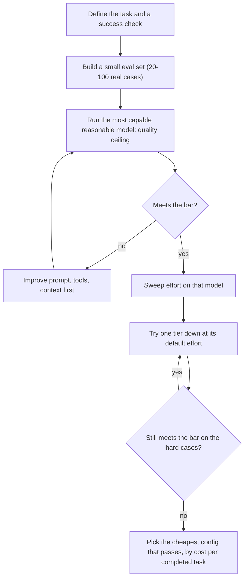

# Choosing the Right Model

## Introduction

"Which model should I use?" is one of the first questions every agent builder asks, and the honest answer is: **it depends on your task, and you should measure rather than guess.**

Model lineups change every few months. Names, prices, and benchmark leaders in any article (including this one) go stale. What does not go stale is the **reasoning process**: understanding the trade-off between capability, latency, and cost, and knowing how to test which model gives you the best result per dollar on *your* workload.

An analogy: choosing a model is like staffing a project. You would not have your most senior architect sort the mail, and you would not hand a junior intern the database migration. You match the person to the job, and sometimes the right answer is a team: a senior lead who plans and a few juniors who execute.

This page gives you a current snapshot (as of late 2026), then focuses on the decision process that will still apply after the snapshot is out of date.

## The Three Core Trade-Offs

Every model choice balances three things:

| Axis | Question | Why it matters for agents |
| --- | --- | --- |
| **Capability** | Can it do the task reliably? | Agents compound errors: a 95%-reliable step repeated 20 times succeeds end-to-end far less often |
| **Latency** | How fast does it respond? | Users waiting in a chat, or agents taking many sequential steps |
| **Cost** | What does a completed task cost? | Agents make many calls, each resending growing context |

Bigger models are generally more capable but slower and more expensive per token. Smaller models are faster and cheaper but fail more on hard tasks. **Effort** (see [Reasoning, Thinking and Effort](./7-agents-thinking-and-effort.mdx)) adds a second dial within a single model.

Beyond those three, check practical constraints:

- **Context window and max output**: does your input fit with room to spare?
- **Features**: vision, PDF input, structured outputs, tool use, specific server-side tools.
- **Availability**: which cloud platforms and regions offer it, and its rate limits for your account.
- **Data handling**: some models have specific data-retention requirements. Check what your organization's policies allow.
- **Lifecycle**: how long the model will be supported before deprecation.

## A Snapshot of the Claude Lineup (Late 2026)

:::caution
This table is a snapshot as of late 2026. Models and prices change. Always confirm on the official [models overview](https://platform.claude.com/docs/en/about-claude/models/overview) and [pricing page](https://platform.claude.com/docs/en/about-claude/pricing).
:::

| Model ID | Tier | Input / output price per 1M tokens | Context | Typical role |
| --- | --- | --- | --- | --- |
| `claude-fable-5-1` | Highest capability | $10 / $50 | 1M | The hardest reasoning and long-horizon agent work |
| `claude-opus-5-5` | Flagship, default | $4 / $20 | 1M | Complex agents, coding, knowledge work |
| `claude-sonnet-5-5` | Balanced | $2 / $10 | 1M | High-volume production work that still needs strong reasoning |
| `claude-haiku-5-5` | Small and fast | $0.10 / $0.50 for prompts up to 100K tokens, higher above | 1M | Classification, routing, extraction, simple subagents |

Other providers organize their lineups the same way: a frontier flagship, a balanced mid-tier, and small "mini/flash/lite" models, plus open-weight models you can host yourself (Llama, Qwen, Mistral, Gemma and others, via Ollama or vLLM). See [OpenAI's models page](https://platform.openai.com/docs/models) and [Google's Gemini models page](https://ai.google.dev/gemini-api/docs/models) for their current options.

### Discovering models programmatically

Rather than hardcoding capabilities, you can query the Models API:

```python
from anthropic import Anthropic

client = Anthropic()

for model in client.models.list():
    print(f"{model.id:<22} context={model.max_input_tokens:>8}  max_output={model.max_tokens}")
```

Example output (abbreviated):

```text
claude-fable-5-1       context= 1000000  max_output=128000
claude-opus-5-5        context= 1000000  max_output=128000
claude-sonnet-5-5      context= 1000000  max_output=128000
claude-haiku-5-5       context= 1000000  max_output=128000
```

## The Decision Process



### Step 1: Start from the top to find the ceiling

Begin with a strong model. If the best model cannot do your task, no cheaper model will, and the problem is your prompt, tools, or context, not the model choice. Starting cheap risks concluding "LLMs can't do this" when the real issue was capability.

### Step 2: Measure on your own cases

Public benchmarks tell you about general ability. They do not tell you how a model performs on *your* tickets, *your* codebase, *your* documents. A small eval set of real examples with a pass/fail check is worth more than any leaderboard. See [Building Evaluation Datasets](../11-agents-evaluation-and-testing/1-agents-building-eval-sets.mdx).

### Step 3: Turn the cheaper dial first

Lowering **effort** on the same model is a smaller change than switching models: prompts stay the same and behavior shifts gradually. Only then try **one tier down**, and re-sweep effort from that model's default.

### Step 4: Compare by cost per completed task

This is the key idea, and the reason per-token prices can mislead:

> A model with a higher price per token can be **cheaper per task** if it finishes in fewer steps, uses fewer tokens, or fails less often. A cheap model that fails still bills its tokens, then the retry, then whatever the failure costs downstream.

```python
def cost_per_completed_task(total_cost: float, tasks: int, success_rate: float) -> float:
    completed = tasks * success_rate
    return total_cost / completed if completed else float("inf")


# Illustrative numbers for 100 agent tasks. Measure your own.
runs = {
    "big model, medium effort":   {"cost": 18.00, "success": 0.94},
    "mid model, high effort":     {"cost": 11.00, "success": 0.81},
    "small model, high effort":   {"cost":  2.50, "success": 0.38},
}

for name, r in runs.items():
    cpt = cost_per_completed_task(r["cost"], 100, r["success"])
    print(f"{name:<26} success={r['success']:.0%}  cost/completed=${cpt:.3f}")
```

Output:

```text
big model, medium effort   success=94%  cost/completed=$0.191
mid model, high effort     success=81%  cost/completed=$0.136
small model, high effort   success=38%  cost/completed=$0.066
```

On these made-up numbers, the small model looks cheapest per completed task. But that ignores what the 62% of failures cost: a human redoing the work, an unhappy customer, a broken deploy. If each failure costs $2 of human time, the picture flips:

```python
FAILURE_COST = 2.00  # e.g. human time to fix or redo the task

for name, r in runs.items():
    failures = 100 * (1 - r["success"])
    total = r["cost"] + failures * FAILURE_COST
    print(f"{name:<26} total cost incl. failures=${total:.2f}")
```

Output:

```text
big model, medium effort   total cost incl. failures=$30.00
mid model, high effort     total cost incl. failures=$49.00
small model, high effort   total cost incl. failures=$126.50
```

The lesson is not "always use the big model". It is: **include the cost of failure**, and let measurements decide.

### Step 5: Price the tail, not the average

On easy tasks, every model looks similar and the cheapest looks best. The difference shows up on the hardest 10% of tasks, which is also where most tokens are spent. Make sure your eval set includes your hardest real cases.

## A Small Comparison Harness

Here is a minimal harness that runs the same cases across several model configurations and reports accuracy, latency, and cost. It is deliberately simple. Real evals use more cases and better grading (see [Grading Methods: Code, Rubrics and LLM Judges](../11-agents-evaluation-and-testing/2-agents-grading-methods.mdx)).

```python
import time

from anthropic import Anthropic

client = Anthropic()

# Snapshot prices (USD per 1M tokens), late 2026. Check the official pricing page.
PRICES = {
    "claude-opus-5-5": (4.00, 20.00),
    "claude-sonnet-5-5": (2.00, 10.00),
    "claude-haiku-5-5": (0.10, 0.50),
}

CASES = [
    ("Ticket: 'I was charged twice.' Category? One word: billing, bug, or feature.", "billing"),
    ("Ticket: 'Export button crashes the app.' Category? One word: billing, bug, or feature.", "bug"),
    ("Ticket: 'Please add a dark theme.' Category? One word: billing, bug, or feature.", "feature"),
]

CONFIGS = [
    ("claude-opus-5-5", "medium"),
    ("claude-sonnet-5-5", "low"),
    ("claude-haiku-5-5", "low"),
]

for model, effort in CONFIGS:
    correct, cost, latencies = 0, 0.0, []
    for prompt, expected in CASES:
        start = time.perf_counter()
        r = client.messages.create(
            model=model,
            max_tokens=2048,
            output_config={"effort": effort},
            messages=[{"role": "user", "content": prompt}],
        )
        latencies.append(time.perf_counter() - start)
        answer = "".join(b.text for b in r.content if b.type == "text").strip().lower()
        correct += answer.startswith(expected)
        price_in, price_out = PRICES[model]
        cost += (r.usage.input_tokens * price_in + r.usage.output_tokens * price_out) / 1_000_000
    avg_latency = sum(latencies) / len(latencies)
    print(f"{model:<18} effort={effort:<6} acc={correct}/{len(CASES)} "
          f"avg_latency={avg_latency:.2f}s cost=${cost:.5f}")
```

Example output (illustrative; your numbers will differ):

```text
claude-opus-5-5    effort=medium acc=3/3 avg_latency=2.10s cost=$0.00412
claude-sonnet-5-5  effort=low    acc=3/3 avg_latency=1.05s cost=$0.00071
claude-haiku-5-5   effort=low    acc=3/3 avg_latency=0.48s cost=$0.00003
```

For an easy classification task like this, all three pass, and the smallest model is far faster and cheaper. That is exactly the kind of evidence that justifies routing simple work to a small model. Run the same harness on your *hard* cases before drawing conclusions for harder work.

## Latency Is More Than Model Size

When users wait on responses, latency can matter as much as cost. Several factors contribute:

- **Model tier**: smaller models generally produce tokens faster.
- **Effort and thinking**: more thinking means more tokens before the answer starts.
- **Output length**: generation time scales with output tokens. Asking for concise answers is a latency optimization.
- **Input length**: very long prompts take longer to process, though cached prefixes help.
- **Number of sequential calls**: an agent with 15 steps pays per-call latency 15 times. Parallel tool calls and fewer, better tools often help more than a faster model.

Stream responses so users see progress (see [Streaming Responses](./5-agents-streaming.mdx)), and see [Latency Optimization](../13-agents-production/3-agents-latency-optimization.mdx) for production techniques.

## Model Lifecycle: Versions and Deprecations

Models are not permanent. Providers release new versions and retire old ones on published schedules. A few practices keep this manageable:

- **Know what your model ID refers to.** Current Claude model IDs such as `claude-opus-5-5` identify a specific model. Some older models also had dated full IDs (for example `claude-haiku-4-5-20251001`). Check the models overview for how each ID behaves.
- **Watch deprecation notices.** The [model deprecations page](https://platform.claude.com/docs/en/about-claude/model-deprecations) lists retirement dates. A retired model returns errors, so plan migrations ahead.
- **Treat upgrades as migrations, not string swaps.** New models can change defaults (for example, the default effort level), reject old parameters, or respond differently to the same prompt. Run your eval suite before switching production traffic.

## When to Consider Open-Weight Models

Self-hosting an open-weight model (with Ollama for development, or vLLM and similar servers in production) makes sense in a few situations:

- **Data cannot leave your infrastructure** for regulatory or contractual reasons.
- **Very high volume of simple tasks**, where GPU costs beat per-token pricing at your scale.
- **Offline or edge deployments** without reliable internet access.

The trade-offs are real: you take on GPU provisioning, scaling, monitoring, and upgrades, and current open models generally trail frontier hosted models on complex multi-step agent tasks. Many teams use hosted frontier models for the agent's reasoning and smaller self-hosted models for narrow, high-volume steps.

## Multi-Model Architectures

You do not have to pick one model for everything. Common patterns:

| Pattern | How it works | When it pays off |
| --- | --- | --- |
| **Router** | A cheap model (or rules) classifies the request, then sends it to a small or large model | Mixed traffic where most requests are easy. See [Routing](../6-agents-planning-and-reasoning/2-agents-routing.mdx) |
| **Orchestrator-workers** | A strong model plans and delegates bulk subtasks to cheaper workers | Many independent subtasks. See [Orchestrator-Workers Pattern](../8-agents-multi-agent-systems/1-agents-orchestrator-workers.mdx) |
| **Cheap judge** | A small model grades or validates outputs | High-volume checks with clear criteria |
| **Escalation** | Try a cheaper config first, escalate to a stronger one on failure | Tasks with a reliable failure signal (tests, validators) |

Each adds complexity, and Anthropic's own cost guidance notes that orchestration only pays when there is real bulk work to hand off. For a single dependent chain of reasoning, one capable model at a lower effort often beats a multi-model setup. Measure before you architect.

## Make the Model a Configuration Value

Hardcoding model IDs throughout a codebase makes testing and upgrades painful. Centralize them:

```python
import os
from dataclasses import dataclass


@dataclass(frozen=True)
class ModelConfig:
    model: str
    effort: str
    max_tokens: int


# One place to change models per role. Override with env vars per environment.
MODELS = {
    "router": ModelConfig(os.getenv("ROUTER_MODEL", "claude-haiku-5-5"), "low", 2048),
    "agent": ModelConfig(os.getenv("AGENT_MODEL", "claude-opus-5-5"), "medium", 64000),
    "judge": ModelConfig(os.getenv("JUDGE_MODEL", "claude-haiku-5-5"), "medium", 4096),
}


def request_kwargs(role: str) -> dict:
    cfg = MODELS[role]
    return {"model": cfg.model, "max_tokens": cfg.max_tokens, "output_config": {"effort": cfg.effort}}


print(request_kwargs("router"))
```

Output:

```text
{'model': 'claude-haiku-5-5', 'max_tokens': 2048, 'output_config': {'effort': 'low'}}
```

When a new model is released, you change one value, run your eval suite, and compare. That process is covered in [Migrating to a New Model](../13-agents-production/8-agents-model-migration.mdx).

:::tip
Switch models **between** conversations, not in the middle of one. A mid-conversation switch restarts the prompt cache, and current models generally cannot read another model's thinking blocks.
:::

## Real-World Scenario

**You run customer support for an online store with about 20,000 conversations a month.** Requests range from "where is my order?" to complicated multi-order refund disputes. You are building an agent that can look up orders and draft replies.

Your evaluation of 150 real past conversations (pass = a support lead approves the draft) guides the design:

1. **Routing** with `claude-haiku-5-5` at low effort classifies each message: order status, returns, billing dispute, other. It is fast and very cheap, and classification is easy to check.
2. **Simple intents** (order status, return policy questions) are handled by the agent on `claude-sonnet-5-5` at medium effort. The eval shows it matches the flagship's approval rate on these.
3. **Disputes and anything multi-step** go to `claude-opus-5-5`, where the eval showed a clear quality gap on the hardest cases.
4. **Re-evaluation** runs whenever any of the three models has a new version available.

### Why this approach

- **Most traffic is easy**, so routing it to cheaper configurations saves the most money where quality is already sufficient.
- **The hard tail goes to the strongest model**, because that is where failures (wrong refunds, angry customers) are expensive.
- **Every decision was backed by the eval**, not by benchmark headlines or intuition.

### When to use it, and when not to

Routing to multiple models is worth it at meaningful volume with clearly separable task types. At low volume (a few hundred requests a month), the savings rarely justify the extra complexity: use one strong model and spend your time on prompts and tools.

### Alternatives and trade-offs

| Approach | Pros | Cons | Best for |
| --- | --- | --- | --- |
| One flagship model for everything | Simplest, highest quality ceiling | Highest cost on easy traffic | Low volume, early prototypes |
| One mid-tier model | Good cost-quality balance | May fail on the hardest cases | Moderate complexity, cost-sensitive |
| Router + tiered models | Spend follows difficulty | More components, routing errors | High volume, mixed difficulty |
| Self-hosted open model | No per-token fees, data stays on your infrastructure | GPU and ops cost, usually lower capability | Strict data residency, very high volume of simple tasks |

## Common Mistakes

- **Picking a model from a leaderboard** without testing it on your tasks.
- **Starting with the cheapest model** and concluding the task is impossible.
- **Comparing price per token instead of cost per completed task**, and ignoring the cost of failures.
- **Hardcoding model IDs** in many files.
- **Carrying prompts and effort settings unchanged across models.** Re-tune and re-evaluate.
- **Not tracking deprecations.** Models retire on a schedule. Subscribe to your provider's deprecation notices.

## Summary

- Model choice balances capability, latency, and cost, plus constraints like context, features, and data handling.
- As of late 2026, Claude's lineup spans Fable 5.1 (highest capability), Opus 5.5 (flagship default), Sonnet 5.5 (balanced), and Haiku 5.5 (small and fast). Check official pages for current details.
- Start with a strong model to find the quality ceiling, then lower effort, then step down tiers, measuring each step.
- Compare configurations by **cost per completed task**, including the cost of failures and the hardest cases.
- Combine models with routing or orchestration only when measurements show it pays off.
- Keep model choice in configuration so upgrades are a one-line change plus an eval run.

## Exercises

1. Build a 20-case eval for a task you care about and run it on two models. Compute success rate and cost per completed task for each.
2. Add a `FAILURE_COST` to your comparison and find the break-even failure cost at which the cheaper model stops being cheaper.
3. Write a simple rule-based router for three request types and measure how often it routes correctly on 50 examples.
4. Use the Models API to list available models and write a function that picks the cheapest model in your config that supports a given context size.

**Next:** [Understanding API Costs](./11-agents-api-cost-basics.mdx).
