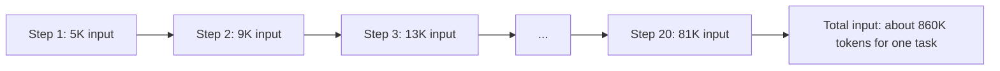

# Understanding API Costs

## Introduction

LLM APIs bill by the token, and the bill can surprise you. A prototype that costs a few cents a day becomes a four-figure monthly invoice once real users arrive, or once an agent starts looping through 40 tool calls per task instead of 4.

The good news is that LLM costs are very **predictable once you understand the model**. Every response tells you exactly how many tokens it used. Prices are published. With a little arithmetic and some logging, you can estimate costs before launch, see where money goes, and cut it without hurting quality.

An analogy: think of an LLM bill like a taxi meter with two rates. There is a charge for every page you hand the driver to read (input tokens), a higher charge for every page the driver writes (output tokens), and a big discount if you hand over the same pages again soon (cached input). Agents are like a driver who re-reads the entire trip log at every intersection. That is why caching matters so much.

## What You Pay For

| Billed item | What it is | Notes |
| --- | --- | --- |
| **Input tokens** | System prompt, tools, messages, documents, images | Charged on every request, including resent history |
| **Output tokens** | Everything the model generates | **Includes thinking tokens.** Output is typically about 5x the input price. |
| **Cache writes** | Input written to the prompt cache | A small premium over base input (1.25x for the 5-minute cache) |
| **Cache reads** | Input served from the cache | A small fraction of base input (0.05x to 0.1x depending on model) |
| **Server-side tools** | e.g. web search | Charged per use on top of tokens |

Modifiers that change the rates:

- **Batch API**: 50% off all tokens for asynchronous jobs.
- **Data residency**: pinning inference to a specific region (for example US-only) adds a multiplier (1.1x on current Claude models).
- **Long prompts on some models**: Claude Haiku 5.5, for example, charges more for prompts over 100K tokens.

## A Pricing Snapshot (Late 2026)

:::caution
Prices change. These are a snapshot as of late 2026 for illustration. Always check the official [Claude pricing page](https://platform.claude.com/docs/en/about-claude/pricing), [OpenAI pricing](https://openai.com/api/pricing/), or [Gemini pricing](https://ai.google.dev/gemini-api/docs/pricing) before making decisions.
:::

Claude models, USD per million tokens (MTok):

| Model | Input | Output | 5-min cache write | Cache read | Batch input / output |
| --- | --- | --- | --- | --- | --- |
| `claude-fable-5-1` | $10 | $50 | $12.50 | $0.25 | $5 / $25 |
| `claude-opus-5-5` | $4 | $20 | $5 | $0.20 | $2 / $10 |
| `claude-sonnet-5-5` | $2 | $10 | $2.50 | $0.10 | $1 / $5 |
| `claude-haiku-5-5` (prompts up to 100K) | $0.10 | $0.50 | $0.125 | $0.01 | $0.05 / $0.25 |
| `claude-haiku-5-5` (prompts over 100K) | $0.50 | $2.50 | $0.625 | $0.05 | $0.25 / $1.25 |

Two things jump out:

1. **Output costs 5x input.** Verbose answers and heavy thinking add up quickly.
2. **Cache reads are 20x to 40x cheaper than base input** on these models. For agents that resend the same prefix repeatedly, caching is the biggest single lever.

## Calculating the Cost of a Call

Every response's `usage` gives you everything you need:

```python
from anthropic import Anthropic

# Snapshot prices, USD per million tokens. Update from the official pricing page.
PRICES = {
    "claude-opus-5-5":   {"input": 4.00, "output": 20.00, "cache_write": 5.00,  "cache_read": 0.20},
    "claude-sonnet-5-5": {"input": 2.00, "output": 10.00, "cache_write": 2.50,  "cache_read": 0.10},
    "claude-haiku-5-5":  {"input": 0.10, "output": 0.50,  "cache_write": 0.125, "cache_read": 0.01},
}


def call_cost(model: str, usage) -> float:
    """Approximate cost of one call. Ignores batch, residency, and long-prompt tiers."""
    p = PRICES[model]
    return (
        usage.input_tokens * p["input"]
        + usage.output_tokens * p["output"]
        + (usage.cache_creation_input_tokens or 0) * p["cache_write"]
        + (usage.cache_read_input_tokens or 0) * p["cache_read"]
    ) / 1_000_000


client = Anthropic()
response = client.messages.create(
    model="claude-opus-5-5",
    max_tokens=4096,
    messages=[{"role": "user", "content": "Explain idempotency in REST APIs in 3 sentences."}],
)
print(response.usage.input_tokens, "in,", response.usage.output_tokens, "out")
print(f"Cost: ${call_cost('claude-opus-5-5', response.usage):.6f}")
```

Example output:

```text
22 in, 143 out
Cost: $0.002948
```

A fraction of a cent. Single calls are cheap. Costs come from **volume** and from **agents**.

## Why Agents Cost More Than Chat

An agent resends its entire context on every step: system prompt, tool definitions, every earlier step, every tool result. So input tokens grow with each step, and **total input across a task grows roughly with the square of the number of steps.**



Let's simulate a 20-step agent task, with and without prompt caching:

```python
P = {"input": 4.00, "output": 20.00, "cache_write": 5.00, "cache_read": 0.20}  # Opus 5.5 snapshot

BASE = 5_000          # system prompt + tools + first user message
PER_STEP_GROWTH = 4_000  # tool result + previous output added each step
OUTPUT_PER_STEP = 800
STEPS = 20


def task_cost(cached: bool) -> float:
    total = 0.0
    context = BASE
    for step in range(STEPS):
        if cached and step > 0:
            # Everything up to last step is read from cache; only the new part is written.
            cache_read = context - PER_STEP_GROWTH
            cache_write = PER_STEP_GROWTH
            total += cache_read * P["cache_read"] + cache_write * P["cache_write"]
        else:
            total += context * P["input"]
        total += OUTPUT_PER_STEP * P["output"]
        context += PER_STEP_GROWTH
    return total / 1_000_000


print(f"No caching:   ${task_cost(cached=False):.2f} per task")
print(f"With caching: ${task_cost(cached=True):.2f} per task")
```

Output:

```text
No caching:   $3.76 per task
With caching: $0.88 per task
```

This is a simplified model (real cache behavior has minimum sizes and expiry windows), but the shape is right: for long agent tasks, **caching can cut costs by well over half**. Once caching is on, most of what remains is cache writes for each step's new content plus output tokens, which is why trimming tool results and verbose output still matters. [Prompt Caching](../4-agents-memory-and-context/4-agents-prompt-caching.mdx) shows how to set it up properly.

## The Unit That Matters: Cost per Completed Task

Price per token is an input to your cost, not the answer. What your business cares about is **cost per completed task**: per resolved ticket, per reviewed pull request, per extracted invoice.

```text
cost per completed task = total spend (including retries and failed attempts) / tasks completed successfully
```

This metric captures things per-token prices miss:

- A stronger model that finishes in 8 steps can beat a cheaper one that takes 25.
- Failed attempts still cost money, and so do the retries after them.
- Effort settings, caching, and prompt changes all show up in one number.

Anthropic's own cost guidance frames optimization exactly this way. [Choosing the Right Model](./10-agents-model-selection.mdx) shows how to compare models with it.

## Where to Cut Costs, in Order

Some levers save money without reducing quality. Others trade quality for cost. Pull the free ones first:

| Order | Lever | Effect on quality | Notes |
| --- | --- | --- | --- |
| 1 | **Prompt caching** | None | Keep stable content (system, tools) first and unchanged. Biggest win for agents. |
| 2 | **Input hygiene** | None or positive | Trim bloated prompts, clip tool results, remove unused tools |
| 3 | **Output hygiene** | None if done well | Ask for concise formats. Do not use `max_tokens` to shorten answers. |
| 4 | **Batch API** | None | 50% off for work nobody is waiting on |
| 5 | **Lower effort** | Possible, measure | Sweep effort on your eval set |
| 6 | **Smaller model** | Possible, measure | Step down one tier at a time, compare cost per completed task |

Cost optimization in production (budgets, multi-model architectures, monitoring) is covered in [Cost Optimization](../13-agents-production/4-agents-cost-optimization.mdx).

### Batch processing example

For bulk work like nightly classification or evaluation runs, the Message Batches API halves the price. Results arrive asynchronously (most batches finish within an hour, and within 24 hours at most):

```python
from anthropic import Anthropic

client = Anthropic()

reviews = {
    "r1": "Arrived broken, very disappointed.",
    "r2": "Exactly as described, fast shipping!",
}

batch = client.messages.batches.create(
    requests=[
        {
            "custom_id": review_id,
            "params": {
                "model": "claude-haiku-5-5",
                "max_tokens": 1024,
                "messages": [{"role": "user", "content": f"Sentiment (positive/negative): {text}"}],
            },
        }
        for review_id, text in reviews.items()
    ]
)
print(batch.id, batch.processing_status)
```

Example output:

```text
msgbatch_01HkcTjaV5uDC8jWR4ZsDV8d in_progress
```

You later poll `client.messages.batches.retrieve(batch.id)` and read results with `client.messages.batches.results(batch.id)`.

## Guardrails Against Runaway Costs

Agents loop, and loops can run away. Put limits in several places:

1. **Workspace spend limits** in the provider console: the final backstop.
2. **Per-task budgets in your code**: stop the agent after N steps or N tokens.
3. **Alerts**: notify the team when daily spend exceeds a threshold.

A simple budget tracker for an agent loop:

```python
class BudgetExceeded(Exception):
    pass


class TokenBudget:
    def __init__(self, max_cost_usd: float, prices: dict):
        self.max_cost = max_cost_usd
        self.prices = prices
        self.spent = 0.0
        self.calls = 0

    def record(self, usage) -> None:
        p = self.prices
        self.spent += (
            usage.input_tokens * p["input"]
            + usage.output_tokens * p["output"]
            + (usage.cache_creation_input_tokens or 0) * p["cache_write"]
            + (usage.cache_read_input_tokens or 0) * p["cache_read"]
        ) / 1_000_000
        self.calls += 1
        if self.spent > self.max_cost:
            raise BudgetExceeded(f"Spent ${self.spent:.2f} over {self.calls} calls (limit ${self.max_cost:.2f})")


# Usage inside an agent loop:
# budget = TokenBudget(max_cost_usd=0.50, prices=PRICES["claude-opus-5-5"])
# response = client.messages.create(...)
# budget.record(response.usage)
```

When the budget is exceeded, stop gracefully: save state, tell the user, and let a human decide whether to continue. [Stopping Conditions and Budgets](../6-agents-planning-and-reasoning/10-agents-stopping-conditions.mdx) covers this pattern in depth.

## Track Costs from Day One

You cannot optimize what you do not measure. For every API call, log at least:

- Model, effort, and feature or endpoint name
- `input_tokens`, `output_tokens`, `cache_creation_input_tokens`, `cache_read_input_tokens`
- Task or session ID, so you can sum cost per task
- Whether the task ultimately succeeded

With that, you can answer "which feature costs the most?", "is caching working?" (cache reads should dominate input on warm agent loops), and "what does a completed task cost?". Organization-wide numbers are also available in the Console and through Anthropic's Usage and Cost Admin API.

## Real-World Scenario

**Your startup is about to launch an AI support agent.** The CFO asks: "What will this cost per month, and how do we keep it from exploding?"

**Step 1: Measure a realistic sample.** Run the agent on 100 past tickets with logging. Suppose the results show an average of 6 steps per ticket, about 60K total input tokens per ticket (90% cache reads after the first step), and 3K output tokens per ticket, with an 88% resolution rate.

**Step 2: Estimate cost per ticket and per month.**

```python
P = {"input": 4.00, "output": 20.00, "cache_write": 5.00, "cache_read": 0.20}  # Opus 5.5 snapshot

input_total = 60_000
cache_read = int(input_total * 0.90)
cache_write = int(input_total * 0.05)
uncached = input_total - cache_read - cache_write
output = 3_000

per_ticket = (uncached * P["input"] + cache_write * P["cache_write"]
              + cache_read * P["cache_read"] + output * P["output"]) / 1_000_000

tickets_per_month = 15_000
resolution_rate = 0.88

print(f"Cost per ticket attempt:   ${per_ticket:.3f}")
print(f"Cost per resolved ticket:  ${per_ticket / resolution_rate:.3f}")
print(f"Estimated monthly spend:   ${per_ticket * tickets_per_month:,.0f}")
```

Output:

```text
Cost per ticket attempt:   $0.098
Cost per resolved ticket:  $0.111
Estimated monthly spend:   $1,467
```

**Step 3: Put it in context.** If a human-handled ticket costs several dollars of staff time, about $0.11 per resolved ticket is a strong case, even after adding the cost of the 12% that still need a human.

**Step 4: Add guardrails.** A per-ticket budget of $0.50 (about 5x the average) stops runaway loops. A workspace spend limit caps the month. A daily alert fires at 150% of the expected spend.

### Why this approach

- **Measured, not guessed.** Estimates come from running the real agent on real tickets.
- **Cost per resolved ticket** connects the API bill to business value.
- **Layered limits** turn bugs into contained incidents rather than budget disasters.

### When to use it, and when not to

Do this estimate before any launch with meaningful volume, and repeat it after major prompt, tool, or model changes. For a small internal tool with a handful of users, a workspace spend limit and occasional checks of the Console are enough.

### Alternatives and trade-offs

| Approach | Pros | Cons | Best for |
| --- | --- | --- | --- |
| Back-of-envelope estimate from prices | Quick | Often wrong by a large factor for agents | Very early planning |
| Measured sample run + extrapolation | Realistic, includes steps and caching | Costs a little to run | Pre-launch budgeting |
| Per-call cost logging in production | Exact, per feature | Requires logging infrastructure | Any production system |
| Provider Console / Usage and Cost API | No code, organization-wide | Coarser attribution | Finance reporting |

## Common Mistakes

- **Estimating agent cost from a single call.** Agents make many calls with growing context.
- **Forgetting that thinking is billed as output.** High effort can multiply output tokens.
- **Breaking the cache by accident** with timestamps or per-request values in the system prompt.
- **Optimizing price per token instead of cost per completed task.**
- **No spend limits or per-task budgets** on agent loops.
- **Using real-time calls for bulk jobs** that could run in the Batch API at half price.
- **Hardcoding prices without a date.** Keep them in one place, labeled with when you last checked.

## Summary

- You pay for input, output (including thinking), cache writes, cache reads, and some server-side tools.
- As of late 2026, output costs about 5x input on Claude models, and cache reads cost a small fraction of input.
- Agents resend growing context every step, so caching is the biggest cost lever.
- Measure **cost per completed task**, including failures and retries.
- Pull free levers first (caching, input and output hygiene, batching), then trade-offs (effort, smaller models).
- Protect yourself with spend limits, per-task budgets, and per-call cost logging.

## Exercises

1. Add the `call_cost` function to your own scripts and print the cost of each call for a day of experimenting.
2. Modify the agent cost simulation for 40 steps instead of 20. How do the cached and uncached costs scale?
3. Build a CSV log of model, tokens, and cost per call, and write a script that summarizes spend per feature.
4. Run the same 50 classification requests through the Batch API and the regular API, and compare cost and turnaround time.

**Next:** Continue to the [Tool Use Introduction](../2-agents-tool-use/0-agents-tool-use-introduction.mdx) to give your model the ability to act.
