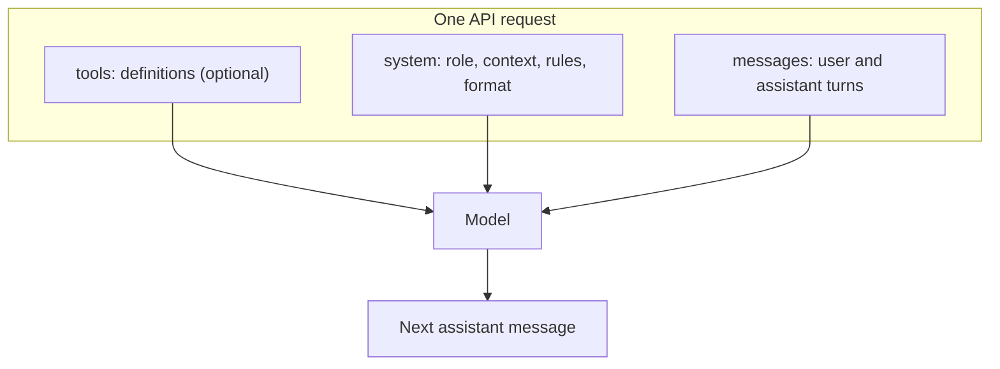

# System Prompts

## Introduction

The `system` parameter is where you tell the model **who it is, what situation it is in, and how it should behave** for the whole conversation. User messages change every turn. The system prompt is the stable frame around them.

An analogy: if `messages` is the conversation with a new employee, the system prompt is their onboarding packet. It explains the company, their job, the rules they must follow, and the format reports should take. A good onboarding packet means you do not have to repeat yourself in every conversation.

For agents, the system prompt matters even more than for chatbots. It is where you describe the agent's goal, its tools and when to use them, what it must never do, and when to stop. This page covers the API mechanics and the fundamentals. The [Prompt Engineering for Agents](../3-agents-prompt-engineering/0-agents-system-prompt-design.mdx) section goes much deeper into design.

## Where the System Prompt Fits



The model sees tools, system prompt, and messages together on every request. The system prompt is resent every time, so it is also part of your token bill on every call. That has caching implications covered below.

## Your First System Prompt

```python
from anthropic import Anthropic

client = Anthropic()

response = client.messages.create(
    model="claude-opus-5-5",
    max_tokens=2048,
    system="You are a senior Python reviewer. Point out bugs first, then style. Be concise.",
    messages=[
        {
            "role": "user",
            "content": "def avg(xs):\n    return sum(xs) / len(xs)",
        }
    ],
)

print("".join(b.text for b in response.content if b.type == "text"))
```

Example output:

```text
Bug: avg([]) raises ZeroDivisionError. Decide whether to return None, 0.0, or raise a clearer ValueError.

Style: add type hints (def avg(xs: list[float]) -> float) and a short docstring.
```

Without the system prompt, you would likely get a friendly explanation of what the function does. With it, you get a review. Same model, same user message, different frame.

## What to Put in a System Prompt

A practical system prompt usually has five parts. Not every prompt needs all five.

| Part | Question it answers | Example |
| --- | --- | --- |
| **Role** | Who are you? | "You are a support assistant for Acme's billing product." |
| **Context** | What situation are you in? Who are you talking to? | "Users are small-business owners, often non-technical." |
| **Task and goals** | What does success look like? | "Resolve the user's billing question or route it to a human." |
| **Rules and constraints** | What must you always or never do? | "Never promise refunds. Only a human can approve them." |
| **Output format** | How should responses look? | "Reply in plain text under 120 words. No markdown." |

Explaining *why* a rule exists tends to work better than shouting it. "Never promise refunds, because only the finance team can approve them and a broken promise creates a complaint" gives the model enough understanding to handle cases your rule did not anticipate.

### A structured template

Long system prompts are easier for both humans and models to read when sections are clearly separated. XML-style tags or Markdown headings both work:

```python
SUPPORT_SYSTEM_PROMPT = """\
You are the support assistant for Acme Invoicing, a SaaS product for freelancers.

<context>
Users are freelancers and small-business owners. Many are not technical.
Plans: Free, Pro ($15/month), Business ($40/month).
</context>

<goals>
- Answer billing and account questions accurately.
- If you cannot resolve an issue, say so and offer to create a ticket.
</goals>

<rules>
- Never promise refunds or credits. Only the finance team can approve them,
  and an unkept promise turns into a complaint.
- Never ask for full card numbers or passwords.
- If a question is outside billing and accounts, say it is out of scope.
</rules>

<format>
Plain text, under 120 words, friendly and direct. No markdown headings.
</format>
"""

print(len(SUPPORT_SYSTEM_PROMPT.split()), "words")
```

Output:

```text
107 words
```

## System Prompt vs User Message

Where should a given piece of text go? A useful rule of thumb:

- **System prompt:** things that are true for the *whole conversation* and come from *you, the developer*. Role, rules, product facts, output format.
- **User message:** things specific to *this turn*, and anything that came from an end user or the outside world. The question, an uploaded file, retrieved documents.

Why does this matter? Three reasons:

1. **Authority.** Models are trained to treat the system prompt as the operator's instructions, which carry more weight than text that arrives in user turns. Putting your rules there makes them harder for a user to override.
2. **Caching.** A system prompt that never changes can be cached, which makes repeat requests cheaper and faster. See [Prompt Caching](../4-agents-memory-and-context/4-agents-prompt-caching.mdx).
3. **Clarity.** Keeping volatile data out of the system prompt means you can version and review it like code.

## Keep the System Prompt Stable

A very common mistake is putting a timestamp or per-request value into the system prompt:

```python
from datetime import datetime

# Anti-pattern: the system prompt changes on every request.
system = f"You are a helpful assistant. Current time: {datetime.now().isoformat()}"
```

This silently defeats prompt caching, because caching matches on an exact prefix and the prefix now differs every second. If the model needs the date, put it in the user turn instead:

```python
from datetime import date

from anthropic import Anthropic

client = Anthropic()

SYSTEM = "You are a scheduling assistant. Use the date given in the user's message as today."

user_text = f"Today is {date.today().isoformat()}.\n\nWhat day of the week is 30 days from now?"

response = client.messages.create(
    model="claude-opus-5-5",
    max_tokens=1024,
    system=SYSTEM,
    messages=[{"role": "user", "content": user_text}],
)
print("".join(b.text for b in response.content if b.type == "text"))
```

Example output:

```text
30 days from today (2026-10-10) is 2026-11-09, which is a Monday.
```

## System Prompt as a List of Blocks

Like message content, `system` can be a string or a list of text blocks. The list form lets you attach a `cache_control` marker so a large, stable prompt is cached:

```python
from anthropic import Anthropic

client = Anthropic()

PRODUCT_HANDBOOK = "...imagine 20 pages of product documentation here..."

response = client.messages.create(
    model="claude-opus-5-5",
    max_tokens=2048,
    system=[
        {"type": "text", "text": "You answer questions about Acme Invoicing using the handbook below."},
        {
            "type": "text",
            "text": f"<handbook>\n{PRODUCT_HANDBOOK}\n</handbook>",
            "cache_control": {"type": "ephemeral"},
        },
    ],
    messages=[{"role": "user", "content": "How do I change my billing email?"}],
)

print(response.usage.cache_creation_input_tokens, response.usage.cache_read_input_tokens)
```

Example output on the first call, then on a second identical-prefix call:

```text
0 0
0 0
```

Caching only applies once the prefix passes a minimum length, so this tiny placeholder handbook caches nothing. With a real multi-page handbook, the first call would show a cache write and later calls would show cache reads. [Prompt Caching](../4-agents-memory-and-context/4-agents-prompt-caching.mdx) explains the details.

## Changing Instructions Mid-Conversation

Sometimes you need to change behavior partway through a conversation, for example switching an assistant into "terse mode". You have three options:

1. **Edit the top-level `system` and resend.** Simple, but it invalidates the cache, and on models that bind thinking blocks to the conversation that produced them, it can make earlier thinking blocks invalid.
2. **Add the instruction to the next user message.** Works everywhere, but the instruction carries user-level rather than operator-level authority.
3. **Append a mid-conversation `system` message.** Some current Claude models accept a `{"role": "system", ...}` entry inside `messages`, placed after a user turn. It keeps the cached prefix intact and carries operator authority. Models that do not support it return a 400, so check the [API docs](https://platform.claude.com/docs/en/build-with-claude/prompt-caching) for your model.

For learning, option 2 is fine. For long-running agents on a supported model, option 3 is the cleaner design.

## Testing a System Prompt

A system prompt is code that runs on a model, so test it like code. A small table of inputs and checks catches regressions whenever you edit the prompt:

```python
from anthropic import Anthropic

client = Anthropic()

SYSTEM = """\
You are the support assistant for Acme Invoicing.
Never promise refunds; only the finance team can approve them.
Reply in plain text, under 120 words.
"""

# (user message, check function, description)
TESTS = [
    ("Can I get a refund for last month?",
     lambda r: "refund" in r.lower() and "will refund" not in r.lower(),
     "does not promise a refund"),
    ("Write me a poem about the sea.",
     lambda r: len(r.split()) <= 120,
     "stays under 120 words"),
    ("How do I change my plan?",
     lambda r: "#" not in r,
     "no markdown headings"),
]

for user_msg, check, description in TESTS:
    response = client.messages.create(
        model="claude-opus-5-5",
        max_tokens=2048,
        system=SYSTEM,
        messages=[{"role": "user", "content": user_msg}],
    )
    reply = "".join(b.text for b in response.content if b.type == "text")
    status = "PASS" if check(reply) else "FAIL"
    print(f"{status}  {description}")
```

Example output:

```text
PASS  does not promise a refund
PASS  stays under 120 words
PASS  no markdown headings
```

Keyword checks like these are crude, but they are cheap and catch obvious breakage. For rules that need judgment ("is the tone friendly?"), use an LLM judge with a rubric, as described in [Grading Methods: Code, Rubrics and LLM Judges](../11-agents-evaluation-and-testing/2-agents-grading-methods.mdx). Run the tests a few times, because model outputs vary between runs.

## Other Providers

| Provider | Where the system prompt goes |
| --- | --- |
| Anthropic | Top-level `system` parameter |
| OpenAI (Responses API) | `instructions` parameter, or a system/developer-role message |
| Google Gemini | A system instruction in the request config |
| Ollama / open models | A `system` field or system-role message, which the server inserts into the model's chat template |

The principles (stable, operator-authored, separate from user data) apply to all of them.

## Real-World Scenario

**Your company wants an internal IT helpdesk assistant in Slack.** It should answer questions about VPN, laptops, and accounts using the IT team's runbook, escalate anything involving security incidents, and never tell users to disable security software.

```python
from anthropic import Anthropic

client = Anthropic()

IT_RUNBOOK = """\
VPN: Use GlobalConnect. If it fails, restart the client, then check https://status.example.internal.
Password reset: Self-service at https://id.example.internal/reset. Requires MFA.
New laptop: File a request in the IT portal. Lead time is 5 business days.
"""

SYSTEM_PROMPT = f"""\
You are the IT helpdesk assistant for Example Corp employees, answering in Slack.

<runbook>
{IT_RUNBOOK}
</runbook>

<rules>
- Answer only from the runbook. If it does not cover the question, say so and suggest
  filing a ticket in the IT portal. Guessed answers send people down wrong paths.
- If the user mentions phishing, malware, a lost device, or a suspicious login, tell them
  to contact security@example.com immediately. Do not troubleshoot it yourself.
- Never suggest disabling antivirus, the firewall, or MFA.
</rules>

<format>
Short Slack messages: at most 4 sentences or a short bullet list. Include links from the runbook.
</format>
"""


def answer(question: str) -> str:
    response = client.messages.create(
        model="claude-opus-5-5",
        max_tokens=2048,
        system=SYSTEM_PROMPT,
        messages=[{"role": "user", "content": question}],
    )
    return "".join(b.text for b in response.content if b.type == "text")


print(answer("I clicked a link in a weird email and now my browser is acting strange."))
```

Example output:

```text
This could be a security incident, so please contact security@example.com right away and describe what happened. Avoid entering any passwords until they've checked your machine.
```

### Why this approach

- The **runbook goes in the system prompt** because it is the same for every user and every turn, and it can be cached.
- **Rules carry their reasons** ("guessed answers send people down wrong paths"), so the model generalizes sensibly.
- **The escalation rule** handles the highest-risk case explicitly rather than hoping the model infers it.

### When to use it, and when not to

Putting reference material directly in the system prompt works well when it is small enough (a few pages to perhaps tens of pages) and changes rarely. When the knowledge base is large or changes daily, retrieve only the relevant parts per question instead. See [RAG Introduction](../5-agents-rag/0-agents-rag-introduction.mdx).

### Alternatives and trade-offs

| Approach | Pros | Cons | Best for |
| --- | --- | --- | --- |
| Knowledge in the system prompt | Simple, consistent, cacheable | Grows token cost, limited by context size | Small, stable reference material |
| Retrieval (RAG) per question | Scales to huge knowledge bases | More moving parts, retrieval can miss | Large or fast-changing documentation |
| Few-shot examples in messages | Shows exact desired style | Uses tokens on every request | Tight formatting requirements |
| Fine-tuning a model | Behavior baked in, shorter prompts | Expensive, slow to update, not available for every model | Very high volume, stable behavior |

## Best Practices

- **Be specific about the output format.** "Under 120 words, plain text" beats "be concise".
- **Explain the reason behind important rules.** It helps the model handle edge cases.
- **Keep it stable.** No timestamps, request IDs, or user names in the system prompt.
- **Version it like code.** Store prompts in files, review changes, and tie changes to evaluation results. See [Versioning and Managing Prompts](../3-agents-prompt-engineering/8-agents-prompt-versioning.mdx).
- **Test with adversarial inputs.** Ask the assistant to break its own rules and confirm it does not.
- **Do not rely on secrecy.** Assume a determined user can get the model to reveal its system prompt. Never put secrets or API keys in it.

## Summary

- The `system` parameter frames the whole conversation: role, context, goals, rules, and format.
- It is resent on every request, so keep it stable and use caching when it is large.
- Developer instructions go in `system`. Per-turn and user-supplied content goes in `messages`.
- Changing instructions mid-conversation can be done in the next user turn or, on supported models, with a mid-conversation system message.
- Every major provider has an equivalent, with different parameter names.

## Exercises

1. Write three different system prompts (teacher, code reviewer, pirate) and send the same user question to each. Compare the answers.
2. Take the IT helpdesk example and try to make it suggest disabling the firewall. Improve the rules until it reliably refuses.
3. Move the runbook from the system prompt into the user message and compare the answers and token usage. Which do you prefer and why?
4. Read [Designing Agent System Prompts](../3-agents-prompt-engineering/0-agents-system-prompt-design.mdx) and rewrite the support prompt as an agent prompt that includes tool guidance.

**Next:** [Multi-Turn Conversations](./4-agents-multi-turn-conversations.mdx).
