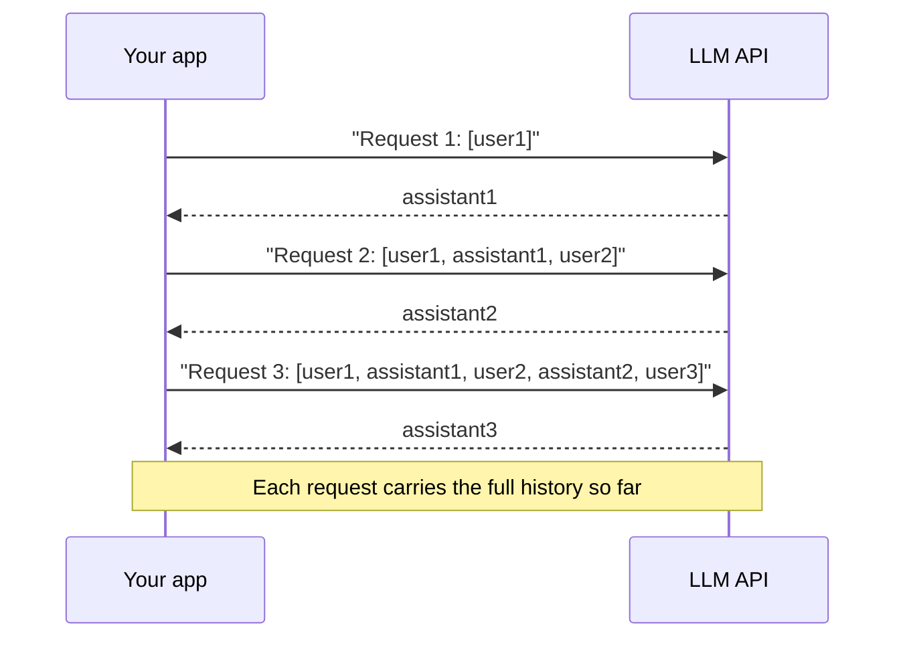

# Multi-Turn Conversations

## Introduction

Chat apps make it look like the model remembers you. It does not. LLM APIs are **stateless**: each request is independent, and the only "memory" is the message history your code sends along with it.

That has big consequences for agents:

- **You own the history.** Your code decides what the model remembers, what it forgets, and where the conversation is stored.
- **History costs money.** Every turn resends every earlier turn, so a long conversation gets more expensive with each message.
- **History bugs are behavior bugs.** Drop a message and the model "forgets". Corrupt the order and you get a 400 error.

An analogy: talking to the model is like talking to someone with no short-term memory who reads a transcript before every reply. You hand them the transcript each time. If the transcript is wrong, so is the reply. If it gets very long, reading it takes longer and costs more.

## How a Conversation Grows



Request 3 pays for input tokens covering everything before it. Over a long session, total input tokens grow roughly with the square of the number of turns. This is why [Prompt Caching](../4-agents-memory-and-context/4-agents-prompt-caching.mdx) and [Compaction and Summarization](../4-agents-memory-and-context/2-agents-compaction-and-summarization.mdx) are so important for agents.

## A Minimal Chat Loop

Here is a working terminal chatbot in about 25 lines:

```python
from anthropic import Anthropic

client = Anthropic()
SYSTEM = "You are a friendly Python tutor. Keep answers under 100 words."

messages: list[dict] = []

while True:
    user_input = input("You: ").strip()
    if user_input.lower() in {"quit", "exit"}:
        break

    messages.append({"role": "user", "content": user_input})

    response = client.messages.create(
        model="claude-opus-5-5",
        max_tokens=2048,
        system=SYSTEM,
        messages=messages,
    )

    reply = "".join(b.text for b in response.content if b.type == "text")
    messages.append({"role": "assistant", "content": reply})
    print(f"Tutor: {reply}\n")
```

Example session:

```text
You: What's a list comprehension?
Tutor: A list comprehension builds a list in one expression: [x * 2 for x in nums] doubles every number in nums. You can add a filter too: [x for x in nums if x > 0].

You: Can you show the filter example with my doubling one combined?
Tutor: Sure: [x * 2 for x in nums if x > 0] keeps only positive numbers, then doubles them.

You: quit
```

The second answer works only because the first exchange is in `messages`. Comment out the line that appends the assistant reply and the tutor will no longer know what "my doubling one" means.

## A Reusable Conversation Class

Wrapping history in a class keeps the rules in one place: append the user turn, call the API, append the assistant turn, and roll back if the call fails.

```python
from dataclasses import dataclass, field

import anthropic
from anthropic import Anthropic


@dataclass
class Conversation:
    client: Anthropic
    system: str
    model: str = "claude-opus-5-5"
    max_tokens: int = 4096
    messages: list[dict] = field(default_factory=list)

    def send(self, text: str) -> str:
        self.messages.append({"role": "user", "content": text})
        try:
            response = self.client.messages.create(
                model=self.model,
                max_tokens=self.max_tokens,
                system=self.system,
                messages=self.messages,
            )
        except anthropic.APIError:
            # Roll back so a failed call doesn't leave two user turns in a row.
            self.messages.pop()
            raise

        reply = "".join(b.text for b in response.content if b.type == "text")
        self.messages.append({"role": "assistant", "content": reply})
        return reply

    @property
    def turns(self) -> int:
        return len(self.messages) // 2


chat = Conversation(client=Anthropic(), system="You are a concise travel planner.")
print(chat.send("I have 3 days in Lisbon in March."))
print(chat.send("Make day 2 focused on food."))
print("Turns so far:", chat.turns)
```

Example output:

```text
Day 1: Alfama and São Jorge Castle. Day 2: Belém and the riverside. Day 3: Sintra day trip.
Updated day 2: breakfast pastries in Belém, lunch at Time Out Market, an afternoon food tour in Mouraria, and dinner at a tasca in Bairro Alto.
Turns so far: 2
```

The rollback on error matters. Without it, a network failure leaves a dangling user message, and the user's retry creates two consecutive user turns that may confuse the model.

## Text-Only History vs Full Content History

The chat examples above store only the **text** of each reply. For a plain chatbot, that is a reasonable choice: it is compact, easy to store in a database, and easy to display.

Agents need more. When the model calls tools, you must append the **full `response.content`** (thinking blocks, tool_use blocks, and text) so the next request can include matching tool results:

```python
# Agent-style history: keep every block exactly as returned.
messages.append({"role": "assistant", "content": response.content})
```

| History style | Pros | Cons | Use for |
| --- | --- | --- | --- |
| Text only | Small, simple to store and display, safe to trim | Loses the model's earlier reasoning and tool calls | Plain chat without tools |
| Full `response.content` | Required for tool use, preserves reasoning across turns | Larger, contains provider-specific blocks | Agent loops |

:::caution
On current Claude models, thinking blocks are cryptographically bound to the exact conversation that produced them. If you keep full content history and then **edit or remove earlier turns**, replaying those thinking blocks can fail with a 400 error. Treat full-content histories as append-only. To shrink them, use server-side compaction or context editing, covered in [Context Editing](../4-agents-memory-and-context/3-agents-context-editing.mdx), rather than rewriting old turns yourself.
:::

## Keeping History Under Control

Long conversations eventually hit three limits: cost, latency, and the context window. You have several options.

### Option 1: Sliding window (text-only history)

Keep only the most recent N exchanges. Because the first message must be `user`, trim in user/assistant pairs:

```python
def trim_history(messages: list[dict], max_turns: int) -> list[dict]:
    """Keep the last `max_turns` user/assistant pairs. Assumes text-only history."""
    max_messages = max_turns * 2
    if len(messages) <= max_messages:
        return messages
    trimmed = messages[-max_messages:]
    # Guarantee we start on a user message.
    while trimmed and trimmed[0]["role"] != "user":
        trimmed = trimmed[1:]
    return trimmed


history = [
    {"role": "user", "content": "q1"}, {"role": "assistant", "content": "a1"},
    {"role": "user", "content": "q2"}, {"role": "assistant", "content": "a2"},
    {"role": "user", "content": "q3"}, {"role": "assistant", "content": "a3"},
]
print([m["content"] for m in trim_history(history, max_turns=2)])
```

Output:

```text
['q2', 'a2', 'q3', 'a3']
```

Simple and predictable, but the model completely forgets older facts ("my name is Alice" from turn 1).

### Option 2: Summarize old turns

Replace older turns with a short summary produced by a cheap model call, and keep recent turns verbatim:

```python
from anthropic import Anthropic

client = Anthropic()


def summarize_turns(old_messages: list[dict]) -> str:
    transcript = "\n".join(f"{m['role']}: {m['content']}" for m in old_messages)
    response = client.messages.create(
        model="claude-haiku-5-5",  # a small, fast model is enough for summaries
        max_tokens=2048,
        messages=[{
            "role": "user",
            "content": (
                "Summarize the key facts, decisions, and open questions from this "
                "conversation in under 120 words.\n\n"
                f"<transcript>\n{transcript}\n</transcript>"
            ),
        }],
    )
    return "".join(b.text for b in response.content if b.type == "text")


def compact(messages: list[dict], keep_recent_turns: int = 4) -> list[dict]:
    keep = keep_recent_turns * 2
    if len(messages) <= keep:
        return messages
    summary = summarize_turns(messages[:-keep])
    recent = messages[-keep:]
    first = {
        "role": "user",
        "content": f"<earlier_conversation_summary>\n{summary}\n</earlier_conversation_summary>\n\n"
                   + recent[0]["content"],
    }
    return [first] + recent[1:]
```

This keeps important facts at the cost of an extra API call and some loss of detail. The pattern is covered properly in [Compaction and Summarization](../4-agents-memory-and-context/2-agents-compaction-and-summarization.mdx).

### Option 3: Server-side compaction

Claude's API offers a beta compaction feature that summarizes earlier context on the server when a conversation gets long, returning a `compaction` block you keep in the history. It is designed for long agent sessions and is compatible with append-only history. Details are in the official [compaction docs](https://platform.claude.com/docs/en/build-with-claude/compaction).

### Option 4: Long-term memory outside the conversation

Store durable facts (user preferences, project decisions) in a database or file and inject only the relevant ones. See [Long-Term Memory](../4-agents-memory-and-context/5-agents-long-term-memory.mdx).

## Persisting Conversations

Web apps and agents that run across restarts need to save history. Plain dicts serialize directly to JSON. For full-content histories, convert SDK objects to dicts first:

```python
import json
from pathlib import Path

from anthropic import Anthropic

client = Anthropic()
store = Path("session_42.json")

messages = json.loads(store.read_text()) if store.exists() else []
messages.append({"role": "user", "content": "Remind me what we decided about the database?"})

response = client.messages.create(
    model="claude-opus-5-5",
    max_tokens=4096,
    messages=messages,
)

# to_dict() turns the response into plain JSON-compatible data.
messages.append({"role": "assistant", "content": response.to_dict()["content"]})
store.write_text(json.dumps(messages, indent=2))

print(f"Saved {len(messages)} messages to {store}")
```

Example output:

```text
Saved 6 messages to session_42.json
```

In production, store conversations in a database keyed by session ID, and record the model and system prompt version alongside them so you can reproduce behavior later. [Session Persistence](../4-agents-memory-and-context/10-agents-session-persistence.mdx) covers this in depth.

## Other Providers

- **OpenAI**'s Responses API can optionally store conversation state on the server and continue from a previous response ID, so you do not have to resend history yourself. That is convenient, but the provider then holds your data and controls truncation.
- **Gemini**'s SDKs offer chat helpers that keep a history list for you, and Google's newer Interactions API can also manage state server-side.
- **Ollama** and other local servers are stateless like the Messages API: you send the full list each time.

Managing history yourself is more work, but it is portable and gives you full control over what the model sees, which matters for agents.

## Real-World Scenario

**You are adding a support chat widget to a SaaS web app.** Thousands of users chat at once, conversations last 5 to 40 turns, and the backend runs on several stateless web servers behind a load balancer.

The design:

1. **Session store.** Each conversation lives in Redis or Postgres keyed by `session_id`. Any web server can handle any turn.
2. **Per-turn flow:** load history, append the user message, call the API, append the reply, save, respond.
3. **Text-only history** because this assistant has no tools. It is compact and easy to show in an admin panel.
4. **Window plus summary.** After 20 turns, older turns are summarized with a small model, and the summary is stored alongside the session.
5. **Prompt caching** on the large, stable system prompt (product facts), so the repeated prefix is cheap.

```python
import json

from anthropic import Anthropic

client = Anthropic()
SYSTEM = "You are Acme's support assistant. Answer billing and account questions concisely."

# Stand-in for Redis/Postgres. In production, use a real shared store.
SESSIONS: dict[str, str] = {}


def handle_chat_turn(session_id: str, user_text: str) -> str:
    history = json.loads(SESSIONS.get(session_id, "[]"))
    history.append({"role": "user", "content": user_text})

    response = client.messages.create(
        model="claude-opus-5-5",
        max_tokens=2048,
        system=SYSTEM,
        messages=history[-40:],  # hard cap: last 20 exchanges
    )
    reply = "".join(b.text for b in response.content if b.type == "text")

    history.append({"role": "assistant", "content": reply})
    SESSIONS[session_id] = json.dumps(history)
    return reply


print(handle_chat_turn("sess-1", "How do I download last month's invoice?"))
```

Example output:

```text
Go to Settings → Billing → Invoices, find last month's invoice, and click Download PDF.
```

Note that `history[-40:]` always starts on a `user` message here, because history always has an even length before the new user turn is appended.

### Why this approach

- **Stateless servers plus a shared store** scale horizontally, and a server restart loses nothing.
- **A hard cap** bounds worst-case cost and latency per request, even if a user chats for hours.
- **Text-only history** is appropriate because there are no tools, so nothing requires the full blocks.

### When to use it, and when not to

This design suits chat assistants. For agents that call tools and run many steps per user message, use full-content, append-only history and rely on caching and server-side compaction rather than trimming.

### Alternatives and trade-offs

| Approach | Pros | Cons | Best for |
| --- | --- | --- | --- |
| Full history, no trimming | Model sees everything | Cost and latency grow every turn, eventually overflows | Short sessions |
| Sliding window | Simple, bounded cost | Forgets old facts abruptly | Casual chat |
| Window plus summary | Bounded cost, keeps key facts | Extra calls, summary may drop details | Long support conversations |
| Server-side compaction | Little code, append-only friendly | Provider-specific, beta | Long agent sessions on Claude |
| Provider-managed state (stored responses) | Least code | Less control, data held by provider | Prototypes, simple apps |

## Common Mistakes

- **Forgetting to append the assistant reply.** The model then has no idea what it said.
- **Leaving a dangling user turn after an error.** Roll back or handle it before the next request.
- **Trimming so the history starts with `assistant`.** The first message must be `user`.
- **Rewriting earlier turns in a full-content agent history.** On current models this can invalidate thinking blocks. Keep agent histories append-only.
- **Storing history in process memory on a multi-server deployment.** The next request may hit a different server.
- **Ignoring growth.** Log `usage.input_tokens` per turn. If it climbs steadily, you need caching or compaction.

## Summary

- LLM APIs are stateless. Your code sends the full conversation on every request.
- A conversation class should append user and assistant turns together and roll back on failure.
- Plain chat can store text-only history. Agents must store full `response.content` and keep it append-only.
- Control growth with windows, summaries, server-side compaction, or external memory.
- Persist sessions in a shared store, keyed by session ID.

## Exercises

1. Add a `/reset` command to the chat loop that clears history, and a `/tokens` command that prints the last response's `usage`.
2. Run a 15-turn conversation and plot `usage.input_tokens` per turn. What shape does the curve have?
3. Implement the window-plus-summary design and test that a fact from turn 1 ("my name is Priya") survives to turn 30.
4. Save a conversation to JSON, restart your script, load it, and continue the conversation.

**Next:** [Streaming Responses](./5-agents-streaming.mdx). For a deeper treatment of history management, see [Short-Term Memory](../4-agents-memory-and-context/1-agents-short-term-memory.mdx).
