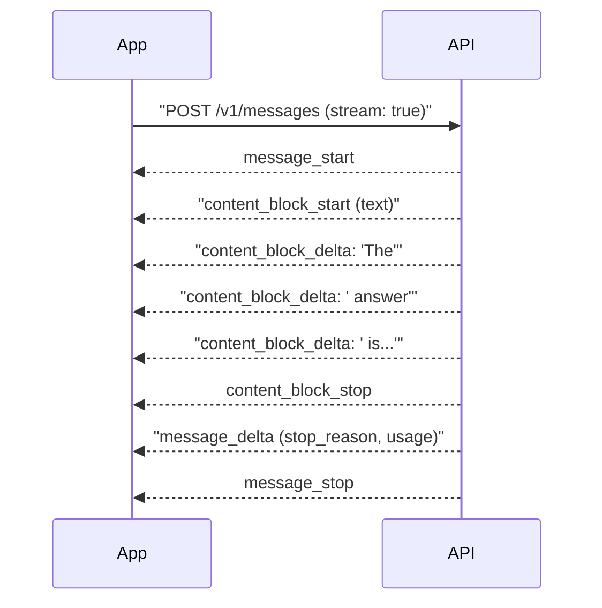

# Streaming Responses

## Introduction

Without streaming, your app sends a request and waits, showing nothing, until the model has written the entire answer. For a long answer, that can be many seconds of a blank screen, or minutes for an agent writing a large file.

With streaming, the API sends the response **as it is generated**, in small pieces. The total time is about the same, but the user sees the first words almost immediately. That is the difference between an app that feels alive and one that feels broken.

An analogy: a non-streaming request is like ordering a printed report and waiting for the courier. Streaming is like watching someone type the report in a shared document. You can start reading, and you can tell right away if it is going in the wrong direction.

Streaming matters for agents for two more reasons:

1. **Long outputs need it.** The Python SDK refuses non-streaming requests that it estimates could take longer than about ten minutes, because idle HTTP connections tend to get dropped. Streaming keeps the connection active.
2. **Progress visibility.** Agents can run for a while. Streaming lets you show what the agent is doing (thinking, calling a tool, writing) as it happens.

## How a Stream Flows

The API uses **server-sent events (SSE)**: one long HTTP response containing a sequence of small events.



| Event | When it fires | What it carries |
| --- | --- | --- |
| `message_start` | Once, at the start | Message ID, model, initial usage |
| `content_block_start` | When a new block begins | Block type: `text`, `thinking`, or `tool_use` |
| `content_block_delta` | Many times | A small chunk: `text_delta`, `thinking_delta`, or `input_json_delta` |
| `content_block_stop` | When a block ends | Block index |
| `message_delta` | Near the end | `stop_reason` and final output token usage |
| `message_stop` | Once, at the end | Nothing more to read |

You rarely handle these by hand. The SDK's helpers do most of the work.

## The Simplest Stream: `text_stream`

```python
from anthropic import Anthropic

client = Anthropic()

with client.messages.stream(
    model="claude-opus-5-5",
    max_tokens=4096,
    messages=[{"role": "user", "content": "Explain how a hash map works in one paragraph."}],
) as stream:
    for text in stream.text_stream:
        print(text, end="", flush=True)
print()
```

Example output (appears gradually in the terminal):

```text
A hash map stores key-value pairs in an array of buckets. When you insert a key, a hash function turns it into a number, which is mapped to a bucket index; the value is stored there. Lookups repeat the same hash calculation to jump straight to the right bucket, giving average O(1) time. When two keys land in the same bucket (a collision), the map stores both, typically in a small list or by probing for another slot, and it resizes the array when it gets too full to keep operations fast.
```

Two details:

- `flush=True` makes Python print each chunk immediately instead of buffering it.
- `text_stream` yields **only text**. Thinking and tool-use chunks are skipped, which is usually what you want for display.

## Getting the Complete Message

After streaming, you usually still need the full `Message` object: to check `stop_reason`, record `usage`, and append the response to history. `get_final_message()` gives you exactly what a non-streaming call would have returned:

```python
from anthropic import Anthropic

client = Anthropic()

with client.messages.stream(
    model="claude-opus-5-5",
    max_tokens=4096,
    messages=[{"role": "user", "content": "List 3 tips for writing clean functions."}],
) as stream:
    for text in stream.text_stream:
        print(text, end="", flush=True)
    final = stream.get_final_message()

print("\n---")
print("stop_reason:", final.stop_reason)
print("output tokens:", final.usage.output_tokens)
```

Example output:

```text
1. Do one thing: a function should have a single, clear responsibility.
2. Name it for what it returns or does, like parse_invoice or send_email.
3. Keep it short; if you need comments to separate sections, split it up.
---
stop_reason: end_turn
output tokens: 112
```

:::tip
A good default for long or agentic requests is to **always stream and call `get_final_message()`**, even if you do not display partial output. You get protection from timeouts with no extra event-handling code.
:::

```python
from anthropic import Anthropic

client = Anthropic()


def create_long(**kwargs):
    """Drop-in replacement for messages.create that streams under the hood."""
    with client.messages.stream(**kwargs) as stream:
        return stream.get_final_message()


report = create_long(
    model="claude-opus-5-5",
    max_tokens=64000,
    messages=[{"role": "user", "content": "Write a detailed onboarding guide for a new backend engineer."}],
)
print(report.stop_reason, report.usage.output_tokens)
```

Example output:

```text
end_turn 5321
```

## Handling Different Block Types

When you need more than text (for example, to show a "Thinking..." indicator or display tool calls as they form), iterate over the stream's events:

```python
from anthropic import Anthropic

client = Anthropic()

with client.messages.stream(
    model="claude-opus-5-5",
    max_tokens=16000,
    thinking={"type": "adaptive", "display": "summarized"},
    messages=[{"role": "user", "content": "Is 221 prime? Explain briefly."}],
) as stream:
    for event in stream:
        if event.type == "content_block_start":
            if event.content_block.type == "thinking":
                print("\n[thinking]")
            elif event.content_block.type == "text":
                print("\n[answer]")
        elif event.type == "content_block_delta":
            if event.delta.type == "thinking_delta":
                print(event.delta.thinking, end="", flush=True)
            elif event.delta.type == "text_delta":
                print(event.delta.text, end="", flush=True)
print()
```

Example output:

```text
[thinking]
Check small primes up to sqrt(221) ≈ 14.9. 221 / 13 = 17, so it factors.
[answer]
No. 221 = 13 × 17, so it is not prime.
```

`display: "summarized"` asks for a readable summary of the model's thinking. By default on current Claude models, thinking text is omitted. See [Reasoning, Thinking and Effort](./7-agents-thinking-and-effort.mdx).

## Measuring Time to First Token

The metric users actually feel is **time to first token (TTFT)**: how long until something appears. Measure it:

```python
import time

from anthropic import Anthropic

client = Anthropic()

start = time.perf_counter()
first_token_at = None

with client.messages.stream(
    model="claude-haiku-5-5",
    max_tokens=2048,
    messages=[{"role": "user", "content": "Give me a one-line motivational quote."}],
) as stream:
    for text in stream.text_stream:
        if first_token_at is None:
            first_token_at = time.perf_counter()
    final = stream.get_final_message()

end = time.perf_counter()
print(f"TTFT: {first_token_at - start:.2f}s  total: {end - start:.2f}s  "
      f"output tokens: {final.usage.output_tokens}")
```

Example output:

```text
TTFT: 0.61s  total: 0.94s  output tokens: 37
```

Your numbers will vary with model, effort level, prompt length, and network. Thinking happens before visible text, so higher effort levels tend to raise TTFT for the answer text. That is one reason latency-sensitive apps often use a smaller model or lower effort.

## Async Streaming

In web servers, use the async client so one long stream does not block other requests:

```python
import asyncio

from anthropic import AsyncAnthropic

client = AsyncAnthropic()


async def main() -> None:
    async with client.messages.stream(
        model="claude-opus-5-5",
        max_tokens=4096,
        messages=[{"role": "user", "content": "Write a limerick about Kubernetes."}],
    ) as stream:
        async for text in stream.text_stream:
            print(text, end="", flush=True)
        final = await stream.get_final_message()
    print("\nstop_reason:", final.stop_reason)


asyncio.run(main())
```

Example output:

```text
A cluster that wanted to scale
Spun up pods by the hundred, then stale,
The YAML grew long,
Half the probes were wrong,
But the autoscaler never would fail.
stop_reason: end_turn
```

## The Low-Level Option: `stream=True`

If you only need raw events and want minimal memory use, pass `stream=True` to `messages.create()`. You get an iterator of events, but **no accumulated final message**: you must build it yourself if you need it.

```python
from anthropic import Anthropic

client = Anthropic()

stream = client.messages.create(
    model="claude-opus-5-5",
    max_tokens=1024,
    messages=[{"role": "user", "content": "Say hi."}],
    stream=True,
)

for event in stream:
    if event.type == "content_block_delta" and event.delta.type == "text_delta":
        print(event.delta.text, end="", flush=True)
    elif event.type == "message_delta":
        print(f"\n[stop_reason={event.delta.stop_reason}]")
```

Example output:

```text
Hi there! How can I help you today?
[stop_reason=end_turn]
```

Prefer `messages.stream()` unless you have a specific reason.

## Errors During a Stream

A stream can fail before it starts (bad key, rate limit) or partway through (dropped connection, server overload). Partial text already shown to the user cannot be "unsent", so plan for it:

```python
import anthropic
from anthropic import Anthropic

client = Anthropic()

received: list[str] = []
try:
    with client.messages.stream(
        model="claude-opus-5-5",
        max_tokens=4096,
        messages=[{"role": "user", "content": "Write a short story about a robot gardener."}],
    ) as stream:
        for text in stream.text_stream:
            received.append(text)
            print(text, end="", flush=True)
except anthropic.APIConnectionError:
    print("\n[Connection lost. Showing partial response.]")
except anthropic.RateLimitError:
    print("\n[Rate limited. Please try again shortly.]")
except anthropic.APIStatusError as exc:
    print(f"\n[API error {exc.status_code}]")

print(f"\nReceived {len(''.join(received))} characters.")
```

Example output (successful run):

```text
Unit 7 had been built to weld car doors...
Received 1843 characters.
```

In a UI, mark interrupted answers clearly and offer a "retry" button. Do not save a partial answer to history as if it were complete. Retry strategy is covered in [Error Handling and Retries](./9-agents-api-error-handling.mdx).

## Streaming in Other Providers

- **OpenAI**: pass `stream=True` to `client.responses.create(...)` and iterate typed events (text deltas, completion events).
- **Gemini**: the SDKs provide streaming variants of their generate/interaction calls that yield chunks.
- **Ollama**: streaming works through both its native API and its Anthropic-compatible endpoint.

All of them use the same idea: an iterator of incremental chunks plus a final completion signal with usage.

## Real-World Scenario

**You are building a chat page for an internal documentation assistant.** Users complained that the old version showed a spinner for 8 to 15 seconds. You want words to appear within about a second, with a clean way to show errors.

The backend is FastAPI. It streams text to the browser as server-sent events:

```python
import json

import anthropic
from anthropic import AsyncAnthropic
from fastapi import FastAPI
from fastapi.responses import StreamingResponse

app = FastAPI()
client = AsyncAnthropic()

SYSTEM = "You answer questions about our internal engineering docs. Be concise."


@app.get("/ask")
async def ask(q: str) -> StreamingResponse:
    async def event_source():
        try:
            async with client.messages.stream(
                model="claude-opus-5-5",
                max_tokens=8192,
                system=SYSTEM,
                messages=[{"role": "user", "content": q}],
            ) as stream:
                async for text in stream.text_stream:
                    yield f"data: {json.dumps({'type': 'text', 'text': text})}\n\n"
                final = await stream.get_final_message()
            yield f"data: {json.dumps({'type': 'done', 'stop_reason': final.stop_reason})}\n\n"
        except anthropic.APIError as exc:
            yield f"data: {json.dumps({'type': 'error', 'message': str(exc)})}\n\n"

    return StreamingResponse(event_source(), media_type="text/event-stream")
```

On the browser side, an `EventSource` (or `fetch` with a stream reader) appends each `text` chunk to the page and switches to a final state on `done` or `error`. The full frontend pattern is in [Streaming Agent Output to a Frontend](../10-agents-integration/2-agents-streaming-to-frontend.mdx).

### Why this approach

- **Perceived latency drops** from the full generation time to the time to first token.
- **SSE is simple**: one HTTP response, works through most proxies, and browsers support it natively.
- **Typed events** (`text`, `done`, `error`) let the frontend distinguish normal completion from failure, so a broken stream is never mistaken for a complete answer.

### When to use it, and when not to

Stream whenever a person is waiting and the output is more than a sentence or two, and for any long agent request. Skip streaming for background jobs where nobody watches (batch classification, nightly reports). There, a simple call, or the Batch API at a discount, is easier to code and retry. Also be careful with streaming when you must **validate before showing** (for example, moderation): buffer and check first.

### Alternatives and trade-offs

| Approach | Pros | Cons | Best for |
| --- | --- | --- | --- |
| No streaming | Simplest code, easy retries | Long blank wait, timeouts on long outputs | Background jobs, short outputs |
| Stream + `get_final_message()` only | Timeout-safe, no UI work | No partial display | Long agent turns run in the background |
| SSE to browser | Simple, one-directional, native browser support | Server to client only | Chat UIs |
| WebSockets | Two-way, can interrupt or steer mid-stream | More infrastructure | Interactive agents with cancel or steer controls |

## Common Mistakes

- **Forgetting `flush=True`** in terminal demos, so output appears in bursts.
- **Using `text_stream` and then expecting tool calls.** It yields only text. Use `get_final_message()` to see all blocks.
- **Not checking `stop_reason` after streaming.** A stream can end with `max_tokens` or `refusal` just like a normal call.
- **Saving partial output as a complete answer** after a mid-stream error.
- **Using a sync client inside an async web server**, which blocks the event loop.
- **Buffering proxies.** Some reverse proxies buffer responses, which defeats streaming. Disable buffering for the SSE route.

## Summary

- Streaming sends the response incrementally, cutting perceived latency to the time to first token.
- `client.messages.stream()` with `text_stream` is the simplest way to show text as it arrives.
- `get_final_message()` gives you the complete `Message` for history, usage, and `stop_reason`.
- Stream long or agentic requests even when nothing is displayed, to avoid timeouts.
- Handle errors mid-stream explicitly and never save partial answers as complete.

## Exercises

1. Modify the `text_stream` example to print a `.` every 20 chunks instead of the text, as a progress indicator.
2. Measure TTFT for the same prompt at `output_config={"effort": "low"}` and `"high"`. What changes?
3. Build the FastAPI endpoint, then write a tiny HTML page with `EventSource` that displays the stream.
4. Simulate a mid-stream failure by breaking out of the loop after 10 chunks, and make your UI code mark the answer as incomplete.

**Next:** [Structured Outputs](./6-agents-structured-outputs.mdx).
