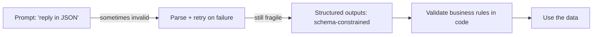

# Structured Outputs

## Introduction

Humans read prose. Programs need data. The moment an LLM's output feeds into code (a database insert, an API call, a routing decision, the next step of an agent) you need it in a predictable, machine-readable shape.

The naive approach is to ask nicely: "Respond only in JSON." That works most of the time, which is the problem. "Most of the time" means a pipeline that processes 10,000 documents a day crashes on a few of them: a stray sentence before the JSON, a trailing comma, a missing field, `"yes"` instead of `true`.

**Structured outputs** solve this at the API level. You provide a JSON Schema, and the model's output is **constrained to match it** during generation. You get valid, parseable JSON that matches your schema's structure, every time the request completes normally.

An analogy: asking for JSON in a prompt is like asking someone to fill in a form by writing on a blank sheet of paper. Structured outputs hand them the actual form, with boxes they cannot write outside of.

## The Progression of Approaches



Even with structured outputs, the last validation step stays. The schema guarantees **shape**. It cannot guarantee the extracted values are **correct**.

## Approach 1: Prompt-Only JSON (and Why It's Not Enough)

```python
import json

from anthropic import Anthropic

client = Anthropic()

response = client.messages.create(
    model="claude-opus-5-5",
    max_tokens=1024,
    messages=[{
        "role": "user",
        "content": (
            "Extract the name and email from this text. Respond with only JSON "
            'with keys "name" and "email".\n\n'
            "Text: Hi, I'm Dana Lee, reach me at dana@example.org."
        ),
    }],
)

text = "".join(b.text for b in response.content if b.type == "text")
try:
    print(json.loads(text))
except json.JSONDecodeError:
    print("Model did not return valid JSON:", repr(text[:80]))
```

Example output:

```text
{'name': 'Dana Lee', 'email': 'dana@example.org'}
```

It usually works. But the code needs a fallback path, and the model might wrap the JSON in a Markdown code fence or add a friendly sentence. For anything automated, use the real feature.

## Approach 2: Structured Outputs with a JSON Schema

Pass a schema in `output_config.format`. The response's text block is then guaranteed to be JSON matching it:

```python
import json

from anthropic import Anthropic

client = Anthropic()

contact_schema = {
    "type": "object",
    "properties": {
        "name": {"type": "string"},
        "email": {"type": "string"},
        "company": {"type": ["string", "null"]},
    },
    "required": ["name", "email", "company"],
    "additionalProperties": False,
}

response = client.messages.create(
    model="claude-opus-5-5",
    max_tokens=1024,
    messages=[{
        "role": "user",
        "content": "Extract contact details: Hi, I'm Dana Lee, reach me at dana@example.org.",
    }],
    output_config={"format": {"type": "json_schema", "schema": contact_schema}},
)

text = next(b.text for b in response.content if b.type == "text")
contact = json.loads(text)
print(contact)
```

Output:

```text
{'name': 'Dana Lee', 'email': 'dana@example.org', 'company': None}
```

Notes on the schema:

- **`additionalProperties: False` is required** on every object. The model cannot invent extra keys.
- **Optional values are modeled as nullable** (`["string", "null"]`) and still listed in `required`. That way your code always gets the key and checks for `None`.
- No prompt instruction about JSON is needed. You still describe *what* to extract.

## Approach 3: Pydantic Models with `messages.parse()`

Writing JSON Schema by hand gets tedious. The SDK's `messages.parse()` accepts a Pydantic model, builds the schema for you, and returns a validated Python object:

```python
from typing import Literal

from anthropic import Anthropic
from pydantic import BaseModel


class SupportTicket(BaseModel):
    category: Literal["billing", "bug", "feature_request", "account", "other"]
    priority: Literal["low", "medium", "high"]
    summary: str
    customer_email: str | None
    mentions_refund: bool


client = Anthropic()

response = client.messages.parse(
    model="claude-opus-5-5",
    max_tokens=2048,
    messages=[{
        "role": "user",
        "content": (
            "Classify this support ticket.\n\n<ticket>\n"
            "From: sam@shop.io\nI was charged twice for March and need one charge reversed ASAP.\n"
            "</ticket>"
        ),
    }],
    output_format=SupportTicket,
)

ticket = response.parsed_output  # a SupportTicket instance
print(ticket)
print(ticket.category, ticket.priority, ticket.mentions_refund)
```

Output:

```text
category='billing' priority='high' summary='Customer was double-charged for March and wants one charge reversed.' customer_email='sam@shop.io' mentions_refund=True
billing high True
```

Why Pydantic is the recommended default in Python:

- **`Literal` types become enums** in the schema, which is exactly what you want for classification. The model cannot answer `"Billing "` or `"payments"`.
- **You get real objects with types**, so your editor autocompletes `ticket.priority` and type checkers catch mistakes.
- **One definition** serves as the schema, the parser, and documentation.

## Schema Features and Limits

Structured outputs support most of JSON Schema, with some restrictions (as of late 2026; check the [structured outputs docs](https://platform.claude.com/docs/en/build-with-claude/structured-outputs) for updates):

| Supported | Not supported in the constrained schema |
| --- | --- |
| object, array, string, integer, number, boolean, null | Recursive schemas |
| `enum`, `const`, `anyOf`, `allOf`, `$ref` / `$defs` | Numeric constraints like `minimum`, `maximum` |
| String formats: `date`, `date-time`, `email`, `uri`, `uuid`, and more | String length constraints like `minLength` |
| `additionalProperties: false` | `additionalProperties` set to anything else |

The Python and TypeScript SDKs handle unsupported constraints gracefully: they remove them from the schema sent to the API and **validate them client-side** after the response arrives. So a Pydantic `Field(ge=0, le=100)` still gets enforced, just not during generation.

:::note
The first request with a new schema has a little extra latency while the schema is compiled. The compiled schema is then cached for a while, so later requests with the same schema are fast. Avoid generating a slightly different schema for every request.
:::

## Extracting Lists and Nested Data

Real extraction usually involves nested structures. Pydantic models compose naturally:

```python
from datetime import date

from anthropic import Anthropic
from pydantic import BaseModel


class LineItem(BaseModel):
    description: str
    quantity: int
    unit_price: float


class Invoice(BaseModel):
    vendor: str
    invoice_number: str
    invoice_date: date
    currency: str
    line_items: list[LineItem]
    total: float


INVOICE_TEXT = """\
ACME Supplies Ltd.   Invoice #INV-2291   Date: 2026-09-14
2 x USB-C dock @ 89.00
5 x HDMI cable @ 12.50
Total due: EUR 240.50
"""

client = Anthropic()
response = client.messages.parse(
    model="claude-opus-5-5",
    max_tokens=4096,
    messages=[{"role": "user", "content": f"Extract the invoice.\n\n<invoice>\n{INVOICE_TEXT}</invoice>"}],
    output_format=Invoice,
)

inv = response.parsed_output
print(inv.vendor, inv.invoice_number, inv.invoice_date, inv.currency)
for item in inv.line_items:
    print(f"  {item.quantity} x {item.description} @ {item.unit_price}")
print("Total:", inv.total)
```

Output:

```text
ACME Supplies Ltd. INV-2291 2026-09-14 EUR
  2 x USB-C dock @ 89.0
  5 x HDMI cable @ 12.5
Total: 240.5
```

## Validate the Meaning, Not Just the Shape

The schema guarantees `total` is a number. It does not guarantee it is the *right* number. Add cheap checks in code for anything that matters:

```python
def check_invoice(inv) -> list[str]:
    """Return a list of problems. Empty list means the invoice looks consistent."""
    problems = []
    computed = round(sum(i.quantity * i.unit_price for i in inv.line_items), 2)
    if abs(computed - inv.total) > 0.01:
        problems.append(f"Line items sum to {computed}, but total says {inv.total}")
    if not inv.line_items:
        problems.append("No line items extracted")
    if len(inv.currency) != 3:
        problems.append(f"Currency '{inv.currency}' is not a 3-letter code")
    return problems
```

For the example invoice, `check_invoice(inv)` returns an empty list, since 2 x 89.00 + 5 x 12.50 = 240.50. When it does not, route the document to a human instead of trusting it.

## When the Output Can Still Fail

Structured outputs guarantee the schema **when generation completes normally**. Two cases break that guarantee, and your code should check for them:

```python
from anthropic import Anthropic
from pydantic import BaseModel


class Sentiment(BaseModel):
    label: str
    confidence: float


client = Anthropic()

response = client.messages.parse(
    model="claude-opus-5-5",
    max_tokens=1024,
    messages=[{"role": "user", "content": "Sentiment of: 'The update broke everything.'"}],
    output_format=Sentiment,
)

if response.stop_reason == "max_tokens":
    raise RuntimeError("Output was truncated, so the JSON may be incomplete. Raise max_tokens.")
if response.stop_reason == "refusal":
    raise RuntimeError("The model declined. The output may not match the schema.")

print(response.parsed_output)
```

Output:

```text
label='negative' confidence=0.95
```

1. **`max_tokens`**: The JSON was cut off. Give enough room, remembering that thinking also consumes `max_tokens`.
2. **`refusal`**: The model declined for safety reasons and the output may not match the schema.

## Structured Tool Inputs: `strict: true`

Agents produce structured data in a second place: **tool call arguments**. Setting `"strict": True` on a tool definition applies the same schema guarantee to the arguments the model passes to that tool:

```python
tools = [{
    "name": "create_ticket",
    "description": "Create a support ticket in the helpdesk system.",
    "strict": True,
    "input_schema": {
        "type": "object",
        "properties": {
            "title": {"type": "string"},
            "priority": {"type": "string", "enum": ["low", "medium", "high"]},
        },
        "required": ["title", "priority"],
        "additionalProperties": False,
    },
}]
```

Use **`output_config.format`** when you want the model's *final answer* in a shape. Use **`strict` tools** when you want the model to *take an action* with valid arguments. You can use both in one request. Tools are covered fully in [Tool Input Schemas](../2-agents-tool-use/2-agents-tool-input-schemas.mdx).

:::caution
Older tutorials often forced JSON by using `tool_choice` to require a specific "fake" tool, or by prefilling the assistant message with `{`. On current Claude models, forced `tool_choice` (`any` or a named tool) and assistant prefill both return 400 errors. Use `output_config.format` or `messages.parse()` instead.
:::

## Other Providers

The idea is the same everywhere, with different spellings (as of late 2026):

| Provider | How you request structured output |
| --- | --- |
| Anthropic | `output_config={"format": {"type": "json_schema", ...}}` or `client.messages.parse(output_format=Model)` |
| OpenAI | A JSON schema text format on the Responses API, or `client.responses.parse(text_format=Model)` with `output_parsed` |
| Gemini | A response schema plus JSON MIME type in the generation config |
| Ollama | A `format` parameter that accepts a JSON schema |

Libraries such as [Instructor](https://python.useinstructor.com/) and [Pydantic AI](https://ai.pydantic.dev/) wrap these differences behind a single Pydantic-first interface.

## Real-World Scenario

**Your finance team receives about 3,000 supplier invoices a month as PDFs and emails.** Today, two people retype them into the accounting system. You want to extract them automatically, with humans checking only the doubtful ones.

The pipeline:

1. **Extract** each invoice into the `Invoice` Pydantic model with `messages.parse()` (PDFs sent as `document` blocks, as shown in [Messages and Roles](./2-agents-messages-and-roles.mdx)).
2. **Check** the stop reason, then run `check_invoice()` business rules: totals add up, currency code valid, vendor known in the supplier table.
3. **Route**: clean invoices go straight into the accounting system's API. Invoices with problems go to a review queue with the problems listed.
4. **Measure**: track the share of invoices auto-approved and how often reviewers correct fields.

```python
def process_invoice(client, invoice_text: str) -> dict:
    response = client.messages.parse(
        model="claude-opus-5-5",
        max_tokens=8192,
        messages=[{"role": "user", "content": f"Extract the invoice.\n\n<invoice>\n{invoice_text}</invoice>"}],
        output_format=Invoice,
    )
    if response.stop_reason != "end_turn":
        return {"status": "review", "reason": f"stop_reason={response.stop_reason}"}

    invoice = response.parsed_output
    problems = check_invoice(invoice)
    if problems:
        return {"status": "review", "reason": "; ".join(problems), "data": invoice.model_dump(mode="json")}
    return {"status": "auto_approved", "data": invoice.model_dump(mode="json")}
```

Example result:

```text
{'status': 'auto_approved', 'data': {'vendor': 'ACME Supplies Ltd.', 'invoice_number': 'INV-2291', 'invoice_date': '2026-09-14', 'currency': 'EUR', 'line_items': [...], 'total': 240.5}}
```

### Why this approach

- **Schema-constrained output** removes an entire class of failures (unparseable JSON) so the remaining failures are about *content*, which your rules can catch.
- **Business-rule validation plus human review** puts people where the model is uncertain, instead of having them retype everything.
- **This is a workflow, not an agent.** The steps are fixed and known in advance. A predictable pipeline is cheaper, faster, and easier to audit. See [Agents vs Workflows](../0-agents-fundamentals/3-agents-vs-workflows.mdx).

### When to use it, and when not to

Use structured outputs whenever code consumes the model's output: extraction, classification, routing decisions, plans an agent will execute, and grades from an LLM judge. Do not use them for free-form text meant for people (emails, explanations). Forcing prose into JSON fields often makes it worse.

### Alternatives and trade-offs

| Approach | Pros | Cons | Best for |
| --- | --- | --- | --- |
| Prompt-only JSON + retry | Works with any model | Occasional invalid output, retry cost | Quick prototypes, models without schema support |
| Structured outputs (JSON schema) | Valid shape guaranteed on normal completion | Some schema features unsupported, first-use compile latency | Production extraction and classification |
| `messages.parse()` with Pydantic | Typed objects, client-side checks for extra constraints | Python/TypeScript-specific helper | Python services |
| Strict tool inputs | Valid arguments for actions | Only covers tool arguments | Agents calling tools |
| Traditional parsers (regex, templates) | Free, deterministic | Breaks when layouts vary | Fixed-format documents from a single source |

## Common Mistakes

- **Forgetting `additionalProperties: False`** in hand-written schemas. The request is rejected.
- **Making optional fields truly optional.** Prefer nullable-and-required, so your code always gets the key.
- **Trusting values because the shape is valid.** Validate totals, IDs, and dates against your own data.
- **Ignoring `stop_reason`.** Truncation and refusals can produce output that does not match the schema.
- **Using free-text fields where an enum belongs.** `Literal[...]` makes downstream code simpler and the output more consistent.
- **Using prefill or forced tool choice to get JSON** on current models. Both return errors. Use the structured outputs feature.

## Summary

- Structured outputs constrain generation to a JSON Schema so the output always parses when generation completes normally.
- Use `output_config.format` with a raw schema, or `client.messages.parse()` with a Pydantic model for typed results.
- Use `strict: True` on tools to get schema-valid tool arguments.
- Check `stop_reason` for `max_tokens` and `refusal`, and validate the meaning of values in code.
- OpenAI, Gemini, and Ollama offer equivalent features with different parameter names.

## Exercises

1. Build a `MeetingNotes` model with `attendees: list[str]`, `decisions: list[str]`, and `action_items` (each with `owner` and `due_date: date | None`), and extract it from a sample transcript.
2. Add a Pydantic constraint such as `Field(ge=0)` on a price and confirm the SDK enforces it client-side by giving the model text with a negative price.
3. Write a classifier for 100 short product reviews using a `Literal` sentiment label, and count how often each label appears.
4. Compare prompt-only JSON and structured outputs on 50 messy inputs. How many prompt-only responses failed to parse?

**Next:** [Reasoning, Thinking and Effort](./7-agents-thinking-and-effort.mdx).
