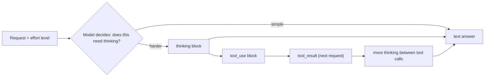

# Reasoning, Thinking and Effort

## Introduction

Early LLMs answered immediately: the first token of the answer was the first token generated. Modern models can **think first**. They generate internal reasoning (working through the problem, checking intermediate results, considering alternatives) and only then write the answer.

For agents this is a big deal. Deciding which tool to call next, noticing that a tool result contradicts an earlier assumption, or planning a multi-step change across several files all benefit from deliberate reasoning. Thinking is also not free: thinking tokens are billed as output tokens and add latency.

So the practical question is not "should the model think?" but **"how much thinking is this task worth?"** On current Claude models, the main dial for that is the **effort** parameter.

An analogy: effort is like telling a consultant how much time to spend. "Give me your gut call" (low) versus "take the time you need and double-check" (high). The same expert, the same question, different depth and different bill.

## How Thinking Fits into a Response



Current Claude models use **adaptive thinking**: the model decides per request (and between tool calls) whether and how much to think. Effort shifts that decision. Higher effort means it thinks more readily and at greater length. Lower effort means it skips thinking on easy problems and keeps reasoning shorter on hard ones.

## Thinking on Current Claude Models

As of late 2026, the default model `claude-opus-5-5` always uses adaptive thinking. You do not need to turn it on, and you cannot turn it off. You can omit the `thinking` parameter or pass `{"type": "adaptive"}`, which is equivalent:

```python
from anthropic import Anthropic

client = Anthropic()

response = client.messages.create(
    model="claude-opus-5-5",
    max_tokens=16000,
    thinking={"type": "adaptive"},  # same as omitting it on this model
    messages=[{
        "role": "user",
        "content": "A bat and a ball cost $1.10 total. The bat costs $1.00 more than the ball. "
                   "How much is the ball?",
    }],
)

for block in response.content:
    print(block.type, "->", getattr(block, "text", getattr(block, "thinking", ""))[:80])
print("output tokens:", response.usage.output_tokens)
```

Example output:

```text
thinking -> 
text -> The ball costs $0.05. If the ball is x, the bat is x + 1.00, so 2x + 1.00 = 1.10
output tokens: 214
```

Notice the thinking block is present but its text is empty. On current Claude models, the raw thinking text is **omitted by default**. You still pay for the thinking tokens (they are included in `output_tokens`), and the block carries a signature that the API uses when you send it back in an agent loop.

### Seeing a summary of the thinking

For debugging or showing progress in a UI, request a summarized view:

```python
from anthropic import Anthropic

client = Anthropic()

response = client.messages.create(
    model="claude-opus-5-5",
    max_tokens=16000,
    thinking={"type": "adaptive", "display": "summarized"},
    messages=[{"role": "user", "content": "Which is larger: 2^30 or 10^9? Answer in one line."}],
)

for block in response.content:
    if block.type == "thinking":
        print("THINKING:", block.thinking)
    elif block.type == "text":
        print("ANSWER:", block.text)
```

Example output:

```text
THINKING: 2^10 = 1024, so 2^30 = 1024^3 ≈ 1.074 × 10^9, which exceeds 10^9.
ANSWER: 2^30 (1,073,741,824) is larger than 10^9.
```

:::warning
Do not show raw or summarized thinking to end users as if it were a verified explanation. It is a working scratchpad, not a guaranteed faithful account of how the answer was produced. Use it for debugging and progress indicators.
:::

### Old patterns that now fail

Earlier Claude models used `thinking={"type": "enabled", "budget_tokens": N}` to set a fixed thinking budget. On current models that returns a 400 error. If you see `budget_tokens` in a tutorial, it is out of date for current models. Use effort instead.

## The Effort Parameter

Effort is set with `output_config`:

```python
from anthropic import Anthropic

client = Anthropic()

response = client.messages.create(
    model="claude-opus-5-5",
    max_tokens=16000,
    output_config={"effort": "low"},
    messages=[{"role": "user", "content": "Convert 72°F to Celsius."}],
)
print("".join(b.text for b in response.content if b.type == "text"))
print("output tokens:", response.usage.output_tokens)
```

Example output:

```text
72°F is about 22.2°C.
output tokens: 19
```

The levels, from least to most work:

| Level | Behavior | Typical use |
| --- | --- | --- |
| `low` | Most efficient. Often skips thinking on simple problems. | Simple, high-volume or latency-sensitive tasks, subagents |
| `medium` | Balanced. The default on Claude Opus 5.5 and Claude Haiku 5.5. | Most agentic tasks that need a balance of speed, cost, and quality |
| `high` | Spends as many tokens as the task needs. The default on most other models. | Complex reasoning, difficult coding |
| `xhigh` | Extended capability for long-horizon work | Long-running agentic and coding tasks |
| `max` | No constraint on token spending | The hardest problems, when evals show it helps |

Key facts about effort (from the [official effort docs](https://platform.claude.com/docs/en/build-with-claude/effort)):

- **It affects all output tokens**: thinking, the visible answer, and tool calls. Lower effort tends to mean fewer, terser tool calls.
- **It is a behavioral signal, not a hard budget.** At low effort, the model still thinks on a sufficiently difficult problem, just less.
- **Defaults differ by model.** Setting effort to the model's default is identical to omitting it. Set it explicitly so behavior does not change silently when you switch models.
- **Not every model supports every level.** Check the docs for the model you use.

### Leave room in `max_tokens`

Thinking counts toward `max_tokens`. At `high` effort and above, a small `max_tokens` can be used up by thinking, leaving a truncated answer (`stop_reason == "max_tokens"`). For high effort and agentic work, set a large `max_tokens` (for example 64,000) and use streaming:

```python
from anthropic import Anthropic

client = Anthropic()

with client.messages.stream(
    model="claude-opus-5-5",
    max_tokens=64000,
    output_config={"effort": "xhigh"},
    messages=[{"role": "user", "content": "Design a database schema for a multi-tenant invoicing app, with reasoning."}],
) as stream:
    final = stream.get_final_message()

print(final.stop_reason, final.usage.output_tokens)
```

Example output:

```text
end_turn 9874
```

## Per-Model Thinking Controls

Different current models expose slightly different thinking switches. As of late 2026:

| Model | Thinking | How to reduce thinking |
| --- | --- | --- |
| `claude-opus-5-5` | Adaptive, always on, cannot be disabled | Lower `effort` (default `medium`) |
| `claude-sonnet-5-5` | Adaptive, on by default | Lower `effort`, or `thinking={"type": "between_tools"}` at effort `high` or below to skip up-front thinking |
| `claude-haiku-5-5` | Adaptive, on by default | Lower `effort` (default `medium`), or `thinking={"type": "disabled"}` at effort `high` or below |

Sending an unsupported combination returns a 400 error with a message telling you what the model accepts. Model details change with new releases, so confirm in the [models overview](https://platform.claude.com/docs/en/about-claude/models/overview) before relying on a specific control.

## Thinking in Agent Loops

When a response contains both `thinking` and `tool_use` blocks, you must send the thinking block back **unmodified** along with the tool result. The simplest way to get this right is to always append the complete `response.content`:

```python
# Inside an agent loop, after `response = client.messages.create(...)`
messages.append({"role": "assistant", "content": response.content})  # includes thinking blocks
messages.append({"role": "user", "content": tool_results})          # all tool_result blocks
```

Two rules follow:

- **Never edit thinking blocks.** Their signatures are verified, and a modified block is rejected.
- **Keep the history append-only.** On current models, thinking blocks are bound to the conversation that produced them. Rewriting earlier turns can invalidate them. See [Multi-Turn Conversations](./4-agents-multi-turn-conversations.mdx).

Adaptive thinking also enables **interleaved thinking**: the model can think *between* tool calls, after reading each result. That is a large part of why reasoning models are better at agent tasks. The loop itself is covered in [Building a Manual Agent Loop](../2-agents-tool-use/3-agents-manual-agent-loop.mdx).

## Thinking vs Prompting for Reasoning

Before reasoning models, developers asked models to "think step by step" in the visible answer (chain-of-thought prompting). That still works with any model, but with built-in thinking:

- You usually **do not need** to ask for step-by-step reasoning in the answer. The model already reasons internally.
- If you want the visible answer to include a short justification (for auditors or users), ask for that explicitly, separately from thinking.
- If you need *less* reasoning, lower effort rather than prompting "don't think".

[Prompting for Reasoning](../3-agents-prompt-engineering/6-agents-reasoning-prompts.mdx) covers when explicit reasoning instructions still help.

## Finding the Right Effort: Run a Sweep

The right effort level depends on your task, not on general rules. The reliable way to choose is a small **effort sweep**: run the same test cases at each level and compare quality, tokens, and time.

```python
import time

from anthropic import Anthropic

client = Anthropic()

# Small labeled test set: (question, expected answer substring)
CASES = [
    ("What is 17 * 23? Reply with just the number.", "391"),
    ("Is 2027 a prime number? Reply yes or no.", "yes"),
    ("How many weekdays are there from Monday 2026-11-02 through Friday 2026-11-13 inclusive? "
     "Reply with just the number.", "10"),
]


def run_sweep(levels: list[str]) -> None:
    for level in levels:
        correct, tokens, start = 0, 0, time.perf_counter()
        for question, expected in CASES:
            r = client.messages.create(
                model="claude-opus-5-5",
                max_tokens=16000,
                output_config={"effort": level},
                messages=[{"role": "user", "content": question}],
            )
            answer = "".join(b.text for b in r.content if b.type == "text").lower()
            correct += expected in answer
            tokens += r.usage.output_tokens
        elapsed = time.perf_counter() - start
        print(f"{level:>6}: {correct}/{len(CASES)} correct, {tokens:>5} output tokens, {elapsed:5.1f}s")


run_sweep(["low", "medium", "high"])
```

Example output (illustrative, from one small run; your numbers will differ):

```text
   low: 3/3 correct,    95 output tokens,   3.1s
medium: 3/3 correct,   410 output tokens,   5.8s
  high: 3/3 correct,   980 output tokens,   9.4s
```

In this toy case, `low` is enough. Real sweeps need more cases (dozens at least), including the **hardest cases** you know about, because that is where higher effort earns its cost. [Agent Evaluation Introduction](../11-agents-evaluation-and-testing/0-agents-evaluation-introduction.mdx) shows how to build proper test sets.

:::tip
Changing the top-level effort between requests in one conversation invalidates prompt caching for that conversation. Pick an effort level per workload and keep it constant, or use the per-message effort feature on models that support it.
:::

## Other Providers

The same idea exists elsewhere under different names (as of late 2026; check each provider's docs):

| Provider | Control |
| --- | --- |
| Anthropic | `output_config={"effort": ...}` plus `thinking` mode |
| OpenAI | A reasoning effort setting on reasoning models (for example `reasoning={"effort": "low"}` in the Responses API) |
| Gemini | A thinking configuration with a thinking level |
| Open models (Ollama, vLLM) | Model-specific: some reasoning models expose a "think" switch or reasoning level |

## Real-World Scenario

**Your team runs an automated pull-request reviewer.** It processes about 400 PRs a day. Most are small (dependency bumps, copy changes). A few are large refactors where a missed bug is expensive. Latency matters less than catching real problems, but the bill has started to attract attention.

The strategy:

1. **Classify each PR cheaply** by size and risk using metadata (files touched, lines changed, whether it touches `auth/` or `payments/`). No model needed.
2. **Pick effort per class:** `low` for trivial PRs, `medium` for normal ones, `xhigh` for high-risk ones.
3. **Re-run on doubt:** if the reviewer flags something at `low` or `medium`, or a test fails in CI, re-run that PR at a higher effort.
4. **Sweep quarterly** on a set of past PRs with known bugs, and after any model upgrade.

```python
def choose_effort(lines_changed: int, files: list[str]) -> str:
    risky_paths = ("auth/", "payments/", "migrations/")
    if any(f.startswith(risky_paths) for f in files):
        return "xhigh"
    if lines_changed <= 20:
        return "low"
    return "medium"


print(choose_effort(8, ["README.md"]))
print(choose_effort(240, ["api/orders.py", "api/serializers.py"]))
print(choose_effort(35, ["payments/refunds.py"]))
```

Output:

```text
low
medium
xhigh
```

### Why this approach

- **Effort follows risk.** Tokens go where a mistake is expensive, not evenly across every PR.
- **Same model throughout.** Changing effort is a smaller, safer change than switching models, and prompts stay the same.
- **The re-run policy** recovers most of the quality of running everything at high effort, while paying for high effort only where needed. Anthropic's cost guidance describes this pattern for workloads that have a failure signal like tests.

### When to use it, and when not to

Per-request effort routing pays off when tasks vary widely in difficulty and you can tell which is which cheaply. If all requests are similar, pick one level from a sweep and keep it. Do not build routing before you have measured that different levels actually change quality on your workload.

### Alternatives and trade-offs

| Approach | Pros | Cons | Best for |
| --- | --- | --- | --- |
| One effort level for everything | Simple, cache-friendly | Overpays on easy tasks or underperforms on hard ones | Uniform workloads |
| Effort routing by task type | Spend follows difficulty | Needs a cheap, reliable classifier | Mixed workloads |
| Low first, re-run failures higher | Strong cost savings with a failure signal | Doubled latency on failures | Tasks with tests or validators |
| Smaller model instead of lower effort | Lower per-token price, faster | Lower capability ceiling, different behavior | High-volume simple tasks (see [Choosing the Right Model](./10-agents-model-selection.mdx)) |

## Common Mistakes

- **Using `budget_tokens`** on current models. It returns a 400. Use effort.
- **Trying to disable thinking on Opus 5.5.** It is always on. Lower effort instead.
- **A small `max_tokens` with high effort.** Thinking consumes the budget and the answer gets truncated.
- **Editing or dropping thinking blocks mid-loop.** Send `response.content` back exactly as received.
- **Assuming higher effort is always better.** On many tasks, quality plateaus while cost keeps rising. Measure.
- **Carrying effort settings across a model upgrade.** Defaults and calibration change between models. Re-run the sweep.

## Summary

- Reasoning models think before answering. Current Claude models use adaptive thinking, deciding when and how much to think.
- On Claude Opus 5.5, thinking is always on. Effort (`low` to `max`) is the main control, with `medium` as its default.
- Thinking tokens are billed as output and count toward `max_tokens`. Use large limits and streaming at high effort.
- Thinking text is omitted by default. Request `display: "summarized"` for debugging.
- In agent loops, append full `response.content` and never modify thinking blocks.
- Choose effort with a sweep on your own test cases, and re-sweep after model changes.

## Exercises

1. Run the effort sweep with 10 harder questions of your own (logic puzzles, date arithmetic, tricky code). At which level does accuracy stop improving?
2. Ask the same coding question at `low` and `high` with `display: "summarized"`. Compare the thinking summaries and the answers.
3. Deliberately set `max_tokens=300` with `effort="high"` on a hard problem, observe the `stop_reason`, and fix it.
4. Implement "low first, re-run on failure" for a set of math questions with known answers. Compare total output tokens with running everything at `high`.

**Next:** [Tokens and Context Windows](./8-agents-tokens-and-context.mdx).
