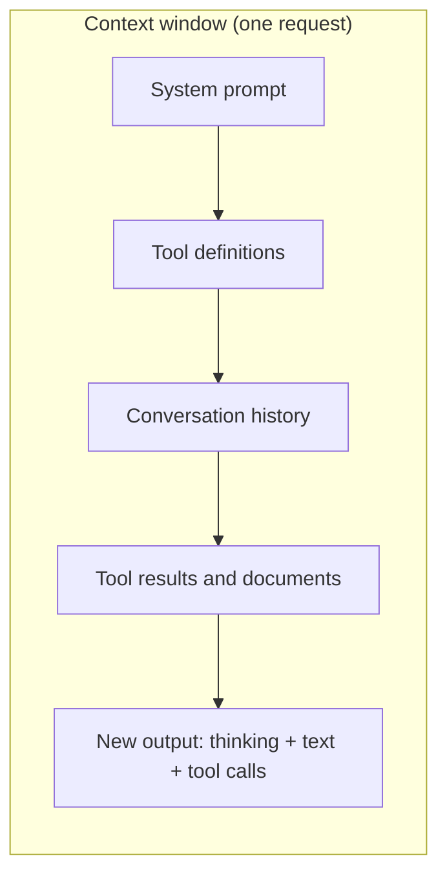

# Tokens and Context Windows

## Introduction

Two numbers quietly govern every LLM application: **how many tokens you send** and **how many fit**. Tokens determine your bill and your latency. The context window determines what the model can consider at once.

For a simple chatbot, you can mostly ignore both. For agents, you cannot. An agent's context fills up with tool definitions, tool results (a single database query or web page can be thousands of tokens), and every previous step. Agents that work fine in a five-minute demo fail on a real task after forty tool calls because nobody budgeted the context.

An analogy: the context window is a desk. Everything the model works with (instructions, conversation, documents, tool outputs) must be on the desk at once. A bigger desk helps, but a desk piled with irrelevant papers makes it harder to find the important one. Good agents keep their desk tidy.

## What Is a Token?

Models do not read characters or words. They read **tokens**: chunks of text from a fixed vocabulary, typically a common word, part of a word, a punctuation mark, or a few characters of code.

- Common English words are often one token. Rare words split into several.
- Code, numbers, URLs, and non-English text usually take **more** tokens per character.
- Whitespace and formatting (indentation, JSON braces) cost tokens too.

As a very rough rule of thumb for English prose, one token is about three to four characters. But **never rely on rules of thumb for budgets**, and never estimate Claude token counts with another provider's tokenizer (such as OpenAI's `tiktoken`). Tokenizers differ between providers and even between model generations of the same provider. For example, Anthropic notes that its newer models' tokenizer produces roughly 30% more tokens for the same text than earlier models. Count with the real thing.

## Counting Tokens Before You Send

The Messages API has a token-counting endpoint. It takes the same parameters as a real request and returns the input token count, without generating anything:

```python
from anthropic import Anthropic

client = Anthropic()

system = "You are a code reviewer."
messages = [{"role": "user", "content": "Review this:\n\ndef add(a, b):\n    return a + b\n"}]

count = client.messages.count_tokens(
    model="claude-opus-5-5",  # counts are model-specific
    system=system,
    messages=messages,
)
print("Input tokens:", count.input_tokens)
```

Example output:

```text
Input tokens: 31
```

Always pass the same model you will use for the real request, since tokenizers differ by model. You can include `tools` too, because tool definitions count as input.

## Reading Token Usage After a Call

Every response reports what it consumed:

```python
from anthropic import Anthropic

client = Anthropic()

response = client.messages.create(
    model="claude-opus-5-5",
    max_tokens=4096,
    messages=[{"role": "user", "content": "Give me 5 names for a pet hedgehog."}],
)

u = response.usage
print("input_tokens:               ", u.input_tokens)
print("output_tokens:              ", u.output_tokens)
print("cache_creation_input_tokens:", u.cache_creation_input_tokens)
print("cache_read_input_tokens:    ", u.cache_read_input_tokens)
```

Example output:

```text
input_tokens:                19
output_tokens:               96
cache_creation_input_tokens: 0
cache_read_input_tokens:     0
```

- **`input_tokens`**: uncached input (system, tools, messages).
- **`output_tokens`**: everything generated, **including thinking**.
- **`cache_creation_input_tokens` / `cache_read_input_tokens`**: input written to or read from the prompt cache. All three input fields count toward the context window. They are just billed differently. See [Prompt Caching](../4-agents-memory-and-context/4-agents-prompt-caching.mdx).

Log these numbers for every call in an agent. They are your primary signal for cost and context growth.

## Images, PDFs, and Tools Cost Tokens Too

Text is not the only thing that consumes tokens:

- **Images** are converted to tokens based on their dimensions. A large screenshot can cost more than a page of text. Resize images to the smallest size that keeps the detail you need.
- **PDFs** cost tokens for both the extracted text and the page images, so a 50-page PDF is far more expensive than its plain text.
- **Tool definitions** are added to the input on every request. Names, descriptions, and schemas all count.
- **Thinking blocks** from earlier turns can stay in the conversation on current models and count as input when resent.

The quickest way to find out what something costs is to measure it: count tokens for a request with and without the item.

```python
from anthropic import Anthropic

client = Anthropic()

base = [{"role": "user", "content": "What's the weather in Oslo?"}]
tools = [{
    "name": "get_weather",
    "description": "Get the current weather for a city. Returns temperature in Celsius and conditions.",
    "input_schema": {
        "type": "object",
        "properties": {"city": {"type": "string", "description": "City name, e.g. 'Oslo'"}},
        "required": ["city"],
    },
}]

without_tools = client.messages.count_tokens(model="claude-opus-5-5", messages=base).input_tokens
with_tools = client.messages.count_tokens(model="claude-opus-5-5", messages=base, tools=tools).input_tokens
print(f"Without tools: {without_tools}, with one tool: {with_tools}, tool overhead: {with_tools - without_tools}")
```

Example output:

```text
Without tools: 15, with one tool: 512, tool overhead: 497
```

The overhead includes both the tool definition and some fixed system text the API adds when tools are present. Multiply that by dozens of tools and every step of an agent, and it adds up. [Working with Large Toolsets](../2-agents-tool-use/10-agents-large-toolsets.mdx) covers ways to keep it under control.

## The Context Window

The **context window** is the maximum number of tokens a model can handle in one request: input *plus* the output it generates.



As of late 2026, current Claude models (Opus 5.5, Sonnet 5.5, Haiku 5.5, and others) have a **1M-token** context window and can generate up to **128K output tokens** per request. Older models such as Claude Haiku 4.5 have 200K. Limits change with new models, so check the [context windows docs](https://platform.claude.com/docs/en/build-with-claude/context-windows) or query the Models API:

```python
from anthropic import Anthropic

client = Anthropic()

model = client.models.retrieve("claude-opus-5-5")
print(model.display_name)
print("Context window:", model.max_input_tokens)
print("Max output:    ", model.max_tokens)
```

Example output:

```text
Claude Opus 5.5
Context window: 1000000
Max output:     128000
```

OpenAI and Gemini models also have large context windows of varying sizes. The concepts on this page apply to all of them.

## What Happens When You Run Out

There are two distinct overflow situations:

1. **The input alone is too large.** The API rejects the request with a 400 `invalid_request_error` ("prompt is too long"). Nothing is generated.
2. **Input fits, but generation runs into the limit.** On current Claude models, the API accepts the request and, if output reaches the window limit, stops with `stop_reason == "model_context_window_exceeded"`.

```python
def check_completion(response) -> None:
    if response.stop_reason == "model_context_window_exceeded":
        raise RuntimeError("Context window full. Compact or trim history before continuing.")
    if response.stop_reason == "max_tokens":
        raise RuntimeError("Hit max_tokens. Raise it or stream.")
```

Note the difference from `max_tokens`: that is *your* per-request output ceiling. The context window is the *model's* total limit.

## More Context Is Not Automatically Better

A 1M-token window is impressive, but filling it has costs:

- **Cost.** Input tokens are billed on every request. An agent that resends 300K tokens of history for each of 50 steps processes 15M input tokens, even before output.
- **Latency.** Processing more input takes longer, which increases time to first token.
- **Quality.** As context grows, models get worse at finding and using the relevant parts. Anthropic's docs call this **context rot**. Irrelevant material is not neutral: it competes for attention.

The goal is not "as much context as fits" but **the smallest set of high-signal tokens that lets the model do the task**. That discipline is called context engineering, covered in [Context Engineering](../4-agents-memory-and-context/0-agents-context-engineering.mdx).

## Where Agent Tokens Go

A token budget for a typical tool-using agent turn might look like this (illustrative):

| Component | Example size | Notes |
| --- | --- | --- |
| System prompt | 1,500 | Stable, cacheable |
| Tool definitions (12 tools) | 4,000 | Stable, cacheable. Grows with every tool you add. |
| Conversation and earlier steps | 20,000 to 200,000+ | Grows every step |
| Latest tool result | 500 to 50,000 | A full web page or query result can be huge |
| Output (thinking + text + tool call) | 1,000 to 20,000 | Depends on effort and task |

The two components that usually blow budgets are **tool results** and **accumulated history**. Here is a simple guard that truncates large tool results before they enter the context:

```python
MAX_TOOL_RESULT_CHARS = 20_000


def clip_tool_output(text: str, limit: int = MAX_TOOL_RESULT_CHARS) -> str:
    """Keep the head and tail of large outputs and say what was removed."""
    if len(text) <= limit:
        return text
    head, tail = text[: limit // 2], text[-limit // 4 :]
    removed = len(text) - len(head) - len(tail)
    return f"{head}\n\n[... {removed} characters omitted ...]\n\n{tail}"


log = "\n".join(f"line {i}: ok" for i in range(10_000))
clipped = clip_tool_output(log)
print(len(log), "->", len(clipped))
print(clipped[-60:])
```

Output:

```text
138889 -> 15039
: ok
line 9996: ok
line 9997: ok
line 9998: ok
line 9999: ok
```

Better still, design tools that return **only what is needed** (filtered rows, a summary, pagination). See [Tool Design Principles](../2-agents-tool-use/7-agents-tool-design-principles.mdx).

## A Context Budget Check

Before each agent step, you can count tokens and act before you hit the wall:

```python
from anthropic import Anthropic

client = Anthropic()

CONTEXT_LIMIT = 1_000_000
SOFT_LIMIT = int(CONTEXT_LIMIT * 0.6)  # leave headroom for output and growth


def context_status(system: str, messages: list, tools: list | None = None) -> str:
    kwargs = {"model": "claude-opus-5-5", "system": system, "messages": messages}
    if tools:
        kwargs["tools"] = tools
    used = client.messages.count_tokens(**kwargs).input_tokens
    pct = used / CONTEXT_LIMIT * 100
    if used > SOFT_LIMIT:
        return f"{used} tokens ({pct:.1f}%) - compact before continuing"
    return f"{used} tokens ({pct:.1f}%) - ok"


print(context_status("You are helpful.", [{"role": "user", "content": "Hello!"}]))
```

Example output:

```text
12 tokens (0.0%) - ok
```

In practice, many agents skip the extra count call and simply track `usage` from the previous response, since the next request's input is roughly the previous input plus the previous output plus the new tool results.

:::note
The soft limit here is a judgment call. Since quality can degrade well before the hard limit, many teams compact much earlier than 60%, based on their own evaluations.
:::

## Strategies When Context Gets Large

| Strategy | What it does | Covered in |
| --- | --- | --- |
| Clip or filter tool results | Keep only relevant parts of outputs | [Tool Design Principles](../2-agents-tool-use/7-agents-tool-design-principles.mdx) |
| Retrieval (RAG) | Fetch only relevant chunks instead of whole documents | [RAG vs Long Context](../5-agents-rag/9-agents-rag-vs-long-context.mdx) |
| Compaction | Summarize older history | [Compaction and Summarization](../4-agents-memory-and-context/2-agents-compaction-and-summarization.mdx) |
| Context editing | Clear old tool results or thinking server-side | [Context Editing](../4-agents-memory-and-context/3-agents-context-editing.mdx) |
| Subagents | Give a subtask its own fresh context, return only a summary | [Subagents and Context Isolation](../8-agents-multi-agent-systems/8-agents-subagents-and-context-isolation.mdx) |
| External memory | Store facts in files or a database, load on demand | [Long-Term Memory](../4-agents-memory-and-context/5-agents-long-term-memory.mdx) |

## Real-World Scenario

**Your team wants an assistant that answers questions about a 400-file Python service** (about 600K tokens of source). Someone suggests: "The model has a 1M window, so let's just put the whole repo in every request."

Let's reason it through.

**Option A: whole repo every time.** It fits. But each question sends about 600K input tokens. With prompt caching, repeated questions in a short window are much cheaper and faster, but you still pay for the cache write, latency is high on cache misses, and the model must find the relevant 2% of the code among everything else.

**Option B: agentic search.** Give the agent tools like `list_files`, `grep`, and `read_file`. It starts with a small context and pulls in only the files it needs. A typical question might touch 10 to 30K tokens.

**Option C: retrieval index.** Embed the code in chunks and retrieve the top matches for each question. Cheap per question, but retrieval can miss relationships across files.

```python
def estimate_input_cost(tokens: int, price_per_million: float) -> float:
    return tokens / 1_000_000 * price_per_million


# Illustrative prices only. Check current pricing before relying on numbers.
PRICE_PER_M_INPUT = 4.00
for name, tokens in [("whole repo", 600_000), ("agentic search", 25_000), ("retrieval", 8_000)]:
    print(f"{name:>15}: {tokens:>7} tokens -> ${estimate_input_cost(tokens, PRICE_PER_M_INPUT):.3f} per question (uncached)")
```

Output:

```text
     whole repo:  600000 tokens -> $2.400 per question (uncached)
 agentic search:   25000 tokens -> $0.100 per question (uncached)
      retrieval:    8000 tokens -> $0.032 per question (uncached)
```

These numbers ignore caching, output tokens, and the multiple steps an agentic search takes. They are only meant to show the order-of-magnitude difference. [Understanding API Costs](./11-agents-api-cost-basics.mdx) shows how to measure real cost per task.

### Why agentic search fits here

- The repo is too big to resend cheaply, but questions usually involve a handful of files.
- Code has structure (imports, call sites) that an agent can follow with `grep`, which chunk retrieval often misses.
- The context stays small, which keeps the model focused and latency reasonable.

### When long context is the right call

Put everything in context when the material is moderate in size, reused across many questions in a short period (so caching pays off), and the task needs a **global view**: "summarize every place we handle refunds", or "find inconsistencies between these three contracts". See [RAG vs Long Context](../5-agents-rag/9-agents-rag-vs-long-context.mdx) for a fuller comparison.

### Alternatives and trade-offs

| Approach | Pros | Cons | Best for |
| --- | --- | --- | --- |
| Whole corpus in context | Global view, no retrieval misses | Expensive per request, slower, context rot | Medium corpora, cross-document analysis |
| Agentic search with tools | Small context, follows structure | More steps and latency per question | Codebases, file systems |
| Retrieval (RAG) | Cheapest per question | Can miss relevant chunks | Large document sets, FAQs |
| Hybrid (retrieve, then agent reads files) | Good recall with small context | Most moving parts | Large production assistants |

## Common Mistakes

- **Estimating Claude tokens with `tiktoken`** or word counts. Use `count_tokens` with the right model.
- **Forgetting that tool definitions count.** Fifty verbose tools can cost thousands of tokens on every request.
- **Dumping raw tool output into context.** Clip, filter, or summarize it first.
- **Treating the context window as a target.** Quality, cost, and latency all get worse as you fill it.
- **Confusing `max_tokens` with the context window.** One is your output cap, the other is the model's total limit.
- **Not logging `usage`.** Without it you cannot see context growth until something breaks.

## Summary

- Tokens are the unit of model input and output. Counts vary by tokenizer, so count with the provider's API.
- `usage` reports input, output (including thinking), and cache tokens for every call.
- The context window holds input plus output. Current Claude models have 1M-token windows and 128K max output.
- Overflow shows up as a 400 (input too large) or `model_context_window_exceeded` (generation hit the limit).
- Bigger context is not free: cost, latency, and quality all suffer. Keep context small and relevant.
- Tool results and history are the main growth sources in agents. Clip, retrieve, compact, or delegate.

## Exercises

1. Use `count_tokens` to compare the token counts of the same paragraph in English, in another language you know, and as minified JSON.
2. Write an agent-step logger that prints `input_tokens`, `output_tokens`, and cache fields for every call, then run a 10-step conversation and watch the trend.
3. Measure how many tokens your tool definitions cost by counting a request with and without `tools`.
4. Take a 50,000-line log file and design a tool that returns only error lines with surrounding context. Compare its token count with the raw file.

**Next:** [Error Handling and Retries](./9-agents-api-error-handling.mdx).
