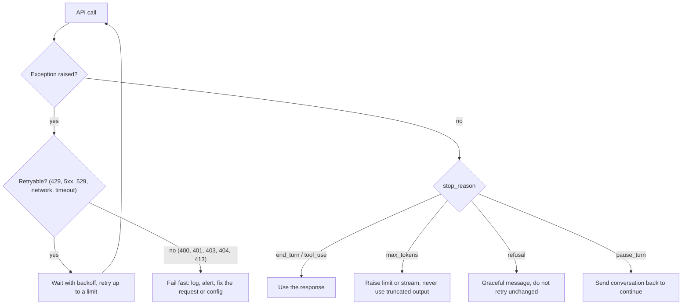
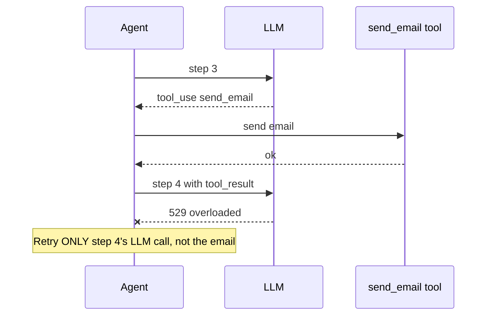

# Error Handling and Retries

## Introduction

LLM APIs fail. Not often, but often enough that any application making thousands of calls will see failures every day: rate limits during a traffic spike, a dropped connection, a temporarily overloaded service, a request your code built incorrectly.

Agents make this worse in two ways. First, a single agent task can make dozens of API calls, so the chance that *at least one* fails is much higher than for a single call. Second, agents take **actions**. If you blindly retry a whole agent step, you might send the same email twice or charge a card twice.

Good error handling for LLM apps comes down to three questions:

1. **Is this error worth retrying?** (A rate limit, yes. An invalid API key, no.)
2. **How should I retry?** (Wait, back off, give up eventually.)
3. **What happens to work already done?** (Especially side effects in agent loops.)

An analogy: calling an API is like phoning a busy office. A busy signal (rate limit) means "call back in a minute". A wrong number (404) means calling back will never help. And if you are not sure whether your order went through before the line dropped, you should check before placing it again.

## Two Kinds of Failure

LLM calls fail in two different ways, and both need handling:

- **Hard failures**: the request did not succeed. The SDK raises an exception (HTTP 4xx/5xx or a network error).
- **Soft failures**: the request succeeded (HTTP 200), but the result is not usable: truncated (`stop_reason == "max_tokens"`), refused (`"refusal"`), paused (`"pause_turn"`), or semantically wrong output.



## HTTP Errors at a Glance

| Status | Error type | Retry? | Typical cause |
| --- | --- | --- | --- |
| 400 | `invalid_request_error` | No | Malformed request: bad parameter, invalid message order, unsupported option for this model |
| 401 | `authentication_error` | No | Missing or invalid API key |
| 402 | `billing_error` | No | Billing or payment problem |
| 403 | `permission_error` | No | Key not allowed to do this |
| 404 | `not_found_error` | No | Wrong model ID or endpoint |
| 413 | `request_too_large` | No | Request body too big |
| 429 | `rate_limit_error` | **Yes** | Too many requests or tokens per minute |
| 500 | `api_error` | **Yes** | Temporary server-side problem |
| 529 | `overloaded_error` | **Yes** | API temporarily overloaded |

Network errors and timeouts (no HTTP status at all) are also retryable.

The rule of thumb: **4xx means fix your request, 429 and 5xx mean try again later.** Retrying a 400 just produces the same 400 again, and wastes time.

## The SDK's Exception Classes

The Python SDK raises a specific exception class per error type. Catch them **most specific first**:

```python
import anthropic
from anthropic import Anthropic

client = Anthropic()

try:
    response = client.messages.create(
        model="claude-opus-5-5",
        max_tokens=1024,
        messages=[{"role": "user", "content": "Hello"}],
    )
    print(response._request_id)  # log this; support teams ask for it
except anthropic.BadRequestError as exc:          # 400
    print("Fix the request:", exc.message)
except anthropic.AuthenticationError:             # 401
    print("Check ANTHROPIC_API_KEY.")
except anthropic.NotFoundError as exc:            # 404
    print("Unknown model or endpoint:", exc.message)
except anthropic.RateLimitError as exc:           # 429
    print("Rate limited. retry-after:", exc.response.headers.get("retry-after"))
except anthropic.APIStatusError as exc:           # any other non-2xx, including 5xx and 529
    print(f"API error {exc.status_code}:", exc.message)
except anthropic.APIConnectionError:              # network failure or timeout, no response
    print("Network problem. Check connectivity.")
```

Example output (successful call):

```text
req_018EeWyXxfu5pfWkrYcMdjWG
```

The class hierarchy, simplified:

```text
anthropic.APIError
├── APIConnectionError          (no response received)
│   └── APITimeoutError
└── APIStatusError              (got an HTTP error response; has .status_code)
    ├── BadRequestError         400
    ├── AuthenticationError     401
    ├── PermissionDeniedError   403
    ├── NotFoundError           404
    ├── RateLimitError          429
    └── InternalServerError     5xx
```

Never match on error message strings. Messages change. Classes and status codes are the stable contract.

## Built-In Retries: Use Them First

You may not need to write any retry code. The SDK **automatically retries** connection errors, timeouts, 408, 409, 429, and 5xx responses with exponential backoff, **2 times by default**. It also respects the server's `retry-after` header.

Configure it on the client or per request:

```python
from anthropic import Anthropic

# More patient client for a background job
client = Anthropic(max_retries=5, timeout=120.0)

# Override for a single, latency-sensitive call
fast = client.with_options(max_retries=1, timeout=15.0)
response = fast.messages.create(
    model="claude-haiku-5-5",
    max_tokens=1024,
    messages=[{"role": "user", "content": "Classify: 'great product' -> positive or negative?"}],
)
print("".join(b.text for b in response.content if b.type == "text"))
```

Example output:

```text
positive
```

How to choose settings:

| Situation | `max_retries` | `timeout` | Why |
| --- | --- | --- | --- |
| User waiting in a chat UI | 1 to 2 | Short (and stream) | Fail fast and show a retry button |
| Background job | 5 or more | Long | Nobody is waiting; success matters more than speed |
| Long generations | Default | Long, and use streaming | The SDK's default timeout is 10 minutes; streaming avoids idle connection drops |
| Tests | 0 | Short | Surface failures immediately |

## Writing Your Own Retry Logic

Write custom retries only when you need behavior the SDK does not provide: logging every attempt, a total time budget, switching to a fallback model, or retrying soft failures. When you do, use **exponential backoff with jitter**:

```python
import random
import time

import anthropic
from anthropic import Anthropic

client = Anthropic(max_retries=0)  # we handle retries ourselves here


def is_retryable(exc: Exception) -> bool:
    if isinstance(exc, (anthropic.APIConnectionError, anthropic.RateLimitError)):
        return True
    if isinstance(exc, anthropic.APIStatusError):
        return exc.status_code >= 500
    return False


def create_with_retry(max_attempts: int = 5, base_delay: float = 1.0, max_delay: float = 30.0, **kwargs):
    for attempt in range(1, max_attempts + 1):
        try:
            return client.messages.create(**kwargs)
        except Exception as exc:
            if not is_retryable(exc) or attempt == max_attempts:
                raise
            retry_after = None
            if isinstance(exc, anthropic.APIStatusError):
                retry_after = exc.response.headers.get("retry-after")
            delay = float(retry_after) if retry_after else min(max_delay, base_delay * 2 ** (attempt - 1))
            delay += random.uniform(0, delay * 0.25)  # jitter avoids synchronized retries
            print(f"Attempt {attempt} failed ({type(exc).__name__}); retrying in {delay:.1f}s")
            time.sleep(delay)


response = create_with_retry(
    model="claude-opus-5-5",
    max_tokens=1024,
    messages=[{"role": "user", "content": "Name a prime number between 10 and 20."}],
)
print("".join(b.text for b in response.content if b.type == "text"))
```

Example output (with one transient failure):

```text
Attempt 1 failed (RateLimitError); retrying in 1.2s
11
```

Why each piece matters:

- **Exponential growth** (1s, 2s, 4s, 8s...) gives an overloaded service room to recover.
- **Jitter** prevents a thousand clients that failed at the same moment from all retrying at the same moment.
- **A cap on attempts and delay** guarantees the function eventually gives up instead of hanging forever.
- **`retry-after`** from the server beats your own guess.

Libraries such as [tenacity](https://tenacity.readthedocs.io/) implement these patterns declaratively if you prefer not to hand-roll them.

## Handling Soft Failures

A 200 response can still be unusable. Handle each `stop_reason` deliberately:

```python
from anthropic import Anthropic

client = Anthropic()


def complete(messages: list, max_tokens: int = 4096) -> str:
    response = client.messages.create(
        model="claude-opus-5-5", max_tokens=max_tokens, messages=messages
    )

    if response.stop_reason == "max_tokens":
        # Retry once with more room rather than returning half an answer.
        if max_tokens < 32000:
            return complete(messages, max_tokens=max_tokens * 4)
        raise RuntimeError("Response still truncated at the maximum budget.")

    if response.stop_reason == "refusal":
        details = response.stop_details
        category = details.category if details else None
        return f"[Declined: {category or 'policy'}]"

    return "".join(b.text for b in response.content if b.type == "text")


print(complete([{"role": "user", "content": "Summarize the water cycle in one sentence."}]))
```

Example output:

```text
Water evaporates, condenses into clouds, falls as precipitation, and flows back to oceans and lakes to begin again.
```

Do not automatically retry a **refusal** with the same input. It will usually refuse again. Log it and handle it in the product. Semantic failures (output that parses but is wrong) are caught with validation, as in [Structured Outputs](./6-agents-structured-outputs.mdx).

## Retries in Agent Loops: Mind the Side Effects

Retrying an **LLM call** is safe. The model call itself has no side effects. Retrying an **agent step that ran tools** may not be:



Practical rules:

- **Retry at the level of the single API call**, not the whole agent step or task.
- **Save tool results into history before the next call**, so a retry resends the result instead of re-running the tool.
- **Make side-effecting tools idempotent** where possible, for example with an idempotency key so a duplicate "create invoice" is ignored.
- **Report tool failures to the model** as `tool_result` blocks with `is_error: True`, instead of crashing the loop, so the model can adapt. See [Handling Tool Errors](../2-agents-tool-use/6-agents-tool-errors.mdx).

## Falling Back to Another Model

When a model is overloaded for a sustained period, a fallback can keep a user-facing feature alive:

```python
import anthropic
from anthropic import Anthropic

client = Anthropic(max_retries=2)

MODEL_CHAIN = ["claude-opus-5-5", "claude-sonnet-5-5"]


def create_with_fallback(**kwargs):
    last_exc = None
    for model in MODEL_CHAIN:
        try:
            return client.messages.create(model=model, **kwargs)
        except (anthropic.RateLimitError, anthropic.InternalServerError, anthropic.APIConnectionError) as exc:
            last_exc = exc
        except anthropic.APIStatusError as exc:
            if exc.status_code != 529:
                raise
            last_exc = exc
    raise last_exc


r = create_with_fallback(max_tokens=1024, messages=[{"role": "user", "content": "Hi!"}])
print(r.model)
```

Example output (normal day):

```text
claude-opus-5-5
```

Fallbacks have a cost: the fallback model may behave differently, so test your prompts on it. Also avoid switching models in the middle of one agent conversation if you can. It restarts the prompt cache, and on current models one model generally cannot read the other's thinking blocks. More on this in [Reliability and Fallbacks](../13-agents-production/5-agents-reliability-and-fallbacks.mdx).

## Real-World Scenario

**Every night, your company summarizes about 5,000 support tickets into a dashboard.** Last week the job crashed at ticket 3,112 on a single 529 error and the dashboard was empty in the morning. Before that, it hammered the API with 200 parallel requests and spent most of its time rate-limited.

The fixed design:

```python
import asyncio

import anthropic
from anthropic import AsyncAnthropic

client = AsyncAnthropic(max_retries=6, timeout=120.0)  # patient: nobody is waiting
CONCURRENCY = asyncio.Semaphore(8)  # stay under rate limits instead of fighting them


async def summarize(ticket_id: str, text: str) -> dict:
    async with CONCURRENCY:
        try:
            r = await client.messages.create(
                model="claude-haiku-5-5",
                max_tokens=2048,
                messages=[{"role": "user", "content": f"Summarize in one sentence:\n<ticket>{text}</ticket>"}],
            )
        except anthropic.BadRequestError as exc:
            return {"id": ticket_id, "status": "bad_request", "error": exc.message}
        except anthropic.APIError as exc:
            # Retries already exhausted inside the SDK: record and move on.
            return {"id": ticket_id, "status": "failed", "error": type(exc).__name__}

    if r.stop_reason != "end_turn":
        return {"id": ticket_id, "status": "review", "error": r.stop_reason}
    summary = "".join(b.text for b in r.content if b.type == "text")
    return {"id": ticket_id, "status": "ok", "summary": summary}


async def run(tickets: dict[str, str]) -> None:
    results = await asyncio.gather(*(summarize(i, t) for i, t in tickets.items()))
    failed = [r for r in results if r["status"] != "ok"]
    print(f"{len(results) - len(failed)} ok, {len(failed)} need attention")


asyncio.run(run({"T-1": "Login page shows 500 error.", "T-2": "Please add CSV export."}))
```

Example output:

```text
2 ok, 0 need attention
```

### Why this approach

- **A concurrency limit** prevents most rate-limit errors in the first place. Retries are a safety net, not a throughput strategy.
- **Patient SDK retries** absorb transient 429/5xx/529 errors without custom code.
- **Per-item error capture** means one bad ticket cannot sink the whole job. Failures are reported and can be re-run.
- **Non-retryable 400s are recorded separately**, because they indicate a bug in how requests are built.

### When to use it, and when not to

This pattern fits any bulk job. If results are not needed for hours, the **Message Batches API** is an even better fit: it handles queuing and retries server-side and costs 50% less. See [Understanding API Costs](./11-agents-api-cost-basics.mdx).

### Alternatives and trade-offs

| Approach | Pros | Cons | Best for |
| --- | --- | --- | --- |
| SDK built-in retries | Zero code, respects `retry-after` | Limited customization | Most applications |
| Custom backoff loop | Full control, logging, soft-failure retries | More code to test | Special policies, total time budgets |
| Concurrency limiting | Prevents rate limits proactively | Lower peak throughput | Bulk and parallel workloads |
| Fallback model | Keeps features alive during outages | Behavior differences, cache restarts | User-facing features with strict availability needs |
| Batch API | Server-side queuing, 50% cheaper | Results are asynchronous | Non-urgent bulk jobs |

## Common Mistakes

- **Retrying 400-level errors.** They will fail again. Fix the request.
- **Catching `Exception` and retrying everything**, including bugs in your own code.
- **Retrying without backoff or jitter**, turning a brief rate limit into a sustained one.
- **Unlimited retries** that hang a job forever.
- **Retrying whole agent steps** and repeating side effects like emails or payments.
- **Ignoring `stop_reason`**, so truncated or refused responses are treated as success.
- **Not logging request IDs**, which makes support investigations much harder.

## Summary

- Separate hard failures (exceptions) from soft failures (`stop_reason` and invalid output).
- Retry 429, 5xx, 529, network errors, and timeouts. Do not retry other 4xx errors.
- The SDK retries automatically (2 times by default). Tune `max_retries` and `timeout` per use case.
- Custom retries use exponential backoff with jitter, a cap, and `retry-after`.
- In agents, retry single API calls, not steps with side effects. Make tools idempotent.
- Limit concurrency to avoid rate limits, and consider the Batch API for bulk work.

## Exercises

1. Point the client at an invalid model ID and confirm `NotFoundError` is raised and not retried.
2. Write a unit test for `create_with_retry` using a fake client that fails twice with a retryable error, then succeeds. See [Mocking LLM Calls in Tests](../11-agents-evaluation-and-testing/5-agents-mocking-llm-calls.mdx).
3. Add a total time budget to `create_with_retry` so it gives up after 60 seconds regardless of attempts.
4. Extend the nightly job to write failed ticket IDs to a file and add a `--retry-failed` mode.

**Next:** [Choosing the Right Model](./10-agents-model-selection.mdx).
