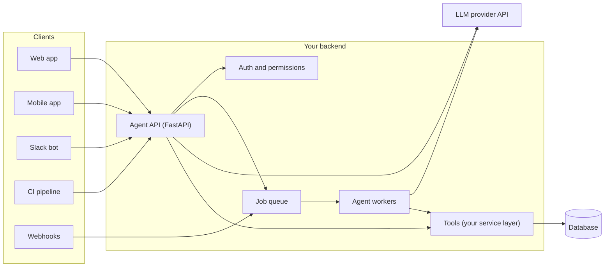
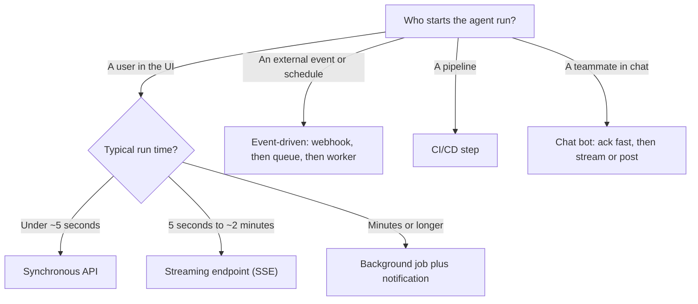

# Integrating Agents into Existing Applications

## Introduction

Most agent tutorials start from an empty folder: a script, a prompt, a loop, and a few tools. Real projects rarely look like that. You
already have a product with users, a database, an authentication system, a deployment pipeline, logs, an on-call rotation, and a
roadmap full of other work. The question is not "how do I build an agent?" but **"how do I fit an agent into the system I already
have without breaking it?"**

A useful way to think about it: an agent is a **new kind of backend component**. It is slow (seconds to minutes instead of
milliseconds), non-deterministic (the same input can produce different outputs), expensive per request (you pay for tokens), and it
can take actions through tools. Every integration decision in this section comes from those four properties:

| Property of an agent | What it forces you to design for |
|---|---|
| Slow | Streaming, background jobs, timeouts, progress updates |
| Non-deterministic | Validation, evaluation, fallbacks, human review |
| Costs money per call | Quotas, budgets, caching, feature flags |
| Takes actions via tools | Authentication, authorization, audit logs, least privilege |

If you keep that table in mind, most of the "where does the agent go?" questions answer themselves.

This page is the map for the section. It introduces the integration patterns, shows how they fit together, and helps you pick
the right one for your situation. The following pages go deep on each pattern.

## The Agent Is Just Another Service

The most important architectural idea is boring on purpose: **put the agent behind your own backend, and treat it like any other
service.** Your frontend, your Slack bot, and your CI pipeline should never call the LLM provider directly with a secret key.
They call *your* code, which:

1. Authenticates the caller.
2. Decides which tools this caller is allowed to use.
3. Runs the agent loop with those tools.
4. Records what happened (logs, traces, cost).
5. Returns or streams the result.



Notice that the tools call into **your service layer**, the same code your REST endpoints already use. The agent does not get a
private back door into the database. That one decision gives you consistent validation, permission checks, and audit logging for
free.

## A Minimal Agent Core

Every page in this section reuses the same small "agent core": a function that runs the tool loop for a given user. Keeping it in
one module means your API, workers, and bots all share one implementation.

```python
# agent_core.py
from dataclasses import dataclass, field
from typing import Any, Callable

from anthropic import Anthropic

client = Anthropic()  # reads ANTHROPIC_API_KEY from the environment
MODEL = "claude-opus-5-5"


@dataclass
class User:
    id: str
    org_id: str
    roles: list[str] = field(default_factory=list)


@dataclass
class Tool:
    name: str
    description: str
    input_schema: dict
    handler: Callable[[User, dict], Any]  # the server passes the user in, not the model
    required_role: str | None = None


def tools_for(user: User, all_tools: list[Tool]) -> list[Tool]:
    """Only show the model tools this user is allowed to use."""
    return [t for t in all_tools if t.required_role is None or t.required_role in user.roles]


def run_agent(user: User, prompt: str, all_tools: list[Tool], max_turns: int = 10) -> str:
    tools = tools_for(user, all_tools)
    by_name = {t.name: t for t in tools}
    tool_defs = [
        {"name": t.name, "description": t.description, "input_schema": t.input_schema}
        for t in tools
    ]
    messages = [{"role": "user", "content": prompt}]

    for _ in range(max_turns):
        response = client.messages.create(
            model=MODEL,
            max_tokens=16000,
            system="You are a helpful assistant inside the Acme dashboard.",
            tools=tool_defs,
            messages=messages,
        )
        if response.stop_reason == "pause_turn":
            messages.append({"role": "assistant", "content": response.content})
            continue
        if response.stop_reason != "tool_use":
            return "".join(b.text for b in response.content if b.type == "text")

        messages.append({"role": "assistant", "content": response.content})
        results = []
        for block in response.content:
            if block.type != "tool_use":
                continue
            tool = by_name.get(block.name)
            try:
                if tool is None:
                    raise PermissionError(f"Tool {block.name} is not available")
                output = tool.handler(user, block.input)
                results.append({"type": "tool_result", "tool_use_id": block.id, "content": str(output)})
            except Exception as exc:  # report failures to the model instead of crashing
                results.append({
                    "type": "tool_result",
                    "tool_use_id": block.id,
                    "content": f"Error: {exc}",
                    "is_error": True,
                })
        messages.append({"role": "user", "content": results})

    return "Stopped: the agent reached its turn limit."
```

Three details matter for integration:

- **`handler(user, input)`**: the authenticated user is injected by the server. The model only supplies business arguments such as
  an order ID. It can never claim to be someone else.
- **`tools_for(user, ...)`**: the model only sees tools the user may call. Hidden tools cannot be misused.
- **`max_turns`**: every integration needs a hard stop. Long-running loops cost money and block workers.

:::note
The code uses the Anthropic Python SDK. OpenAI, Google Gemini, and open-source models served through Ollama or vLLM support the
same tool-calling loop with slightly different field names. The integration patterns in this section apply to all of them.
:::

## The Seven Integration Patterns

Here is the menu. Most real products use two or three of these at once.

### 1. Synchronous API endpoint

A `POST /agent/runs` endpoint that runs the agent and returns JSON. Simple and easy to test, but only suitable when the agent
finishes in a few seconds. See [Exposing an Agent as an API Service](./1-agents-as-api-service.mdx).

### 2. Streaming endpoint

The same endpoint, but it streams tokens and tool progress to the client with Server-Sent Events (SSE). This is what chat
interfaces use, because users tolerate a 30-second answer if they see it forming. See
[Streaming Agent Output to a Frontend](./2-agents-streaming-to-frontend.mdx).

### 3. Background job

The request enqueues a job and returns `202 Accepted` with a job ID. A worker runs the agent and stores the result. Use this for
tasks that take minutes, such as research reports or bulk processing. See
[Running Agents as Background Jobs](./3-agents-background-jobs.mdx).

### 4. Event-driven trigger

Nobody clicks a button. A webhook (new support ticket, new GitHub issue, failed payment) or a schedule starts the agent. See
[Event-Driven Agents and Webhooks](./4-agents-event-driven.mdx).

### 5. Embedded in the UI

An "Ask AI" panel, a smart form filler, or a copilot inside an existing web page, with page context passed in. See
[Agents in Web Applications](./7-agents-in-web-apps.mdx).

### 6. Chat platform bot

The agent lives where your team already talks: Slack, Microsoft Teams, Discord. See
[Agents in Slack and Chat Platforms](./8-agents-chat-platform-bots.mdx).

### 7. Pipeline step

The agent runs inside CI/CD: reviewing pull requests, explaining test failures, writing release notes. See
[Agents in CI/CD Pipelines](./9-agents-in-ci-cd.mdx).

Two cross-cutting concerns apply to **all** of these patterns:

- [User Authentication and Agent Permissions](./5-agents-auth-and-permissions.mdx): the agent acts on behalf of a user and must
  never have more rights than that user.
- [Agents That Work with Your Database](./6-agents-with-databases.mdx): how to give the agent data access without handing it a
  loaded `DROP TABLE`.

## Choosing a Pattern

The fastest way to pick is to ask three questions: **Who starts the run? How long does it take? Does a human watch it?**



The thresholds are rules of thumb, not laws. A 20-second agent run is fine with streaming, but painful as a blocking request
behind a load balancer with a 30-second timeout.

| Pattern | Latency tolerance | Main risk | First thing to add |
|---|---|---|---|
| Sync API | Low | Timeouts | Strict `max_turns`, request timeout |
| Streaming | Medium | Dropped connections | Cancellation, reconnect logic |
| Background job | High | Duplicate or lost work | Idempotency keys, retries |
| Event-driven | High | Untrusted input, event storms | Signature checks, dedupe, rate limits |
| UI-embedded | Medium | Confusing UX | Clear states, a stop button |
| Chat bot | Medium | Platform timeouts | Fast acknowledgement |
| CI/CD step | High | Secret leaks, runaway cost | Least-privilege tokens, budgets |

## Fitting Into What You Already Have

An agent touches many parts of an existing system. Before writing agent code, inventory what you already have and reuse it.

### Reuse your service layer for tools

If your app has a function `orders.cancel(order_id, actor)` that checks permissions and writes an audit log, the agent's
`cancel_order` tool should call that function. Do not write a second, agent-only implementation.

```python
# tools.py - thin wrappers over existing business logic
from agent_core import Tool, User


class OrderService:
    """Stands in for your existing service layer."""

    def get(self, order_id: str, actor: User) -> dict:
        # Real code: load from DB, then check order.org_id == actor.org_id
        return {"id": order_id, "status": "shipped", "org_id": actor.org_id}


orders = OrderService()

get_order_tool = Tool(
    name="get_order",
    description="Look up one order by ID. Returns status, items, and shipping info.",
    input_schema={
        "type": "object",
        "properties": {"order_id": {"type": "string", "description": "Order ID such as ord_123"}},
        "required": ["order_id"],
    },
    handler=lambda user, args: orders.get(args["order_id"], actor=user),
)
```

### Reuse your auth

Use the same session cookie or JWT your app already validates. The agent endpoint is just another protected route.

### Reuse your infrastructure

If you already run Celery, Sidekiq, or SQS consumers, run agent jobs there. If you already use OpenTelemetry, trace agent runs with
it. Adding an agent should not require a second platform.

### Add only what is genuinely new

Three things usually *are* new:

- **Conversation and run storage.** A table for agent runs (who, when, input, output, status, tokens, cost) and optionally
  messages, so you can debug and bill.
- **LLM-specific limits.** Per-user and per-org token budgets, on top of normal rate limits.
- **Evaluation.** A set of test prompts and expected behaviors that runs before you change prompts or models. See
  [Agent Evaluation Introduction](../11-agents-evaluation-and-testing/0-agents-evaluation-introduction.mdx).

A minimal runs table looks like this:

```python
# models.py - SQLAlchemy 2.0 style
from datetime import datetime

from sqlalchemy import DateTime, Integer, String, Text, func
from sqlalchemy.orm import DeclarativeBase, Mapped, mapped_column


class Base(DeclarativeBase):
    pass


class AgentRun(Base):
    __tablename__ = "agent_runs"

    id: Mapped[str] = mapped_column(String(36), primary_key=True)
    user_id: Mapped[str] = mapped_column(String(64), index=True)
    org_id: Mapped[str] = mapped_column(String(64), index=True)
    feature: Mapped[str] = mapped_column(String(64))          # e.g. "invoice_assistant"
    status: Mapped[str] = mapped_column(String(16))           # queued, running, done, failed
    input_text: Mapped[str] = mapped_column(Text)
    output_text: Mapped[str | None] = mapped_column(Text, nullable=True)
    input_tokens: Mapped[int] = mapped_column(Integer, default=0)
    output_tokens: Mapped[int] = mapped_column(Integer, default=0)
    model: Mapped[str] = mapped_column(String(64))
    prompt_version: Mapped[str] = mapped_column(String(32))
    created_at: Mapped[datetime] = mapped_column(DateTime, server_default=func.now())
```

Storing `model` and `prompt_version` on every run is cheap and pays off the first time someone asks "why did answers get worse last
Tuesday?"

## Real-World Scenario

Your team runs a B2B invoicing SaaS. Customers keep emailing support with questions like "why is invoice INV-2041 overdue?" and
"which clients haven't paid this quarter?". Product wants an "Ask about your invoices" assistant. The app is a React frontend, a
FastAPI backend, PostgreSQL, and Celery workers for PDF generation.

**The integration plan:**

1. **Start small.** Ship a read-only assistant inside the invoice page, behind a feature flag for five pilot customers
   ([Incrementally Adding AI to a Product](./10-agents-incremental-adoption.mdx)).
2. **API service.** Add `POST /api/assistant/messages` to the existing FastAPI app, protected by the existing session auth
   ([Exposing an Agent as an API Service](./1-agents-as-api-service.mdx)).
3. **Streaming.** Stream answers to a side panel in React via SSE
   ([Streaming Agent Output to a Frontend](./2-agents-streaming-to-frontend.mdx)).
4. **Tools.** Expose three narrow tools: `get_invoice`, `list_invoices(status, date_range)`, `get_client`. Each calls the existing
   service layer, scoped to the user's organization
   ([Agents That Work with Your Database](./6-agents-with-databases.mdx)).
5. **Permissions.** Only users with the `billing` role see the `send_reminder` tool added in phase two, and it requires a click to
   confirm ([User Authentication and Agent Permissions](./5-agents-auth-and-permissions.mdx)).
6. **Background jobs.** "Generate a collections report for all overdue clients" goes to the existing Celery queue and emails a link
   when done ([Running Agents as Background Jobs](./3-agents-background-jobs.mdx)).

### Why this approach

- It reuses the existing auth, service layer, and worker infrastructure, so the new surface area is small.
- Read-only first means the worst failure is a wrong answer, not a wrong email sent to a customer's client.
- The feature flag and pilot group let the team measure real usage and cost before a full launch.

### When to use it and when not to

Use this layered approach when you have an existing product with real users and data. Skip the infrastructure if you are building a
throwaway prototype or an internal script: a single Python file calling the API is fine there. And if the questions are
predictable ("show overdue invoices"), a normal filter UI may beat an agent entirely. See
[When Should You Build an Agent?](../0-agents-fundamentals/7-agents-when-to-build.mdx).

### Alternatives and trade-offs

| Approach | Pros | Cons | Best for |
|---|---|---|---|
| Agent inside your existing backend | Reuses auth, data, deploys; one codebase | Agent load affects main app; Python or Node only | Most teams starting out |
| Separate agent microservice | Independent scaling and deploys; isolates failures | Needs service-to-service auth and user propagation | Larger teams, heavy agent traffic |
| Managed agent platform | Fast to start, hosted sandbox and tools | Less control; data leaves your infra; vendor lock-in | Prototypes, internal tools |
| Direct frontend-to-LLM calls | Very simple | Exposes keys, no server-side permissions | Never in production |
| No agent: classic feature or single LLM call | Predictable, cheap, testable | Less flexible | Narrow, well-defined tasks |

## Common Mistakes

- **Calling the LLM provider from the browser.** Anyone can read the key from DevTools. Always proxy through your backend.
- **Giving the agent a superuser database connection.** The agent should use the same permission checks as a user would, or tighter.
- **Trusting identity from the prompt.** "I am the admin of org 42" in a message proves nothing. Identity comes from the session.
- **Blocking HTTP workers on long runs.** A 90-second agent run inside a synchronous request ties up a worker and hits proxy timeouts.
- **No turn or token limits.** A confused agent can loop for dozens of turns. Always set `max_turns`, `max_tokens`, and a per-user budget.
- **Not logging runs.** Without the prompt, tool calls, model, and prompt version, you cannot debug complaints.
- **Launching to everyone at once.** Roll out behind a flag, measure, then expand.

## Summary

- An agent is a slow, non-deterministic, costly component that can take actions. Design for those properties.
- Put the agent **behind your own backend**. Clients call your API, never the LLM provider directly.
- Build tools as thin wrappers around your **existing service layer** so validation and permissions are shared.
- Pick an integration pattern by asking who starts the run, how long it takes, and whether a human is watching.
- Inject the authenticated user into tools on the server. Filter the tool list by permission.
- Add run storage, budgets, and evaluation. Reuse everything else you already have.
- Start with a small, read-only, feature-flagged release.

## Exercises

1. Draw the architecture of an application you know (or a sample app) and mark where an agent endpoint, a job queue, and the tools
   would sit. Which existing service functions would become tools?
2. Extend `run_agent` so it returns the total input and output tokens (from `response.usage`) along with the text, and store them in
   an `AgentRun` row.
3. For three features you might build (a chat assistant, a nightly report, a PR reviewer), use the decision flowchart to choose a
   pattern and justify it in one sentence each.
4. List every place your current app checks permissions. How would you make sure an agent tool goes through the same checks?

**Related pages:**

- [The Agent Loop](../0-agents-fundamentals/4-agents-agent-loop.mdx)
- [Building a Manual Agent Loop](../2-agents-tool-use/3-agents-manual-agent-loop.mdx)
- [Deployment Architectures](../13-agents-production/1-agents-deployment-architectures.mdx)
- [Least Privilege for Agent Tools](../12-agents-safety-and-security/2-agents-least-privilege.mdx)
- [Project: Adding an Agent Feature to a SaaS App](../14-agents-projects/9-agents-project-saas-feature.mdx)
