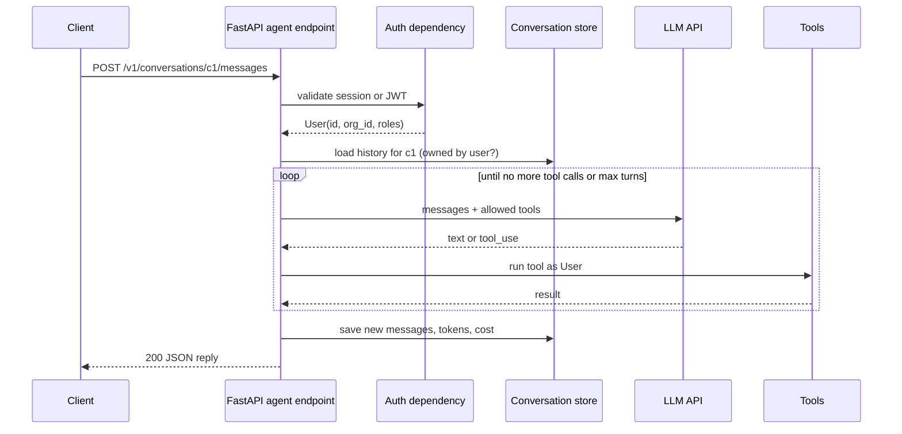
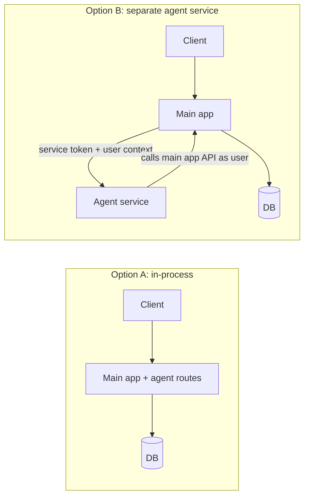

# Exposing an Agent as an API Service

## Introduction

Once your agent works in a script, the next step is to let the rest of your system use it. The cleanest way is to expose it as an
**HTTP API**: your web app, mobile app, Slack bot, and internal tools all call the same endpoint, and all the hard parts (API keys,
permissions, limits, logging) live in one place.

Think of the agent like a payment provider. You would never let the browser talk to Stripe with your secret key. You put a small
server in between that knows who the user is, what they are allowed to do, and how much they have already spent. An agent deserves
the same treatment.

In this page you will build a FastAPI service step by step:

1. A minimal endpoint that runs an agent and returns JSON.
2. Authentication and per-user tool access.
3. Server-side conversation storage for multi-turn chats.
4. Timeouts, error mapping, and usage limits.
5. A look at running the agent as a separate microservice.

Streaming responses are covered on the next page,
[Streaming Agent Output to a Frontend](./2-agents-streaming-to-frontend.mdx). Everything here still applies there.

## The Request Lifecycle



## Step 1: The Smallest Useful Endpoint

Start with a single endpoint that takes a message and returns the agent's reply. Use **Pydantic models** for the request and
response so FastAPI validates input and generates OpenAPI docs automatically.

```python
# main.py
from anthropic import AsyncAnthropic
from fastapi import FastAPI
from pydantic import BaseModel, Field

app = FastAPI(title="Acme Agent API")
client = AsyncAnthropic()  # reads ANTHROPIC_API_KEY
MODEL = "claude-opus-5-5"


class AskRequest(BaseModel):
    message: str = Field(min_length=1, max_length=4000)


class AskResponse(BaseModel):
    reply: str
    input_tokens: int
    output_tokens: int


@app.post("/v1/ask", response_model=AskResponse)
async def ask(req: AskRequest) -> AskResponse:
    response = await client.messages.create(
        model=MODEL,
        max_tokens=2000,
        system="You are a concise assistant for Acme's customers.",
        messages=[{"role": "user", "content": req.message}],
    )
    text = "".join(b.text for b in response.content if b.type == "text")
    return AskResponse(
        reply=text,
        input_tokens=response.usage.input_tokens,
        output_tokens=response.usage.output_tokens,
    )
```

Run it with `uvicorn main:app --reload` and call it:

```bash
curl -s -X POST http://localhost:8000/v1/ask \
  -H "Content-Type: application/json" \
  -d '{"message": "In one sentence, what is an invoice?"}'
```

Example output:

```text
{"reply":"An invoice is a document a seller sends a buyer listing goods or services provided and the amount owed.","input_tokens":31,"output_tokens":24}
```

Two choices here are deliberate:

- **`AsyncAnthropic`** with an `async def` endpoint. LLM calls spend most of their time waiting on the network. An async client lets
  one Uvicorn worker serve many concurrent requests instead of blocking a thread per request.
- **`max_length` on the input.** Without it, someone can paste a 2 MB document and you pay for every token.

## Step 2: Add Authentication

An agent endpoint is a protected route like any other. Reuse your app's existing session or JWT validation as a FastAPI
**dependency**. The code below fakes token validation so it stays runnable. In production you would verify a JWT signature or look
up a session.

```python
# auth.py
from dataclasses import dataclass, field
from typing import Annotated

from fastapi import Depends, HTTPException, status
from fastapi.security import HTTPAuthorizationCredentials, HTTPBearer

bearer = HTTPBearer()


@dataclass
class User:
    id: str
    org_id: str
    roles: list[str] = field(default_factory=list)


# Stand-in for JWT verification or a session lookup
FAKE_TOKENS = {
    "token-alice": User(id="u_alice", org_id="org_1", roles=["member", "billing"]),
    "token-bob": User(id="u_bob", org_id="org_2", roles=["member"]),
}


async def get_current_user(
    creds: Annotated[HTTPAuthorizationCredentials, Depends(bearer)],
) -> User:
    user = FAKE_TOKENS.get(creds.credentials)
    if user is None:
        raise HTTPException(status_code=status.HTTP_401_UNAUTHORIZED, detail="Invalid token")
    return user


CurrentUser = Annotated[User, Depends(get_current_user)]
```

Now every agent endpoint takes `user: CurrentUser`. The rest of the code, including every tool, receives that `User` object from
the server. The model never decides who the user is.

:::warning
Do not accept `user_id` or `org_id` in the request body and pass them to the agent. A client can send any value. Identity comes from
the verified token only. See [User Authentication and Agent Permissions](./5-agents-auth-and-permissions.mdx).
:::

## Step 3: Tools That Run as the User

Next, give the agent tools. Each tool handler receives the `User` from the server plus the arguments chosen by the model.

```python
# agent_tools.py
from typing import Any, Awaitable, Callable

from auth import User

INVOICES = {
    "INV-1001": {"org_id": "org_1", "client": "Globex", "amount": 1200, "status": "overdue"},
    "INV-1002": {"org_id": "org_1", "client": "Initech", "amount": 300, "status": "paid"},
    "INV-2001": {"org_id": "org_2", "client": "Umbrella", "amount": 999, "status": "open"},
}


async def get_invoice(user: User, args: dict) -> dict:
    inv = INVOICES.get(args["invoice_id"])
    # Same rule as the REST API: you can only see your own org's invoices.
    if inv is None or inv["org_id"] != user.org_id:
        raise LookupError("Invoice not found")
    return {k: v for k, v in inv.items() if k != "org_id"}


Handler = Callable[[User, dict], Awaitable[Any]]

TOOLS: dict[str, tuple[dict, Handler]] = {
    "get_invoice": (
        {
            "name": "get_invoice",
            "description": "Get one invoice by ID (for example INV-1001). Returns client, amount, and status.",
            "input_schema": {
                "type": "object",
                "properties": {"invoice_id": {"type": "string"}},
                "required": ["invoice_id"],
            },
        },
        get_invoice,
    ),
}
```

Note the error message: "Invoice not found" for both "does not exist" and "belongs to another org". Returning "forbidden" would leak
that the invoice exists.

The async agent loop lives in its own module so the API, workers, and bots can share it:

```python
# agent_loop.py
import json
from dataclasses import dataclass

from anthropic import AsyncAnthropic

from agent_tools import TOOLS
from auth import User

client = AsyncAnthropic()
MODEL = "claude-opus-5-5"
SYSTEM = "You help Acme users understand their invoices. Use tools to look up data. Be concise."


@dataclass
class AgentResult:
    reply: str
    messages: list
    input_tokens: int = 0
    output_tokens: int = 0


async def run_agent(user: User, messages: list, max_turns: int = 8) -> AgentResult:
    tool_defs = [spec for spec, _ in TOOLS.values()]
    result = AgentResult(reply="", messages=list(messages))

    for _ in range(max_turns):
        response = await client.messages.create(
            model=MODEL, max_tokens=4000, system=SYSTEM,
            tools=tool_defs, messages=result.messages,
        )
        result.input_tokens += response.usage.input_tokens
        result.output_tokens += response.usage.output_tokens
        result.messages.append({"role": "assistant", "content": [b.to_dict() for b in response.content]})

        if response.stop_reason == "pause_turn":
            continue
        if response.stop_reason != "tool_use":
            result.reply = "".join(b.text for b in response.content if b.type == "text")
            return result

        tool_results = []
        for block in response.content:
            if block.type != "tool_use":
                continue
            _, handler = TOOLS[block.name]
            try:
                output = await handler(user, block.input)
                tool_results.append({"type": "tool_result", "tool_use_id": block.id,
                                     "content": json.dumps(output)})
            except Exception as exc:
                tool_results.append({"type": "tool_result", "tool_use_id": block.id,
                                     "content": f"Error: {exc}", "is_error": True})
        result.messages.append({"role": "user", "content": tool_results})

    result.reply = "I could not finish this request. Please try a narrower question."
    return result
```

The loop stores assistant content as plain dictionaries with the SDK's `to_dict()`. That makes the history JSON-serializable, which
you need for the next step. Store the blocks **exactly as returned**: do not strip, trim, or drop blocks (including `thinking`
blocks whose text is empty) when you save and replay them, because the API expects earlier assistant turns to come back unchanged.

## Step 4: Server-Side Conversations

Chat features need multi-turn memory. There are two ways to do it:

| Option | How it works | Problem |
|---|---|---|
| Client sends full history | Browser keeps the messages array and posts it every time | Client can forge assistant turns and tool results; payload grows |
| Server stores history | Client sends only `conversation_id` and the new message | Needs storage, but history is trustworthy |

Always prefer **server-side storage** for agents with tools. If the client can submit history, it can invent a fake `tool_result`
saying "refund approved" and the model will believe it.

```python
# conversations.py
import uuid
from typing import Annotated

from fastapi import APIRouter, HTTPException
from pydantic import BaseModel, Field

from agent_loop import run_agent
from auth import CurrentUser

router = APIRouter(prefix="/v1/conversations")

# Stand-in for a database table: conversation_id -> record
CONVERSATIONS: dict[str, dict] = {}


class NewMessage(BaseModel):
    message: Annotated[str, Field(min_length=1, max_length=4000)]


class Reply(BaseModel):
    conversation_id: str
    reply: str


@router.post("", status_code=201)
async def create_conversation(user: CurrentUser) -> dict:
    conv_id = str(uuid.uuid4())
    CONVERSATIONS[conv_id] = {"user_id": user.id, "messages": []}
    return {"conversation_id": conv_id}


@router.post("/{conversation_id}/messages", response_model=Reply)
async def send_message(conversation_id: str, body: NewMessage, user: CurrentUser) -> Reply:
    conv = CONVERSATIONS.get(conversation_id)
    if conv is None or conv["user_id"] != user.id:
        raise HTTPException(status_code=404, detail="Conversation not found")

    history = conv["messages"] + [{"role": "user", "content": body.message}]
    result = await run_agent(user, history)
    conv["messages"] = result.messages  # persist the full transcript, including tool calls
    return Reply(conversation_id=conversation_id, reply=result.reply)
```

In a real app, `CONVERSATIONS` is a table with a JSON column for messages (or one row per message). Long conversations eventually
exceed the context window. The techniques in [Compaction and Summarization](../4-agents-memory-and-context/2-agents-compaction-and-summarization.mdx)
and [Session Persistence](../4-agents-memory-and-context/10-agents-session-persistence.mdx) apply here.

## Step 5: Timeouts and Error Mapping

LLM APIs fail in ways your normal endpoints do not: rate limits, overloaded servers, and very slow responses. Map them to sensible
HTTP status codes so clients can react correctly, and put an overall time limit on each request.

```python
# errors.py
import asyncio

import anthropic
from fastapi import HTTPException

REQUEST_BUDGET_SECONDS = 60


async def run_with_limits(coro):
    try:
        return await asyncio.wait_for(coro, timeout=REQUEST_BUDGET_SECONDS)
    except asyncio.TimeoutError:
        raise HTTPException(status_code=504, detail="The assistant took too long. Try a simpler question.")
    except anthropic.RateLimitError:
        # Our provider quota is exhausted. Tell the client to back off.
        raise HTTPException(status_code=503, detail="Assistant is busy. Please retry shortly.",
                            headers={"Retry-After": "10"})
    except anthropic.APIStatusError as exc:
        if exc.status_code >= 500:
            raise HTTPException(status_code=502, detail="Upstream AI service error.")
        # 4xx from the provider usually means a bug in our request, not the user's fault
        raise HTTPException(status_code=500, detail="Assistant request was invalid.")
    except anthropic.APIConnectionError:
        raise HTTPException(status_code=502, detail="Could not reach the AI service.")
```

Then wrap the agent call: `result = await run_with_limits(run_agent(user, history))`.

A few notes:

- The SDK already retries some transient errors with backoff (configurable with `max_retries` on the client). Do not stack your own
  retry loop on top of it inside a request, or one user request can take minutes.
- `RateLimitError` is a subclass of `APIStatusError`, so catch it first.
- A provider 429 is **your** quota problem. Returning 503 to your client is more honest than 429, which suggests the *user* sent
  too many requests. Use 429 for your own per-user limits (below).

## Step 6: Per-User Usage Limits

Normal rate limits count requests. For agents you also want to count **tokens**, because one request can cost a hundred times more
than another. A simple daily budget per user:

```python
# usage.py
from collections import defaultdict
from datetime import date

from fastapi import HTTPException

DAILY_TOKEN_LIMIT = 200_000
_usage: dict[tuple[str, date], int] = defaultdict(int)  # use Redis or your DB in production


def check_budget(user_id: str) -> None:
    if _usage[(user_id, date.today())] >= DAILY_TOKEN_LIMIT:
        raise HTTPException(status_code=429, detail="Daily assistant limit reached. It resets at midnight UTC.")


def record_usage(user_id: str, input_tokens: int, output_tokens: int) -> None:
    _usage[(user_id, date.today())] += input_tokens + output_tokens


if __name__ == "__main__":
    record_usage("u_alice", 150_000, 60_000)
    try:
        check_budget("u_alice")
    except HTTPException as exc:
        print(exc.status_code, exc.detail)
```

Output:

```text
429 Daily assistant limit reached. It resets at midnight UTC.
```

Call `check_budget` before running the agent and `record_usage` after. Output tokens usually cost more than input tokens, so you
may prefer to track estimated **cost** instead of raw tokens. See
[Understanding API Costs](../1-agents-llm-apis/11-agents-api-cost-basics.mdx).

## Putting It Together

```python
# app.py
from fastapi import FastAPI, HTTPException

from agent_loop import run_agent
from auth import CurrentUser
from conversations import CONVERSATIONS, NewMessage, Reply
from errors import run_with_limits
from usage import check_budget, record_usage

app = FastAPI(title="Acme Agent API", version="1.0.0")


@app.post("/v1/conversations/{conversation_id}/messages", response_model=Reply)
async def send_message(conversation_id: str, body: NewMessage, user: CurrentUser) -> Reply:
    conv = CONVERSATIONS.get(conversation_id)
    if conv is None or conv["user_id"] != user.id:
        raise HTTPException(status_code=404, detail="Conversation not found")

    check_budget(user.id)
    history = conv["messages"] + [{"role": "user", "content": body.message}]
    result = await run_with_limits(run_agent(user, history))
    record_usage(user.id, result.input_tokens, result.output_tokens)

    conv["messages"] = result.messages
    return Reply(conversation_id=conversation_id, reply=result.reply)


@app.get("/healthz")
async def health() -> dict:
    # Do not call the LLM here: health checks run often and should be free and fast.
    return {"ok": True}
```

Notice the `/v1/` prefix. Agent behavior changes when you change prompts, tools, or models. Versioning the URL lets you ship a
breaking change (for example a new response shape with citations) without breaking old mobile clients.

## Deploying: In-Process or Separate Service?

You can mount these routes inside your existing FastAPI app, or run them as a separate **agent service** that your main backend calls.



With a separate service, you must **propagate the user**. The main app forwards a short-lived token that represents the user (or
signs a user context), and the agent service calls back into the main app's API with it. The agent service should not have its own
superuser database credentials. Otherwise you have built a confused deputy: a service that can be tricked into doing things the
user could not.

## Real-World Scenario

You work on a project-management SaaS with a Django monolith and a growing FastAPI service for new features. Three teams want AI:
the web team wants an in-app assistant, the mobile team wants the same assistant, and the support team wants a Slack bot that can
look up customer projects.

**Solution:** build one agent API service with FastAPI:

- `POST /v1/conversations` and `POST /v1/conversations/{id}/messages` (plus a streaming variant).
- Auth via the same JWTs the monolith already issues. The Slack bot uses a service account whose tools are limited to read-only
  lookups, plus the Slack user's mapped identity.
- Tools call the monolith's internal REST API, forwarding the user's token, so Django's permission checks still apply.
- Token budgets per org, stored in Redis, matching each plan's tier.

### Why this approach

Three clients, one agent. Prompts, tools, model choice, and safety rules change in one place. Permission logic is not duplicated,
because tools reuse the monolith's API. Python has the most mature LLM tooling, so a FastAPI service avoids forcing it into the
Django request cycle.

### When to use it and when not to

Use a dedicated API when more than one client needs the agent, or when you need central control over cost and safety. If only one
internal script uses the agent, an API is overhead. If the agent needs minutes per run, keep the API but make it enqueue a job
instead of blocking ([Running Agents as Background Jobs](./3-agents-background-jobs.mdx)).

### Alternatives and trade-offs

| Approach | Pros | Cons | Best for |
|---|---|---|---|
| Sync JSON endpoint (this page) | Simple, easy to test and cache | Bad UX for runs over a few seconds; proxy timeouts | Short tasks, server-to-server calls |
| Streaming SSE endpoint | Great chat UX, early feedback | More complex clients and error handling | User-facing chat |
| Async job API (202 + polling) | Handles long runs, survives restarts | Needs queue and status storage | Reports, bulk work |
| GraphQL or gRPC wrapper | Fits existing API style | Streaming and errors need extra care | Teams already standardized on them |
| Expose tools via MCP instead | Any MCP client can use them | You still need auth and a host agent | Sharing tools across many agents |

## Common Mistakes

- **Accepting chat history from the client.** Store it on the server, keyed by a conversation ID the user owns.
- **Taking `user_id` from the request body.** Use the authenticated identity only.
- **Synchronous client in async endpoints.** Calling the blocking `Anthropic()` client inside `async def` freezes the event loop.
  Use `AsyncAnthropic`, or declare the endpoint with plain `def` so FastAPI runs it in a thread pool.
- **No overall timeout.** Each LLM call may be fine, but eight turns of tool use can add up to minutes.
- **Leaking provider errors.** Raw error messages can include request details. Map them to clean, user-facing messages and log the
  original server-side.
- **Calling the LLM in health checks.** It costs money and makes your service look down when the provider is slow.
- **Unversioned API.** Prompt and tool changes alter behavior. Version the endpoint and record `prompt_version` per run.

## Summary

- Put the agent behind a FastAPI endpoint so keys, permissions, limits, and logs live in one place.
- Use Pydantic models for validation, `AsyncAnthropic` for concurrency, and a reusable `run_agent` module.
- Authenticate with your existing auth. Inject the user into every tool handler on the server.
- Store conversations server-side and check ownership on every request.
- Wrap runs in an overall timeout and map provider errors to meaningful HTTP status codes.
- Enforce per-user token or cost budgets in addition to request rate limits.
- If you split the agent into its own service, propagate the user's identity and avoid superuser credentials.

## Exercises

1. Add a `GET /v1/conversations/{id}` endpoint that returns only the user-visible text turns (hide tool calls). Make sure Bob cannot
   read Alice's conversation.
2. Replace the in-memory `_usage` dictionary with Redis using `INCRBY` and a key that expires after 24 hours.
3. Write a pytest test with FastAPI's `TestClient` that mocks `run_agent` and checks that an invalid token returns 401 and an
   over-budget user returns 429. See [Mocking LLM Calls in Tests](../11-agents-evaluation-and-testing/5-agents-mocking-llm-calls.mdx).
4. Add an `Idempotency-Key` header: if the client retries the same message with the same key, return the stored reply instead of
   running the agent again.

**Related pages:**

- [Error Handling and Retries](../1-agents-llm-apis/9-agents-api-error-handling.mdx)
- [Multi-Turn Conversations](../1-agents-llm-apis/4-agents-multi-turn-conversations.mdx)
- [Abuse Prevention and Rate Limiting](../12-agents-safety-and-security/8-agents-abuse-and-rate-limiting.mdx)
- [Scaling and Concurrency](../13-agents-production/2-agents-scaling.mdx)
