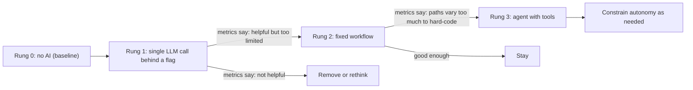

# Incrementally Adding AI to a Product

## Introduction

The riskiest way to add AI to a product is the "big launch": six months building an ambitious autonomous agent, then shipping it to
every customer at once. When it misbehaves (and it will in some cases), you find out from angry users, you have no baseline to compare
against, and turning it off means removing a headline feature.

The safer path is the one good teams use for any risky change: **ship something small, measure it, and grow it.** For AI features
that path has a natural shape, a ladder with three rungs:

1. **A single LLM call** that does one well-defined job, such as summarizing a ticket.
2. **A workflow**: a few LLM calls and normal code chained in a fixed order, such as classify, then retrieve docs, then draft a reply.
3. **An agent** that decides for itself which tools to use and when it is done.

Each rung adds capability *and* cost, latency, and unpredictability. You climb only when the data shows the lower rung is not
enough. Many features never need to leave rung one, and that is a success, not a failure.

Think of it like learning to drive: parking lot, quiet streets, then highways. You *could* start on the highway, but you would learn
expensive lessons there.



## Step 0: Know Your Baseline

Before writing any AI code, measure the thing you want to improve, without AI. If your goal is "support agents resolve tickets
faster", record today's median handle time, first-response time, and customer satisfaction. Without a baseline you cannot tell
whether the AI helped, and you will end up arguing from anecdotes.

Also write down **what a failure looks like**. For a ticket summary, a failure is a summary that misstates the customer's problem.
For an auto-reply, a failure is a wrong answer sent to a customer. Different failures need different safeguards.

## Rung 1: A Single LLM Call Behind a Feature Flag

Pick a feature where:

- The task is narrow and the output is easy to judge.
- A human sees the output before it matters (suggest, do not act).
- There is an obvious non-AI fallback.

"Summarize this long ticket thread at the top of the page" fits perfectly. The support agent still reads the thread if the summary
looks wrong.

### The feature flag

Wrap the AI path in a flag so you can enable it for internal users, then a few customers, then a percentage, and switch it off
instantly without a deploy. You can use a flag service (LaunchDarkly, Unleash, Flagsmith, GrowthBook, OpenFeature-compatible
providers) or a simple table. A minimal version:

```python
# flags.py
import hashlib

FLAGS = {
    "ticket_summary": {"enabled": True, "orgs": {"org_internal", "org_pilot_1"}, "percent": 10},
}


def is_enabled(flag: str, org_id: str) -> bool:
    cfg = FLAGS.get(flag)
    if not cfg or not cfg["enabled"]:
        return False
    if org_id in cfg["orgs"]:
        return True
    # Stable bucketing: the same org always lands in the same bucket.
    bucket = int(hashlib.sha256(f"{flag}:{org_id}".encode()).hexdigest(), 16) % 100
    return bucket < cfg["percent"]


for org in ["org_internal", "org_42", "org_63", "org_1234"]:
    print(org, is_enabled("ticket_summary", org))
```

Output:

```text
org_internal True
org_42 False
org_63 True
org_1234 False
```

Stable bucketing by organization (not by request) matters: a customer should not see the feature appear and disappear on every
page load. The site's [Feature Flags](../../../devops/cicd/3-cicd-practices/10-cicd-feature-flags.mdx) tutorial covers flags in more depth.

### The call, with a fallback

```python
# summary.py
import logging
import time

import anthropic
from anthropic import Anthropic

from flags import is_enabled

log = logging.getLogger("ai.summary")
client = Anthropic(timeout=15.0, max_retries=1)
PROMPT_VERSION = "summary-v3"


def summarize_ticket(org_id: str, ticket_text: str) -> dict:
    if not is_enabled("ticket_summary", org_id):
        return {"summary": None, "source": "disabled"}

    started = time.monotonic()
    try:
        response = client.messages.create(
            model="claude-haiku-5-5",  # small, fast model for a narrow task
            max_tokens=300,
            system="Summarize the support ticket in 2-3 sentences: the problem, what was tried, and what is still needed.",
            messages=[{"role": "user", "content": ticket_text[:20000]}],
        )
        summary = "".join(b.text for b in response.content if b.type == "text").strip()
        log.info("summary ok", extra={
            "org_id": org_id, "prompt_version": PROMPT_VERSION,
            "latency_ms": int((time.monotonic() - started) * 1000),
            "input_tokens": response.usage.input_tokens, "output_tokens": response.usage.output_tokens,
        })
        return {"summary": summary, "source": "ai", "prompt_version": PROMPT_VERSION}
    except anthropic.APIError as exc:  # covers status, connection, and timeout errors
        # Fallback: the page renders exactly as it did before AI existed.
        log.warning("summary failed: %s", type(exc).__name__)
        return {"summary": None, "source": "fallback"}
```

The design choices here are what make rung 1 safe:

- **Fail closed to the old experience.** If the API is slow or down, the user sees the normal ticket page, not an error.
- **A tight timeout** (15 seconds) and **one retry**. A summary that arrives after the user has already read the thread is worthless.
- **A small model.** Summarization rarely needs the largest model. Start small and move up only if evals show a quality gap. See
  [Choosing the Right Model](../1-agents-llm-apis/10-agents-model-selection.mdx).
- **Logging the prompt version, latency, and tokens** on every call, so you can compare versions later.

## Measuring What Matters

Instrument the feature from day one. Useful metrics fall into four groups:

| Group | Metric | How to collect |
|---|---|---|
| Usage | Share of eligible users who use it; repeat usage after a week | Product analytics events |
| Quality | Thumbs up/down rate; acceptance rate of suggestions; how much users edit AI drafts before sending | UI events, diffing draft vs sent |
| Outcome | The baseline metric (handle time, resolution rate, conversion) for flag-on vs flag-off groups | Compare cohorts |
| Operations | p50/p95 latency, error and fallback rate, tokens and cost per use, cost per *successful* use | Server logs, traces |

Two of these deserve special attention:

- **Acceptance and edit rate** are often better quality signals than thumbs ratings, because few users click thumbs. If agents send
  AI drafts unchanged 70% of the time, the drafts are useful. If they rewrite nearly every one, they are not.
- **Cost per successful use** is the number your finance team will eventually ask about. Divide total LLM spend for the feature by the
  number of accepted outputs, not by the number of calls.

Capturing feedback can be a small endpoint:

```python
# feedback.py
from typing import Literal

from fastapi import FastAPI
from pydantic import BaseModel

app = FastAPI()
EVENTS: list[dict] = []  # send to your analytics pipeline in production


class Feedback(BaseModel):
    feature: str
    run_id: str
    rating: Literal["up", "down"] | None = None
    accepted: bool | None = None
    edited_chars: int | None = None


@app.post("/v1/ai-feedback", status_code=204)
async def record_feedback(fb: Feedback) -> None:
    EVENTS.append(fb.model_dump())
```

Link every feedback event to a `run_id`, so you can open the exact prompt, model, and output behind a thumbs-down. Thumbs-down
examples become test cases for your evaluation set. See
[Building Evaluation Datasets](../11-agents-evaluation-and-testing/1-agents-building-eval-sets.mdx).

## Rung 2: From One Call to a Workflow

Suppose the summary is a hit, and support leads now ask: "Can it also draft the reply?" A good reply needs the right help-center
articles and the customer's plan. That is more than one call, but the steps are **predictable**: classify, retrieve, draft. A fixed
workflow handles it.

```python
# reply_workflow.py
from anthropic import Anthropic

client = Anthropic()


def classify(ticket: str) -> str:
    r = client.messages.create(
        model="claude-haiku-5-5", max_tokens=10,
        system="Reply with exactly one word: billing, bug, howto, or other.",
        messages=[{"role": "user", "content": ticket}],
    )
    label = r.content[0].text.strip().lower() if r.content and r.content[0].type == "text" else "other"
    return label if label in {"billing", "bug", "howto", "other"} else "other"


def retrieve_articles(category: str, ticket: str) -> list[str]:
    # Normal code: your search index, filtered by category. No LLM needed.
    return [f"Help article about {category}"]


def draft_reply(ticket: str, articles: list[str]) -> str:
    context = "\n\n".join(articles)
    r = client.messages.create(
        model="claude-sonnet-5-5", max_tokens=800,
        system="Draft a friendly support reply using only the provided articles. If they do not answer the question, say a specialist will follow up.",
        messages=[{"role": "user", "content": f"Articles:\n{context}\n\nTicket:\n{ticket}"}],
    )
    return "".join(b.text for b in r.content if b.type == "text")


def suggest_reply(ticket: str) -> dict:
    category = classify(ticket)
    if category == "other":
        return {"draft": None, "reason": "not confident"}  # humans handle the long tail
    articles = retrieve_articles(category, ticket)
    return {"draft": draft_reply(ticket, articles), "category": category}
```

A workflow is still easy to reason about: each step can be tested and measured on its own, you know the maximum number of LLM calls
(two), and costs are predictable. Notice the **escape hatch**: when the classifier is unsure, the workflow does nothing. Declining to
help is a valid, safe output. [Prompt Chaining](../6-agents-planning-and-reasoning/1-agents-prompt-chaining.mdx) and
[Routing](../6-agents-planning-and-reasoning/2-agents-routing.mdx) cover these patterns in detail.

## Rung 3: From Workflow to Agent

Move to an agent when the metrics show a pattern like this: drafts are good for simple tickets, but the tickets humans still struggle
with need *different* information each time. One needs the customer's recent invoices, another needs the status of a known bug,
another needs the last three conversations. Hard-coding every path becomes a mess. That is the signal that **the model should choose
the steps**.

Even then, climb carefully:

1. **Read-only tools first.** The agent can look things up (`get_invoices`, `get_bug_status`, `search_past_tickets`) but still only
   produces a draft for a human.
2. **Shadow mode.** Run the agent alongside the workflow for a slice of traffic, store both outputs, and compare them offline or with
   reviewers before showing agent drafts to anyone.
3. **Write actions with approval.** Later, add actions like "issue a refund under 20 dollars" that require a human click. See
   [Human Approval Gates](../12-agents-safety-and-security/7-agents-approval-gates.mdx).
4. **Limited autonomy.** Only after a long record of correct approved actions should you consider letting the agent act on its own,
   and only for low-risk, reversible actions.

A shadow-mode wrapper is straightforward:

```python
# shadow.py
import asyncio
import logging

log = logging.getLogger("ai.shadow")


async def workflow_reply(ticket: str) -> str:
    return "draft from workflow"


async def agent_reply(ticket: str) -> str:
    return "draft from agent"


async def suggest(ticket: str, shadow_enabled: bool) -> str:
    primary = await workflow_reply(ticket)  # what the user sees
    if shadow_enabled:
        async def run_shadow() -> None:
            try:
                candidate = await asyncio.wait_for(agent_reply(ticket), timeout=60)
                log.info("shadow result", extra={"primary": primary, "candidate": candidate})
            except Exception as exc:  # shadow failures must never affect users
                log.warning("shadow failed: %s", exc)
        asyncio.create_task(run_shadow())  # keep a reference in real code so it is not garbage-collected
    return primary


print(asyncio.run(suggest("My invoice is wrong", shadow_enabled=False)))
```

Output:

```text
draft from workflow
```

The user-facing behavior does not change while you gather evidence. The cost does, so shadow a sample of traffic rather than all of it.

## Fallbacks at Every Rung

Every AI feature needs an answer to "what happens when the AI part fails?" Plan the fallbacks in layers:

| Failure | Fallback |
|---|---|
| Provider timeout or outage | Show the non-AI experience; optionally retry once with a different model or provider |
| Rate limit hit | Queue the work or degrade to a smaller model |
| Output fails validation (wrong format, empty, too long) | Retry once, then hide the AI output |
| Agent exceeds turn or cost budget | Stop and hand off to a human with the partial context |
| Quality regression after a prompt or model change | Flip the flag back to the previous version |
| Cost spike | Per-org budgets; kill switch on the flag |

That last-but-one row is why you version prompts and keep the old version deployable. A flag that selects `summary-v3` or `summary-v2`
turns a quality incident into a one-minute rollback. See
[Versioning Prompts, Tools and Models](../13-agents-production/7-agents-versioning.mdx) and
[Reliability and Fallbacks](../13-agents-production/5-agents-reliability-and-fallbacks.mdx).

## Real-World Scenario

You run engineering at a mid-sized helpdesk SaaS. The CEO wants "an AI agent that resolves tickets automatically" by next quarter.
Your team has never shipped an LLM feature.

**A ladder-based plan:**

- **Weeks 1 to 3, rung 1:** Ticket summaries for internal support staff, behind a flag, using a small model. Measure handle time for
  flag-on vs flag-off agents and summary thumbs ratings. Build the logging, cost dashboard, and evaluation set you will reuse later.
- **Weeks 4 to 8, rung 2:** Suggested replies using a classify, retrieve, draft workflow for three pilot customers. Track acceptance and
  edit rate per category. Discover that billing questions get 75% acceptance while bug reports get 20% (illustrative numbers you would
  measure yourself).
- **Weeks 9 to 12, rung 3 in shadow:** For bug reports only, an agent with read-only tools (bug tracker status, recent deploys,
  customer environment). Compare its drafts against human replies offline.
- **Next quarter:** Promote the agent for bug reports where shadow results beat the workflow. Consider auto-sending only for one narrow,
  high-acceptance category (for example "how do I reset my password") with a human-review sample.

### Why this approach

Each step ships value within weeks, builds the infrastructure the next step needs (flags, logging, evals, feedback), and produces data
that justifies, or rejects, the next investment. The CEO gets visible progress, and the team learns the failure modes on low-risk
features before an agent can send anything to a customer.

### When to use it and when not to

Use the ladder for any customer-facing AI feature in an existing product, especially when your team is new to LLMs. You can skip rungs
when the task is inherently open-ended (for example a coding assistant, where a single call cannot do anything useful) or for internal
prototypes where the cost of mistakes is low. Even then, keep the flag, the metrics, and the fallback.

### Alternatives and trade-offs

| Approach | Pros | Cons | Best for |
|---|---|---|---|
| Incremental ladder (this page) | Low risk, data-driven, reusable foundations | Slower to reach the most ambitious version | Most existing products |
| Big-bang agent launch | Fast headline feature | High risk, no baseline, hard to debug | Rarely appropriate |
| Internal-only first (dogfooding) | Real usage with forgiving users | Internal users differ from customers | Any team, as a first stage |
| Buy an off-the-shelf AI add-on | Fastest to market | Less control, generic behavior, data sharing | Commodity features like generic chat |
| Beta opt-in program | Engaged users give rich feedback | Self-selected users skew metrics | B2B products with close customers |

## Common Mistakes

- **Starting with the agent.** Most of the value often sits in rung 1 or 2, at a fraction of the cost and risk.
- **No baseline.** Without "before" numbers you cannot prove the feature helps.
- **Per-request random rollout.** Users see the feature flicker. Bucket by user or organization.
- **No kill switch.** You need to be able to turn AI off in seconds, without a deploy.
- **Fallback equals error page.** The fallback should be the product as it worked before AI.
- **Measuring only thumbs ratings.** Few users click them. Track acceptance, edits, and outcome metrics.
- **Ignoring cost per success.** A feature that costs more than the time it saves is not a win.
- **Changing prompt and model at the same time.** Change one variable per release so you know what caused a metric shift.

## Summary

- Add AI in rungs: a single call, then a workflow, then an agent. Climb only when metrics justify it.
- Measure the non-AI baseline first, and define what failure looks like.
- Put every AI path behind a feature flag with stable bucketing and an instant kill switch.
- Design fallbacks so failures quietly return users to the pre-AI experience.
- Track usage, quality (acceptance, edits), outcomes, latency, and cost per successful use.
- Use shadow mode and read-only tools before giving an agent write actions, and approval gates before autonomy.

## Exercises

1. Pick a feature in an app you know. Write a one-page plan with the baseline metric, the rung-1 version, its fallback, and the signal
   that would justify rung 2.
2. Extend `is_enabled` to support a `prompt_version` variant per bucket (A/B test `summary-v2` against `summary-v3`) and log which
   variant each org received.
3. Build a small dashboard query: given a table of runs and feedback events, compute acceptance rate and cost per accepted output per
   prompt version.
4. Add a "model fallback" to `summarize_ticket`: on `RateLimitError` or overload, retry once with a different model, and record which
   model produced the result.

**Related pages:**

- [When Should You Build an Agent?](../0-agents-fundamentals/7-agents-when-to-build.mdx)
- [Levels of Agent Autonomy](../0-agents-fundamentals/6-agents-autonomy-levels.mdx)
- [Monitoring and Alerting](../13-agents-production/6-agents-monitoring-and-alerting.mdx)
- [Cost Optimization](../13-agents-production/4-agents-cost-optimization.mdx)
- [Integrating Agents into Existing Applications](./0-agents-integration-overview.mdx)
