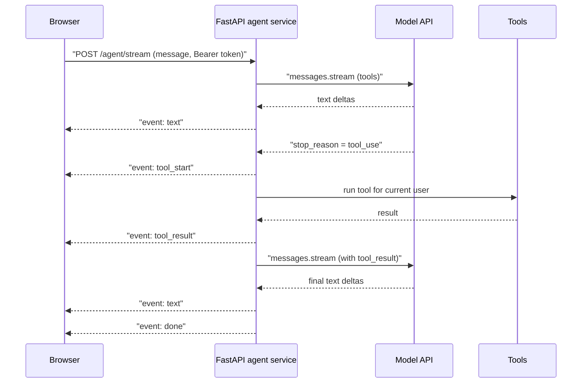
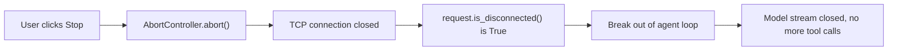

# Streaming Agent Output to a Frontend

## Introduction

An agent run can take anywhere from a few seconds to a few minutes. It calls the model, runs a tool, calls the model again, runs two more tools, and finally writes an answer. If your frontend waits for the whole run to finish before showing anything, the user stares at a spinner and wonders whether the app is broken.

**Streaming** fixes that. Instead of one big response at the end, the server pushes small updates as they happen:

- text tokens as the model writes them
- "Searching orders..." when a tool starts
- "Found 3 orders" when the tool finishes
- a final "done" marker with usage information

Think of it like a food delivery app. You could wait 40 minutes for a knock on the door, or you could watch "Order confirmed → Cooking → Driver picked up → 2 minutes away." The food arrives at the same time either way, but the second experience feels faster and builds trust.

In this page you will:

1. Design a small, typed **event protocol** for agent progress.
2. Stream an agent loop from **FastAPI** using **Server-Sent Events (SSE)**.
3. Consume the stream in **TypeScript** with `fetch` and a `ReadableStream` parser.
4. Handle cancellation, client disconnects, proxy buffering, and reconnects.
5. Compare SSE with WebSockets and polling.

This page assumes you know how token streaming works for a single model call. If not, read [Streaming Responses](../1-agents-llm-apis/5-agents-streaming.mdx) first. The agent loop itself is covered in [Building a Manual Agent Loop](../2-agents-tool-use/3-agents-manual-agent-loop.mdx).

## Why Agents Need More Than Token Streaming

A plain chatbot only streams text. An agent produces several kinds of output, and the user cares about all of them:

| Output | Example | Why the user cares |
| --- | --- | --- |
| Text deltas | "Your last invoice was..." | Reading starts immediately |
| Tool start | `search_orders` with query "late" | Shows the agent is working, not stuck |
| Tool result summary | "3 orders found" | Builds trust and lets users spot mistakes early |
| Errors | "Billing service unavailable" | Lets the UI show a fallback instead of hanging |
| Done | stop reason, token usage | Lets the UI re-enable the input box |

If you only forward raw provider events to the browser, you couple your frontend to one model provider's wire format. A better design is to translate provider events into **your own** small set of events. Then you can switch providers, add a tool, or change the loop without touching the frontend.

## The Overall Flow



The browser holds one HTTP connection open for the whole run. The server writes events into it as the loop progresses.

## Step 1: Define an Event Protocol

Start with the contract between backend and frontend. Keeping it small makes both sides easy to test.

```python
# events.py
from typing import Literal

from pydantic import BaseModel


class TextEvent(BaseModel):
    type: Literal["text"] = "text"
    delta: str


class ToolStartEvent(BaseModel):
    type: Literal["tool_start"] = "tool_start"
    tool_use_id: str
    name: str
    label: str  # human-friendly, e.g. "Searching orders"


class ToolResultEvent(BaseModel):
    type: Literal["tool_result"] = "tool_result"
    tool_use_id: str
    ok: bool
    summary: str  # short text for the UI, not the full tool output


class DoneEvent(BaseModel):
    type: Literal["done"] = "done"
    stop_reason: str
    input_tokens: int
    output_tokens: int


class ErrorEvent(BaseModel):
    type: Literal["error"] = "error"
    message: str
    retryable: bool


AgentEvent = TextEvent | ToolStartEvent | ToolResultEvent | DoneEvent | ErrorEvent
```

Notice two choices:

- `ToolResultEvent` carries a **summary**, not the raw tool output. Raw output may be large or contain data the UI should not display (internal IDs, other customers' fields that the tool filtered later, and so on).
- `ErrorEvent` has a `retryable` flag so the UI can decide between "Try again" and "Contact support."

The matching TypeScript type for the frontend:

```typescript
// agentEvents.ts
export type AgentEvent =
  | { type: "text"; delta: string }
  | { type: "tool_start"; tool_use_id: string; name: string; label: string }
  | { type: "tool_result"; tool_use_id: string; ok: boolean; summary: string }
  | { type: "done"; stop_reason: string; input_tokens: number; output_tokens: number }
  | { type: "error"; message: string; retryable: boolean };
```

## Step 2: An Agent Loop That Yields Events

Next, write the agent loop as an **async generator**. Instead of returning a final answer, it `yield`s events. This makes the loop independent of HTTP: you can test it in a script, reuse it in a background job, or plug it into SSE.

```python
# agent_stream.py
import json
from collections.abc import AsyncIterator

import anthropic
from anthropic import AsyncAnthropic

from events import AgentEvent, DoneEvent, ErrorEvent, TextEvent, ToolResultEvent, ToolStartEvent

client = AsyncAnthropic()  # reads ANTHROPIC_API_KEY

TOOLS = [
    {
        "name": "search_orders",
        "description": "Search the current user's orders by status. Returns at most 10 orders.",
        "input_schema": {
            "type": "object",
            "properties": {
                "status": {"type": "string", "enum": ["pending", "shipped", "late", "delivered"]}
            },
            "required": ["status"],
        },
    }
]

TOOL_LABELS = {"search_orders": "Searching your orders"}


async def run_tool(name: str, args: dict, user_id: str) -> tuple[str, str]:
    """Run a tool for this user. Returns (content_for_model, summary_for_ui)."""
    if name == "search_orders":
        # In a real app, query your database scoped to user_id.
        orders = [{"id": "A-1001", "status": args["status"], "eta": "2026-10-14"}]
        return json.dumps(orders), f"{len(orders)} order(s) found"
    raise ValueError(f"Unknown tool: {name}")


async def agent_events(user_message: str, user_id: str, max_turns: int = 8) -> AsyncIterator[AgentEvent]:
    messages = [{"role": "user", "content": user_message}]
    usage_in = usage_out = 0

    try:
        for _ in range(max_turns):
            async with client.messages.stream(
                model="claude-opus-5-5",
                max_tokens=16000,
                system="You are a helpful order-support assistant. Use tools to look up facts.",
                tools=TOOLS,
                messages=messages,
            ) as stream:
                async for event in stream:
                    if event.type == "text":
                        yield TextEvent(delta=event.text)
                response = await stream.get_final_message()

            usage_in += response.usage.input_tokens
            usage_out += response.usage.output_tokens
            messages.append({"role": "assistant", "content": response.content})

            if response.stop_reason == "pause_turn":
                continue
            if response.stop_reason != "tool_use":
                yield DoneEvent(stop_reason=response.stop_reason, input_tokens=usage_in, output_tokens=usage_out)
                return

            tool_results = []
            for block in response.content:
                if block.type != "tool_use":
                    continue
                yield ToolStartEvent(tool_use_id=block.id, name=block.name, label=TOOL_LABELS.get(block.name, block.name))
                try:
                    content, summary = await run_tool(block.name, block.input, user_id)
                    tool_results.append({"type": "tool_result", "tool_use_id": block.id, "content": content})
                    yield ToolResultEvent(tool_use_id=block.id, ok=True, summary=summary)
                except Exception as exc:
                    tool_results.append(
                        {"type": "tool_result", "tool_use_id": block.id, "content": str(exc), "is_error": True}
                    )
                    yield ToolResultEvent(tool_use_id=block.id, ok=False, summary="Tool failed")
            # All tool results go back in ONE user message
            messages.append({"role": "user", "content": tool_results})

        yield ErrorEvent(message="The agent hit its step limit.", retryable=False)
    except anthropic.RateLimitError:
        yield ErrorEvent(message="The assistant is busy. Please retry in a moment.", retryable=True)
    except anthropic.APIStatusError as exc:
        yield ErrorEvent(message=f"Model API error ({exc.status_code}).", retryable=exc.status_code >= 500)
    except anthropic.APIConnectionError:
        yield ErrorEvent(message="Could not reach the model API.", retryable=True)
```

A few details worth pointing out:

- `messages.stream(...)` emits high-level `text` events, so you do not need to parse raw `content_block_delta` events yourself.
- `get_final_message()` gives you the complete assistant turn, including `tool_use` blocks, to append to the history.
- Errors become **events**, not exceptions. Once you have started sending a 200 response, you can no longer change the HTTP status code, so the error must travel inside the stream.
- `max_turns` is a hard budget. See [Stopping Conditions and Budgets](../6-agents-planning-and-reasoning/10-agents-stopping-conditions.mdx).

Because the loop is a plain async generator, you can test it with `async for ev in agent_events(...)` in a script, with no web server involved.

## Step 3: Serve It with Server-Sent Events

**Server-Sent Events (SSE)** is a simple standard for one-way server-to-client streaming over plain HTTP. The response has `Content-Type: text/event-stream`, and each message looks like this:

```text
event: text
id: 7
data: {"type":"text","delta":"Hello"}

```

A blank line ends each message. That is the whole format.

### Using FastAPI's built-in SSE support

FastAPI added first-class SSE support in version **0.135.0** with `EventSourceResponse` and `ServerSentEvent` in the `fastapi.sse` module. Check the [FastAPI SSE docs](https://fastapi.tiangolo.com/tutorial/server-sent-events/) for the current details, since this is a recent addition.

```python
# main.py
from collections.abc import AsyncIterable
from contextlib import aclosing
from dataclasses import dataclass

from fastapi import Depends, FastAPI, Header, HTTPException, Request
from fastapi.sse import EventSourceResponse, ServerSentEvent
from pydantic import BaseModel

from agent_stream import agent_events

app = FastAPI()


@dataclass
class User:
    id: str
    org_id: str
    roles: list[str]


async def get_current_user(authorization: str = Header(...)) -> User:
    # Replace with real token verification (JWT, session lookup, etc.)
    if authorization != "Bearer demo-token":
        raise HTTPException(status_code=401, detail="Invalid token")
    return User(id="u_42", org_id="org_1", roles=["member"])


class ChatRequest(BaseModel):
    message: str


@app.post("/agent/stream", response_class=EventSourceResponse)
async def stream_agent(
    body: ChatRequest,
    request: Request,
    user: User = Depends(get_current_user),
) -> AsyncIterable[ServerSentEvent]:
    seq = 0
    # aclosing() guarantees the generator is closed right away on break
    async with aclosing(agent_events(body.message, user_id=user.id)) as events:
        async for ev in events:
            if await request.is_disconnected():
                # The browser went away: stop calling the model and tools.
                break
            seq += 1
            yield ServerSentEvent(data=ev, event=ev.type, id=str(seq))
```

What FastAPI handles for you here, according to its docs:

- It JSON-encodes `data` (Pydantic models work directly).
- It sends a `ping` comment every 15 seconds when nothing else is sent, which keeps idle proxies from closing the connection while a slow tool runs.
- It sets `Cache-Control: no-cache` and `X-Accel-Buffering: no` so caches and Nginx do not hold back events.

Authentication happens **before** the stream starts. If the token is bad, `get_current_user` raises a normal 401 and no stream is opened. That is much easier to handle on the client than an error event.

### Older FastAPI: StreamingResponse

On FastAPI versions before 0.135.0 (or with plain Starlette), you can build SSE by hand with `StreamingResponse`. You format each message yourself:

```python
# main_legacy.py
from collections.abc import AsyncIterator

from fastapi import FastAPI, Request
from fastapi.responses import StreamingResponse
from pydantic import BaseModel

from agent_stream import agent_events

app = FastAPI()


class ChatRequest(BaseModel):
    message: str


def sse(event: str, data: str, event_id: int) -> str:
    return f"event: {event}\nid: {event_id}\ndata: {data}\n\n"


@app.post("/agent/stream")
async def stream_agent(body: ChatRequest, request: Request) -> StreamingResponse:
    async def gen() -> AsyncIterator[str]:
        seq = 0
        async for ev in agent_events(body.message, user_id="u_42"):
            if await request.is_disconnected():
                break
            seq += 1
            yield sse(ev.type, ev.model_dump_json(), seq)

    return StreamingResponse(
        gen(),
        media_type="text/event-stream",
        headers={"Cache-Control": "no-cache", "X-Accel-Buffering": "no"},
    )
```

The trade-off: you now own keep-alive pings and must make sure `data` never contains a raw newline (`model_dump_json()` escapes newlines inside strings, so JSON is safe). The third-party `sse-starlette` package is another common option on older stacks.

## Step 4: Consume the Stream in TypeScript

Browsers ship a built-in `EventSource` class for SSE, but it has two limits that matter for agents:

- It only sends **GET** requests, so you cannot POST a message body.
- It cannot set custom headers, so you cannot send an `Authorization: Bearer ...` header.

So most agent frontends use `fetch` and read the response body as a stream. You need a tiny SSE parser:

```typescript
// streamAgent.ts
import type { AgentEvent } from "./agentEvents";

export async function streamAgent(
  message: string,
  token: string,
  onEvent: (ev: AgentEvent) => void,
  signal: AbortSignal,
): Promise<void> {
  const res = await fetch("/agent/stream", {
    method: "POST",
    headers: {
      "Content-Type": "application/json",
      Accept: "text/event-stream",
      Authorization: `Bearer ${token}`,
    },
    body: JSON.stringify({ message }),
    signal,
  });

  if (!res.ok || !res.body) {
    throw new Error(`Request failed with status ${res.status}`);
  }

  const reader = res.body.pipeThrough(new TextDecoderStream()).getReader();
  let buffer = "";

  while (true) {
    const { value, done } = await reader.read();
    if (done) break;
    buffer += value;

    // SSE messages are separated by a blank line
    let sep: number;
    while ((sep = buffer.indexOf("\n\n")) !== -1) {
      const raw = buffer.slice(0, sep);
      buffer = buffer.slice(sep + 2);

      const dataLines = raw
        .split("\n")
        .filter((line) => line.startsWith("data:"))
        .map((line) => line.slice(5).trimStart());

      if (dataLines.length === 0) continue; // comment or ping
      onEvent(JSON.parse(dataLines.join("\n")) as AgentEvent);
    }
  }
}
```

Key points:

- Network chunks do **not** line up with SSE messages. One chunk can hold half a message or three messages, so you keep a `buffer` and only parse complete messages.
- Lines starting with `:` are comments (FastAPI's keep-alive pings). The parser skips them because they have no `data:` line.
- `TextDecoderStream` handles multi-byte UTF-8 characters split across chunks. Decoding each chunk separately with `new TextDecoder().decode(chunk)` without `{ stream: true }` can corrupt emoji and non-English text.

:::note
Some servers send `\r\n` line endings. If you talk to services you do not control, normalize with `buffer.replace(/\r\n/g, "\n")` before splitting. Libraries such as `eventsource-parser` handle every edge case of the spec if you prefer not to maintain your own parser.
:::

### Using it with a stop button

```typescript
// usage.ts
import { streamAgent } from "./streamAgent";

const controller = new AbortController();
let answer = "";

document.getElementById("stop")!.addEventListener("click", () => controller.abort());

streamAgent(
  "Are any of my orders late?",
  "demo-token",
  (ev) => {
    switch (ev.type) {
      case "text":
        answer += ev.delta;
        console.log(answer);
        break;
      case "tool_start":
        console.log(`⏳ ${ev.label}...`);
        break;
      case "tool_result":
        console.log(ev.ok ? `✔ ${ev.summary}` : `✖ ${ev.summary}`);
        break;
      case "error":
        console.error(ev.message, ev.retryable ? "(retry possible)" : "");
        break;
      case "done":
        console.log(`Done: ${ev.output_tokens} output tokens`);
        break;
    }
  },
  controller.signal,
).catch((err) => {
  if (err.name === "AbortError") console.log("Stopped by user");
  else console.error(err);
});
```

Example output:

```text
⏳ Searching your orders...
✔ 1 order(s) found
Yes, one
Yes, one order is late: A-1001,
Yes, one order is late: A-1001, now expected on October 14.
Done: 64 output tokens
```

## Step 5: Cancellation and Disconnects

When a user clicks **Stop** or closes the tab, `controller.abort()` closes the HTTP connection. That is only half the job. The server must notice and **stop working**, or it keeps paying for model tokens and may even keep running tools nobody is waiting for.



In the FastAPI handler above, the loop checks `request.is_disconnected()` between events. When the client is gone, breaking out of the loop makes `contextlib.aclosing` close the `agent_events` generator immediately (instead of whenever it is garbage collected), which exits the `async with client.messages.stream(...)` block and closes the upstream model connection.

Two caveats:

- A tool that is already running will usually finish. If a tool has side effects (sending an email, issuing a refund), decide whether it should complete even if the user disconnects. Often the answer is yes, and you record the result for the next session.
- Disconnect detection is not instant. Behind some proxies the server only learns about the disconnect when it next tries to write. Keep events flowing (pings help) so writes happen regularly.

## Step 6: Proxies, Buffering, and Timeouts

Streaming works on your laptop and then mysteriously arrives all at once in production. The usual cause is something in the middle **buffering** the response:

| Component | Problem | Fix |
| --- | --- | --- |
| Nginx | Buffers responses by default | `X-Accel-Buffering: no` header or `proxy_buffering off;` |
| Load balancers | Idle timeout (often around 60 seconds) closes long silent connections | Send keep-alive pings; raise the idle timeout |
| Compression middleware | Gzip may wait for a full block before flushing | Exclude `text/event-stream` from compression |
| Serverless platforms | Some limit response duration or buffer output | Check your platform's streaming support and max duration |
| Corporate proxies | Some buffer everything | Polling fallback (see below) |

:::caution
Default timeout values differ between providers and change over time. Check your load balancer and hosting documentation rather than assuming a number.
:::

## Step 7: Reconnecting with Last-Event-ID

Mobile networks drop. If the connection breaks mid-run, you have two choices:

1. **Start over.** Simple, but it wastes tokens and may repeat tool calls.
2. **Resume.** Keep the run going on the server, store its events, and let the client pick up where it left off.

SSE has resume built in. Each event has an `id`. When a client reconnects, it sends the last ID it saw in the `Last-Event-ID` header. To support this, the agent run must not live inside the HTTP request. Instead, the run writes events to a store (Redis Streams, a database table) keyed by `run_id`, and the SSE endpoint replays from that store:

```python
# resume.py
from collections.abc import AsyncIterable
from typing import Annotated

from fastapi import FastAPI, Header
from fastapi.sse import EventSourceResponse, ServerSentEvent

app = FastAPI()

# Stand-in for Redis Streams or a DB table: run_id -> list of (seq, event_dict)
RUN_EVENTS: dict[str, list[tuple[int, dict]]] = {}


@app.get("/runs/{run_id}/events", response_class=EventSourceResponse)
async def run_events(
    run_id: str,
    last_event_id: Annotated[int | None, Header()] = None,
) -> AsyncIterable[ServerSentEvent]:
    start = (last_event_id or 0) + 1
    for seq, event in RUN_EVENTS.get(run_id, []):
        if seq >= start:
            yield ServerSentEvent(data=event, event=event["type"], id=str(seq))
    # A real implementation keeps waiting for new events until "done" or "error".
```

This pattern, where the run is started by one request and observed by another, is exactly the architecture in [Running Agents as Background Jobs](./3-agents-background-jobs.mdx). Use it when runs are long or networks are unreliable. For short chat replies, "start over on error" is usually fine.

## Real-World Scenario

Your team runs a SaaS helpdesk. Support agents (the humans) use an "AI draft reply" panel that reads the ticket, searches the knowledge base, looks up the customer's plan, and drafts an answer. Runs take 8 to 30 seconds. In the first version the panel showed a spinner until the draft was done. Support staff complained that it "felt slow" and that they could not tell when it was stuck.

**The solution:**

1. Keep the existing agent loop but turn it into an async generator of typed events.
2. Expose it as `POST /tickets/{ticket_id}/draft/stream` with `EventSourceResponse`. Authenticate the support agent with the existing session cookie dependency, and load the ticket server-side using `ticket_id` and the user's org.
3. In the React panel, show tool steps as a checklist ("Reading ticket ✔", "Searching knowledge base ✔", "Checking plan ⏳") and stream the draft text into the editor.
4. Add a **Stop** button wired to `AbortController`. The server checks `request.is_disconnected()` and stops the loop, so abandoned drafts stop costing tokens.
5. Set `X-Accel-Buffering: no` (FastAPI does it automatically) and raise the load balancer idle timeout above the longest expected silent gap.

**Why this approach:** The first text appears within a second or two, and the tool checklist proves the system is working. SSE runs over plain HTTP, so it works with the existing auth cookies, CORS settings, and load balancer, with no new infrastructure.

**When to use it:** interactive features where a person is watching, runs under a few minutes, and one-way server-to-client updates.

**When not to use it:** jobs that take many minutes or run with nobody watching (use background jobs and notifications), or features where the user must send messages *during* the run, such as interrupting with new instructions. That calls for WebSockets.

| Approach | Pros | Cons | Best for |
| --- | --- | --- | --- |
| SSE over fetch | Plain HTTP, works with existing auth and proxies, simple server code | One direction only; custom parser needed for POST | Chat and agent progress in web apps |
| Native `EventSource` | Built-in auto-reconnect with `Last-Event-ID` | GET only, no custom headers | Observing a run started elsewhere, cookie auth |
| WebSockets | Two-way, low overhead per message | Stateful connections, harder to scale and load balance, separate auth handshake | Voice, collaborative editing, interrupting a running agent |
| Polling a run status endpoint | Works everywhere, trivially cacheable | Higher latency, more requests, no token-by-token text | Long background runs, restrictive networks |
| Wait for full response | Simplest possible code | Poor UX for anything over a couple of seconds | Very short single LLM calls |

## Common Mistakes

- **Forwarding raw provider events to the browser.** You lock the frontend to one SDK's format and may leak internal data (full tool inputs, thinking content). Translate to your own event protocol.
- **Parsing each network chunk as a complete message.** Chunks split anywhere. Always buffer until the blank-line separator.
- **Ignoring disconnects.** Without `request.is_disconnected()` checks, a closed tab still burns tokens until the agent finishes.
- **Raising exceptions after the stream started.** The client sees a truncated stream with no explanation. Send an `error` event, then end the stream.
- **Sending full tool outputs to the UI.** They can be large and may contain fields the user should not see. Send short summaries.
- **Using `EventSource` with a Bearer token in the URL query string.** URLs end up in logs and browser history. Use fetch with headers, or cookie auth.
- **Forgetting the proxy.** Test streaming through the same proxy and load balancer you use in production, not only against `localhost`.

## Summary

- Agents produce text, tool progress, errors, and completion signals. Stream all of them, not just text.
- Define a small, typed event protocol that you own, and translate provider events into it.
- Write the agent loop as an async generator so it is reusable outside HTTP.
- FastAPI 0.135.0+ provides `EventSourceResponse` and `ServerSentEvent` with keep-alive pings and anti-buffering headers. On older versions, use `StreamingResponse` with `text/event-stream`.
- In the browser, use `fetch` plus a buffered SSE parser so you can POST and send auth headers.
- Wire a Stop button to `AbortController`, and check `request.is_disconnected()` on the server to stop spending.
- For resumable or long runs, decouple the run from the request and replay events using `Last-Event-ID`.

## Exercises

1. Add a `thinking` event type that streams a short status like "Planning..." whenever the model starts a new turn after tool results. Update both the Pydantic and TypeScript types.
2. Write a unit test for the TypeScript SSE parser that feeds it a message split across three chunks and two messages in a single chunk.
3. Add a per-run cost cap: if `input_tokens + output_tokens` exceeds a limit, emit an `error` event with `retryable: false` and stop.
4. Change the `StreamingResponse` version to send a `: ping` comment every 15 seconds while a slow tool runs. Hint: use `asyncio.wait_for` on the next event with a timeout.

**Related pages:**

- [Streaming Responses](../1-agents-llm-apis/5-agents-streaming.mdx) for model-level streaming basics
- [Exposing an Agent as an API Service](./1-agents-as-api-service.mdx) for the non-streaming API design
- [Agents in Web Applications](./7-agents-in-web-apps.mdx) for building the React UI on top of this stream
- [Running Agents as Background Jobs](./3-agents-background-jobs.mdx) for long, resumable runs
- [Latency Optimization](../13-agents-production/3-agents-latency-optimization.mdx) for making the first token arrive sooner
