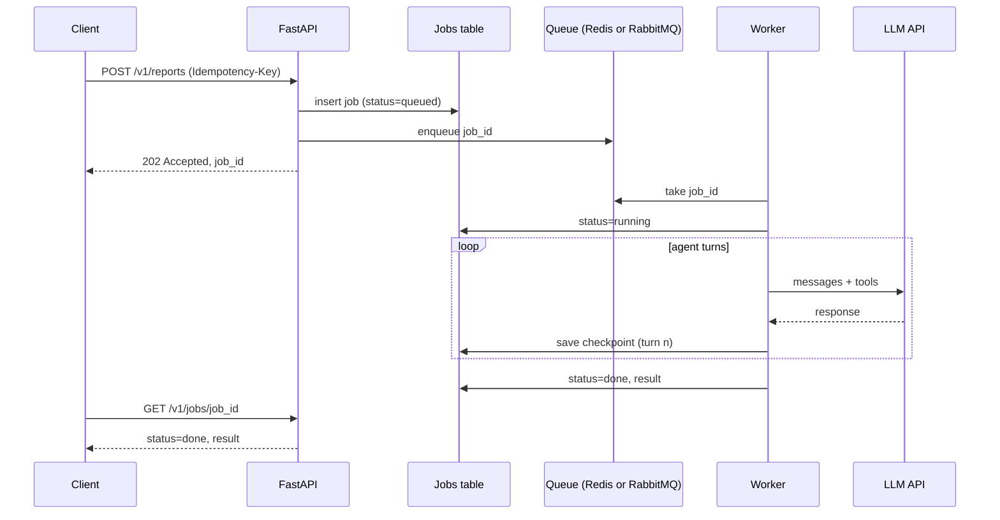

# Running Agents as Background Jobs

## Introduction

Some agent tasks finish in five seconds. Others take five minutes: researching a topic across twenty web pages, reviewing every
contract in a folder, or generating a weekly report from several data sources. Running those inside an HTTP request is a bad idea.
Load balancers time out, users close tabs, deploys restart servers, and a single slow request ties up a worker that could have served
hundreds of fast ones.

The solution is the same one web apps have used for years for sending emails or resizing images: **run the work in the background**.
The API accepts the request, puts a job on a queue, and immediately returns a job ID. A separate worker process picks up the job,
runs the agent, and stores the result. The client checks back later or gets notified.

A restaurant analogy: the waiter (your API) takes the order and hands you a ticket number right away. The kitchen (the worker)
cooks. You do not stand at the counter blocking the waiter while your meal is prepared.

Agents add a few twists to the classic job pattern:

- **Each run costs money.** Running a job twice by accident is not just wasteful, it shows up on the bill.
- **Runs have side effects.** If the agent already sent an email in turn 3 and the job crashes in turn 5, a naive retry sends the
  email again.
- **Some errors are worth retrying and some are not.** A rate limit will clear up. A prompt that confuses the model will not.

## The Job Pattern



The key points: the API responds in milliseconds, the **database** is the source of truth for job state (not the queue), and the
worker saves progress as it goes.

## Step 1: The Job API

Start with the HTTP side. The submit endpoint validates input, creates a job record, enqueues it, and returns `202 Accepted`.

```python
# api.py
import uuid
from typing import Annotated

from fastapi import FastAPI, Header, HTTPException
from pydantic import BaseModel, Field

app = FastAPI()

# Stand-in for a jobs table. Columns: id, user_id, idempotency_key, status, progress, result, error
JOBS: dict[str, dict] = {}


class ReportRequest(BaseModel):
    topic: str = Field(min_length=3, max_length=500)


def enqueue(job_id: str) -> None:
    """Replaced by run_report_job.delay(job_id) once Celery is wired up."""


@app.post("/v1/reports", status_code=202)
async def submit_report(
    req: ReportRequest,
    idempotency_key: Annotated[str | None, Header()] = None,
) -> dict:
    user_id = "u_alice"  # from your auth dependency in real code
    # The same key from the same user returns the existing job instead of creating a new one.
    if idempotency_key:
        for job in JOBS.values():
            if job["user_id"] == user_id and job["idempotency_key"] == idempotency_key:
                return {"job_id": job["id"], "status": job["status"]}

    job_id = str(uuid.uuid4())
    JOBS[job_id] = {
        "id": job_id, "user_id": user_id, "idempotency_key": idempotency_key,
        "status": "queued", "progress": [], "input": req.topic, "result": None, "error": None,
    }
    enqueue(job_id)
    return {"job_id": job_id, "status": "queued"}


@app.get("/v1/jobs/{job_id}")
async def get_job(job_id: str) -> dict:
    job = JOBS.get(job_id)
    if job is None or job["user_id"] != "u_alice":
        raise HTTPException(status_code=404, detail="Job not found")
    return {k: job[k] for k in ("id", "status", "progress", "result", "error")}
```

Calling it twice with the same key returns the same job:

```bash
curl -s -X POST localhost:8000/v1/reports -H "Idempotency-Key: abc123" \
  -H "Content-Type: application/json" -d '{"topic": "EU battery regulations"}'
curl -s -X POST localhost:8000/v1/reports -H "Idempotency-Key: abc123" \
  -H "Content-Type: application/json" -d '{"topic": "EU battery regulations"}'
```

Example output:

```text
{"job_id":"7f1c0b9e-1f43-4c55-9b0b-4c2b7e1d9a10","status":"queued"}
{"job_id":"7f1c0b9e-1f43-4c55-9b0b-4c2b7e1d9a10","status":"queued"}
```

Idempotency keys matter more for agents than for most APIs. Mobile clients and flaky networks retry requests automatically, and
every duplicate job is a full agent run you pay for. In a real database, enforce this with a unique index on
`(user_id, idempotency_key)` rather than a loop.

## Step 2: A Celery Worker

[Celery](https://docs.celeryq.dev/) is the most widely used Python task queue. It works with Redis or RabbitMQ as the broker. Here
is a task that runs an agent for a job ID.

```python
# worker.py
import anthropic
from anthropic import Anthropic
from celery import Celery
from celery.exceptions import SoftTimeLimitExceeded

celery_app = Celery("agents", broker="redis://localhost:6379/0")
client = Anthropic(max_retries=0)  # let Celery own retries so they are visible and bounded

JOBS: dict[str, dict] = {}  # in real code, import your DB session instead

TRANSIENT_ERRORS = (
    anthropic.RateLimitError,
    anthropic.APIConnectionError,
    anthropic.InternalServerError,
)


@celery_app.task(
    bind=True,
    acks_late=True,               # only remove from queue after the task finishes
    autoretry_for=TRANSIENT_ERRORS,
    retry_backoff=True,           # exponential backoff: 1s, 2s, 4s, ...
    retry_backoff_max=300,
    retry_jitter=True,
    max_retries=5,
    soft_time_limit=600,          # raises SoftTimeLimitExceeded inside the task
    time_limit=660,               # hard kill shortly after
)
def run_report_job(self, job_id: str) -> None:
    job = JOBS[job_id]
    if job["status"] == "done":
        return  # already finished: a duplicate delivery is a no-op
    job["status"] = "running"
    try:
        job["result"] = run_research_agent(job)
        job["status"] = "done"
    except TRANSIENT_ERRORS:
        job["status"] = "retrying"
        raise  # autoretry_for schedules the retry
    except SoftTimeLimitExceeded:
        job["status"], job["error"] = "failed", "Timed out after 10 minutes"
    except Exception as exc:  # bad input, refusal, bug: retrying will not help
        job["status"], job["error"] = "failed", f"{type(exc).__name__}: {exc}"


def run_research_agent(job: dict) -> str:
    response = client.messages.create(
        model="claude-opus-5-5",
        max_tokens=8000,
        messages=[{"role": "user", "content": f"Write a short briefing on: {job['input']}"}],
    )
    return "".join(b.text for b in response.content if b.type == "text")
```

Start a worker with `celery -A worker worker --loglevel=info`, and in the API replace `enqueue(job_id)` with
`run_report_job.delay(job_id)`.

Things to notice:

- **Retry only transient errors.** `autoretry_for` lists rate limits, connection errors, and server errors. A `BadRequestError` or a
  bug in your tool code fails immediately. Retrying it five times just burns money.
- **`max_retries=0` on the SDK client.** The SDK retries some errors by default. If both the SDK and Celery retry, the attempts
  multiply. Pick one layer to own retries.
- **`acks_late=True`.** By default Celery acknowledges a message when a worker *receives* it. If the worker crashes mid-run, the job
  is lost. With late acknowledgement, the message is redelivered. That means the task can run more than once, so it must be
  idempotent (the `status == "done"` check).
- **Time limits.** `soft_time_limit` lets you record a clean failure. `time_limit` is the hard stop if the task ignores it.

:::tip
Pass the **job ID**, not the full input, to the task. Task arguments are serialized into the broker, often unencrypted, and large
payloads slow the queue down. The worker loads the details from the database.
:::

## Step 3: Checkpoints So Retries Resume

A research agent might take 15 turns. If it crashes on turn 12 because of a network error, restarting from turn 1 wastes 11 turns of
tokens and may repeat side effects. Instead, **save the message history after each turn** and resume from it.

```python
# checkpointed_agent.py
from anthropic import Anthropic

client = Anthropic(max_retries=0)
CHECKPOINTS: dict[str, list] = {}  # job_id -> messages. Use a DB column or object storage.
SIDE_EFFECTS_DONE: set[str] = set()  # keys of side effects already performed


def send_email(job_id: str, args: dict) -> str:
    key = f"{job_id}:email:{args['to']}"
    if key in SIDE_EFFECTS_DONE:
        return "Already sent (skipped duplicate)"
    # real email sending would happen here
    SIDE_EFFECTS_DONE.add(key)
    return f"Sent to {args['to']}"


TOOLS = [{
    "name": "send_email",
    "description": "Email the finished briefing to a recipient.",
    "input_schema": {"type": "object", "properties": {"to": {"type": "string"}}, "required": ["to"]},
}]


def run_with_checkpoints(job_id: str, task: str, max_turns: int = 15) -> str:
    messages = CHECKPOINTS.get(job_id) or [{"role": "user", "content": task}]

    for _ in range(max_turns):
        response = client.messages.create(
            model="claude-opus-5-5", max_tokens=8000, tools=TOOLS, messages=messages,
        )
        messages.append({"role": "assistant", "content": [b.to_dict() for b in response.content]})
        if response.stop_reason == "pause_turn":
            CHECKPOINTS[job_id] = messages
            continue
        if response.stop_reason != "tool_use":
            CHECKPOINTS.pop(job_id, None)
            return "".join(b.text for b in response.content if b.type == "text")

        results = []
        for block in response.content:
            if block.type == "tool_use" and block.name == "send_email":
                results.append({"type": "tool_result", "tool_use_id": block.id,
                                "content": send_email(job_id, block.input)})
        messages.append({"role": "user", "content": results})
        CHECKPOINTS[job_id] = messages  # durable after every completed turn
        print(f"checkpoint saved: {len(messages)} messages")

    raise RuntimeError("Agent exceeded max_turns")
```

Two separate safety nets are at work:

1. **Checkpoints** avoid re-running completed turns.
2. **Idempotent side effects** (the `SIDE_EFFECTS_DONE` key) protect against the gap between "the tool ran" and "the checkpoint was
   saved". If the worker crashes in that gap, the retry replays the turn, but the email is not sent twice.

For external APIs that support it, pass an idempotency key derived from the job ID and tool call (Stripe and many payment APIs accept
one) instead of tracking it yourself.

## Step 4: Reporting Progress

Users waiting minutes want to know something is happening. Append small progress events to the job record from inside the loop:

```python
# progress.py
from datetime import datetime, timezone


def report(job: dict, message: str) -> None:
    job["progress"].append({"at": datetime.now(timezone.utc).isoformat(timespec="seconds"), "msg": message})


job = {"progress": []}
report(job, "Searching sources")
report(job, "Reading 6 documents")
report(job, "Writing briefing")
for p in job["progress"]:
    print(p["msg"])
```

Output:

```text
Searching sources
Reading 6 documents
Writing briefing
```

The client can poll `GET /v1/jobs/{id}` every few seconds, or you can push updates. Common options:

| Delivery method | How | Good for |
|---|---|---|
| Polling | Client calls the status endpoint every 2 to 5 seconds | Simple apps, low traffic |
| SSE or WebSocket | Worker publishes to Redis pub/sub, API streams to the browser | Live progress in the UI |
| Webhook callback | Worker POSTs to a URL the caller registered | Server-to-server integrations |
| Email or in-app notification | Send a link when done | Very long jobs, users who leave |

See [Streaming Agent Output to a Frontend](./2-agents-streaming-to-frontend.mdx) for the SSE side.

## Other Queues: RQ and Cloud Queues

[RQ (Redis Queue)](https://python-rq.org/) is a lighter alternative to Celery. The shape is almost the same:

```python
# rq_example.py
from redis import Redis
from rq import Queue, Retry

from worker import run_research_agent

queue = Queue("agents", connection=Redis())


def submit(job: dict):
    # job_timeout kills runaway agents; Retry handles failures with delays between attempts
    return queue.enqueue(
        run_research_agent, job,
        job_timeout=600,
        retry=Retry(max=3, interval=[10, 30, 60]),
    )
```

RQ retries on any exception, so put the "should this be retried?" decision inside your function (catch permanent errors and record
them instead of raising). On AWS, Google Cloud, or Azure, a managed queue (SQS, Pub/Sub, Service Bus) plus a container or function
worker works the same way. Watch serverless time limits: some function platforms cap run time at around 15 minutes, which a long
agent can exceed.

## Durable Workflows with Temporal

Checkpointing by hand works for one agent. When a job becomes a **multi-step process** (research, then draft, then wait for a human
to approve, then publish), you end up re-implementing a workflow engine. Tools like [Temporal](https://temporal.io/) do this for you:
each step is an **activity** whose result is recorded durably, and if the worker dies, the workflow resumes after the last completed
activity.

```python
# temporal_agent.py
from datetime import timedelta

from temporalio import activity, workflow
from temporalio.common import RetryPolicy


@activity.defn
async def research(topic: str) -> str:
    # One LLM call or agent run. Activities may do I/O and may be retried.
    return f"notes about {topic}"


@activity.defn
async def write_draft(notes: str) -> str:
    return f"draft based on {notes}"


@workflow.defn
class BriefingWorkflow:
    @workflow.run
    async def run(self, topic: str) -> str:
        retry = RetryPolicy(maximum_attempts=3, initial_interval=timedelta(seconds=5))
        notes = await workflow.execute_activity(
            research, topic, start_to_close_timeout=timedelta(minutes=10), retry_policy=retry,
        )
        return await workflow.execute_activity(
            write_draft, notes, start_to_close_timeout=timedelta(minutes=5), retry_policy=retry,
        )
```

You start it from your API with a Temporal client (`await client.start_workflow(BriefingWorkflow.run, topic, id=job_id,
task_queue="agents")`) and run a `Worker` process that registers the workflow and activities. Using the job ID as the workflow ID
gives you deduplication for free.

The important rule: **workflow code must be deterministic.** All LLM calls, tool calls, and anything else with I/O or randomness
go in activities, never directly in the workflow function. Check the
[Temporal Python SDK docs](https://docs.temporal.io/develop/python) for the current setup details. Similar durable-execution options
include AWS Step Functions, Azure Durable Functions, Inngest, and Restate.

## Bulk Work: The Message Batches API

If you need to run the *same* kind of prompt over thousands of items (classify every support ticket from last month, summarize every
document in an archive) and nobody is waiting for the answer, a provider batch API can be cheaper than running your own workers.
Anthropic's [Message Batches API](https://platform.claude.com/docs/en/build-with-claude/batch-processing) processes requests
asynchronously at 50% of standard prices, with most batches finishing within an hour and a maximum of 24 hours (check the docs, as
terms may change). OpenAI and Google offer similar batch endpoints.

Batches fit single-call workflows best. A multi-turn agent with tools does not map cleanly onto one batch request, though you can run
one turn per batch for very large, latency-tolerant jobs.

## Real-World Scenario

Your company sells a compliance product. Customers upload vendor contracts (often 50 to 200 per batch), and an agent reads each one,
looks up clauses against a policy database with tools, and produces a risk summary. A single contract takes one to three minutes.
Today the upload endpoint runs everything synchronously and times out after 60 seconds.

**Solution:**

1. `POST /v1/contract-reviews` stores the files, creates one job per contract plus a parent "batch" record, and returns `202` with
   the batch ID.
2. Celery workers (a dedicated `agents` queue, so PDF generation is not starved) run one agent per contract with `acks_late`,
   transient-only retries, a 10-minute soft limit, and a turn limit.
3. Each turn is checkpointed. Tool calls are read-only, so retries are safe.
4. The UI polls the batch endpoint and shows "37 of 120 reviewed". When all jobs finish, the customer gets an email.
5. A concurrency cap (number of worker processes) keeps the team under its provider rate limit.

### Why this approach

The work is long, parallel, and does not need a human watching each step. A queue spreads it across workers, survives deploys, and
lets you control concurrency, which is your main lever for staying under provider rate limits. The team already runs Celery, so
there is nothing new to operate.

### When to use it and when not to

Use background jobs when runs take longer than roughly 30 seconds, when the user does not need to watch tokens appear, or when work
is triggered in bulk. Do not use them for interactive chat: the extra hops add latency and complexity. If the process has many
steps, waits for humans, or must survive days of downtime, move up to a durable workflow engine.

### Alternatives and trade-offs

| Approach | Pros | Cons | Best for |
|---|---|---|---|
| Celery | Mature, many features, Python-native | Config-heavy; retries and idempotency are your job | Existing Python stacks |
| RQ | Very simple, Redis only | Fewer features (routing, rate limits) | Small apps and prototypes |
| Cloud queue + workers (SQS, Pub/Sub) | Managed, scales well | Vendor-specific; function time limits | Cloud-native teams |
| Temporal or Step Functions | Durable multi-step state, human waits, replay | New system to learn and run; determinism rules | Long multi-step agent processes |
| Provider batch API | 50% cheaper on Anthropic, no workers to run | Up to 24h latency; best for single calls | Large offline classification or summarization |

## Common Mistakes

- **Retrying everything.** Retrying a 400 error or a bug just multiplies cost. Retry only transient errors.
- **Double retries.** The SDK, your HTTP client, and the queue each retrying three times gives 27 attempts. Choose one owner.
- **Non-idempotent side effects.** With at-least-once delivery, assume every task can run twice. Guard emails, payments, and writes
  with idempotency keys.
- **Using the queue as the database.** Store job status and results in your database. Queues are for delivery, not for state.
- **No time limits.** An agent stuck in a loop holds a worker forever. Set turn limits and task time limits.
- **Unbounded concurrency.** 200 workers hitting the LLM API at once will trigger rate limits for your whole organization. Size the
  worker pool to your limits.
- **Putting secrets or large documents in task arguments.** Pass IDs and load data in the worker.

## Summary

- Run long agent tasks in workers: the API returns `202` and a job ID, and clients poll or get notified.
- Use idempotency keys on submission and idempotent side effects in tools, because jobs can run more than once.
- Retry only transient errors (rate limits, connection errors, 5xx), with backoff, and in one layer only.
- Checkpoint the message history after each turn so retries resume instead of restarting.
- Celery and RQ cover most needs. Temporal and similar engines handle long, multi-step, human-in-the-loop processes.
- For large offline jobs, a provider batch API can halve the cost.

## Exercises

1. Add a `DELETE /v1/jobs/{id}` endpoint that cancels a queued or running job. How does the worker notice the cancellation between
   turns?
2. Change `run_report_job` to record total tokens used per job, and fail the job if it exceeds a per-job token budget.
3. Write a test that runs `run_with_checkpoints` with a mocked client that raises `APIConnectionError` on turn 3, then call it again
   and assert it resumes from the saved checkpoint.
4. Convert the contract-review scenario to Temporal: one workflow per batch that starts child activities for each contract and
   reports progress.

**Related pages:**

- [Error Handling and Retries](../1-agents-llm-apis/9-agents-api-error-handling.mdx)
- [Agent State Management](../4-agents-memory-and-context/9-agents-state-management.mdx)
- [Stopping Conditions and Budgets](../6-agents-planning-and-reasoning/10-agents-stopping-conditions.mdx)
- [Event-Driven Agents and Webhooks](./4-agents-event-driven.mdx)
- [Scaling and Concurrency](../13-agents-production/2-agents-scaling.mdx)
