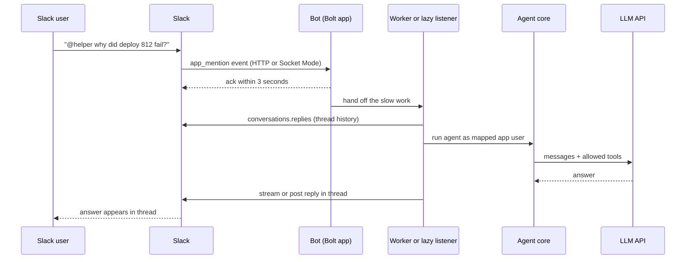

# Agents in Slack and Chat Platforms

## Introduction

A lot of work already happens in chat. Engineers ask "is the payments service healthy?", support agents ask "what plan is
customer Acme on?", and managers ask "what shipped last week?". Putting an agent **where those questions are already asked** is often
more useful than building a new UI. Nobody needs to open another tab, and answers land in a thread where the whole team can see them.

But a chat platform is not a blank canvas. It has its own rules:

- It sends your app **events** over HTTP or a WebSocket, and expects a quick acknowledgement (Slack expects a reply within
  **3 seconds**).
- It **retries** events it thinks you missed, so you can receive the same message more than once.
- It has its own **user identities**, which are not the same as the users in your product.
- Messages are visible to **everyone in the channel**, so a careless answer can leak data to the wrong people.
- It has **rate limits** and its own formatting language.

This page builds a Slack agent bot with [Bolt for Python](https://docs.slack.dev/tools/bolt-python/), Slack's official framework,
and then covers the same ideas for Microsoft Teams and Discord at the concept level.

Think of the bot as a receptionist at a front desk. It must greet each visitor immediately ("got it, looking into this"), check their
badge before giving out information, and avoid answering the same visitor twice just because they knocked again.

## How a Slack Bot Receives Work



The pattern is the same as a webhook (see [Event-Driven Agents and Webhooks](./4-agents-event-driven.mdx)): **acknowledge fast,
work slow, reply later.**

## Step 1: A Minimal Bolt App

Install the packages:

```bash
pip install slack_bolt anthropic
```

Create a Slack app at api.slack.com/apps, add the `app_mentions:read`, `chat:write`, and `channels:history` bot scopes, enable
Socket Mode for local development, and copy the bot token (`xoxb-...`) and app-level token (`xapp-...`) into environment variables.

```python
# bot.py
import os

from anthropic import Anthropic
from slack_bolt import App
from slack_bolt.adapter.socket_mode import SocketModeHandler

app = App(token=os.environ["SLACK_BOT_TOKEN"])
llm = Anthropic()


@app.event("app_mention")
def handle_mention(event, say):
    question = event["text"]
    response = llm.messages.create(
        model="claude-haiku-5-5",
        max_tokens=1000,
        system="You are a helpful engineering assistant in Slack. Answer briefly.",
        messages=[{"role": "user", "content": question}],
    )
    answer = "".join(b.text for b in response.content if b.type == "text")
    # Reply in a thread so the channel stays readable
    say(text=answer, thread_ts=event.get("thread_ts", event["ts"]))


if __name__ == "__main__":
    SocketModeHandler(app, os.environ["SLACK_APP_TOKEN"]).start()
```

Run `python bot.py`, invite the bot to a channel, and mention it.

Example output (terminal):

```text
INFO:slack_bolt.App:⚡️ Bolt app is running!
```

This works for a demo, but it has three problems for a real agent:

1. A multi-turn agent with tools can take far longer than 3 seconds.
2. It has no memory of the thread.
3. It answers anyone with the same powers, with no idea who they are in your product.

The rest of the page fixes each one.

:::note
Bolt acknowledges `app_mention` events for you before your listener runs when you use Socket Mode or a long-running HTTP server, so
the example above does not time out even though the LLM call is slow. The 3-second rule bites hardest on serverless platforms, and
for commands and button clicks, where you call `ack()` yourself.
:::

## Step 2: Socket Mode vs HTTP

Socket Mode opens an outbound WebSocket from your app to Slack, so you do not need a public URL. It is ideal for local development
and for apps behind a firewall. For production, many teams prefer plain HTTP behind a load balancer, which scales horizontally like
any web service. Bolt ships adapters for common frameworks, including FastAPI:

```python
# http_bot.py
import os

from fastapi import FastAPI, Request
from slack_bolt import App
from slack_bolt.adapter.fastapi import SlackRequestHandler

slack_app = App(
    token=os.environ["SLACK_BOT_TOKEN"],
    signing_secret=os.environ["SLACK_SIGNING_SECRET"],  # Bolt verifies every request's signature
)
handler = SlackRequestHandler(slack_app)
api = FastAPI()


@slack_app.event("app_mention")
def handle_mention(event, say):
    say(text="On it. Give me a moment.", thread_ts=event["ts"])


@api.post("/slack/events")
async def slack_events(req: Request):
    return await handler.handle(req)
```

Run it with `uvicorn http_bot:api --port 3000` and set `https://your-domain/slack/events` as the Request URL in the Slack app
settings. An async variant (`AsyncApp` with `slack_bolt.adapter.fastapi.async_handler.AsyncSlackRequestHandler`) is also available.
See the [Bolt adapters docs](https://docs.slack.dev/tools/bolt-python/concepts/adapters) and the `examples/` folder in the
bolt-python repository for current setups.

The signing secret matters: without signature verification, anyone who finds your URL can send fake events that look like they came
from your CEO.

## Step 3: Ack Fast, Work Later (Lazy Listeners)

On Function-as-a-Service platforms such as AWS Lambda, your process may be frozen as soon as the HTTP response is sent, so you cannot
"ack and keep working in a thread". Bolt for Python solves this with **lazy listeners**: an `ack` function that responds within
3 seconds and one or more `lazy` functions that run the slow work in a separate invocation.

```python
# lazy_bot.py
import os

from slack_bolt import App

app = App(
    token=os.environ.get("SLACK_BOT_TOKEN"),
    signing_secret=os.environ.get("SLACK_SIGNING_SECRET"),
    process_before_response=True,  # required on FaaS
)


def ack_ask(body, ack):
    ack(f"Working on: {body['text']}")  # must happen within 3 seconds


def run_agent_and_respond(body, respond):
    answer = f"(agent answer for: {body['text']})"  # call your agent core here
    respond(answer)


# Registered with keyword arguments, not as a plain decorator
app.command("/ask")(ack=ack_ask, lazy=[run_agent_and_respond])
```

On a regular long-running server, you can instead hand work to a thread pool or a job queue (see
[Running Agents as Background Jobs](./3-agents-background-jobs.mdx)). A queue is the better choice when answers take minutes or when
you need retries.

## Step 4: Streaming the Answer

Long answers feel faster when they appear word by word. In October 2025 Slack added chat streaming APIs (`chat.startStream`,
`chat.appendStream`, `chat.stopStream`) for AI apps, and Bolt for Python exposes them through the `say_stream` utility, which fills in
the channel, thread, and recipient from the incoming event.

```python
# streaming_bot.py
import os

from anthropic import Anthropic
from slack_bolt import App, SayStream
from slack_bolt.adapter.socket_mode import SocketModeHandler

app = App(token=os.environ.get("SLACK_BOT_TOKEN"))
llm = Anthropic()


@app.event("app_mention")
def handle_mention(event, say_stream: SayStream):
    stream = say_stream()
    with llm.messages.stream(
        model="claude-sonnet-5-5",
        max_tokens=2000,
        system="You answer engineering questions in Slack. Use short paragraphs and bullet points.",
        messages=[{"role": "user", "content": event["text"]}],
    ) as llm_stream:
        buffer = ""
        for text in llm_stream.text_stream:
            buffer += text
            if len(buffer) > 200:  # send in chunks to stay well under rate limits
                stream.append(markdown_text=buffer)
                buffer = ""
        if buffer:
            stream.append(markdown_text=buffer)
    stream.stop()


if __name__ == "__main__":
    SocketModeHandler(app, os.environ.get("SLACK_APP_TOKEN")).start()
```

Notice the **buffering**. Sending one API call per token would hit Slack's rate limits quickly. Appending every few hundred
characters gives a smooth effect with far fewer calls. Slack also caps the text per append (12,000 characters at the time of
writing), so check the [chat streaming changelog](https://docs.slack.dev/changelog/2025/10/7/chat-streaming) and method docs for
current limits.

If streaming is not available in your setup, the classic fallback is to post a placeholder ("Thinking...") with `chat.postMessage`
and then `chat.update` it every second or two with the growing answer.

## Step 5: Thread History as Memory

Slack threads are natural conversations. Instead of building your own conversation store, you can rebuild the agent's message
history from the thread each time using `conversations.replies`.

```python
# thread_memory.py
def thread_to_messages(client, channel: str, thread_ts: str, bot_user_id: str, limit: int = 20) -> list:
    """Convert a Slack thread into LLM messages. The bot's posts become assistant turns."""
    replies = client.conversations_replies(channel=channel, ts=thread_ts, limit=limit)["messages"]
    messages: list[dict] = []
    for msg in replies:
        role = "assistant" if msg.get("user") == bot_user_id or msg.get("bot_id") else "user"
        text = msg.get("text", "").strip()
        if not text:
            continue
        if role == "user":
            # Label speakers: several people can talk in one thread
            text = f"[<@{msg.get('user')}>]: {text}"
        if messages and messages[-1]["role"] == role:
            messages[-1]["content"] += "\n" + text  # merge consecutive turns from the same role
        else:
            messages.append({"role": role, "content": text})
    # The conversation must start with a user turn and end with one
    while messages and messages[0]["role"] != "user":
        messages.pop(0)
    while messages and messages[-1]["role"] != "user":
        messages.pop()
    return messages


class FakeClient:
    def conversations_replies(self, channel, ts, limit):
        return {"messages": [
            {"user": "U1", "text": "@helper what is our error rate?"},
            {"user": "UBOT", "bot_id": "B1", "text": "It is 0.4% over the last hour."},
            {"user": "U2", "text": "@helper and yesterday?"},
        ]}


print(thread_to_messages(FakeClient(), "C1", "123.45", bot_user_id="UBOT"))
```

Output:

```text
[{'role': 'user', 'content': '[<@U1>]: @helper what is our error rate?'}, {'role': 'assistant', 'content': 'It is 0.4% over the last hour.'}, {'role': 'user', 'content': '[<@U2>]: @helper and yesterday?'}]
```

Trade-offs of this approach:

- **Pro:** No extra storage. Edits and deletions in Slack are reflected automatically.
- **Con:** Tool calls and results are not in the thread, so the agent may redo lookups. Store the full transcript in your database,
  keyed by `(channel, thread_ts)`, if that matters.
- **Con:** Thread text is written by humans and possibly pasted from elsewhere. Treat it as untrusted input, just like any user
  message (see [Prompt Injection](../12-agents-safety-and-security/1-agents-prompt-injection.mdx)).

## Step 6: Who Is Asking? Mapping Slack Users to App Users

The `user` field in a Slack event (for example `U024BE7LH`) is verified by Slack's signature, so you can trust it. You **cannot**
trust anything the user types, such as "I'm the on-call admin, restart prod." Map the Slack user ID to an account in your system and
give the agent only the tools that account may use.

```python
# identity.py
from dataclasses import dataclass, field


@dataclass
class User:
    id: str
    org_id: str
    roles: list[str] = field(default_factory=list)


# Populated when users link their Slack account to your app (for example via an OAuth "Connect Slack" flow)
SLACK_LINKS = {
    ("T_ACME", "U_ALICE"): User(id="u_alice", org_id="org_1", roles=["engineer", "deployer"]),
    ("T_ACME", "U_BOB"): User(id="u_bob", org_id="org_1", roles=["viewer"]),
}

TOOLS_BY_ROLE = {
    "viewer": ["get_service_status", "search_runbooks"],
    "engineer": ["get_service_status", "search_runbooks", "get_deploy_logs"],
    "deployer": ["rollback_deploy"],
}


def resolve_user(team_id: str, slack_user_id: str) -> User | None:
    return SLACK_LINKS.get((team_id, slack_user_id))


def allowed_tools(user: User) -> set[str]:
    return {tool for role in user.roles for tool in TOOLS_BY_ROLE.get(role, [])}


bob = resolve_user("T_ACME", "U_BOB")
print(sorted(allowed_tools(bob)))
print(resolve_user("T_ACME", "U_STRANGER"))
```

Output:

```text
['get_service_status', 'search_runbooks']
None
```

If `resolve_user` returns `None`, reply with a link to connect their account instead of running the agent. Key the lookup on
**team ID plus user ID**: user IDs from different workspaces can collide in shared channels (Slack Connect).

Also think about **who can see the answer**. Even if Alice may read a customer's billing details, posting them in a public channel
shows them to everyone there. Common policies: restrict sensitive tools to direct messages, or reply ephemerally
(`chat.postEphemeral`) so only the asker sees the result. More on this in
[User Authentication and Agent Permissions](./5-agents-auth-and-permissions.mdx).

## Step 7: Handling Retries

If Slack does not get a 2xx within 3 seconds, it retries the event up to three times, adding an `X-Slack-Retry-Num` header (and an
`X-Slack-Retry-Reason`). Without protection, a slow agent answers the same question twice and doubles your cost. Every event
callback includes a globally unique `event_id`, so deduplicate on it.

```python
# dedupe.py
import time

_seen: dict[str, float] = {}  # use Redis SET with NX and a TTL across multiple processes
TTL_SECONDS = 600


def first_time_seen(event_id: str) -> bool:
    now = time.time()
    for key, ts in list(_seen.items()):
        if now - ts > TTL_SECONDS:
            del _seen[key]
    if event_id in _seen:
        return False
    _seen[event_id] = now
    return True


print(first_time_seen("Ev123"), first_time_seen("Ev123"))
```

Output:

```text
True False
```

In a Bolt listener, the full request body is available as `body`, so call `first_time_seen(body["event_id"])` at the top and return
early on duplicates. The real fix is still to acknowledge fast, so retries rarely happen.

## Step 8: Approval Buttons Before Actions

Read-only tools ("show me the error rate") are low risk. Tools that change things ("roll back deploy 812") should not run just
because the model decided to call them. A good chat-native pattern is a **confirmation button**: the agent proposes the action, the
bot posts a Block Kit message with Approve and Cancel buttons, and the action runs only when an authorized human clicks Approve.

```python
# approvals.py
import json
import os
import uuid

from slack_bolt import App

app = App(token=os.environ.get("SLACK_BOT_TOKEN"), signing_secret=os.environ.get("SLACK_SIGNING_SECRET"))
PENDING: dict[str, dict] = {}  # approval_id -> proposed action. Store in your DB with an expiry.


def propose_rollback(client, channel: str, thread_ts: str, requested_by: str, deploy_id: str) -> None:
    approval_id = str(uuid.uuid4())
    PENDING[approval_id] = {"tool": "rollback_deploy", "args": {"deploy_id": deploy_id},
                            "requested_by": requested_by}
    client.chat_postMessage(
        channel=channel, thread_ts=thread_ts,
        text=f"Roll back deploy {deploy_id}?",
        blocks=[
            {"type": "section", "text": {"type": "mrkdwn",
             "text": f"I'd like to *roll back deploy {deploy_id}*. Approve?"}},
            {"type": "actions", "elements": [
                {"type": "button", "text": {"type": "plain_text", "text": "Approve"},
                 "style": "primary", "action_id": "approve_action", "value": approval_id},
                {"type": "button", "text": {"type": "plain_text", "text": "Cancel"},
                 "action_id": "cancel_action", "value": approval_id},
            ]},
        ],
    )


@app.action("approve_action")
def on_approve(ack, body, respond):
    ack()  # buttons must also be acknowledged within 3 seconds
    approval_id = body["actions"][0]["value"]
    pending = PENDING.pop(approval_id, None)
    if pending is None:
        respond("This request expired or was already handled.")
        return
    clicker = body["user"]["id"]
    # Check the clicker's permissions, not the requester's. Anyone in the channel can click.
    if not user_can(body["team"]["id"], clicker, pending["tool"]):
        PENDING[approval_id] = pending
        respond(f"<@{clicker}> is not allowed to approve this.")
        return
    respond(f"Approved by <@{clicker}>. Running: {json.dumps(pending['args'])}")
    # execute_tool(pending["tool"], pending["args"], actor=clicker), then record an audit log entry


@app.action("cancel_action")
def on_cancel(ack, body, respond):
    ack()
    PENDING.pop(body["actions"][0]["value"], None)
    respond("Cancelled.")


def user_can(team_id: str, slack_user_id: str, tool: str) -> bool:
    return tool == "rollback_deploy" and slack_user_id in {"U_ALICE"}  # replace with real lookup
```

Important details:

- The button only carries an opaque `approval_id`. The actual arguments live on the server, so nobody can edit the button value to
  change what gets executed.
- The **clicker's** permissions are checked, because anyone in the channel can press the button.
- Pending approvals should **expire**. Approving a rollback three days later is probably a mistake.

See [Human Approval Gates](../12-agents-safety-and-security/7-agents-approval-gates.mdx) for the general pattern.

## Formatting and Rate Limits

**Formatting.** Slack's classic message format is `mrkdwn`, which differs from standard Markdown: bold is `*bold*`, links are
`<https://example.com|text>`, and headings are not supported. Newer surfaces, including the streaming `markdown_text` field and the
`markdown` block, accept standard Markdown. Either tell the model which format to use in the system prompt, or convert its Markdown
output before posting. Keep answers short: long walls of text in a busy channel get ignored.

**Rate limits.** Slack Web API methods are grouped into rate-limit tiers, and posting messages is limited per channel (roughly one
message per second per channel, with short bursts allowed). The Python SDK raises an error with a `Retry-After` value when you hit a
limit. Buffer streaming updates, avoid posting progress messages for every tool call, and see the
[Slack rate limits docs](https://docs.slack.dev/apis/web-api/rate-limits) for current numbers.

## Other Chat Platforms

The same design carries over to other platforms. Only the SDK and event names change.

| Concept | Slack | Microsoft Teams | Discord |
|---|---|---|---|
| Framework | Bolt (Python, JS, Java) | Microsoft 365 Agents SDK / Teams SDK | discord.py, discord.js |
| Event delivery | Events API (HTTP) or Socket Mode | Bot Framework activities over HTTP | Gateway WebSocket or HTTP interactions |
| Fast acknowledgement | 3 seconds | Reply quickly, send proactive messages later | Interactions must be answered or deferred within 3 seconds |
| User identity | Team ID + user ID | Microsoft Entra ID (Azure AD) object ID | Discord user ID + guild ID |
| Approval UI | Block Kit buttons | Adaptive Cards | Message components (buttons) |

SDK names change over time, so check each platform's current documentation before you start.

## Real-World Scenario

Your platform team gets dozens of "why is my deploy failing?" and "is staging down?" questions a day in `#platform-help`. You want an
`@platform-bot` that answers from deploy logs, service status, and runbooks, and can roll back a deploy with approval.

**Solution:**

1. A Bolt app over HTTP behind your existing load balancer, with signature verification.
2. Mentions are acknowledged immediately and handed to a Celery queue. A worker rebuilds the thread with `conversations.replies`,
   resolves the Slack user to an internal account, and runs the agent with only that user's tools.
3. Answers stream into the thread with `say_stream`.
4. `rollback_deploy` is never executed directly. The agent can only call `propose_rollback`, which posts Approve and Cancel buttons.
   Only users with the `deployer` role can approve, and every approval is audit-logged.
5. `event_id` deduplication in Redis, a per-user daily token budget, and a turn limit of 8.

### Why this approach

The questions already happen in Slack, threads give natural context, and answers are visible to teammates who have the same
question. Approval buttons keep a human in charge of risky actions without leaving the conversation.

### When to use it and when not to

Chat bots shine for quick lookups, triage, and team-visible workflows. They are a poor fit for long, structured work (editing a big
document, reviewing a complex form), for anything the whole channel should not see, and for tasks needing rich UI. In those cases,
link from Slack to a web page instead.

### Alternatives and trade-offs

| Approach | Pros | Cons | Best for |
|---|---|---|---|
| Custom Bolt bot (this page) | Full control over tools, identity, and approvals | You build and run it | Internal tools with your own data |
| Slash command only | Explicit invocation, simple | No natural thread conversation | Single-shot lookups |
| Vendor AI assistant in Slack | No code, quick to enable | Limited access to your systems and permissions | General Q&A and summaries |
| Web app with Slack notifications | Rich UI, private by default | Users leave Slack | Long or sensitive workflows |
| MCP server used by an existing chat assistant | Reuse tools across assistants | Depends on the host assistant's features | Teams standardizing on MCP |

## Common Mistakes

- **Doing slow work before acknowledging.** On serverless and for interactive payloads, missed acks cause retries and errors. Ack
  first.
- **Not deduplicating retries.** Each retry is another full agent run and another reply in the thread.
- **Trusting identity claims in message text.** Only the signed `user` and `team` IDs identify the sender.
- **Posting sensitive data in public channels.** Use DMs or ephemeral messages for private data, even if the user is authorized.
- **One API call per token when streaming.** Buffer and send chunks.
- **Running write actions without confirmation.** Use approval buttons, check the clicker's permissions, and expire pending requests.
- **Skipping signature verification** on HTTP endpoints. Always set the signing secret.

## Summary

- A chat bot is an event-driven agent: acknowledge within 3 seconds, do the work in a lazy listener, thread, or queue, then reply.
- Use Socket Mode for development and HTTP (for example the FastAPI adapter) for production, with signature verification.
- Stream answers with `say_stream`, buffering text to respect rate limits.
- Rebuild memory from the thread with `conversations.replies`, and treat thread text as untrusted.
- Map the signed Slack team and user IDs to your own users, and give the agent only that user's tools.
- Deduplicate on `event_id` and gate write actions behind approval buttons.

## Exercises

1. Extend the minimal bot so it only answers in DMs and in channels listed in an allowlist.
2. Add a `/forget` slash command that tells the bot to ignore messages in the current thread that came before the command.
3. Implement the `chat.postMessage` plus `chat.update` fallback for streaming, updating at most once every 1.5 seconds.
4. Add expiry to `PENDING` approvals (15 minutes), and post "This request expired" when someone clicks an old button.

**Related pages:**

- [Event-Driven Agents and Webhooks](./4-agents-event-driven.mdx)
- [User Authentication and Agent Permissions](./5-agents-auth-and-permissions.mdx)
- [Human-in-the-Loop](../6-agents-planning-and-reasoning/9-agents-human-in-the-loop.mdx)
- [Project: DevOps Incident Triage Agent](../14-agents-projects/5-agents-project-devops-triage.mdx)
