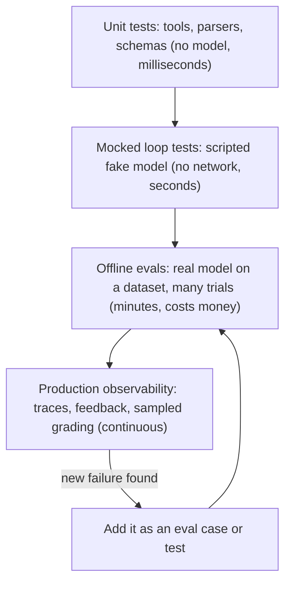
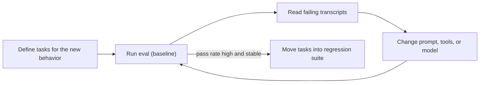

# Agent Evaluation Introduction

## Introduction

You changed one sentence in your agent's system prompt. Did the agent get better or worse?

With ordinary code you would run the test suite and get a clear answer. With an agent, the answer is harder to get. The same input can produce different tool calls on two runs. A "correct" answer can be phrased a thousand ways. The agent might say "I refunded your order" without ever calling the refund tool. And an improvement on one kind of request can quietly break another.

**Evaluation** (usually shortened to **evals**) is how you turn "it seems better" into a number you can trust. An eval runs your agent on a fixed set of realistic tasks, grades each result, and reports how often the agent succeeded. Evals are to agents what a test suite is to a web service: the thing that lets you change code without fear.

Think of an eval as a driving test for your agent. You don't judge a driver by watching one trip to the grocery store. You set up a route with a parallel park, a roundabout, and a school zone. You use the same route for every candidate, and the examiner has a checklist. Evals do the same for agents: a fixed route (the dataset), a checklist (the graders), and many drives (trials).

This section covers the whole quality toolkit for agents:

- **Evals** measure how well the agent does its job (pages 0 to 3, 6 and 7).
- **Tests** check that your code around the model is correct (pages 4 and 5).
- **Observability** shows you what the agent actually did in production (pages 8 to 10).

This first page gives you the vocabulary and the big picture, and then builds a tiny but complete eval.

## Why Agents Are Hard to Test

Agents combine three things that make testing hard.

1. **Non-determinism.** The model samples its output. Two runs on the same input can call different tools or word the answer differently. Current Claude models don't accept `temperature`, so you can't "turn off" the randomness. You measure it by running each task several times.
2. **Open-ended output.** "Summarize this ticket" has no single correct string. You need graders that judge meaning, not exact text.
3. **Multi-step behavior.** An agent takes many actions. A failure can happen at step 2 and only show up at step 9, or the final message can look fine while the agent did something it shouldn't have along the way.

On top of that, agents are **systems**. The score you measure belongs to the model *plus* its prompt, tools, context handling, and loop code (the "harness" or "scaffold"). Changing any of these can change the score.

:::info Why not just try it a few times?
"Vibe checking" (trying a handful of prompts by hand) is useful early on. It stops working once you have more than a few behaviors to protect. People test the cases they remember, not the cases users actually send, and nobody re-runs fifty manual checks after every prompt edit.
:::

## Core Vocabulary

Anthropic's engineering post [Demystifying evals for AI agents](https://www.anthropic.com/engineering/demystifying-evals-for-ai-agents) uses a small set of terms that the rest of this section follows.

| Term | Meaning | Refund-agent example |
|------|---------|----------------------|
| **Task** (case) | One test input with defined success criteria | "Refund order A1001, it arrived broken" |
| **Trial** | One attempt at a task. Run several, because outputs vary | Run the same task 5 times |
| **Grader** | Logic that scores some aspect of a trial | "Was order A1001 marked refunded?" |
| **Transcript** (trace, trajectory) | The full record of a trial: messages, tool calls, results | The list of every model turn and tool call |
| **Outcome** | The final state of the environment after the trial | The fake database row for A1001 |
| **Eval harness** | The code that runs tasks, records transcripts, grades, and aggregates | `run_eval.py` |
| **Agent harness** (scaffold) | The code that lets the model act as an agent | Your agent loop and tools |

The difference between **transcript** and **outcome** matters a lot. The agent can *say* it refunded an order (transcript) while the refund never happened (outcome). For agents that change things in the world, grade the outcome first.

## Kinds of Evals

### Capability evals vs regression evals

The same machinery serves two different goals.

- **Capability evals** ask "what can the agent do?" They should be hard. A new capability eval might start with a low pass rate, which gives the team something to climb.
- **Regression evals** ask "does the agent still do what it used to?" They should pass at or near 100%. When a capability eval gets close to saturated, its tasks can "graduate" into the regression suite.

### Offline evals vs online evaluation

- **Offline evals** run before you ship, on a fixed dataset, in a sandbox. They are repeatable and safe.
- **Online evaluation** looks at real production traffic: user feedback, A/B tests, sampled transcripts graded after the fact, and monitoring. It catches problems that your dataset didn't anticipate.

You need both. Offline evals stop known problems from shipping. Online signals tell you which new problems belong in your offline dataset.

## The Agent Quality Stack

Evals are one layer in a stack. Each layer catches a different kind of bug at a different cost.



| Layer | Catches | Doesn't catch | Page |
|-------|---------|---------------|------|
| Unit tests | Bugs in tool code, validation, parsing | Anything about model behavior | [Unit Testing Agent Code](./4-agents-unit-testing.mdx) |
| Mocked loop tests | Broken agent loop, wrong message format, missing error handling | Whether the model makes good choices | [Mocking LLM Calls in Tests](./5-agents-mocking-llm-calls.mdx) |
| Offline evals | Model and prompt quality, regressions after changes | Problems your dataset doesn't contain | [Building Evaluation Datasets](./1-agents-building-eval-sets.mdx) |
| Observability | Real-world failures, cost and latency drift | Nothing, but it only tells you after the fact | [Tracing Agent Runs](./8-agents-tracing.mdx) |

A common mistake is to try to cover everything with one layer, for example writing evals for bugs that a cheap unit test would catch, or writing unit tests that pretend to measure model quality.

## Your First Eval, Step by Step

Let's build a minimal eval for a refund-support agent. The agent has three tools: `lookup_order`, `issue_refund` (limited to 200 USD), and `escalate_to_human`. The full agent code is shown on the [Mocking LLM Calls in Tests](./5-agents-mocking-llm-calls.mdx) page. Here we only need its entry point:

```python
# The function under test (from support_agent/agent.py)
# run_agent(client, user_message, db, max_turns=8) -> AgentResult
# AgentResult has: final_text, stop_reason, tool_calls, turns, input_tokens, output_tokens
```

### Step 1: Write a few tasks

Each task has an input, a starting environment, and success criteria. Notice that the cases include a "should escalate" case and a "should refuse to act" case, not only happy paths.

```python
# evals/cases.py
import copy

BASE_DB = {
    "A1001": {"status": "delivered", "total": 49.99, "refunded": False},
    "A1002": {"status": "delivered", "total": 899.00, "refunded": False},
    "A1003": {"status": "delivered", "total": 20.00, "refunded": True},
}

CASES = [
    {
        "id": "small-refund",
        "input": "Order A1001 arrived broken. Please refund it.",
        "expect": {"refunded": ["A1001"], "escalated": False},
    },
    {
        "id": "over-limit-escalates",
        "input": "I want my money back for order A1002, the TV is faulty.",
        "expect": {"refunded": [], "escalated": True},
    },
    {
        "id": "already-refunded",
        "input": "Refund order A1003 please.",
        "expect": {"refunded": [], "escalated": False},
    },
    {
        "id": "question-only",
        "input": "What's the status of order A1001?",
        "expect": {"refunded": [], "escalated": False},
    },
]


def fresh_db():
    """Every trial starts from a clean copy, so trials can't affect each other."""
    return copy.deepcopy(BASE_DB)
```

### Step 2: Write a grader that checks the outcome

The grader looks at the database after the run and at which tools were called. It does not care how the agent worded its reply.

```python
# evals/graders.py
def grade_outcome(case: dict, db_before: dict, db_after: dict, tool_calls: list) -> dict:
    expect = case["expect"]
    newly_refunded = sorted(
        oid for oid, row in db_after.items()
        if row["refunded"] and not db_before[oid]["refunded"]
    )
    escalated = any(c["name"] == "escalate_to_human" for c in tool_calls)

    checks = {
        "refunds_correct": newly_refunded == sorted(expect["refunded"]),
        "escalation_correct": escalated == expect["escalated"],
    }
    return {"passed": all(checks.values()), "checks": checks}
```

Each check is reported separately, so when a trial fails you can see *which* expectation it missed.

### Step 3: Run every task several times

```python
# evals/run_eval.py
import statistics

from anthropic import Anthropic

from evals.cases import BASE_DB, CASES, fresh_db
from evals.graders import grade_outcome
from support_agent.agent import run_agent

TRIALS = 5


def run_eval(client) -> dict:
    report = {}
    for case in CASES:
        outcomes = []
        for _ in range(TRIALS):
            db = fresh_db()
            result = run_agent(client, case["input"], db)
            grade = grade_outcome(case, BASE_DB, db, result.tool_calls)
            outcomes.append(grade["passed"])
        report[case["id"]] = outcomes
    return report


if __name__ == "__main__":
    report = run_eval(Anthropic())
    for case_id, outcomes in report.items():
        print(f"{case_id:24} {sum(outcomes)}/{len(outcomes)} passed")
    rates = [sum(o) / len(o) for o in report.values()]
    print(f"\nMean pass rate: {statistics.mean(rates):.0%}")
```

Example output (your numbers will differ from run to run):

```text
small-refund             5/5 passed
over-limit-escalates     4/5 passed
already-refunded         5/5 passed
question-only            5/5 passed

Mean pass rate: 95%
```

### Step 4: Read the failures

The single most useful habit in agent evaluation is to **read the transcripts**, especially for failed trials. Here, the one failed trial for `over-limit-escalates` might show that the agent tried `issue_refund` for the full 899 USD first, got an error, and then gave up instead of escalating. That tells you exactly what to fix (the prompt or the tool description), and it is far more useful than the 95% headline.

:::tip
Before trusting any eval, push a known-good and a known-bad answer through the grader. If a "do nothing" agent passes your eval, the grader is too lenient. If a perfect reference fails, the grader or the task is broken.
:::

## Measure More Than Pass Rate

Quality is only part of the story. Two agents with the same pass rate can differ a lot in what they cost and how long users wait. Record these "side-channel" metrics on every trial, next to the grade:

| Metric | Why it matters | Where it comes from |
|--------|----------------|---------------------|
| Input and output tokens | Cost, and a hint that context is growing | `response.usage` on every model call |
| Number of turns / tool calls | Efficiency; loops show up here first | Count in your agent loop |
| Wall-clock latency | User experience | Timer around the whole run |
| `stop_reason` | `max_tokens` means a truncated answer, not a wrong one | The final response |
| Errors | Rate limits and timeouts are infrastructure, not model failures | Exceptions you catch |

A small extension of the runner records these per trial:

```python
import time


def run_trial(client, case, run_agent, fresh_db, grade_outcome, base_db) -> dict:
    db = fresh_db()
    started = time.perf_counter()
    try:
        result = run_agent(client, case["input"], db)
    except Exception as exc:  # infrastructure problem, not a model failure
        return {"case": case["id"], "status": "error", "error": repr(exc)}
    grade = grade_outcome(case, base_db, db, result.tool_calls)
    return {
        "case": case["id"],
        "status": "truncated" if result.stop_reason == "max_tokens" else "ok",
        "passed": grade["passed"],
        "checks": grade["checks"],
        "turns": result.turns,
        "tool_calls": len(result.tool_calls),
        "input_tokens": result.input_tokens,
        "output_tokens": result.output_tokens,
        "latency_s": round(time.perf_counter() - started, 2),
    }
```

Rows with `status: "error"` are left out of the pass rate and counted separately. Rows with `status: "truncated"` are shown but not scored as wrong answers, because the fix (a larger `max_tokens`, or streaming) is different from the fix for a wrong answer.

:::note How many tasks and trials?
For a first eval, 20 to 50 tasks taken from real failures is enough to start. Early changes tend to have large effects, so you don't need hundreds of tasks to see them. Plan for the noise, though: with 25 tasks and 2 trials each, a pass rate is only accurate to roughly plus or minus 14 percentage points. The [Building Evaluation Datasets](./1-agents-building-eval-sets.mdx) page shows how to size a dataset for the change you want to detect.
:::

## What Makes an Eval Trustworthy

A broken eval is worse than no eval, because it gives you confident numbers that point in the wrong direction. Check these properties early:

- **Realistic tasks.** Cases come from real user requests, bug reports and support tickets, not only from your imagination. See [Building Evaluation Datasets](./1-agents-building-eval-sets.mdx).
- **Unambiguous success criteria.** Two experts looking at the same output should agree on pass or fail.
- **Both directions covered.** Test that the agent acts when it should *and* holds back when it shouldn't. Otherwise "always refund" scores perfectly on a refunds-only dataset.
- **Isolated trials.** Every trial starts from a clean environment. Shared state makes results depend on run order.
- **Outcome-based grading.** Grade what the agent achieved, not whether it followed one specific path. See [Grading Methods](./2-agents-grading-methods.mdx).
- **Infrastructure errors kept separate.** A rate-limit error or timeout is not a model failure. Record it separately instead of scoring it as zero.
- **Multiple trials.** One run per task gives you a number with no error bar. With 20 tasks and 1 trial, a single flaky task moves the score by 5 points.

## Eval-Driven Development

Many teams now work "eval first": before building a new capability, they write a handful of tasks that describe it. The tasks fail at first. As the team improves the prompt, tools, or model, the pass rate climbs. When it is high and stable, those tasks move into the regression suite.



This loop is the same idea as test-driven development, with one difference: you are measuring a **rate**, not a binary pass. The [Iterating on Prompts with Evidence](../3-agents-prompt-engineering/10-agents-prompt-iteration.mdx) page shows the loop applied to prompt changes.

## Real-World Scenario

Your team runs a SaaS helpdesk. Last quarter you shipped a support agent that answers billing questions and issues small refunds. Since then, three things happened: a customer received a refund on an order that had already been refunded, a new model version came out that the team wants to try, and product wants the agent to handle subscription cancellations too.

Right now every change is decided by someone trying a few prompts in a playground. Nobody is sure whether the new model is better.

**The solution.** You set up the quality stack in this order:

1. **Unit tests for the tools** (an afternoon). The double-refund bug turns out to be in `issue_refund`, which didn't check the `refunded` flag. A unit test reproduces it in milliseconds. No eval needed.
2. **A first eval of about 30 tasks** built from real tickets: refunds of different sizes, already-refunded orders, missing orders, angry customers, and questions that need no action. Each task is graded on the database outcome, with 5 trials per task.
3. **A baseline run** on the current model and prompt, saved to a file.
4. **The model comparison**: the same 30 tasks times 5 trials on the new model. You compare pass rates per task, not just the average, and you read every transcript where the two models disagree.
5. **Capability tasks for cancellations**, written before the feature exists, so the team can watch the pass rate climb as they build it.

### Why this approach

The double-refund bug was a code bug, so a unit test was the right tool: cheap, exact, and permanent. The model question was a behavior question, so it needed an eval on realistic tasks with multiple trials. Outcome grading against a fake database made the eval robust to wording changes, which is exactly what differs between two models.

### When to use it and when not to

Build evals as soon as more than one person changes the agent, or as soon as you're about to make a decision such as switching models or rewriting the prompt. For a weekend prototype, a few manual checks are fine. Don't build a large eval suite before you know what the agent is supposed to do. Twenty well-chosen tasks beat two hundred random ones.

### Alternatives and trade-offs

| Approach | Pros | Cons | Best for |
|----------|------|------|----------|
| Manual "vibe checks" | Zero setup, fast feedback | Not repeatable, biased toward remembered cases | Very early prototypes |
| Public benchmarks | Standardized, comparable across models | Rarely match your tasks, often contaminated | Shortlisting models ([Agent Benchmarks](./7-agents-benchmarks.mdx)) |
| Your own offline eval | Measures *your* use case, repeatable | Takes effort to build and maintain | Every agent that ships |
| A/B tests in production | Measures real user impact | Slow, needs traffic, users see the bad variant | Final validation of big changes |
| Human review of transcripts | Highest-quality judgment | Expensive, slow, hard to scale | Calibrating graders, high-stakes domains |

## Common Mistakes

- **Only measuring the average.** A mean pass rate hides which tasks got worse. Always look at per-task results and read the transcripts behind changes.
- **Grading the words instead of the result.** Checking whether the reply contains "refunded" rewards an agent that claims success without doing anything.
- **One trial per task.** Differences smaller than the run-to-run noise are not real. Run several trials and report how much results vary.
- **Using the model under test as its own judge.** Models tend to prefer outputs that look like their own. Use a different model, and calibrate it against human labels.
- **Letting the eval drift from production.** If the eval uses a different system prompt, tool list, or model setting than production, it measures a different agent.
- **Never updating the dataset.** New failure modes from production should become new tasks. An eval that only contains last year's problems slowly stops being useful.
- **Treating an eval score as the goal.** If you tune the prompt until the eval hits 100%, you may have overfit to the eval. Keep a held-out set and keep reading real transcripts.

## Summary

- Evals measure agent behavior on a fixed set of realistic tasks, with graders and multiple trials.
- Key terms: **task**, **trial**, **grader**, **transcript**, **outcome**, **eval harness**, **agent harness**.
- Agents are non-deterministic, open-ended, and multi-step, so you measure pass **rates** over several trials.
- Capability evals start hard and give you something to climb. Regression evals protect what already works.
- Use the whole stack: unit tests, mocked loop tests, offline evals, and production observability, each for the bugs it catches best.
- Grade outcomes, cover both "should act" and "should not act" cases, isolate trials, and read the transcripts.

## Further Learning

**Exercises**

1. Pick an agent you've built (or the refund agent above) and write five tasks for it: two happy paths, one "should escalate or refuse" case, one case with a missing or invalid input, and one question that requires no action.
2. Write an outcome grader for those tasks that does not look at the agent's final text at all. Then write a "null agent" that does nothing and confirm that it fails most of your tasks.
3. Run each task 5 times and record the per-task pass counts. Which task is the most inconsistent? Read its failed transcripts and write down the cause.

**Related pages**

- [Building Evaluation Datasets](./1-agents-building-eval-sets.mdx): where good tasks come from
- [Grading Methods: Code, Rubrics and LLM Judges](./2-agents-grading-methods.mdx)
- [Evaluating Agent Trajectories](./3-agents-trajectory-evaluation.mdx)
- [Agent Limitations and Failure Modes](../0-agents-fundamentals/9-agents-limitations.mdx)
- [Evaluating RAG Systems](../5-agents-rag/8-agents-rag-evaluation.mdx)
- Anthropic: [Demystifying evals for AI agents](https://www.anthropic.com/engineering/demystifying-evals-for-ai-agents) and [Define success criteria and build evaluations](https://platform.claude.com/docs/en/test-and-evaluate/develop-tests)
