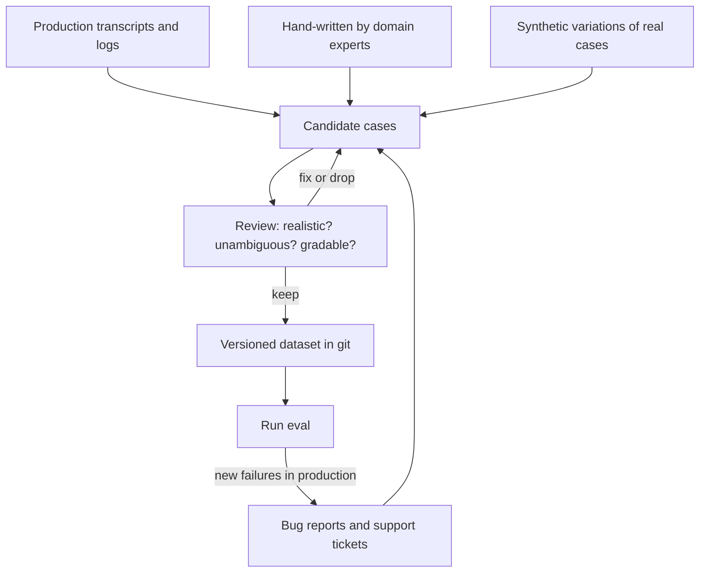

# Building Evaluation Datasets

## Introduction

An eval is only as good as its tasks. A clever grader and a fast harness can't rescue a dataset full of easy, unrealistic, or ambiguous cases. In practice, the dataset is where most of the effort, and most of the value, goes.

A good dataset is like a good exam. It covers the material students will actually face, includes some hard questions, has an answer key that two teachers agree on, and doesn't give away answers in the question wording. A bad exam can be passed by memorizing or guessing, and tells you little about who actually learned the material.

This page shows how to build that exam for an agent: what a single case contains, where cases come from, how to cover the right behaviors, how to set up the environment each case runs in, and how many cases you need.

We'll keep using the refund-support agent from the [Agent Evaluation Introduction](./0-agents-evaluation-introduction.mdx). It can look up orders, refund up to 200 USD, and escalate to a human.

## Anatomy of an Eval Case

A case is everything the harness needs to run one task and grade it. For agents, that's more than a prompt and an answer.

| Field | Purpose | Example |
|-------|---------|---------|
| `id` | Stable name, so you can compare runs over time | `"refund-over-limit-01"` |
| `input` | What the user sends. Can be a full conversation prefix | `"My TV (order A1002) is broken, refund please"` |
| `fixture` | The starting environment: database rows, files, user profile | Orders A1001 to A1003 |
| `expect` | What success looks like: outcome checks, a rubric, or a reference answer | `{"refunded": [], "escalated": true}` |
| `tags` | Labels for slicing results | `["refund", "over-limit", "negative"]` |
| `source` | Where the case came from | `"ticket-48213"`, `"synthetic"` |

The shape of `expect` depends on how you grade. For an outcome check it holds the target state. For an LLM judge it might hold a short per-case rubric. For a comparison against a baseline it might be empty. See [Grading Methods](./2-agents-grading-methods.mdx).

Store cases as **JSONL** (one JSON object per line). It diffs well in git, streams easily, and every language can read it:

```json
{"id": "refund-small-01", "input": "Order A1001 arrived broken. Please refund it.", "fixture": "orders_basic", "expect": {"refunded": ["A1001"], "escalated": false}, "tags": ["refund", "happy-path"], "source": "ticket-48102"}
{"id": "refund-over-limit-01", "input": "My TV (order A1002) stopped working, I want my money back.", "fixture": "orders_basic", "expect": {"refunded": [], "escalated": true}, "tags": ["refund", "over-limit", "negative"], "source": "ticket-48213"}
{"id": "status-only-01", "input": "Where is order A1001?", "fixture": "orders_basic", "expect": {"refunded": [], "escalated": false}, "tags": ["status", "no-action"], "source": "handwritten"}
```

Keep fixtures in their own files and reference them by name. Many cases can share one fixture, and you can change a fixture without editing every case.

## Where Good Cases Come From

Work down this list and use the best source you can.



1. **Production transcripts.** The highest-fidelity source, because they show what users really send, including typos, vague requests and multiple questions in one message. Before pulling them, check retention rules and personal data. If you can't keep the raw data, store only IDs and fetch at run time, anonymize a sample, or rewrite real cases into synthetic ones with the same shape.
2. **Bug reports and complaints.** Every "the agent did something wrong" report is a ready-made test case. These are often the most valuable cases you'll have.
3. **Hand-written cases from experts.** Ask the people who handle these requests today for five to ten examples, especially the tricky ones. Hand-written sets tend to over-represent what's memorable, so treat them as a seed.
4. **Synthetic cases.** Generated by a model from your prompt, docs and a few real examples. This is the lowest-fidelity source. Use it to fill gaps, never as the whole dataset.

:::caution Don't start from synthetic data alone
Cases generated "cold" from a system prompt tend to be simple and polite, and they cluster around the obvious requests. Seed generation with real examples and a description of what makes a case hard in your domain.
:::

## Covering the Right Behaviors

### Tag along a few dimensions

Pick a few dimensions that matter for your agent and tag every case. For the refund agent:

- **Intent:** refund, status question, cancellation, complaint, out of scope.
- **Expected action:** act, escalate, refuse, ask a clarifying question, no action.
- **Difficulty:** clear request, missing info, conflicting info, multi-step.
- **Risk:** low (status question) to high (money moves).

Tags let you report results per slice ("escalations dropped from 90% to 60%") instead of one blended number.

### Test both directions

If every case in your dataset expects a refund, an agent that refunds everything scores 100%. For every behavior, include cases where the agent **should** do it and cases where it **should not**:

| Behavior | Should do it | Should NOT do it |
|----------|--------------|------------------|
| Issue refund | Broken item under 200 USD | Already refunded; over the limit; just asking for status |
| Escalate | Over the limit; legal threat | Simple refund it can handle itself |
| Ask a clarifying question | No order ID given | Order ID given clearly |
| Use web search (if it had one) | Question about a current event | Question answered by the order database |

### Include the hard and the weird

Real traffic has a long tail. Add a few cases for each of these:

- Missing or malformed input ("refund my last order" with no ID).
- Conflicting instructions ("refund it, actually no, just check the status").
- Out-of-scope requests ("write me a poem").
- Adversarial input, such as prompt injection hidden in an order note. See [Prompt Injection](../12-agents-safety-and-security/1-agents-prompt-injection.mdx).
- Long multi-turn conversations, where an early detail matters late.

## Writing Good Cases

Each case should pass a few quality checks.

- **Unambiguous success.** Would two experts agree on pass or fail? "Handle the customer well" is not gradable. "Refunds A1001 and does not escalate" is.
- **A reference solution exists.** You (or a human) should be able to solve the task and pass the grader. A case that every model fails on every trial is more often broken than hard.
- **The answer is not leaked.** Check that the expected answer doesn't appear in the system prompt, few-shot examples, tool descriptions, or files the agent can read.
- **The symptom, not the investigation.** For diagnostic tasks, give the agent what a user would actually report. Don't hand it the log line, file name or failing test that a real user wouldn't know.
- **Not answerable from memory.** If you're testing tool use, make sure the model can't answer from general knowledge. Use synthetic order IDs, products and names.
- **Hard because of the problem, not the wording.** Write requests plainly. Obscure phrasing measures puzzle solving, not your agent's job.
- **Fresh.** If a case depends on facts that change (prices, dates, versions), note when the expected answer was last checked.

## Fixtures: The Environment Each Case Runs In

Agents act on an environment, so each case needs a starting state, and every trial must start from a **clean copy** of it. Otherwise one trial's refund changes the next trial's starting point.

```python
# evals/fixtures.py
import copy
import json
from pathlib import Path

FIXTURE_DIR = Path(__file__).parent / "fixtures"


def load_fixture(name: str) -> dict:
    """Return a fresh, independent copy of a named fixture for one trial."""
    data = json.loads((FIXTURE_DIR / f"{name}.json").read_text())
    return copy.deepcopy(data)
```

For tools that touch the real world, you have three options:

| Option | How | Trade-off |
|--------|-----|-----------|
| Real system, test account | Point the agent at a staging API with test users | Most realistic; needs cleanup and may be slow |
| Fake in-memory system | A dict or SQLite database like the one above | Fast and isolated; must stay faithful to the real API |
| Stub with canned results | Tool returns recorded responses | Easiest; you can only grade tool calls, not real outcomes |

For coding or file-editing agents, run each trial in a fresh container or temporary directory, then grade what's left behind. See [Sandboxing Agent Execution](../12-agents-safety-and-security/3-agents-sandboxing.mdx).

## Loading and Auditing a Dataset

As a dataset grows past what you can read in one sitting, let code check it. This loader validates every case and prints a quick audit: duplicates, missing fields, tag balance, and how many cases expect action versus no action.

```python
# evals/dataset.py
import json
from collections import Counter
from pathlib import Path

REQUIRED = {"id", "input", "fixture", "expect", "tags"}


def load_cases(path: str) -> list[dict]:
    cases = []
    for line_no, line in enumerate(Path(path).read_text().splitlines(), start=1):
        if not line.strip():
            continue
        case = json.loads(line)
        missing = REQUIRED - case.keys()
        if missing:
            raise ValueError(f"line {line_no}: missing {sorted(missing)}")
        cases.append(case)
    return cases


def audit(cases: list[dict]) -> None:
    ids = Counter(c["id"] for c in cases)
    dup_ids = [i for i, n in ids.items() if n > 1]
    inputs = Counter(c["input"].strip().lower() for c in cases)
    dup_inputs = sum(n - 1 for n in inputs.values() if n > 1)
    tags = Counter(t for c in cases for t in c["tags"])
    acts = sum(1 for c in cases if c["expect"].get("refunded"))
    print(f"{len(cases)} cases, {len(dup_ids)} duplicate ids, {dup_inputs} duplicate inputs")
    print(f"expects a refund: {acts}, expects no refund: {len(cases) - acts}")
    print("tags:", ", ".join(f"{t}={n}" for t, n in tags.most_common()))


if __name__ == "__main__":
    audit(load_cases("evals/cases.jsonl"))
```

Running it on the three cases from earlier, plus a copy-pasted duplicate:

```text
4 cases, 1 duplicate ids, 1 duplicate inputs
expects a refund: 2, expects no refund: 2
tags: refund=3, happy-path=2, over-limit=1, negative=1, status=1, no-action=1
```

For large sets, also skim a **stratified sample**: pick a few cases from each tag and read them closely. Code catches duplicates and skew. Only a human catches "this expected answer is wrong."

## Generating Synthetic Variations

Once you have real seed cases, a model can help you produce variations: different wording, a missing detail, an angrier tone, a second question in the same message. Use structured outputs so the result parses reliably.

```python
# evals/synthesize.py
from anthropic import Anthropic
from pydantic import BaseModel


class Variation(BaseModel):
    input: str
    what_changed: str


class Variations(BaseModel):
    variations: list[Variation]


SEED = "Order A1001 arrived broken. Please refund it."

client = Anthropic()
response = client.messages.parse(
    model="claude-sonnet-5-5",
    max_tokens=4000,
    messages=[{
        "role": "user",
        "content": (
            "You help build test cases for a refund-support agent.\n"
            f"Real customer message: {SEED!r}\n"
            "Write 5 realistic variations a real customer might send. Vary tone, "
            "length, typos, and missing details. Keep the same order ID and intent. "
            "Do not make them more polite or tidier than real customers."
        ),
    }],
    output_format=Variations,
)

for v in response.parsed_output.variations:
    print(f"- {v.input}  ({v.what_changed})")
```

Example output:

```text
- hey my order A1001 came smashed, need a refund asap  (casual, urgent)
- A1001 broken. refund.  (very short)
- Hi, I received order A1001 today but the glass was cracked in the box. Could I get my money back?  (more detail)
- this is the second time an order from you arrived damaged (A1001). I want a refund  (frustrated, mentions history)
- refund pls, the thing I ordered arrived broken  (missing order ID)
```

Notice that the last variation dropped the order ID. That changes the correct behavior: the agent should now ask for the ID instead of refunding. Synthetic variations need the same human review as any other case, including a fresh look at `expect`.

:::tip
When you find a problem in generated cases, fix the generation prompt and regenerate. Patching individual outputs by hand leaves similar problems in their siblings.
:::

## How Many Cases Do You Need?

Enough to see the change you care about through the noise. A useful rule of thumb for a pass rate is that the noise is roughly `1 / sqrt(cases x trials)`:

```python
import math

for cases, trials in [(20, 1), (25, 2), (50, 3), (100, 2), (100, 5)]:
    noise = 1 / math.sqrt(cases * trials)
    print(f"{cases:>4} cases x {trials} trials  ->  about +/- {noise:.0%}")
```

Output:

```text
  20 cases x 1 trials  ->  about +/- 22%
  25 cases x 2 trials  ->  about +/- 14%
  50 cases x 3 trials  ->  about +/- 8%
 100 cases x 2 trials  ->  about +/- 7%
 100 cases x 5 trials  ->  about +/- 4%
```

If you want to detect a 5-point improvement, 20 cases with one trial each won't show it reliably. Cases and trials are two knobs on the same dial: more trials are cheap to add, while more cases also improve coverage. A practical starting point is 20 to 50 cases from real failures with 3 to 5 trials each, growing to a few hundred cases as the agent matures.

## Splits and Versioning

- **Development set vs held-out set.** If you tune prompts against your eval, you'll slowly overfit to it. Keep a random slice (for example 20%) that you only run before a release decision. Choose the split at random, never by picking the cases that currently fail.
- **Capability vs regression.** Keep hard, not-yet-solved tasks separate from tasks that must always pass. They answer different questions and have different thresholds. See [Regression Testing for Agents](./6-agents-regression-testing.mdx).
- **Version the dataset with the grader.** Commit cases, fixtures, and grader code together. A score from before a grader change is not comparable to a score after it.
- **Treat it as a living suite.** Every production incident becomes a new case. Tasks that every version passes easily can be made harder or moved to the regression suite.

## Real-World Scenario

Your company runs a helpdesk for an online store. The support agent has been live for a month. The team wants an eval before they switch to a new model, but they have no test cases.

**The solution.** One engineer and one senior support lead spend two days on the dataset:

1. **Pull real tickets.** They export 300 recent agent conversations, then drop the ones that include addresses or card details (the company's retention policy doesn't allow storing those in the repo). They keep the ticket IDs as `source` and rewrite the remaining text with synthetic order IDs and names.
2. **Add the complaints.** Twelve tickets were escalated by unhappy customers. Each becomes a case, with the support lead writing the expected behavior.
3. **Tag and balance.** After tagging, they find 70% of cases are simple refunds and only two cases test "should not refund." They hand-write ten more negative cases (already refunded, over the limit, status-only) and generate variations of the rarest intents.
4. **Build fixtures.** Three fixture files cover normal orders, orders with past refunds, and an account flagged for fraud review.
5. **Audit and review.** The audit script finds four duplicates and two cases missing `expect`. The support lead reads a stratified sample of 40 cases and corrects five expected outcomes.
6. **Split.** 60 cases go in the development set and 15 are held out at random.

The final dataset has 75 cases. At 3 trials each, it can detect differences of roughly 7 to 8 points, which is enough for the model decision. It will grow as new failures come in.

### Why this approach

The team started from real traffic, so the eval measures what customers actually send. They added complaints because those are the failures that matter most. Balancing "should" and "should not" cases means a model that refunds too eagerly will score badly, which is exactly the failure that cost them money before.

### When to use it and when not to

Use this process whenever an eval will drive a decision: a model switch, a prompt rewrite, a new tool. For a quick sanity check during development, five hand-written cases are fine. Don't over-invest in a big dataset before the agent's job is stable, because the expected outcomes will keep changing.

### Alternatives and trade-offs

| Approach | Pros | Cons | Best for |
|----------|------|------|----------|
| Production logs | Most realistic distribution | Privacy and retention work; needs labeling | Mature agents with traffic |
| Bug reports and complaints | High value, already labeled as "wrong" | Biased toward past failures | Regression suites |
| Expert hand-written | Covers tricky cases on purpose | Slow; reflects what experts remember | Seeding a new eval, rare edge cases |
| Synthetic generation | Fast, fills gaps cheaply | Simplistic if not seeded; needs review | Expanding coverage of rare intents |
| Public benchmark tasks | Ready-made, standardized | Rarely match your domain | General model comparison only |

## Common Mistakes

- **Only happy paths.** Without "should not act" cases, the eval rewards an agent that acts on everything.
- **Expected answers copied from the current model.** If your reference answers came from model A, comparing model A to model B rewards imitation of A. Have humans write or verify references, or use a rubric instead.
- **Shared state between trials.** If trial 2 sees the refund from trial 1, results depend on run order. Copy fixtures fresh for every trial.
- **Answers leaked into the prompt.** Few-shot examples copied from the dataset make the eval measure recall of the examples.
- **Picking the held-out set by score.** Choosing the currently failing cases as the test set guarantees misleading "improvements." Split at random.
- **Too small to see the change.** Check the noise estimate before you start comparing variants.
- **Never reading the cases.** An audit script finds duplicates. Only reading finds wrong labels.

## Summary

- A case contains an input, a starting environment (fixture), success criteria, tags and a source.
- Prefer real sources (production transcripts, tickets, expert examples) and use synthetic variations to fill gaps.
- Tag cases and cover both directions: when the agent should act and when it should not.
- Each case needs unambiguous success criteria, no leaked answers, and a reference solution that passes.
- Every trial starts from a fresh copy of its fixture.
- Size the dataset against the change you want to detect: noise is roughly `1 / sqrt(cases x trials)`.
- Keep a random held-out split, version cases with graders, and keep adding cases from production failures.

## Further Learning

**Exercises**

1. Write ten JSONL cases for an agent you know, tagged by intent and expected action. Make sure at least three are "should not act" cases.
2. Run the audit script on your cases. Add one deliberate duplicate and one case missing `expect`, and confirm the script catches both.
3. Use the synthesis prompt to generate variations of your rarest case. Review each one and update `expect` where the variation changes the correct behavior.
4. Calculate how many cases and trials you'd need to detect a 10-point change, then a 3-point change.

**Related pages**

- [Agent Evaluation Introduction](./0-agents-evaluation-introduction.mdx)
- [Grading Methods: Code, Rubrics and LLM Judges](./2-agents-grading-methods.mdx)
- [Regression Testing for Agents](./6-agents-regression-testing.mdx)
- [Structured Outputs](../1-agents-llm-apis/6-agents-structured-outputs.mdx)
- [Data Privacy and PII](../12-agents-safety-and-security/5-agents-data-privacy.mdx)
- [Evaluating RAG Systems](../5-agents-rag/8-agents-rag-evaluation.mdx)
