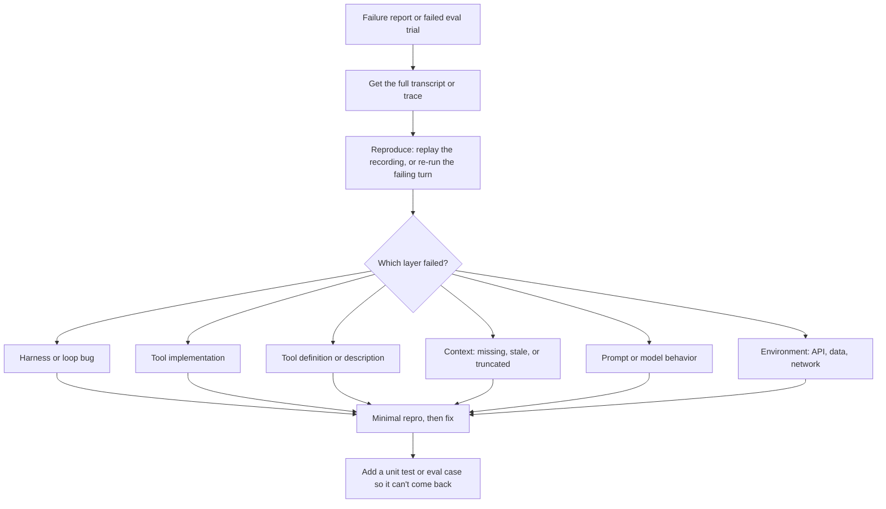

# Debugging Agents

## Introduction

Debugging an agent feels different from debugging ordinary code. There's often no stack trace. The agent didn't crash. It just did the wrong thing: it called the wrong tool, looped until it hit the turn limit, or told a customer their refund was on its way when it wasn't. Worse, when you try the same input again, it might work fine.

The good news is that agent failures follow patterns, and a systematic process works much better than editing the prompt and hoping. The process is the same one good engineers use everywhere: **reproduce, localize, minimize, fix, and lock in the fix with a test.** What changes for agents is how you do each step.

Think of a doctor diagnosing a patient. They don't prescribe medicine based on one symptom. They take a history (the transcript), run tests (replays and validators), narrow down which organ is involved (which layer of the agent failed), treat the cause, and schedule a follow-up (a regression test). This page gives you the agent version of that toolkit.

## The Debugging Workflow



### Step 1: Get the transcript

You can't debug what you can't see. You need the full sequence of messages: system prompt, user input, every model turn with its tool calls, every tool result, and the final answer, plus `stop_reason` and token usage for each turn. If you have tracing (see [Tracing Agent Runs](./8-agents-tracing.mdx)), this is one click. If not, the recording client below is the fastest way to start capturing it.

### Step 2: Reproduce

There are two kinds of reproduction for agents, and you usually want both:

- **Exact replay**: feed the recorded model responses back through a fake client. Your code runs again, deterministically, and you can add print statements or a debugger. This is ideal for bugs in your own code.
- **Re-running a turn**: send the exact recorded request for the failing turn to the real model several times and count how often it makes the bad choice. This tells you whether the failure is rare bad luck or a consistent behavior, and lets you test fixes on just that turn.

### Step 3: Localize the layer

Most agent failures come from one of six layers. Ask the questions in this order, because the earlier layers are cheaper to check and more often the cause than people expect:

| Layer | Question to ask | How to check |
|-------|-----------------|--------------|
| Harness / loop | Did my code send what I think it sent? | Validate the message history; read the recorded requests |
| Tool implementation | Did the tool return the right thing? | Call the tool directly with the recorded input |
| Tool definition | Could the model understand what the tool does? | Read the name, description and schema as if you'd never seen them |
| Context | Did the model have the information it needed at that turn? | Read the exact request for that turn, top to bottom |
| Prompt / model | Given all of that, did the model choose badly? | Re-run the turn several times; try a clearer instruction |
| Environment | Did something outside change? | Check API errors, rate limits, data changes, dependency versions |

A useful rule: **read the exact request the model saw before blaming the model.** Many "the model ignored my instruction" bugs turn out to be an instruction that was never in the request, a tool result that was truncated, or a history-trimming function that dropped the key message.

## Common Symptoms and Their Usual Causes

| Symptom | Usual causes | First things to try |
|---------|--------------|---------------------|
| Same tool called repeatedly with the same input | Tool result doesn't change; error message unclear; no stopping guidance | Make the error message actionable; add loop detection and a turn budget |
| Wrong tool chosen | Overlapping tool descriptions; vague names | Rewrite descriptions to say when to use and when not to use each tool |
| Invented or wrong arguments | Schema too loose; required info not in context | Tighten the schema (enums, formats); use `strict: True`; make the agent ask for missing info |
| Ignores a tool error and claims success | Error not marked with `is_error`; error text unclear; no instruction about failures | Set `is_error: True`; say plainly what failed and what to do next |
| Stops too early | No clear success criteria; overly cautious prompt | State what "done" means; check `stop_reason` |
| Answer cut off mid-sentence | `stop_reason` is `max_tokens` | Raise `max_tokens`, stream long outputs, or ask for shorter answers |
| Forgets earlier facts in long sessions | History trimming or compaction dropped them | Inspect the request at the failing turn; preserve key facts in state |
| `stop_reason` is `refusal` | Request triggered a safety refusal | Read the input; rephrase legitimate tasks; handle refusals gracefully in code |
| `stop_reason` is `pause_turn` | A long-running server-side tool turn was paused | Send the response back as-is to let the model continue |
| HTTP 400 errors | Malformed history: unmatched `tool_use`/`tool_result`, consecutive same-role messages, trailing assistant message (prefill), unsupported parameters | Validate the history before sending (below) |
| HTTP 429 / 529 errors | Rate limits or overload | Back off and retry; these are infrastructure issues, not agent behavior |
| Works in testing, fails in production | Different prompt, tools, model ID, or data | Diff the production configuration against your test configuration |

For more failure patterns, see [Agent Limitations and Failure Modes](../0-agents-fundamentals/9-agents-limitations.mdx) and [Handling Tool Errors](../2-agents-tool-use/6-agents-tool-errors.mdx).

## Tool 1: A Recording Client

The fastest way to make an agent debuggable is to record every request and response. This wrapper has the same interface as the real client, so you can drop it into the refund agent from [Mocking LLM Calls in Tests](./5-agents-mocking-llm-calls.mdx) without changing anything else.

```python
# support_agent/recording.py
"""Record every model request/response so a failing run can be replayed exactly."""
import json

from anthropic.types import Message


def _jsonable(obj):
    return obj.model_dump(mode="json") if hasattr(obj, "model_dump") else str(obj)


class RecordingClient:
    """Wraps a real client. Same interface: client.messages.create(**kwargs)."""

    def __init__(self, client, path: str):
        self._client = client
        self._path = path
        self._log = []
        self.messages = self

    def create(self, **kwargs):
        response = self._client.messages.create(**kwargs)
        # Snapshot now: the agent keeps mutating its `messages` list after this call.
        entry = json.dumps({"request": kwargs, "response": response}, default=_jsonable)
        self._log.append(json.loads(entry))
        with open(self._path, "w") as f:
            json.dump(self._log, f, indent=1)
        return response


def load_recording(path: str):
    """Return (requests, responses) from a recording file."""
    with open(path) as f:
        log = json.load(f)
    requests = [entry["request"] for entry in log]
    responses = [Message.model_validate(entry["response"]) for entry in log]
    return requests, responses
```

The snapshot comment points at a real bug worth knowing about: the agent loop appends to the same `messages` list on every turn. If you store the request without copying it, every recorded request ends up showing the final conversation, and your recording lies to you.

:::caution Recordings contain user data
A recording holds everything the user typed and every tool result. Store recordings with the same care as production data: limited access, retention limits, and redaction where needed. See [Data Privacy and PII](../12-agents-safety-and-security/5-agents-data-privacy.mdx).
:::

## Tool 2: Turn-by-Turn Summaries

Raw JSON transcripts are long. A one-line summary per model turn makes the shape of a run visible at a glance:

```python
# support_agent/debug_tools.py (part 1)
import json


def describe_turn(turn: int, response) -> str:
    """One compact line per model turn, for verbose debugging output."""
    parts = []
    for b in response.content:
        if b.type == "text":
            parts.append(f"text({b.text[:60]!r})")
        elif b.type == "tool_use":
            parts.append(f"{b.name}({json.dumps(b.input)})")
        else:
            parts.append(b.type)
    u = response.usage
    return (f"[turn {turn}] stop={response.stop_reason} in={u.input_tokens} "
            f"out={u.output_tokens} | " + ", ".join(parts))
```

You can call this inside your loop behind a `DEBUG` flag, or run it over a recording after the fact.

## Tool 3: A Message History Validator

A large share of "mysterious" HTTP 400 errors in agent loops come from a malformed message history. The rules are simple, but easy to break in loop code: every `tool_use` needs a matching `tool_result` in the very next user message, all results for one turn go in **one** message, roles alternate, and the conversation can't end with an assistant message (assistant prefill isn't supported on current models). A validator turns the API's error into a precise explanation.

```python
# support_agent/debug_tools.py (part 2)
def _blocks(content):
    if isinstance(content, str):
        return [{"type": "text", "text": content}]
    return [b if isinstance(b, dict) else b.model_dump() for b in content]


def validate_history(messages: list[dict]) -> list[str]:
    """Return a list of problems that would make the API reject this message history."""
    problems = []
    if not messages or messages[0]["role"] != "user":
        problems.append("history must start with a user message")
    for i, msg in enumerate(messages):
        if i > 0 and msg["role"] == messages[i - 1]["role"]:
            problems.append(f"messages {i - 1} and {i} are both {msg['role']!r}")
        blocks = _blocks(msg["content"])
        if msg["role"] == "assistant":
            tool_ids = [b["id"] for b in blocks if b["type"] == "tool_use"]
            if not tool_ids:
                continue
            nxt = messages[i + 1] if i + 1 < len(messages) else None
            if nxt is None:
                problems.append(f"message {i}: tool_use {tool_ids} has no tool_result message after it")
                continue
            nxt_blocks = _blocks(nxt["content"])
            result_ids = [b["tool_use_id"] for b in nxt_blocks if b["type"] == "tool_result"]
            missing = set(tool_ids) - set(result_ids)
            if missing:
                problems.append(f"message {i + 1}: missing tool_result for {sorted(missing)}")
            first_types = [b["type"] for b in nxt_blocks[: len(result_ids)]]
            if result_ids and set(first_types) != {"tool_result"}:
                problems.append(f"message {i + 1}: tool_result blocks must come first")
        if msg["role"] == "user":
            for b in blocks:
                if b["type"] == "tool_result":
                    prev = messages[i - 1] if i > 0 else None
                    prev_ids = [x.get("id") for x in _blocks(prev["content"])] if prev else []
                    if b["tool_use_id"] not in prev_ids:
                        problems.append(f"message {i}: tool_result {b['tool_use_id']!r} has no matching tool_use")
    if messages and messages[-1]["role"] == "assistant":
        problems.append("history ends with an assistant message (prefill is not supported)")
    return problems
```

Here's a history produced by a buggy loop that sent parallel tool results in separate messages and then appended a stray assistant message:

```python
from support_agent.debug_tools import validate_history

broken = [
    {"role": "user", "content": "Refund A1001 and A1002"},
    {"role": "assistant", "content": [
        {"type": "tool_use", "id": "toolu_1", "name": "lookup_order", "input": {"order_id": "A1001"}},
        {"type": "tool_use", "id": "toolu_2", "name": "lookup_order", "input": {"order_id": "A1002"}},
    ]},
    {"role": "user", "content": [
        {"type": "tool_result", "tool_use_id": "toolu_1", "content": "{...}"},
    ]},
    {"role": "user", "content": [
        {"type": "tool_result", "tool_use_id": "toolu_2", "content": "{...}"},
    ]},
    {"role": "assistant", "content": "Let me check"},
]

for problem in validate_history(broken):
    print("-", problem)
```

Output:

```text
- message 2: missing tool_result for ['toolu_2']
- messages 2 and 3 are both 'user'
- message 3: tool_result 'toolu_2' has no matching tool_use
- history ends with an assistant message (prefill is not supported)
```

Each line points at the exact message to fix. The validator is cheap, so some teams run it before every API call in development builds, and in a unit test over recorded conversations.

## Putting the Tools Together: A Worked Debugging Session

A customer complains: "The bot said my 899 USD refund was on its way. It never arrived." The production agent was running with the recording client, so you have `run_0412.json`. Replay it:

```python
from support_agent.agent import run_agent
from support_agent.debug_tools import describe_turn, validate_history
from support_agent.recording import load_recording
from tests.fakes import FakeClient

requests, responses = load_recording("run_0412.json")
for turn, response in enumerate(responses):
    print(describe_turn(turn, response))

last_request = requests[-1]
print("tool result the model saw:", last_request["messages"][-1]["content"][0])
print("history problems:", validate_history(last_request["messages"]) or "none")

replayed = run_agent(FakeClient(responses), "Refund my TV, order A1002",
                     {"A1002": {"status": "delivered", "total": 899.0, "refunded": False}})
print("replayed final text:", replayed.final_text)
```

Output:

```text
[turn 0] stop=tool_use in=100 out=20 | issue_refund({"order_id": "A1002", "amount": 899.0})
[turn 1] stop=end_turn in=100 out=20 | text('Good news: your refund of $899.00 is on its way!')
tool result the model saw: {'type': 'tool_result', 'tool_use_id': 'toolu_0', 'content': 'Amount 899.0 is over the 200.0 limit; escalate instead', 'is_error': True}
history problems: none
replayed final text: Good news: your refund of $899.00 is on its way!
```

(The token counts are small because this recording came from a scripted demo. Real recordings show real usage.)

Now walk the layers:

1. **Harness:** the history is valid, and the tool result was sent with `is_error: True`. The loop did its job.
2. **Tool implementation:** the tool correctly refused the refund. No money moved, which matches the complaint.
3. **Tool definition and context:** the model saw a clear error that said what to do ("escalate instead").
4. **Model behavior:** despite that, the model told the customer the refund was on its way. It also skipped `lookup_order`, which the system prompt asks for.

So this is a model-behavior failure, and you've ruled out your own code in a few minutes. The next question is how often it happens.

## Tool 4: Re-Running a Single Turn

Re-running the whole conversation adds noise from every earlier turn. Instead, re-send the **exact recorded request** for the failing turn several times and count what the model does:

```python
from collections import Counter

from anthropic import Anthropic


def rerun_turn(client, request: dict, n: int = 10) -> Counter:
    """Send the same recorded request n times and tally what the model does."""
    outcomes = Counter()
    for _ in range(n):
        response = client.messages.create(**request)
        tools = [b.name for b in response.content if b.type == "tool_use"]
        outcomes[", ".join(tools) if tools else f"text ({response.stop_reason})"] += 1
    return outcomes


client = Anthropic()
print("as recorded:", rerun_turn(client, last_request))

# Try a fix on just this turn: a clearer tool error message.
fixed = dict(last_request)
fixed["messages"] = [*last_request["messages"][:-1], {"role": "user", "content": [{
    **last_request["messages"][-1]["content"][0],
    "content": ("REFUND NOT ISSUED: 899.0 is over the 200.0 limit. No money was moved. "
                "Call escalate_to_human, and do not tell the customer a refund was issued."),
}]}]
print("with fix:", rerun_turn(client, fixed))
```

Example output (illustrative; your counts will vary):

```text
as recorded: Counter({'text (end_turn)': 6, 'escalate_to_human': 4})
with fix: Counter({'escalate_to_human': 10})
```

Now you know the failure was common, not a fluke, and that a more explicit error message fixes it on this turn. Before shipping, confirm with your full eval, because a fix for one turn can change behavior elsewhere. A complementary fix lives in code: the tool layer could return a structured `{"refund_issued": false}` field, and a grader can flag any reply that claims a refund when none happened (see the no-op detector on [Grading Methods](./2-agents-grading-methods.mdx)).

:::tip Re-run turns, not conversations
Re-running one recorded turn isolates the model's decision from everything that happened before it. It's also much cheaper than replaying a twenty-turn conversation live, and it lets you A/B test a prompt or tool-description change on exactly the moment that failed.
:::

## More Debugging Techniques

**Count tokens before blaming the model.** When an agent "forgets" things in long sessions, check how big the request actually is. The Anthropic SDK has `client.messages.count_tokens(...)`, which takes the same `model`, `system`, `tools` and `messages` as `create` and returns `input_tokens` without running the model. If you're near the context limit, or your trimming code is dropping messages, the fix is in context management, not the prompt. See [Tokens and Context Windows](../1-agents-llm-apis/8-agents-tokens-and-context.mdx).

**Diff working and failing runs.** Put a passing and a failing transcript for similar inputs side by side. The first turn where they differ is usually where to look.

**Bisect configuration changes.** If behavior changed after a deploy that touched the prompt, the tools and the model at once, run your eval on each change separately to find which one caused it. Version your prompts and pin model IDs so this is possible. See [Regression Testing for Agents](./6-agents-regression-testing.mdx).

**Ask the model, carefully.** You can show the model a transcript and ask why the agent made a choice, or ask it to critique the tool descriptions. This often produces useful ideas, such as "the description of `issue_refund` doesn't say what to do over the limit." But a model's explanation of its own earlier behavior is a plausible story, not a reliable record of what caused it. Treat the answer as a hypothesis and test it with re-runs.

**Read the thinking, if enabled.** With extended or adaptive thinking turned on, the thinking blocks in a response can show how the model interpreted the situation. Like any explanation, they help you form hypotheses but aren't proof of cause. See [Reasoning, Thinking and Effort](../1-agents-llm-apis/7-agents-thinking-and-effort.mdx).

**Check the boring things.** Is the deployed system prompt the one in your repo? Is the model ID what you expect, and does `response.model` match? Did a tool's upstream API change its response format? Many incidents end here.

## Real-World Scenario

Your team's DevOps assistant triages alerts and can restart services. After a release, on-call engineers report that it sometimes restarts the same service three or four times in a row, and one night it hit the turn limit without ever posting a summary.

**The solution.**

1. **Get transcripts.** Traces for the affected runs show repeated `restart_service` calls, each followed by a `check_health` call that returns `{"status": "starting"}`.
2. **Reproduce.** Replaying the recordings through a fake client reproduces the loop exactly, with no live calls.
3. **Localize.** The history validator reports no problems, so the harness is fine. Calling `check_health` directly shows the issue: the release changed it to return `"starting"` for 60 seconds after a restart, where it used to block until the service was up. The model, seeing "starting," concluded the restart failed and restarted again.
4. **Re-run the turn.** With the recorded request, the model restarts again in most re-runs. With a tool result that says `"starting (restart in progress, check again in 60 seconds; do not restart again)"`, it waits instead in every re-run.
5. **Fix in two places.** The tool now returns the clearer message plus a `retry_after_seconds` field, and the loop code refuses a second restart of the same service within five minutes, returning an `is_error` result that explains why.
6. **Lock it in.** A unit test covers the restart cooldown, a fake-client test replays the original looping conversation and checks it now ends with a summary, and an eval case with a slow-starting service joins the regression suite.

### Why this approach

The symptom looked like a model problem ("it keeps restarting"), but the cause was a tool behavior change. Working through the layers in order found that quickly. Re-running the single turn proved the fix worked before touching the prompt, and the code-level cooldown made sure the failure can't cause harm even if the model makes a similar choice in a new situation.

### When to use it and when not to

Use this full workflow for failures that matter: user complaints, safety issues, eval regressions. For a one-off oddity in development, reading the transcript is often enough. Avoid jumping straight to prompt edits: changing the prompt without understanding the cause often moves the failure somewhere else.

### Alternatives and trade-offs

| Approach | Pros | Cons | Best for |
|----------|------|------|----------|
| Reading transcripts and traces | Always the first step; often enough | Slow for long runs | Every investigation |
| Exact replay with a fake client | Deterministic, free, debugger-friendly | Doesn't show how the model would act now | Bugs in your code |
| Re-running a single turn live | Measures how often the model fails; tests fixes cheaply | Costs API calls; ignores earlier-turn variation | Model-behavior failures |
| History validator | Pinpoints malformed requests | Only catches format errors | HTTP 400s, loop bugs |
| Asking the model why | Fast source of hypotheses | Explanations aren't reliable causes | Brainstorming fixes |
| Full eval run | Confirms the fix doesn't break other cases | Slower, costs more | Before shipping any fix |

## Common Mistakes

- **Editing the prompt before reading the request.** The instruction you think the model ignored may not have been in the request at all.
- **Testing a fix once.** One successful re-run proves little. Re-run the turn several times, then run the eval.
- **Debugging without recordings.** If you can't see the exact requests and responses, you're guessing. Record or trace from the start.
- **Recording by reference.** Storing the live `messages` list instead of a snapshot makes every recorded request look like the last one.
- **Treating 429 and 529 errors as agent bugs.** They're infrastructure. Retry with backoff and keep them out of quality metrics.
- **Trusting the model's self-explanation as fact.** Use it to generate hypotheses, then test them.
- **Fixing without a test.** If the fix isn't locked in by a unit test, a mocked test or an eval case, the bug will come back.

## Summary

- Debug agents with a loop: get the transcript, reproduce, localize the layer, minimize, fix, and add a test.
- Check layers in order: harness, tool implementation, tool definition, context, prompt and model, environment.
- Read the exact request the model saw before blaming the model.
- Record every request and response with snapshots, so you can replay runs deterministically.
- Use a history validator to explain malformed-request errors.
- Re-run the failing turn several times to measure how often the model fails and to test fixes cheaply.
- Lock in every fix with a unit test, a fake-client test, or an eval case.

## Further Learning

**Exercises**

1. Add the recording client to an agent you've built, trigger a tool error, and use `describe_turn` to print a summary of the run.
2. Write a pytest test that loads every recording in a folder and asserts `validate_history` returns no problems for each recorded request.
3. Take a failing eval trial, extract the request for the turn where it went wrong, and re-run it 10 times. Then try two different fixes (tool description vs system prompt) and compare the counts.
4. Extend `validate_history` to warn when a `tool_result` has an empty `content`, which often confuses the model.

**Related pages**

- [Tracing Agent Runs](./8-agents-tracing.mdx)
- [Mocking LLM Calls in Tests](./5-agents-mocking-llm-calls.mdx)
- [Evaluating Agent Trajectories](./3-agents-trajectory-evaluation.mdx)
- [Handling Tool Errors](../2-agents-tool-use/6-agents-tool-errors.mdx)
- [Error Handling and Retries](../1-agents-llm-apis/9-agents-api-error-handling.mdx)
- [Incident Response for Agents](../13-agents-production/9-agents-incident-response.mdx)
