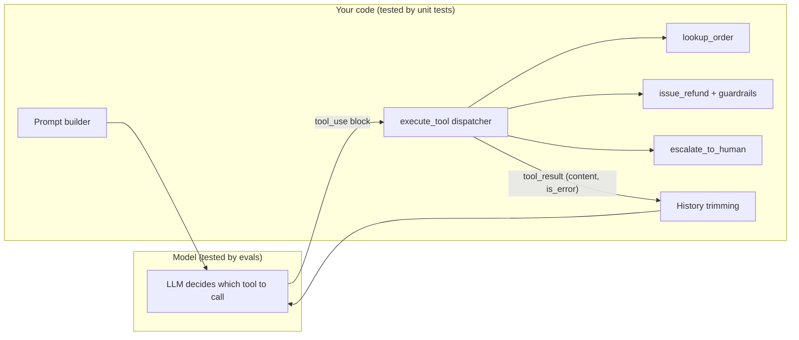

# Unit Testing Agent Code

## Introduction

An agent is mostly ordinary code. The model makes the decisions, but your code defines the tools, checks their inputs, builds the prompts, trims the conversation history, parses the outputs and enforces the limits. All of that code is deterministic, and all of it can break.

**Unit tests** check that code. They don't call the model, they run in milliseconds, they cost nothing, and they give the same answer every time. That makes them the right tool for a whole class of bugs that people often try (and fail) to catch with evals.

Think of an agent as a pilot flying a plane. Evals test the pilot: do they make good decisions in realistic situations? Unit tests check the plane: do the instruments read correctly, do the brakes work, does the fuel gauge stop at empty? You'd never use a flight test to find a broken fuel gauge, and you shouldn't use a model eval to find a broken refund limit.

In this page you'll unit test a small refund-support agent with **pytest**: its tools, guardrails, tool schemas, prompt builder and history trimming. The next page, [Mocking LLM Calls in Tests](./5-agents-mocking-llm-calls.mdx), tests the agent loop itself with a fake model.

## What to Unit Test (and What Not To)

| Unit test this | Don't unit test this |
|----------------|----------------------|
| Tool implementations and their error handling | Whether the model picks the right tool |
| Guardrails: limits, permissions, validation | Whether the reply is helpful or polite |
| Tool input schemas | How the model phrases its answer |
| Prompt builders and templates | Whether a prompt change improves quality |
| History trimming and context assembly | Model behavior with long context |
| Output parsers and structured-output models | Whether the model fills the fields correctly |
| Routing, retry and budget logic | Real API latency or rate limits |

The left column has a single right answer that code can check. The right column is model behavior, which belongs in evals (see [Agent Evaluation Introduction](./0-agents-evaluation-introduction.mdx)).

## Design for Testability

Agent code is easy to test if you keep three seams clean:

1. **Tools are plain functions.** Each tool takes ordinary arguments and returns data or raises an error. It doesn't know about the model or the message format.
2. **Dependencies are passed in.** The database, HTTP clients and the model client are arguments, not globals, so tests can pass fakes.
3. **Decisions that must be enforced live in code, not in the prompt.** "Never refund more than 200 USD" belongs in `issue_refund`, where a test can prove it. The prompt can also mention it, but the prompt is a suggestion and the code is a guarantee.



## The Code Under Test

Here are the tools of the refund agent. Note how `issue_refund` enforces every business rule itself, and how `execute_tool` turns any problem into an error result the model can read, instead of crashing the loop.

```python
# support_agent/tools.py
import json

REFUND_LIMIT = 200.00  # refunds above this must go to a human

TOOLS = [
    {
        "name": "lookup_order",
        "description": "Look up an order by ID. Returns status, total, and refund state.",
        "input_schema": {
            "type": "object",
            "properties": {"order_id": {"type": "string", "description": "e.g. A1001"}},
            "required": ["order_id"],
        },
    },
    {
        "name": "issue_refund",
        "description": f"Refund an order. Only for amounts up to {REFUND_LIMIT:.0f} USD.",
        "input_schema": {
            "type": "object",
            "properties": {
                "order_id": {"type": "string"},
                "amount": {"type": "number", "description": "Amount in USD"},
            },
            "required": ["order_id", "amount"],
        },
    },
    {
        "name": "escalate_to_human",
        "description": "Hand the conversation to a human agent with a short reason.",
        "input_schema": {
            "type": "object",
            "properties": {"reason": {"type": "string"}},
            "required": ["reason"],
        },
    },
]


class ToolError(Exception):
    """A problem the model should see and recover from."""


def lookup_order(db: dict, order_id: str) -> dict:
    order = db.get(order_id)
    if order is None:
        raise ToolError(f"Order {order_id} not found")
    return {"order_id": order_id, **order}


def issue_refund(db: dict, order_id: str, amount: float) -> dict:
    order = db.get(order_id)
    if order is None:
        raise ToolError(f"Order {order_id} not found")
    if order["refunded"]:
        raise ToolError(f"Order {order_id} was already refunded")
    if amount <= 0:
        raise ToolError("Refund amount must be positive")
    if amount > order["total"]:
        raise ToolError(f"Amount {amount} exceeds order total {order['total']}")
    if amount > REFUND_LIMIT:
        raise ToolError(f"Amount {amount} is over the {REFUND_LIMIT} limit; escalate instead")
    order["refunded"] = True
    return {"order_id": order_id, "refunded": amount, "status": "ok"}


def escalate_to_human(db: dict, reason: str) -> dict:
    return {"status": "escalated", "reason": reason}


HANDLERS = {
    "lookup_order": lookup_order,
    "issue_refund": issue_refund,
    "escalate_to_human": escalate_to_human,
}


def execute_tool(db: dict, name: str, tool_input: dict) -> tuple[str, bool]:
    """Run one tool. Returns (content, is_error). Never raises."""
    handler = HANDLERS.get(name)
    if handler is None:
        return f"Unknown tool: {name}", True
    try:
        return json.dumps(handler(db, **tool_input)), False
    except ToolError as exc:
        return str(exc), True
    except TypeError as exc:  # wrong or missing arguments from the model
        return f"Bad arguments for {name}: {exc}", True
```

## Testing Tools and Guardrails

Install pytest, then put tests in a `tests/` folder next to your package:

```bash
pip install pytest
```

The tests below use a **fixture** to build a fresh fake database for every test, and **parametrize** to check every guardrail with one test function.

```python
# tests/test_tools.py
import json

import pytest

from support_agent.tools import (
    REFUND_LIMIT,
    TOOLS,
    ToolError,
    execute_tool,
    issue_refund,
    lookup_order,
)


@pytest.fixture
def db():
    """A fresh fake database for every test, so tests can't leak state."""
    return {
        "A1001": {"status": "delivered", "total": 49.99, "refunded": False},
        "A1002": {"status": "delivered", "total": 899.00, "refunded": False},
        "A1003": {"status": "delivered", "total": 20.00, "refunded": True},
    }


def test_lookup_existing_order(db):
    assert lookup_order(db, "A1001")["total"] == 49.99


def test_lookup_missing_order_raises(db):
    with pytest.raises(ToolError, match="not found"):
        lookup_order(db, "NOPE")


def test_refund_marks_order_refunded(db):
    out = issue_refund(db, "A1001", 49.99)
    assert out["status"] == "ok"
    assert db["A1001"]["refunded"] is True


@pytest.mark.parametrize(
    "order_id, amount, message",
    [
        ("A1003", 5.00, "already refunded"),
        ("A1001", 0, "must be positive"),
        ("A1001", 60.00, "exceeds order total"),
        ("A1002", REFUND_LIMIT + 1, "over the"),
    ],
)
def test_refund_guardrails(db, order_id, amount, message):
    with pytest.raises(ToolError, match=message):
        issue_refund(db, order_id, amount)
    # A rejected refund must not change state.
    assert db[order_id]["refunded"] is (order_id == "A1003")


def test_execute_tool_turns_errors_into_tool_results(db):
    content, is_error = execute_tool(db, "issue_refund", {"order_id": "A1002", "amount": 899})
    assert is_error is True
    assert "escalate" in content


def test_execute_tool_handles_unknown_tool_and_bad_args(db):
    assert execute_tool(db, "delete_everything", {}) == ("Unknown tool: delete_everything", True)
    content, is_error = execute_tool(db, "lookup_order", {"id": "A1001"})  # wrong key
    assert is_error and "Bad arguments" in content


def test_execute_tool_success_returns_json(db):
    content, is_error = execute_tool(db, "lookup_order", {"order_id": "A1001"})
    assert not is_error
    assert json.loads(content)["status"] == "delivered"


@pytest.mark.parametrize("tool", TOOLS, ids=lambda t: t["name"])
def test_tool_schemas_are_well_formed(tool):
    schema = tool["input_schema"]
    assert tool["description"].strip(), "every tool needs a description"
    assert schema["type"] == "object"
    for name in schema.get("required", []):
        assert name in schema["properties"], f"required field {name} is not defined"
```

Run them:

```bash
pytest tests/test_tools.py -q
```

Output:

```text
.............                                                            [100%]
13 passed in 0.06s
```

Thirteen checks in well under a second, with no API key and no network. Now watch what happens if someone "simplifies" `issue_refund` and deletes the already-refunded check:

```text
FAILED tests/test_tools.py::test_refund_guardrails[A1003-5.0-already refunded]
E       Failed: DID NOT RAISE ToolError
1 failed, 12 passed in 0.12s
```

That's the double-refund bug, caught before it reaches a customer. An eval might only catch it if the dataset happened to contain an already-refunded order, and even then only as a drop in a pass rate.

:::tip Test that failures don't change state
The line `assert db[order_id]["refunded"] is ...` checks that a rejected refund leaves the database untouched. Partial writes before an error are a classic agent-tool bug, because the model will often retry, and a half-applied first attempt plus a full second attempt is how money disappears.
:::

## Validating Tool Schemas

Your tool's `input_schema` is a contract between the model and your code. Two kinds of tests are useful:

1. **Structural checks** (the last test above): every tool has a description, required fields exist, types are set.
2. **Example-based checks**: inputs you expect the model to send pass validation, and inputs your code can't handle fail it. The `jsonschema` package does the validation.

```python
# tests/test_schemas.py
import jsonschema
import pytest

from support_agent.tools import TOOLS

SCHEMAS = {t["name"]: t["input_schema"] for t in TOOLS}


@pytest.mark.parametrize("tool, args", [
    ("lookup_order", {"order_id": "A1001"}),
    ("issue_refund", {"order_id": "A1001", "amount": 49.99}),
    ("escalate_to_human", {"reason": "over limit"}),
])
def test_valid_inputs_match_schema(tool, args):
    jsonschema.validate(args, SCHEMAS[tool])


@pytest.mark.parametrize("tool, args", [
    ("lookup_order", {}),                                         # missing required
    ("issue_refund", {"order_id": "A1001", "amount": "lots"}),   # wrong type
])
def test_invalid_inputs_rejected_by_schema(tool, args):
    with pytest.raises(jsonschema.ValidationError):
        jsonschema.validate(args, SCHEMAS[tool])
```

If you set `strict: True` on a tool, the API guarantees the model's input matches the schema, which makes these schema tests even more valuable: the schema becomes the exact boundary your code must handle. See [Tool Input Schemas](../2-agents-tool-use/2-agents-tool-input-schemas.mdx).

## Testing Prompt Builders

System prompts are often assembled from templates and user data. Bugs here are silent: an unfilled placeholder, a missing policy line, or private data leaking into the prompt. Make the builder a pure function, and pass in anything that changes (such as today's date) so tests are repeatable.

```python
# support_agent/prompts.py
from datetime import date

from support_agent.tools import REFUND_LIMIT

TEMPLATE = """You are a refund assistant for {store}.
Today is {today}. The customer is {name} (plan: {plan}).
Always look up the order before refunding.
Refund at most {limit:.0f} USD; escalate anything larger to a human."""


def build_system_prompt(customer: dict, store: str = "Acme Shop", today: date | None = None) -> str:
    today = today or date.today()
    return TEMPLATE.format(
        store=store,
        today=today.isoformat(),
        name=customer.get("name", "unknown"),
        plan=customer.get("plan", "free"),
        limit=REFUND_LIMIT,
    )
```

```python
# tests/test_prompts.py
from datetime import date

from support_agent.prompts import build_system_prompt


def test_system_prompt_contains_policy_and_customer():
    prompt = build_system_prompt({"name": "Dana", "plan": "pro"}, today=date(2026, 10, 1))
    assert "Dana (plan: pro)" in prompt
    assert "Refund at most 200 USD" in prompt
    assert "2026-10-01" in prompt


def test_system_prompt_handles_missing_fields():
    prompt = build_system_prompt({}, today=date(2026, 10, 1))
    assert "unknown (plan: free)" in prompt
    assert "{" not in prompt  # no unfilled template placeholders


def test_system_prompt_never_leaks_internal_fields():
    customer = {"name": "Dana", "plan": "pro", "card_number": "4111111111111111"}
    assert "4111" not in build_system_prompt(customer)
```

Notice that the policy line in the prompt comes from the same `REFUND_LIMIT` constant the tool uses. If someone changes the limit, the prompt and the guardrail can't drift apart.

:::caution Don't assert on the whole prompt text
A test that compares the entire prompt string breaks on every wording tweak, and people learn to update it without reading. Assert on the facts that must be present or absent instead.
:::

## Testing History Trimming

Context management code is a common source of hard-to-debug API errors. For example, if you trim old messages and the first remaining message is a `tool_result` without its matching `tool_use`, the API rejects the request. This is the kind of logic that deserves thorough tests.

```python
# support_agent/history.py
def trim_history(messages: list[dict], max_messages: int) -> list[dict]:
    """Keep the most recent messages, but never split a tool_use from its tool_result.

    The first kept message must be a plain user message (not a list of
    tool_result blocks), otherwise the API rejects the request.
    """
    if len(messages) <= max_messages:
        return messages
    start = len(messages) - max_messages
    while start < len(messages):
        msg = messages[start]
        is_plain_user = msg["role"] == "user" and isinstance(msg["content"], str)
        if is_plain_user:
            return messages[start:]
        start += 1
    return messages[-1:]  # fall back to the latest message only
```

```python
# tests/test_history.py
import pytest

from support_agent.history import trim_history


def _conversation():
    return [
        {"role": "user", "content": "Refund A1001"},
        {"role": "assistant", "content": [{"type": "tool_use", "id": "t1", "name": "lookup_order", "input": {}}]},
        {"role": "user", "content": [{"type": "tool_result", "tool_use_id": "t1", "content": "{}"}]},
        {"role": "assistant", "content": [{"type": "text", "text": "Refunded."}]},
        {"role": "user", "content": "Thanks! And order A1002?"},
        {"role": "assistant", "content": [{"type": "tool_use", "id": "t2", "name": "lookup_order", "input": {}}]},
        {"role": "user", "content": [{"type": "tool_result", "tool_use_id": "t2", "content": "{}"}]},
    ]


def test_trim_keeps_short_history_unchanged():
    msgs = _conversation()
    assert trim_history(msgs, 10) == msgs


def test_trim_never_starts_with_orphan_tool_result():
    trimmed = trim_history(_conversation(), max_messages=4)
    assert trimmed[0] == {"role": "user", "content": "Thanks! And order A1002?"}
    assert len(trimmed) == 3


@pytest.mark.parametrize("limit", range(1, 8))
def test_trim_always_starts_with_plain_user_message(limit):
    trimmed = trim_history(_conversation(), limit)
    assert trimmed[0]["role"] == "user"
    assert isinstance(trimmed[0]["content"], str) or len(trimmed) == 1
```

The parametrized test tries every possible limit, which is how you find the off-by-one cases you didn't think of. For real compaction strategies, see [Compaction and Summarization](../4-agents-memory-and-context/2-agents-compaction-and-summarization.mdx).

## Property-Based Testing for Guardrails

Example-based tests check the cases you thought of. **Property-based tests** generate hundreds of random inputs and check a rule that must always hold. They're a great fit for guardrails, because the model will eventually send inputs you didn't think of. The `hypothesis` library does this for pytest:

```python
# tests/test_properties.py
from hypothesis import given, strategies as st

from support_agent.tools import REFUND_LIMIT, ToolError, issue_refund


@given(
    total=st.floats(min_value=0.01, max_value=10_000, allow_nan=False),
    amount=st.floats(min_value=-100, max_value=10_000, allow_nan=False),
)
def test_refund_never_exceeds_limit_or_total(total, amount):
    db = {"X1": {"status": "delivered", "total": total, "refunded": False}}
    try:
        out = issue_refund(db, "X1", amount)
    except ToolError:
        assert db["X1"]["refunded"] is False   # failures never change state
        return
    assert 0 < out["refunded"] <= min(total, REFUND_LIMIT)
```

Running the whole unit suite (tools, schemas, prompts, history and properties):

```text
...............................                                          [100%]
31 passed in 0.13s
```

## Organizing Agent Tests

- **Keep unit tests fast and offline.** They should run on every save and every commit. If a test needs the network or an API key, it isn't a unit test.
- **Mark slow or paid tests.** Use a pytest marker such as `@pytest.mark.live` for anything that calls a real model, and exclude it by default. The next page shows how.
- **One fixture per environment shape.** A `db` fixture, a `tmp_path` workspace for file tools, a fake HTTP server for API tools.
- **Test the dispatcher, not just the tools.** `execute_tool` is where model output meets your code: unknown tool names, wrong argument names and wrong types all arrive there.
- **Add a test for every bug.** When a bug report comes in, write the failing test first. That's how your suite grows to cover real failures.

## Real-World Scenario

Your team maintains a DevOps assistant that can restart services, scale deployments and read logs. Last month it scaled a production deployment to zero replicas. The model had sent `{"replicas": "0"}` as a string, a helper converted it with `int()`, and nothing checked the minimum.

The team's first reaction was to add an eval case: "scale the API to zero" should be refused. That's useful, but it measures how often the *model* tries something dangerous. It doesn't prove the *code* will stop it.

**The solution.** You add unit tests at the tool layer:

1. A parametrized test of `scale_deployment` with `0`, `-1`, `"0"`, `"3"`, `1000` and `None`, asserting that anything below the minimum or above the maximum raises a tool error and changes nothing.
2. A property-based test: for any integer, the resulting replica count is always within the allowed range or the call fails.
3. A dispatcher test: arguments with wrong types return `is_error=True` with a clear message, instead of being silently converted.
4. A schema test: the tool's `input_schema` declares `replicas` as an integer with `minimum` and `maximum`, and invalid examples fail validation.

The tests run in under a second in CI, on every pull request. The eval case stays too, now measuring how often the model asks for something the guard has to block.

### Why this approach

The failure was a code bug that the model happened to trigger. Unit tests are exact, fast, and permanent, and they test the guarantee itself rather than the model's tendency. Moving the rule into code (instead of only the prompt) also means the guarantee holds even when a future model behaves differently.

### When to use it and when not to

Unit test anything deterministic: tools, validation, prompt assembly, parsing, context handling. Don't try to unit test model choices by asserting on real model output. Those tests are flaky and slow, and they belong in evals with multiple trials.

### Alternatives and trade-offs

| Approach | Pros | Cons | Best for |
|----------|------|------|----------|
| Example-based unit tests | Simple, readable, exact | Only cover cases you thought of | Tools, prompt builders, parsers |
| Property-based tests | Find edge cases automatically | Harder to write good properties | Guardrails and validators |
| Schema validation tests | Catch contract drift early | Don't test behavior | Tool input and output schemas |
| Mocked loop tests | Test loop logic without the network | Fake model can drift from the real API | The agent loop ([next page](./5-agents-mocking-llm-calls.mdx)) |
| Evals | Measure real model behavior | Slow, costly, statistical | Model and prompt quality |

## Common Mistakes

- **Putting guardrails only in the prompt.** "Never refund more than 200 USD" in the system prompt is a request. In code, it's a rule you can test.
- **Testing through the model.** A unit test that calls the real API is slow, costs money, and fails randomly. Test the code directly.
- **Shared mutable fixtures.** A module-level dict that one test modifies breaks the next test. Build fresh data in a fixture.
- **Asserting on full prompt strings.** Assert on required facts instead, or the test gets updated blindly.
- **Ignoring the dispatcher.** Most model-caused crashes happen where tool inputs are unpacked. Test unknown tools, wrong keys and wrong types.
- **Exceptions escaping the tool layer.** An unhandled exception kills the whole agent run. Convert expected errors into `is_error` tool results the model can react to.

## Summary

- Most agent code is deterministic and should be unit tested without calling a model.
- Keep tools as plain functions, pass dependencies in, and enforce must-hold rules in code.
- Test tools, guardrails, the tool dispatcher, schemas, prompt builders and history trimming with pytest.
- Use fixtures for fresh state, parametrize for many cases, and property-based tests for guardrails.
- Check that failures leave state unchanged.
- Leave model behavior to evals, and test the agent loop with a fake model (next page).

## Further Learning

**Exercises**

1. Add a `cancel_subscription` tool to the refund agent that refuses to cancel accounts with an open dispute. Write parametrized tests for every rule before writing the tool.
2. Write a property-based test for `trim_history`: for any list of alternating messages and any limit, the result never starts with a `tool_result` message.
3. Find a guardrail in an agent you've built that exists only in the system prompt. Move it into code and add a test that proves it holds.

**Related pages**

- [Mocking LLM Calls in Tests](./5-agents-mocking-llm-calls.mdx)
- [Regression Testing for Agents](./6-agents-regression-testing.mdx)
- [Defining Tools](../2-agents-tool-use/1-agents-defining-tools.mdx)
- [Handling Tool Errors](../2-agents-tool-use/6-agents-tool-errors.mdx)
- [Least Privilege for Agent Tools](../12-agents-safety-and-security/2-agents-least-privilege.mdx)
- [pytest documentation](https://docs.pytest.org/) and [Hypothesis documentation](https://hypothesis.readthedocs.io/)
