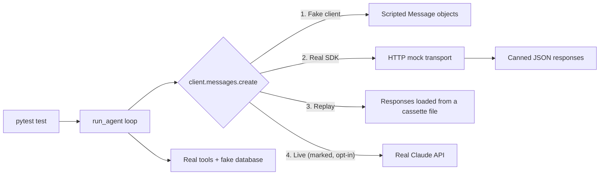

# Mocking LLM Calls in Tests

## Introduction

The agent loop is the code that calls the model, runs the tools it asks for, sends the results back, and decides when to stop. It's short, but it's full of details that are easy to get wrong: returning **all** tool results in one message, marking failed tools with `is_error`, stopping at a turn limit, handling a truncated response. A bug in any of them breaks every conversation.

You can't test that loop reliably against the real API. Real calls are slow, cost money, need a key in CI, and the model's choices vary between runs. So a test that says "the agent should call `lookup_order` first" would pass most of the time and fail randomly.

The solution is to **replace the model with a script**. A fake client returns exactly the responses you choose, in order. Your loop runs for real, your tools run for real, and you check what the loop did with each response.

It's like a flight simulator. You don't learn how a plane's autopilot handles an engine failure by waiting for an engine to fail. You script the failure in a simulator, run it a hundred times, and check that the autopilot responds correctly every time.

This page shows four ways to replace the model, from simplest to most realistic, all with **pytest** and no network.

## Four Ways to Replace the Model

| Technique | What's fake | What's real | Best for |
|-----------|-------------|-------------|----------|
| **Fake client object** | The whole client | Your loop and tools | Most loop tests |
| **HTTP-level mock** | The network | The SDK, serialization, error classes | Request format, SDK errors, retries |
| **Record and replay** | The model, using saved real responses | Everything else | Regression tests of real conversations |
| **Live smoke test** | Nothing | Everything | A few end-to-end checks, run separately |



## The Agent Loop Under Test

Here's the refund agent's loop. The important design choice is the first parameter: the **client is passed in**. Production passes `Anthropic()`. Tests pass a fake.

```python
# support_agent/agent.py
from dataclasses import dataclass, field

from support_agent.tools import TOOLS, execute_tool

MODEL = "claude-opus-5-5"
SYSTEM_PROMPT = (
    "You are a refund assistant for an online store. Always look up the order "
    "before refunding. Refund at most 200 USD; escalate anything larger."
)


@dataclass
class AgentResult:
    final_text: str
    stop_reason: str
    tool_calls: list = field(default_factory=list)  # [{"name": ..., "input": ..., "is_error": ...}]
    turns: int = 0
    input_tokens: int = 0
    output_tokens: int = 0


def run_agent(client, user_message: str, db: dict, max_turns: int = 8) -> AgentResult:
    messages = [{"role": "user", "content": user_message}]
    result = AgentResult(final_text="", stop_reason="")

    for _ in range(max_turns):
        response = client.messages.create(
            model=MODEL,
            max_tokens=16000,
            system=SYSTEM_PROMPT,
            tools=TOOLS,
            messages=messages,
        )
        result.turns += 1
        result.input_tokens += response.usage.input_tokens
        result.output_tokens += response.usage.output_tokens

        if response.stop_reason != "tool_use":
            result.stop_reason = response.stop_reason  # end_turn, max_tokens, refusal...
            result.final_text = "".join(
                b.text for b in response.content if b.type == "text"
            )
            return result

        # Keep the full assistant turn, then answer every tool call in ONE user message.
        messages.append({"role": "assistant", "content": response.content})
        tool_results = []
        for block in response.content:
            if block.type != "tool_use":
                continue
            content, is_error = execute_tool(db, block.name, block.input)
            result.tool_calls.append(
                {"name": block.name, "input": block.input, "is_error": is_error}
            )
            tool_results.append(
                {
                    "type": "tool_result",
                    "tool_use_id": block.id,
                    "content": content,
                    "is_error": is_error,
                }
            )
        messages.append({"role": "user", "content": tool_results})

    result.stop_reason = "max_turns"
    return result
```

The tools (`TOOLS` and `execute_tool`) are the ones unit tested on the [Unit Testing Agent Code](./4-agents-unit-testing.mdx) page. For a full explanation of the loop, see [Building a Manual Agent Loop](../2-agents-tool-use/3-agents-manual-agent-loop.mdx).

## Technique 1: A Scripted Fake Client

A fake client needs only what the loop uses: `client.messages.create(**kwargs)`. It returns the next scripted response and records every request, so tests can inspect what the loop sent.

Build the scripted responses from the SDK's **real types** (`Message`, `TextBlock`, `ToolUseBlock`, `Usage`). That way, if your loop reads a field that doesn't exist, or the SDK changes a type, your tests notice.

```python
# tests/fakes.py
"""A scripted stand-in for the Anthropic client. No network, no API key."""
import copy

from anthropic.types import Message, TextBlock, ToolUseBlock, Usage


def text_response(text: str, stop_reason: str = "end_turn") -> Message:
    return _message([TextBlock(type="text", text=text)], stop_reason)


def tool_response(*calls: tuple[str, dict], text: str = "") -> Message:
    blocks = [TextBlock(type="text", text=text)] if text else []
    for i, (name, tool_input) in enumerate(calls):
        blocks.append(ToolUseBlock(type="tool_use", id=f"toolu_{i}", name=name, input=tool_input))
    return _message(blocks, "tool_use")


def _message(content, stop_reason) -> Message:
    return Message(
        id="msg_test",
        type="message",
        role="assistant",
        model="claude-opus-5-5",
        content=content,
        stop_reason=stop_reason,
        stop_sequence=None,
        usage=Usage(input_tokens=100, output_tokens=20),
    )


class FakeMessages:
    def __init__(self, responses):
        self._responses = list(responses)
        self.calls = []  # every kwargs dict the agent sent

    def create(self, **kwargs):
        # Deep-copy so later mutations of `messages` don't rewrite history.
        self.calls.append(copy.deepcopy(kwargs))
        if not self._responses:
            raise AssertionError("Agent made more model calls than the test scripted")
        response = self._responses.pop(0)
        if isinstance(response, Exception):
            raise response
        return response


class FakeClient:
    def __init__(self, responses):
        self.messages = FakeMessages(responses)
```

Two details matter here. The `deepcopy` in `create` is necessary because the loop keeps appending to the same `messages` list. Without the copy, every recorded call would show the final conversation. And running out of scripted responses raises an error, so a loop that makes unexpected extra calls fails loudly.

Now the tests. Each one scripts a conversation and checks a property of the loop:

```python
# tests/test_agent_loop.py
import pytest

from support_agent.agent import MODEL, run_agent
from tests.fakes import FakeClient, text_response, tool_response


@pytest.fixture
def db():
    return {
        "A1001": {"status": "delivered", "total": 49.99, "refunded": False},
        "A1002": {"status": "delivered", "total": 899.00, "refunded": False},
    }


def test_happy_path_lookup_then_refund(db):
    client = FakeClient([
        tool_response(("lookup_order", {"order_id": "A1001"})),
        tool_response(("issue_refund", {"order_id": "A1001", "amount": 49.99})),
        text_response("Done! I refunded $49.99 for order A1001."),
    ])

    result = run_agent(client, "Please refund order A1001", db)

    assert result.stop_reason == "end_turn"
    assert [c["name"] for c in result.tool_calls] == ["lookup_order", "issue_refund"]
    assert db["A1001"]["refunded"] is True          # real side effect on the fake DB
    assert result.input_tokens == 300                # usage summed over 3 calls


def test_request_shape(db):
    client = FakeClient([text_response("Hi! How can I help?")])
    run_agent(client, "hello", db)

    sent = client.messages.calls[0]
    assert sent["model"] == MODEL
    assert {t["name"] for t in sent["tools"]} == {"lookup_order", "issue_refund", "escalate_to_human"}
    assert sent["messages"] == [{"role": "user", "content": "hello"}]


def test_parallel_tool_calls_answered_in_one_message(db):
    client = FakeClient([
        tool_response(("lookup_order", {"order_id": "A1001"}),
                      ("lookup_order", {"order_id": "A1002"})),
        text_response("Both orders were delivered."),
    ])
    run_agent(client, "Check A1001 and A1002", db)

    second_request = client.messages.calls[1]["messages"]
    last = second_request[-1]
    assert last["role"] == "user"
    assert [r["tool_use_id"] for r in last["content"]] == ["toolu_0", "toolu_1"]


def test_tool_error_is_sent_back_with_is_error(db):
    client = FakeClient([
        tool_response(("issue_refund", {"order_id": "A1002", "amount": 899.00})),
        tool_response(("escalate_to_human", {"reason": "Refund over limit"})),
        text_response("I've passed this to a teammate."),
    ])
    result = run_agent(client, "Refund A1002 in full", db)

    error_result = client.messages.calls[1]["messages"][-1]["content"][0]
    assert error_result["is_error"] is True
    assert "limit" in error_result["content"]
    assert db["A1002"]["refunded"] is False
    assert result.tool_calls[-1]["name"] == "escalate_to_human"


def test_stops_after_max_turns(db):
    looping = [tool_response(("lookup_order", {"order_id": "A1001"})) for _ in range(3)]
    result = run_agent(FakeClient(looping), "loop forever", db, max_turns=3)
    assert result.stop_reason == "max_turns"
    assert result.turns == 3


def test_truncated_answer_is_reported(db):
    client = FakeClient([text_response("Your refund is", stop_reason="max_tokens")])
    result = run_agent(client, "Refund A1001", db)
    assert result.stop_reason == "max_tokens"   # caller can retry or warn the user
```

Notice what these tests do **not** claim. `test_happy_path_lookup_then_refund` doesn't prove the model will look up the order first. You scripted that. It proves that **if** the model does, the loop executes the tools correctly, updates the database, and sums usage. Model behavior is for evals.

:::tip Script the weird responses too
The most valuable fake-client tests cover responses that are rare in practice: two tool calls in one turn, a tool error, a `max_tokens` cut-off, a `refusal`, an unknown tool name, or the model looping. These are hard to trigger with a real model on demand, and they're exactly where loops crash.
:::

### Why not just use MagicMock?

`unittest.mock.MagicMock` is tempting, but it accepts *anything*. Every attribute exists, and every call succeeds:

```python
from unittest.mock import MagicMock

client = MagicMock()
client.messages.create.return_value.stop_reason = "end_turn"
client.messages.create.return_value.content = []
resp = client.messages.create(model="x")
print(type(resp.usage.input_tokens))
print(client.mesages.create)  # typo still works
```

Output:

```text
<class 'unittest.mock.MagicMock'>
<MagicMock name='mock.mesages.create' id='125431384788000'>
```

`usage.input_tokens` is a mock, not a number, and the typo `mesages` doesn't fail. Tests written this way pass while the code is wrong. If you do use `unittest.mock`, build return values from real SDK types and use `create_autospec` or `spec=` so unknown attributes raise errors.

## Technique 2: Mocking at the HTTP Layer

A fake client skips the SDK entirely. To also test how requests are serialized, and how HTTP errors become SDK exceptions, keep the real SDK and replace only the network. The Anthropic Python SDK accepts a custom `http_client`, and its HTTP library provides a `MockTransport` that answers requests with a function you write.

```python
# tests/test_http_mock.py
"""Mock at the HTTP layer: the real SDK runs, only the network is fake."""
import json

import anthropic
import httpx2  # recent SDK versions use httpx2; older ones use httpx (same API)
import pytest

from support_agent.agent import run_agent


def make_client(handler) -> anthropic.Anthropic:
    transport = httpx2.MockTransport(handler)
    return anthropic.Anthropic(
        api_key="test-key",
        http_client=httpx2.Client(transport=transport),
        max_retries=0,
    )


def test_real_sdk_against_fake_server():
    seen = []

    def handler(request):
        body = json.loads(request.content)
        seen.append(body)
        return httpx2.Response(200, json={
            "id": "msg_1", "type": "message", "role": "assistant",
            "model": body["model"],
            "content": [{"type": "text", "text": "Hello from the fake server"}],
            "stop_reason": "end_turn", "stop_sequence": None,
            "usage": {"input_tokens": 12, "output_tokens": 6},
        })

    result = run_agent(make_client(handler), "hi", db={})

    assert result.final_text == "Hello from the fake server"
    assert seen[0]["tools"][0]["name"] == "lookup_order"   # serialized request body


def test_rate_limit_surfaces_as_sdk_exception():
    def handler(request):
        return httpx2.Response(429, json={
            "type": "error",
            "error": {"type": "rate_limit_error", "message": "slow down"},
        })

    with pytest.raises(anthropic.RateLimitError):
        run_agent(make_client(handler), "hi", db={})
```

:::caution Check which HTTP library your SDK uses
Recent releases of the `anthropic` Python SDK use `httpx2`, a maintained fork of `httpx` with the same API. Older releases use `httpx`. Run `pip show anthropic` and look at "Requires". Passing an object from the wrong library raises a `TypeError`. Libraries such as `respx` patch `httpx` specifically, so they may not intercept an `httpx2`-based SDK.
:::

The rate-limit test is a good example of what this technique is for: your retry and error-handling code (see [Error Handling and Retries](../1-agents-llm-apis/9-agents-api-error-handling.mdx)) depends on the SDK raising `anthropic.RateLimitError`, and this test proves it does, without waiting for a real rate limit.

## Technique 3: Record and Replay

Hand-written fake responses are only as realistic as your imagination. A **cassette** is a file of real API responses saved from an actual run. Replaying it through the fake client gives you a realistic, deterministic test of a real conversation.

To record, save each `response.model_dump()` from a real run to a JSON list. Review the file for secrets or personal data before committing it. A saved cassette looks like this:

```json
[
  {"id": "msg_01", "type": "message", "role": "assistant", "model": "claude-opus-5-5",
   "content": [{"type": "tool_use", "id": "toolu_01", "name": "lookup_order", "input": {"order_id": "A1001"}}],
   "stop_reason": "tool_use", "stop_sequence": null, "usage": {"input_tokens": 812, "output_tokens": 41}},
  {"id": "msg_02", "type": "message", "role": "assistant", "model": "claude-opus-5-5",
   "content": [{"type": "tool_use", "id": "toolu_02", "name": "issue_refund", "input": {"order_id": "A1001", "amount": 49.99}}],
   "stop_reason": "tool_use", "stop_sequence": null, "usage": {"input_tokens": 905, "output_tokens": 52}},
  {"id": "msg_03", "type": "message", "role": "assistant", "model": "claude-opus-5-5",
   "content": [{"type": "text", "text": "I've refunded $49.99 for order A1001."}],
   "stop_reason": "end_turn", "stop_sequence": null, "usage": {"input_tokens": 990, "output_tokens": 18}}
]
```

Load it with `Message.model_validate`, which also checks that the saved data still matches the SDK's types:

```python
# tests/test_replay.py
import json
import os
from pathlib import Path

import pytest
from anthropic.types import Message

from support_agent.agent import run_agent
from tests.fakes import FakeClient

CASSETTES = Path(__file__).parent / "cassettes"


def load_cassette(name: str) -> list[Message]:
    raw = json.loads((CASSETTES / name).read_text())
    return [Message.model_validate(item) for item in raw]


def test_replay_recorded_refund_conversation():
    db = {"A1001": {"status": "delivered", "total": 49.99, "refunded": False}}
    client = FakeClient(load_cassette("refund_a1001.json"))

    result = run_agent(client, "Please refund order A1001", db)

    assert db["A1001"]["refunded"] is True
    assert "49.99" in result.final_text


@pytest.mark.live
@pytest.mark.skipif(not os.environ.get("ANTHROPIC_API_KEY"), reason="needs a real API key")
def test_live_smoke():
    """Runs against the real API. Excluded from the default test run."""
    import anthropic

    db = {"A1001": {"status": "delivered", "total": 49.99, "refunded": False}}
    result = run_agent(anthropic.Anthropic(), "Please refund order A1001", db)
    assert result.stop_reason == "end_turn"
```

Replay has a limit: the recorded responses don't react to your changes. If you change a tool's output format, the replayed model still "sees" the old one. Cassettes test that your code still handles real responses, not that the model would make the same choices today. Re-record them periodically, and when the conversation shape changes.

## Technique 4: Live Smoke Tests, Kept Separate

You still want a few tests against the real API, to catch things no fake can: an invalid model name, a schema the API rejects, an expired key. The `test_live_smoke` test above is one. Register the `live` marker and exclude it by default:

```text
# pytest.ini
[pytest]
markers =
    live: calls the real model API (slow, costs money)
addopts = -m "not live"
```

Now `pytest` runs only the offline tests, and `pytest -m live` runs only the live ones, for example in a nightly CI job that has the API key. Keep live tests few and assert only on things that should be true on every run, such as "the run completes" or "the refund happened." Anything statistical belongs in your eval suite.

Running the offline suite for the loop:

```bash
pytest tests/test_agent_loop.py tests/test_http_mock.py tests/test_replay.py -v
```

Output:

```text
collected 10 items / 1 deselected / 9 selected
tests/test_agent_loop.py::test_happy_path_lookup_then_refund PASSED      [ 11%]
tests/test_agent_loop.py::test_request_shape PASSED                      [ 22%]
tests/test_agent_loop.py::test_parallel_tool_calls_answered_in_one_message PASSED [ 33%]
tests/test_agent_loop.py::test_tool_error_is_sent_back_with_is_error PASSED [ 44%]
tests/test_agent_loop.py::test_stops_after_max_turns PASSED              [ 55%]
tests/test_agent_loop.py::test_truncated_answer_is_reported PASSED       [ 66%]
tests/test_http_mock.py::test_real_sdk_against_fake_server PASSED        [ 77%]
tests/test_http_mock.py::test_rate_limit_surfaces_as_sdk_exception PASSED [ 88%]
tests/test_replay.py::test_replay_recorded_refund_conversation PASSED    [100%]
======================= 9 passed, 1 deselected in 0.50s ========================
```

All of this ran with `ANTHROPIC_API_KEY` unset. The same ideas carry over to other providers: the OpenAI, Gemini and other SDKs also let you inject a client or HTTP transport, and frameworks such as LangChain ship fake chat models for tests.

## Real-World Scenario

Your team is refactoring its support agent from a hand-written loop to support parallel tool calls and a turn budget. The old loop had no tests. Every change was checked by chatting with the agent in a staging environment, which takes ten minutes, and the bugs that slipped through were rare-path bugs: the agent crashed on the second tool call in a turn, or sent tool results in two separate messages, which the API rejected.

**The solution.** Before touching the loop, you write characterization tests with a fake client:

1. Scripted conversations for every stop reason your loop handles: `end_turn`, `tool_use`, `max_tokens`, `refusal`, and the turn budget.
2. A parallel-tool test that checks both results arrive in one user message, with matching `tool_use_id`s.
3. A tool-error test that checks `is_error: True` reaches the model.
4. Three cassettes recorded from real staging conversations, including one with an escalation.
5. Two HTTP-level tests: one for request serialization, one for a 429 error, to cover the retry wrapper.
6. One live smoke test in the nightly job.

The refactor takes a day. The fake-client tests catch two bugs along the way, both in the parallel-tool path. The full offline suite runs in under a second on every commit.

### Why this approach

The bugs the team kept shipping were in the loop code, not in the model's choices. Those bugs are deterministic once you control the model's responses, so a scripted fake finds them every time. Cassettes add realism, HTTP mocks cover the SDK boundary, and a single live test catches configuration problems.

### When to use it and when not to

Use fake clients for any code that reacts to model responses: loops, routers, parsers, retry logic. Don't use them to claim the agent "works," because you wrote the model's lines. For that, run evals against the real model with several trials.

### Alternatives and trade-offs

| Approach | Pros | Cons | Best for |
|----------|------|------|----------|
| Fake client object | Fastest, full control, no dependencies | Skips SDK serialization; can drift from real responses | Loop logic, rare stop reasons |
| `MagicMock` with `spec` | Quick to set up | Easy to write tests that pass while code is wrong | Small, isolated call sites |
| HTTP-level mock | Real SDK, real error classes | More setup; tied to the HTTP library | Request format, error handling |
| Record and replay | Realistic responses, deterministic | Goes stale; doesn't react to your changes | Regression tests of real conversations |
| Live API tests | Catch config and API changes | Slow, costly, non-deterministic | A few nightly smoke tests |

## Common Mistakes

- **Asserting the model's choices in mocked tests.** You scripted them, so the assertion proves nothing about the model.
- **Fakes built from plain dicts.** If production code reads `response.content[0].text` and your fake is a dict, the test and production disagree. Use the SDK's types.
- **Not copying recorded requests.** The loop mutates `messages`, so without a deep copy every recorded call looks like the final one.
- **Silent extra calls.** A fake that returns a default response forever hides loops. Fail when the script runs out.
- **Live tests in the default run.** They make the suite slow, flaky and expensive, and developers stop running it.
- **Committing cassettes with secrets or personal data.** Review and scrub recordings before they go into git.
- **Never refreshing cassettes.** Old recordings can hide that the API, your tools, or your prompts have changed.

## Summary

- Pass the model client into your agent so tests can replace it.
- A scripted fake client built from real SDK types tests loop logic quickly and deterministically.
- Script the rare cases: parallel calls, tool errors, `max_tokens`, refusals, loops.
- Mock at the HTTP layer to test serialization and SDK error handling with the real SDK.
- Record and replay real conversations for realistic regression tests, and re-record them periodically.
- Keep a few live smoke tests behind a pytest marker, out of the default run.
- Mocked tests check your code. Evals check the model's behavior.

## Further Learning

**Exercises**

1. Add a `refusal` case: script a response with `stop_reason="refusal"` and make the loop return a safe fallback message. Write the test first.
2. Extend `FakeMessages.create` to raise a scripted `anthropic.APIConnectionError` on the first call, add a retry wrapper around `run_agent`, and test that it recovers.
3. Write a small recorder that wraps a real client, saves every response to a cassette file, and passes the responses through unchanged.
4. Write an async version of the fake client for `AsyncAnthropic` (its `messages.create` is a coroutine) and test an async agent loop with `pytest-asyncio`.

**Related pages**

- [Unit Testing Agent Code](./4-agents-unit-testing.mdx)
- [Regression Testing for Agents](./6-agents-regression-testing.mdx)
- [Debugging Agents](./10-agents-debugging.mdx)
- [Building a Manual Agent Loop](../2-agents-tool-use/3-agents-manual-agent-loop.mdx)
- [Parallel Tool Calls](../2-agents-tool-use/5-agents-parallel-tool-calls.mdx)
- [Error Handling and Retries](../1-agents-llm-apis/9-agents-api-error-handling.mdx)
