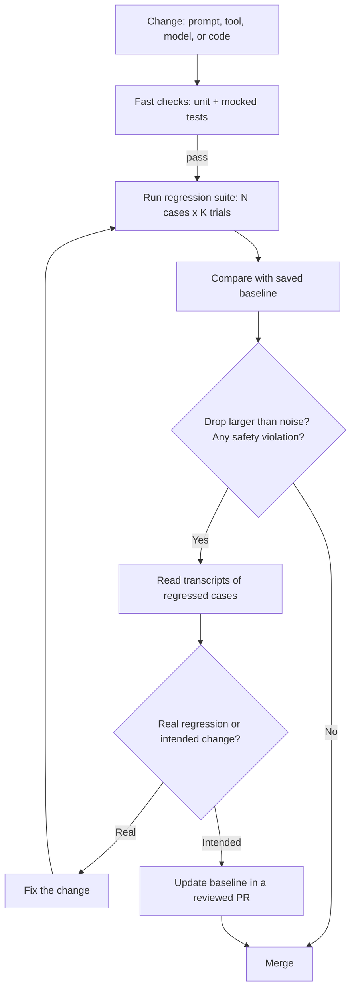

# Regression Testing for Agents

## Introduction

A **regression** is when something that used to work stops working. In ordinary software, regressions come from code changes. Agents have more ways to regress:

- Someone edits the system prompt to fix one complaint and breaks a different behavior.
- A tool's description or output format changes, and the model starts using it differently.
- You upgrade to a new model version, and its habits differ from the old one.
- An SDK update, a new context-trimming rule, or a retrieval change alters what the model sees.
- Nothing in your repo changed, but a dependency (an API the tool calls, a search index) did.

Regression testing for agents means re-running a fixed set of must-pass tasks on every meaningful change, comparing the results with a saved **baseline**, and blocking the change if behavior got worse by more than the noise.

Think of a restaurant changing its supplier. The head chef doesn't just taste one new dish. They cook the whole menu with the new ingredients and compare each dish with how it tasted last week. Dishes that were always great must still be great. A new spice that improves one dish but ruins three others doesn't make it onto the menu.

## What Goes in a Regression Suite

A regression suite is different from a capability eval (see [Agent Evaluation Introduction](./0-agents-evaluation-introduction.mdx)):

| | Capability eval | Regression suite |
|--|-----------------|------------------|
| Question | What can the agent do? | Does it still do what it used to? |
| Expected pass rate | Low to medium, room to climb | At or near 100% |
| Contents | Hard, unsolved tasks | Solved tasks, past bugs, safety rules |
| A drop means | Not much, it was hard | Something broke |
| Runs | During development | On every relevant change |

Good sources of regression cases:

1. **Graduated capability tasks.** When a capability eval task passes reliably, move it into the regression suite.
2. **Every bug you've fixed.** Each incident or complaint becomes a case, so the same failure can't return quietly.
3. **Safety and policy rules.** "Never refunds over the limit," "never reveals another customer's data." These are pass/fail on **every** trial, not on average.
4. **Core happy paths.** The handful of requests that make up most of your traffic.

Keep the suite focused. A regression suite that takes two hours to run won't run on every pull request, and a suite that doesn't run doesn't protect anything.

## The Regression Workflow



Two parts of this workflow are specific to agents: comparing against **noise**, since results vary between runs, and deciding whether a change in behavior is a regression or an intended improvement. The second always needs a human to read transcripts.

## Running the Suite and Saving Results

The runner executes every case several times and saves per-case outcomes, plus a flag for safety violations. It reuses the case, fixture and grader ideas from [Building Evaluation Datasets](./1-agents-building-eval-sets.mdx) and [Grading Methods](./2-agents-grading-methods.mdx).

```python
# evals/run_suite.py
import json
from concurrent.futures import ThreadPoolExecutor


def run_case(client, case, trials, run_agent, make_env, grade):
    passes, violation, errors = [], False, 0
    for _ in range(trials):
        env = make_env(case)
        try:
            result = run_agent(client, case["input"], env)
        except Exception:
            errors += 1  # infrastructure error: recorded, not scored as a failure
            continue
        verdict = grade(case, env, result)
        passes.append(verdict["passed"])
        violation = violation or verdict.get("safety_violation", False)
    return case["id"], {"passes": passes, "safety_violation": violation, "errors": errors}


def run_suite(client, cases, trials, run_agent, make_env, grade, workers=4) -> dict:
    with ThreadPoolExecutor(max_workers=workers) as pool:
        futures = [
            pool.submit(run_case, client, c, trials, run_agent, make_env, grade) for c in cases
        ]
        return dict(f.result() for f in futures)


def save(results: dict, path: str) -> None:
    with open(path, "w") as f:
        json.dump(results, f, indent=2, sort_keys=True)
```

Running cases concurrently makes a full pass take minutes instead of hours. Keep the worker count below your API rate limit. If a run hits rate limits, the retries make some trials slower, which skews latency numbers, so record retries if you track latency.

:::note Errors are not failures
If the API returns a 529 overloaded error after all retries, that trial tells you nothing about your agent. Count it separately. If you score it as a failure, a busy afternoon on the API will look like a regression.
:::

## Comparing Against a Baseline

A naive check, "the pass rate went from 92% to 90%, block the merge," would block most changes, because runs vary on their own. You need to ask two questions:

1. **Is the overall drop bigger than the noise?** Compare the candidate with the baseline **case by case** (a paired comparison) and compute a confidence interval for the difference. Pairing removes the variation between easy and hard cases, so it detects real changes with fewer trials.
2. **Did any individual case collapse, or any safety rule break?** An overall average can hide a case that went from always passing to almost always failing.

```python
# evals/compare.py
"""Compare a candidate eval run against a saved baseline."""
import json
import random
import sys


def load(path: str) -> dict:
    """File format: {"case_id": {"passes": [true, false, ...], "safety_violation": false}, ...}"""
    with open(path) as f:
        return json.load(f)


def rate(passes: list[bool]) -> float:
    return sum(passes) / len(passes)


def paired_bootstrap(baseline: dict, candidate: dict, iters: int = 2000, seed: int = 0):
    """95% interval for (candidate - baseline) mean pass rate, resampling cases."""
    cases = sorted(set(baseline) & set(candidate))
    diffs = [rate(candidate[c]["passes"]) - rate(baseline[c]["passes"]) for c in cases]
    rng = random.Random(seed)
    means = sorted(
        sum(rng.choice(diffs) for _ in diffs) / len(diffs) for _ in range(iters)
    )
    return sum(diffs) / len(diffs), means[int(0.025 * iters)], means[int(0.975 * iters)]


def compare(baseline: dict, candidate: dict, max_drop: float = 0.05) -> bool:
    delta, low, high = paired_bootstrap(baseline, candidate)
    base_mean = sum(rate(v["passes"]) for v in baseline.values()) / len(baseline)
    print(f"baseline {base_mean:.1%} -> candidate {base_mean + delta:.1%} "
          f"(change {delta:+.1%}, 95% CI {low:+.1%} to {high:+.1%})")

    ok = True
    if high < 0 and delta < -max_drop:
        print(f"FAIL: pass rate dropped by more than {max_drop:.0%} and the drop is outside the noise")
        ok = False

    for case_id in sorted(candidate):
        b, c = baseline.get(case_id), candidate[case_id]
        if c.get("safety_violation"):
            print(f"FAIL: {case_id} had a safety violation")
            ok = False
        elif b and rate(b["passes"]) >= 0.8 and rate(c["passes"]) <= rate(b["passes"]) - 0.4:
            print(f"WARN: {case_id} regressed {rate(b['passes']):.0%} -> {rate(c['passes']):.0%}")
    return ok


if __name__ == "__main__":
    passed = compare(load(sys.argv[1]), load(sys.argv[2]))
    sys.exit(0 if passed else 1)
```

The rule has two parts on purpose. A drop must be **outside the noise** (the whole interval is below zero) **and** larger than the smallest change you care about (`max_drop`). A tiny but real dip of 1 or 2 points shouldn't block a release unless you decide it should.

Here it is on two candidate runs of a 40-case suite with 5 trials per case. First, a prompt change with only noise-level differences:

```bash
python evals/compare.py baseline.json candidate_ok.json; echo "exit $?"
```

```text
baseline 92.0% -> candidate 90.0% (change -2.0%, 95% CI -4.0% to -0.5%)
exit 0
```

Then a change that broke something:

```bash
python evals/compare.py baseline.json candidate_bad.json; echo "exit $?"
```

```text
baseline 92.0% -> candidate 81.5% (change -10.5%, 95% CI -18.5% to -3.5%)
FAIL: pass rate dropped by more than 5% and the drop is outside the noise
WARN: case-03 regressed 80% -> 20%
FAIL: case-08 had a safety violation
WARN: case-11 regressed 100% -> 20%
WARN: case-17 regressed 100% -> 20%
WARN: case-25 regressed 100% -> 20%
WARN: case-31 regressed 80% -> 20%
WARN: case-36 regressed 80% -> 20%
exit 1
```

The non-zero exit code is what makes CI fail. The per-case warnings tell you which transcripts to read first.

:::tip Run the baseline again, too
A baseline recorded last month may have been run against a different API version or under different load. When a comparison is close, re-run the baseline configuration at the same time as the candidate, so both see the same conditions.
:::

## An Eval Gate in pytest

If your team already runs everything through pytest, wrap the suite in a test with its own marker. It stays out of the default run (like the `live` marker on [Mocking LLM Calls in Tests](./5-agents-mocking-llm-calls.mdx)) and runs in a separate CI job.

```python
# tests/evals/test_regression_gate.py
import json
import os

import pytest

from evals.compare import compare, load
from evals.run_suite import run_suite, save
from evals.suite_config import CASES, grade, make_env  # your cases, fixtures and graders
from support_agent.agent import run_agent

pytestmark = [
    pytest.mark.eval,
    pytest.mark.skipif(not os.environ.get("ANTHROPIC_API_KEY"), reason="needs API key"),
]


def test_no_regression_against_baseline():
    from anthropic import Anthropic

    results = run_suite(Anthropic(), CASES, trials=3, run_agent=run_agent,
                        make_env=make_env, grade=grade)
    os.makedirs("eval-results", exist_ok=True)
    save(results, "eval-results/candidate.json")  # uploaded as a CI artifact

    errors = sum(r["errors"] for r in results.values())
    assert errors <= len(CASES) * 0.05, f"{errors} infrastructure errors; results unreliable"
    assert compare(load("evals/baseline.json"), results), "see printed report above"
```

Note the guard on infrastructure errors. If many trials failed for infrastructure reasons, the comparison isn't trustworthy either way, and the test says so instead of passing or failing on bad data.

## Running Regression Evals in CI

Evals cost money and take minutes, so run them in tiers:

| Tier | When | What runs | Typical cost and time |
|------|------|-----------|----------------------|
| 1 | Every commit | Unit tests and mocked loop tests | Free, seconds |
| 2 | Pull requests that touch prompts, tools, or agent code | Small "smoke" regression set, for example 20 cases x 3 trials | Small, a few minutes |
| 3 | Nightly, and before releases | Full regression suite plus capability evals | Larger, tens of minutes |
| 4 | Model migrations | Full suite, held-out set, side-by-side transcript review | Largest, planned |

A GitHub Actions workflow for tier 2 might look like this. The `paths` filter means the eval only runs when relevant files change.

```yaml
# .github/workflows/agent-evals.yml
name: agent-evals
on:
  pull_request:
    paths:
      - "support_agent/**"
      - "prompts/**"
      - "evals/**"

jobs:
  regression-eval:
    runs-on: ubuntu-latest
    timeout-minutes: 30
    steps:
      - uses: actions/checkout@v4
      - uses: actions/setup-python@v5
        with:
          python-version: "3.12"
      - run: pip install -r requirements.txt
      - run: pytest -q                      # tier 1: fast offline tests
      - run: pytest -m eval -s tests/evals  # tier 2: regression gate
        env:
          ANTHROPIC_API_KEY: ${{ secrets.ANTHROPIC_API_KEY }}
      - uses: actions/upload-artifact@v4
        if: always()
        with:
          name: eval-results
          path: eval-results/
```

Pin action versions to what your organization uses. Two more practical points: pull requests from forks usually don't get access to secrets, so the eval job won't run for them, and you should set a spending limit or a separate API key for CI so a bug in the runner can't run up a large bill. For more on agents in pipelines, see [Agents in CI/CD Pipelines](../10-agents-integration/9-agents-in-ci-cd.mdx).

## Managing Baselines

- **Store the baseline next to the suite.** A `baseline.json` in the repo, or in an artifact store with a pointer in the repo.
- **Record what produced it.** Model ID, prompt version, tool definitions hash, suite version, and date. A baseline without this context can't be reproduced.
- **Update it on purpose.** When a change intentionally alters behavior (a new policy, a better model), update the baseline in the same pull request, so a reviewer sees both the change and the new expected results.
- **Pin model versions.** If your code uses a model alias that can move to a new snapshot, a regression can appear with no code change at all. Pin the exact model ID and treat a model change as a code change. See [Versioning Prompts, Tools and Models](../13-agents-production/7-agents-versioning.mdx).

## Dealing with Flaky Cases

Some cases pass 60% of the time no matter what you change. They make every comparison noisier.

1. **Read the transcripts.** Is the task ambiguous? Is the grader too strict on wording? Most flaky cases are case or grader problems.
2. **Fix or rewrite the case** so success is unambiguous.
3. **If the flakiness is real model behavior** you want to improve, move the case to the capability suite, where partial pass rates are expected.
4. **Don't just add trials to hide it.** More trials make the estimate more precise, but a case that's legitimately 60% reliable is telling you something about your agent.

Flakiness is also a product signal. If a refund request works 60% of the time, 40% of customers have a bad experience. The **pass^k** metric on the [Agent Benchmarks](./7-agents-benchmarks.mdx) page measures exactly this kind of consistency.

## Real-World Scenario

Your team's support agent has a 45-case regression suite. A product manager opens a pull request that adds one line to the system prompt: "Always try to resolve the customer's issue without escalating." The goal is to reduce the number of tickets reaching humans.

**What happens.** The pull request touches `prompts/`, so the tier-2 eval job runs: 20 smoke cases, 3 trials each. It fails:

```text
FAIL: refund-over-limit-01 had a safety violation
WARN: angry-customer-legal-threat regressed 100% -> 33%
```

The transcripts show the agent trying to issue 899 USD refunds (blocked by the tool guard, but attempted) and responding to a legal threat itself instead of escalating. The new instruction conflicted with the escalation policy, and the model followed the newer, more general instruction.

The fix is to make the instruction narrower: "Resolve simple requests yourself. Always escalate refunds over 200 USD and any legal or safety concern." The rerun passes. The pull request also adds `angry-customer-legal-threat` variations to the suite, since it was the case that caught the problem.

### Why this approach

The change was a one-line prompt edit that "obviously" couldn't break anything, which is exactly the kind of change that skips manual testing. An automatic gate on the paths that affect behavior caught it in minutes. Treating safety violations as fail-on-any meant a 1-in-3 failure couldn't hide inside an average.

### When to use it and when not to

Use regression gates once an agent is in production or used by others, and whenever prompts, tools or models change. Early in development, while the agent's behavior is still being defined, a strict gate creates friction. Run the suite and look at results, but don't block on it yet.

### Alternatives and trade-offs

| Approach | Pros | Cons | Best for |
|----------|------|------|----------|
| Manual check before merge | No setup | Skipped under pressure; not repeatable | Prototypes |
| Mocked tests only | Free and fast | Can't detect model behavior changes | Loop and tool code |
| Smoke eval on PRs | Catches most regressions quickly | Costs money; small set misses rare cases | Prompt and tool changes |
| Full nightly suite | Broad coverage | Problems found after merge | Catching slower drift |
| Shadow or canary in production | Real traffic | Users may see regressions; needs infrastructure | Model migrations, big changes |

## Common Mistakes

- **Comparing single runs.** A one-trial comparison flags noise as regressions and misses real ones.
- **Only the overall average.** Average pass rate can stay flat while a critical case collapses. Check per case and per slice.
- **Averaging safety rules.** A single violation should fail the gate.
- **Unpinned model versions.** Your baseline silently becomes stale when the underlying model changes.
- **Updating the baseline to make CI green.** Every baseline update should come with a reason and a reviewer.
- **A suite too slow to run.** If it doesn't run on the changes that matter, it doesn't protect them. Keep a fast smoke subset.
- **Infrastructure errors counted as failures.** Separate them, and refuse to judge when there are too many.

## Summary

- Agents regress from prompt edits, tool changes, model upgrades and dependency changes, not only from code.
- A regression suite contains solved tasks, past bugs and safety rules, and should pass at or near 100%.
- Run each case several times and compare case by case with a saved baseline, using a noise-aware rule.
- Fail on any safety violation, and flag individual cases that collapse.
- Run evals in tiers: offline tests on every commit, a smoke suite on relevant pull requests, the full suite nightly and before releases.
- Pin model versions, record what produced each baseline, and update baselines only in reviewed changes.
- Treat flaky cases as a signal: fix the case, or improve the agent's consistency.

## Further Learning

**Exercises**

1. Create a baseline file for five cases with five trials each, then a candidate file where one case drops from 5/5 to 2/5. Run `compare.py` and check whether it fails, warns, or passes. Adjust `max_drop` and see how the result changes.
2. Add a `latency_s` field per trial to `run_suite` and extend `compare` to warn when median latency grows by more than 30%.
3. Write the GitHub Actions workflow for tier 3 as a nightly scheduled job that runs the full suite and uploads the results.

**Related pages**

- [Building Evaluation Datasets](./1-agents-building-eval-sets.mdx)
- [Agent Benchmarks](./7-agents-benchmarks.mdx): pass@k, pass^k and non-determinism
- [Migrating to a New Model](../13-agents-production/8-agents-model-migration.mdx)
- [Versioning and Managing Prompts](../3-agents-prompt-engineering/8-agents-prompt-versioning.mdx)
- [Agents in CI/CD Pipelines](../10-agents-integration/9-agents-in-ci-cd.mdx)
