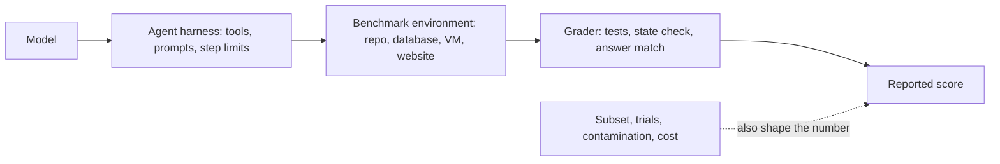

# Agent Benchmarks

## Introduction

Every new model announcement comes with a table of benchmark scores: SWE-bench for coding, tau-bench for customer service, OSWorld for computer use, and so on. These public benchmarks are useful. They give everyone the same tasks and the same grading, so you can compare models and track how the field moves.

They are also easy to misread. A benchmark measures one kind of task, with one harness, under particular conditions. Your agent works on different tasks, with your tools, your prompts and your users. A model that tops a coding leaderboard might be a poor fit for your support agent, and a small difference in a published score can say less than it seems.

Think of benchmarks like standardized test scores on a job application. A high score tells you the candidate is capable in general and is worth interviewing. It doesn't tell you whether they'll be good at *your* job. For that, you give them a work sample from your actual job. For agents, that work sample is your own task-specific eval.

This page explains what the major agent benchmarks measure, how they're graded, where they fall short, and how to read a benchmark claim critically. It also covers two ideas you need for any agent measurement: **pass@k vs pass^k**, and **non-determinism**.

## What a Benchmark Is Made Of

An agent benchmark has the same parts as your own eval (see [Agent Evaluation Introduction](./0-agents-evaluation-introduction.mdx)):

- **Tasks** with a starting environment: a code repository, a simulated airline database, a virtual desktop.
- **A harness** that runs the agent: which tools it gets, how many steps, how much time.
- **Graders**, usually checks on the end state: hidden tests pass, the database matches a goal state, an answer matches exactly.
- **A metric**, usually the fraction of tasks solved, sometimes over several trials.

Because the agent harness is part of what's measured, the same model can score very differently with different scaffolding. That's the first thing to check in any benchmark claim.



## The Major Agent Benchmarks

Task counts below come from the benchmarks' papers and official sites. Versions change, so check the official pages for current details. This page deliberately does not quote leaderboard scores, which change every few weeks. Look them up at the source when you need them.

### SWE-bench (coding)

**What it measures:** whether an agent can resolve real GitHub issues in open-source Python repositories. The agent gets a repository at a past commit and the issue text, and must produce a patch.

**How it's graded:** hidden unit tests from the real fix are run against the agent's patch. Tests that failed before the fix must now pass, and tests that passed before must still pass.

**Versions:** the original set has 2,294 tasks from 12 Python repositories. **SWE-bench Verified** (released by OpenAI with the SWE-bench authors in August 2024) is a 500-task subset that human annotators screened for unclear issues and unfair tests. **SWE-bench Pro** (from Scale AI) is a newer, harder set built from more repositories, including copyleft and private codebases, intended to reduce contamination. There are also multilingual and multimodal variants.

**Limitations:**

- **Contamination.** The issues and fixes are public on GitHub, so they may appear in model training data. Audits have reported cases where models could reproduce the original fix, and flawed tests among the hardest tasks. This is one reason newer sets such as SWE-bench Pro exist.
- **Narrow slice of software work.** Mostly Python, mostly bug fixes with an existing test suite. No design discussions, no ambiguity about what the user wants.
- **Scaffold dependence.** Results depend heavily on the agent harness, so a "model score" is really a "model plus scaffold" score.
- **Tests as the only judge.** A patch can pass the tests and still be unmergeable.

### tau-bench and tau2-bench (tool use with a user)

**What it measures:** whether an agent can complete customer-service tasks (for example, changing a flight or returning an item) by talking with a **simulated user** and calling domain APIs, while following a written policy. The original release from Sierra covers retail and airline domains. **tau2-bench** adds a telecom domain where both the agent and the user can act on the environment.

**How it's graded:** the final state of the database is compared with the expected goal state, and required information in the agent's replies is checked. The path doesn't matter, only the outcome.

**Why it matters for this page:** tau-bench introduced the **pass^k** metric, which asks whether the agent succeeds on *every one* of k tries. Customer-facing agents need that kind of consistency (more below).

**Limitations:**

- The simulated user is itself a language model, so it adds noise and sometimes behaves unrealistically.
- The domains and policies are fixed and fairly small compared with a real business.
- Task counts are modest (tens to a little over a hundred per domain), so small score differences are within the noise.

### GAIA (general assistant tasks)

**What it measures:** questions that are easy for people to verify but require several steps for an AI assistant: browsing the web, reading files, doing calculations, combining facts. The paper describes 466 questions at three difficulty levels. Answers for most of them are held back for a hidden test set.

**How it's graded:** exact match on a short, unambiguous final answer (a number, a name, a short string).

**Limitations:**

- Exact-match grading only sees the final answer, not how it was found.
- Some questions depend on web pages that change or disappear over time.
- It mixes several skills (search, file reading, reasoning), so a score doesn't tell you which one is weak.

### Terminal-Bench (command-line work)

**What it measures:** whether an agent can complete realistic tasks in a containerized terminal: building software, configuring systems, debugging, data processing, security fixes. **Terminal-Bench 2.0** has a curated set of tasks (89 at release), each validated for solvability and a clear specification, and runs through a harness called **Harbor**.

**How it's graded:** each task ships with tests that check the container's final state.

**Limitations:**

- A modest number of tasks means wide confidence intervals.
- Results depend on the agent harness and on time and resource limits.
- Terminal tasks are a small, technical slice of agent work.

### OSWorld (computer use)

**What it measures:** whether a multimodal agent can operate a real desktop operating system through screenshots, mouse and keyboard: editing documents and spreadsheets, using a browser, managing files, and workflows across apps. The original paper has 369 tasks on Ubuntu virtual machines. **OSWorld-Verified** (2025) is a refreshed version that fixed task and grading issues.

**How it's graded:** a custom script per task checks the final state of the machine, for example the contents of a saved file.

**Limitations:**

- Running it needs a lot of infrastructure (virtual machines) and is slow.
- Some tasks depend on online services and may need to be excluded, which must be reported.
- Setups vary: screenshot resolution, step limits, and which tools are allowed all affect results.

### Others worth knowing

- **WebArena:** 812 tasks on self-hosted copies of websites (a shop, a forum, GitLab, a content management system), graded on the resulting site state or answer.
- **BrowseComp:** 1,266 hard-to-find-information questions for browsing agents, graded on short verifiable answers.

New benchmarks appear constantly, often because older ones become **saturated**: when most strong models score near the top, the remaining differences come from noise and quirks rather than capability.

### Summary table

| Benchmark | Domain | Environment | Grading | Main caveats |
|-----------|--------|-------------|---------|--------------|
| SWE-bench (Verified, Pro) | Coding | Git repository | Hidden unit tests | Contamination, Python-heavy, scaffold-dependent |
| tau-bench / tau2-bench | Customer service | Simulated APIs and user | Final database state | Simulated-user noise, small domains |
| GAIA | General assistant | Web, files, tools | Exact-match answer | Answer-only, web drift |
| Terminal-Bench 2.0 | Command line | Docker containers | Tests on container state | Few tasks, harness-dependent |
| OSWorld (Verified) | Computer use | Desktop VMs | Per-task state scripts | Heavy infrastructure, setup variation |
| WebArena | Web navigation | Self-hosted sites | Site state or answer | Synthetic sites |
| BrowseComp | Web research | Open web | Short answer match | Answer-only |

## pass@k vs pass^k

Agents are non-deterministic, so a single task can succeed on one try and fail on the next. Two metrics summarize multiple trials in opposite ways:

- **pass@k**: the probability that **at least one** of k attempts succeeds. It goes **up** as k grows. It fits situations where you can try several times and keep the best result, for example generating several patches and running the tests on each.
- **pass^k** (read "pass hat k"): the probability that **all** k attempts succeed. It goes **down** as k grows. It fits agents that face users directly, where every conversation has to work.

If a task's per-trial success rate is p and trials are independent, pass@k is `1 - (1 - p)^k` and pass^k is `p^k`. With p = 0.75 and k = 3, pass^3 is about 0.42: an agent that succeeds 75% of the time handles three customers in a row correctly only about 42% of the time.

When you've run n trials and seen c successes, use these estimators (the pass@k one comes from the Codex paper, the pass^k one from tau-bench):

```python
from math import comb


def pass_at_k(n: int, c: int, k: int) -> float:
    """Chance that at least one of k trials succeeds (unbiased, from n trials with c successes)."""
    if n - c < k:
        return 1.0
    return 1 - comb(n - c, k) / comb(n, k)


def pass_hat_k(n: int, c: int, k: int) -> float:
    """Chance that all k trials succeed (pass^k), estimated from n trials with c successes."""
    return comb(c, k) / comb(n, k)


# One task, 10 trials, 7 successes
n, c = 10, 7
for k in (1, 3, 5):
    print(f"k={k}:  pass@k = {pass_at_k(n, c, k):.2f}   pass^k = {pass_hat_k(n, c, k):.2f}")
```

Output:

```text
k=1:  pass@k = 0.70   pass^k = 0.70
k=3:  pass@k = 0.99   pass^k = 0.29
k=5:  pass@k = 1.00   pass^k = 0.08
```

At k = 1 the two metrics are identical. As k grows they move far apart. The same agent looks nearly perfect by one metric and unreliable by the other.

That difference matters when comparing agents. Here are two agents with the **same** average pass rate, measured with 8 trials on each of 4 tasks:

```python
from math import comb

def pass_at_k(n, c, k):
    if n - c < k:
        return 1.0
    return 1 - comb(n - c, k) / comb(n, k)

def pass_hat_k(n, c, k):
    return comb(c, k) / comb(n, k)

# Two agents, 4 tasks each, 8 trials per task: number of successes per task
agent_a = [8, 8, 4, 4]   # reliable on half the tasks, coin-flip on the rest
agent_b = [6, 6, 6, 6]   # decent everywhere, never fully reliable

for name, successes in [("A", agent_a), ("B", agent_b)]:
    def avg(fn, k):
        return sum(fn(8, c, k) for c in successes) / len(successes)
    print(f"agent {name}: pass@1={avg(pass_at_k, 1):.2f}  "
          f"pass@4={avg(pass_at_k, 4):.2f}  pass^4={avg(pass_hat_k, 4):.2f}")
```

Output:

```text
agent A: pass@1=0.75  pass@4=0.99  pass^4=0.51
agent B: pass@1=0.75  pass@4=1.00  pass^4=0.21
```

Both agents score 75% on a single try. With retries allowed (pass@4), both look almost perfect. But measured by consistency (pass^4), agent A is more than twice as reliable, because it's completely dependable on half the tasks. For a support agent, A is the better choice. For a coding tool that generates four candidate patches and keeps the one that passes the tests, the two are about equal.

:::tip Pick the metric that matches how the agent is used
If users see every attempt, measure pass^k. If you can automatically verify attempts and keep the best one, pass@k is the honest measure. Many published numbers are pass@1, which is neither the worst case nor the best case.
:::

## Non-Determinism: Why You Run Trials

Agent results vary between runs for several reasons: the model samples its output, small early differences change later steps, tools and websites respond differently, and simulated users vary. Current Claude models don't accept a `temperature` parameter, so you can't make runs deterministic by setting it to zero. Even on models that accept it, a temperature of zero doesn't guarantee identical outputs.

So treat every score as an estimate with an error bar:

- **Run several trials per task.** Three to five is a common starting point. Report pass^k or the spread across trials, not just the mean.
- **Report a confidence interval.** For a pass rate, the Wilson interval behaves well even with small samples:

```python
import math


def wilson_interval(successes: int, trials: int, z: float = 1.96) -> tuple[float, float]:
    """95% confidence interval for a pass rate. Better than +/- sqrt(p(1-p)/n) for small n."""
    if trials == 0:
        return 0.0, 1.0
    p = successes / trials
    denom = 1 + z**2 / trials
    centre = (p + z**2 / (2 * trials)) / denom
    half = z * math.sqrt(p * (1 - p) / trials + z**2 / (4 * trials**2)) / denom
    return centre - half, centre + half


for successes, trials in [(14, 20), (70, 100), (350, 500)]:
    low, high = wilson_interval(successes, trials)
    print(f"{successes}/{trials} = {successes / trials:.0%}  ->  95% CI {low:.0%} to {high:.0%}")
```

Output:

```text
14/20 = 70%  ->  95% CI 48% to 85%
70/100 = 70%  ->  95% CI 60% to 78%
350/500 = 70%  ->  95% CI 66% to 74%
```

A 70% score on 20 tasks is compatible with anything from about 48% to 85%. Two agents at 70% and 74% on a 100-task benchmark are not meaningfully different. Note that trials of the same task are correlated, so for many trials per task, resample by task (as in the paired bootstrap on [Regression Testing for Agents](./6-agents-regression-testing.mdx)) rather than treating every trial as independent.

## Reading a Benchmark Claim Critically

When you see "Model X scores Y% on benchmark Z," ask:

1. **Which version and subset?** Full set, Verified, Lite, or a subset that runs on the evaluator's infrastructure? Scores from different subsets aren't comparable.
2. **Which harness?** The vendor's own scaffold, a public reference harness, or a custom agent with extra tools? Did it get more steps, more time, or parallel attempts?
3. **How many trials, and which metric?** pass@1 averaged over several runs, best of several runs, or pass@k with a verifier choosing the answer?
4. **What effort or compute settings?** Higher reasoning effort and longer time limits usually raise scores and cost.
5. **Who ran it?** Self-reported numbers and independent reproductions often differ.
6. **Is the difference bigger than the noise?** A 2-point gap on a few hundred tasks is usually within the confidence interval.
7. **Could the test set be in the training data?** Public tasks from GitHub or the web are especially exposed.
8. **What did it cost?** Two agents with the same score can differ several times over in tokens and time per task.

## Running a Benchmark Yourself

Sometimes published numbers aren't enough, for example when vendors used different harnesses, or when you want to compare models under your own settings. Re-running a benchmark yourself gives you a fair, same-harness comparison. A few practical points:

- **Use the official harness** (or a well-known open-source one) and pin its version. Small harness changes can move scores by several points.
- **Run the same configuration for every model:** same tools, step limits, time limits and effort settings. Record all of them with the results.
- **Run multiple trials** and report intervals, as described above. A single pass over a few hundred tasks is not enough to separate close models.
- **Budget for cost and time.** Agent benchmarks run many multi-step episodes. Start with a small random subset to estimate cost per task before running the full set.
- **Sandbox everything.** Coding and terminal benchmarks execute model-written code. Run them in containers or VMs with no access to your secrets or production network. See [Sandboxing Agent Execution](../12-agents-safety-and-security/3-agents-sandboxing.mdx).
- **Check a few failures by hand.** Benchmarks have broken tasks too. If a model fails a task in a way that looks correct to you, the task or its grader may be the problem.

:::note A benchmark is a sample, too
Even a well-run benchmark is a sample of tasks from one domain. A model that is 3 points better on it might be 3 points worse on the next benchmark in the same domain. Treat any single benchmark as one piece of evidence.
:::

## Why Your Own Evals Matter More

Public benchmarks answer "how capable is this model at this kind of task, in general?" Your product needs the answer to "how well does **my agent** do **my users' tasks** with **my tools**?" Those questions often have different answers:

- Your tools, prompts and policies are not in any benchmark.
- Your users' requests have a distribution and a long tail no benchmark captures.
- Your success criteria (what counts as a correct refund) are specific to you.
- Your constraints (latency, cost, safety rules) change which model is best.
- Your eval can't be contaminated by training data, because it isn't public.

The practical approach: use public benchmarks to **shortlist** candidate models, then decide with **your own** eval. The rest of this section shows how to build that eval: [Building Evaluation Datasets](./1-agents-building-eval-sets.mdx), [Grading Methods](./2-agents-grading-methods.mdx), and [Regression Testing](./6-agents-regression-testing.mdx).

You can also borrow from benchmarks without adopting their scores. Their **design patterns** (end-state grading, hidden tests, simulated users, isolated containers, pass^k) work well in private evals. Open-source harnesses such as [Inspect](https://inspect.aisi.org.uk/) and Harbor can run both public benchmarks and your own tasks in sandboxes.

## Real-World Scenario

Your team builds a coding assistant that fixes failing CI builds in your company's TypeScript monorepo. A new model has been released with a strong SWE-bench Verified score, and management asks whether you should switch.

**The solution.**

1. **Shortlist with benchmarks.** You read the SWE-bench and Terminal-Bench results for three candidate models, noting which harness and settings each vendor used. All three are plausible. None of the benchmarks covers TypeScript monorepos or your CI setup.
2. **Build a private eval.** You collect 60 real CI failures from the past six months that engineers fixed by hand. Each case is a repository snapshot plus the CI log a user would see, graded by re-running CI in a fresh container. You also check that the diff touches only relevant files.
3. **Run trials.** Each model runs every task 5 times with your production harness, tools and prompts.
4. **Compare on the right metrics.** Because engineers see every attempt the bot makes, you report pass^3 alongside pass@1, plus median cost and time per task, with confidence intervals.
5. **Read transcripts** for every task where the models disagree.

The result: the new model wins on pass@1 by a margin inside the noise, but is clearly more consistent (higher pass^3) and costs somewhat more per task. You switch for the CI bot, where consistency matters most, and keep the current model for a lower-stakes code-explanation feature.

### Why this approach

Benchmarks narrowed the field cheaply, but couldn't answer the real question because your language, repository and harness differ from theirs. A private eval of real CI failures, graded the same way production success is judged (CI passes), measured what matters. pass^k matched how engineers experience the bot.

### When to use it and when not to

Use public benchmarks for an early shortlist, to follow the state of the field, and to sanity-check a vendor's claims. Don't use them as the deciding factor for a production model choice, or as evidence that your agent works. If you have no eval of your own yet, building even 20 real tasks will tell you more than any leaderboard.

### Alternatives and trade-offs

| Approach | Pros | Cons | Best for |
|----------|------|------|----------|
| Published benchmark scores | Free, instant, comparable within a benchmark | Different harnesses, possible contamination, not your tasks | Shortlisting models |
| Re-running a public benchmark yourself | Controlled settings, same harness for all models | Costly infrastructure, still not your tasks | Fair model comparisons in a domain |
| Private task-specific eval | Measures your actual product, can't be contaminated | Takes effort to build and maintain | Production decisions |
| A/B test in production | Real users, real impact | Slow, risky, needs traffic | Final confirmation of big changes |

## Common Mistakes

- **Treating a benchmark score as a product guarantee.** It's evidence about a model on a task family, not about your agent.
- **Comparing numbers from different harnesses or subsets.** "Verified" vs full set, or a custom scaffold vs a reference one, aren't comparable.
- **Ignoring confidence intervals.** Small gaps on small benchmarks are usually noise.
- **Reporting pass@k for a user-facing agent.** Users don't get to retry until it works. Use pass^k or report consistency.
- **One trial per task.** Without repeated trials, you can't tell a reliable agent from a lucky one.
- **Tuning against a public benchmark.** Optimizing your prompts for a benchmark overfits to it, and its tasks may already be in the model's training data.
- **Forgetting cost and latency.** A higher score at many times the cost may be the wrong choice.

## Summary

- Public agent benchmarks (SWE-bench, tau-bench, GAIA, Terminal-Bench, OSWorld, WebArena, BrowseComp) standardize tasks and grading so models can be compared.
- Each measures a narrow slice of work, depends on its harness, and has limitations such as contamination, saturation, small size or simulated users.
- pass@k measures the chance of at least one success in k tries. pass^k measures the chance that all k succeed. Choose based on whether users see every attempt.
- Agent results are non-deterministic. Run several trials and report confidence intervals.
- Read benchmark claims critically: version, harness, trials, metric, effort, cost and who ran it.
- Use benchmarks to shortlist. Use your own task-specific eval to decide.

## Further Learning

**Exercises**

1. For one task, run your agent 10 times and record the successes. Compute pass@1, pass@3 and pass^3 with the functions above. Which metric best describes your users' experience?
2. Pick a recent model announcement and list, for one benchmark result, the version, subset, harness, number of trials and metric. Which of these were not stated?
3. Compute the Wilson interval for your own eval's pass rate. How many more tasks would you need to cut the interval width in half?
4. Take one design pattern from a benchmark (simulated user, hidden tests, or end-state grading) and add it to your own eval.

**Related pages**

- [Agent Evaluation Introduction](./0-agents-evaluation-introduction.mdx)
- [Evaluating Agent Trajectories](./3-agents-trajectory-evaluation.mdx)
- [Regression Testing for Agents](./6-agents-regression-testing.mdx)
- [Choosing the Right Model](../1-agents-llm-apis/10-agents-model-selection.mdx)
- [Migrating to a New Model](../13-agents-production/8-agents-model-migration.mdx)
- Official sites: [SWE-bench](https://www.swebench.com/), [tau-bench](https://github.com/sierra-research/tau-bench), [GAIA](https://huggingface.co/gaia-benchmark), [Terminal-Bench](https://www.tbench.ai/), [OSWorld](https://os-world.github.io/)
