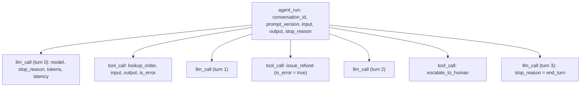

# Tracing Agent Runs

## Introduction

A customer writes in: "Your bot said it refunded me, but nothing happened." Your logs show one line, `agent finished in 2.7s`. What did the agent actually do? Which tools did it call, with what arguments, and what did they return? Which model served the request? Did a tool fail?

Without a **trace**, you can't answer. With one, you can replay the whole run step by step.

A trace is a structured record of everything that happened during one agent run, organized as a tree of **spans**. Each span is one unit of work (the whole run, a model call, a tool call) with a start time, a duration, a parent, and attributes such as token counts or tool arguments.

Think of the flight data recorder on an airplane. It doesn't prevent problems, but when something goes wrong, investigators can reconstruct exactly what happened, in order, with all the instrument readings. Agent traces are the flight recorder for your agent, and they're also the raw material for evals, debugging and cost analysis.

This page shows what to record, builds a small tracer in plain Python so you can see how tracing works, and then covers the tools teams use in practice. The next page, [OpenTelemetry for Agents](./9-agents-opentelemetry.mdx), shows the industry-standard way to do the same thing.

## Logs vs Traces

Ordinary logs are lines of text, written independently. Traces connect related events.

| | Logs | Traces |
|--|------|--------|
| Shape | Flat lines | Tree of spans with parent/child links |
| Answers | "What happened at 14:02?" | "What happened during this run, in what order, and how long did each step take?" |
| Correlation | By grepping for an ID, if you remembered to log it | Built in: every span carries the trace ID |
| Timing | Timestamps only | Durations per step, so you see where time went |
| Best for | Individual events and errors | Multi-step workflows such as agent runs |

Agent runs are multi-step by nature, so traces fit them much better than logs. You can still keep logs, ideally with the trace ID in each line so you can jump from a log line to the full trace.

## The Shape of an Agent Trace

A single-agent run has three kinds of spans:



With multiple agents, a subagent's run becomes a child span of the orchestrator's tool call that started it, so the whole system appears as one tree. Retrieval steps, guardrail checks and human approvals can also be spans.

## What to Record

Record enough to reconstruct and explain a run, without storing data you're not allowed to keep.

**On the agent run span:**

- A trace ID, plus a conversation or session ID and an (internal) user ID, so you can find all runs for one customer.
- The prompt version and tool-set version, so you can tell which configuration produced the run. See [Versioning and Managing Prompts](../3-agents-prompt-engineering/8-agents-prompt-versioning.mdx).
- The input and final output (subject to redaction).
- The final `stop_reason`, the number of turns, and the total tokens and cost.
- The outcome if known, such as "escalated" or "refund issued."

**On each model call span:**

- The model you requested **and** the model reported in the response. If they ever differ, you want to know.
- `stop_reason`: `end_turn`, `tool_use`, `max_tokens`, `pause_turn`, or `refusal`.
- Token usage: input, output, cache reads and cache writes. Cache hit rate explains many cost changes. See [Prompt Caching](../4-agents-memory-and-context/4-agents-prompt-caching.mdx).
- Latency, and for streaming, time to first token.
- Optionally, the full request and response messages. They're the most useful debugging data and also the most sensitive.

**On each tool call span:**

- Tool name, tool use ID (to match the model's request), and input arguments.
- The output (possibly truncated) and whether it was an error.
- Latency. A slow tool and a slow model look the same from the outside.

**On errors:** the exception type, message, and retry count. Keep infrastructure errors (timeouts, rate limits) distinguishable from model behavior.

## Build a Tiny Tracer

To see how tracing works, here is a minimal tracer that writes spans as JSON lines. It uses a `contextvars.ContextVar` to remember the current span, so nested `with` blocks automatically become children. It also redacts obvious personal data before writing.

```python
# support_agent/tracing.py
"""A tiny tracer: nested spans written as JSON lines. For learning, not production."""
import contextvars
import json
import re
import time
import uuid
from contextlib import contextmanager

_current_span = contextvars.ContextVar("current_span", default=None)

EMAIL = re.compile(r"[\w.+-]+@[\w-]+\.[\w.]+")
CARD = re.compile(r"\b(?:\d[ -]?){13,16}\b")


def redact(value):
    """Mask obvious personal data before it is written anywhere."""
    if isinstance(value, str):
        return CARD.sub("[CARD]", EMAIL.sub("[EMAIL]", value))
    if isinstance(value, dict):
        return {k: redact(v) for k, v in value.items()}
    if isinstance(value, list):
        return [redact(v) for v in value]
    return value


class JsonlTracer:
    def __init__(self, path: str):
        self.path = path

    @contextmanager
    def span(self, name: str, **attributes):
        parent = _current_span.get()
        span = {
            "trace_id": parent["trace_id"] if parent else uuid.uuid4().hex[:12],
            "span_id": uuid.uuid4().hex[:8],
            "parent_id": parent["span_id"] if parent else None,
            "name": name,
            "attributes": dict(attributes),
            "start": time.time(),
        }
        token = _current_span.set(span)
        try:
            yield span["attributes"]          # callers add attributes as they learn them
            span["status"] = "ok"
        except Exception as exc:
            span["status"] = "error"
            span["error"] = repr(exc)
            raise
        finally:
            span["duration_ms"] = round((time.time() - span["start"]) * 1000, 1)
            _current_span.reset(token)
            with open(self.path, "a") as f:
                f.write(json.dumps(redact(span), default=str) + "\n")
```

## Instrument the Agent Loop

Now wrap the refund agent's loop (from [Mocking LLM Calls in Tests](./5-agents-mocking-llm-calls.mdx)) in spans. The loop logic is unchanged. Each model call and each tool call gets its own span, and attributes are added as soon as they're known.

```python
# support_agent/traced_agent.py
import time

from support_agent.agent import MODEL, SYSTEM_PROMPT
from support_agent.tools import TOOLS, execute_tool
from support_agent.tracing import JsonlTracer

PROMPT_VERSION = "refund-v7"


def run_agent_traced(client, user_message, db, tracer: JsonlTracer,
                     conversation_id: str, max_turns: int = 8) -> str:
    messages = [{"role": "user", "content": user_message}]
    with tracer.span("agent_run", conversation_id=conversation_id,
                     prompt_version=PROMPT_VERSION, input=user_message) as run:
        for turn in range(max_turns):
            with tracer.span("llm_call", turn=turn, requested_model=MODEL) as call:
                started = time.perf_counter()
                response = client.messages.create(
                    model=MODEL, max_tokens=16000, system=SYSTEM_PROMPT,
                    tools=TOOLS, messages=messages,
                )
                call.update(
                    response_model=response.model,          # what actually served it
                    stop_reason=response.stop_reason,
                    input_tokens=response.usage.input_tokens,
                    output_tokens=response.usage.output_tokens,
                    cache_read_tokens=response.usage.cache_read_input_tokens or 0,
                    latency_ms=round((time.perf_counter() - started) * 1000),
                )

            if response.stop_reason != "tool_use":
                answer = "".join(b.text for b in response.content if b.type == "text")
                run.update(output=answer, stop_reason=response.stop_reason, turns=turn + 1)
                return answer

            messages.append({"role": "assistant", "content": response.content})
            results = []
            for block in response.content:
                if block.type != "tool_use":
                    continue
                with tracer.span("tool_call", tool=block.name, tool_use_id=block.id,
                                 input=block.input) as tool_span:
                    content, is_error = execute_tool(db, block.name, block.input)
                    tool_span.update(is_error=is_error, output=content[:500])
                results.append({"type": "tool_result", "tool_use_id": block.id,
                                "content": content, "is_error": is_error})
            messages.append({"role": "user", "content": results})

        run.update(stop_reason="max_turns", turns=max_turns)
        return ""
```

## View the Trace

A trace file is only useful if you can read it. This script rebuilds the tree from the JSON lines and prints it with durations:

```python
# show_trace.py
import json
import sys
from collections import defaultdict


def show(path: str) -> None:
    spans = [json.loads(line) for line in open(path)]
    children = defaultdict(list)
    for s in spans:
        children[s["parent_id"]].append(s)

    def walk(span, depth):
        a = span["attributes"]
        detail = {
            "agent_run": lambda: f"stop={a.get('stop_reason')} turns={a.get('turns')}",
            "llm_call": lambda: (f"stop={a['stop_reason']} in={a['input_tokens']} "
                                 f"out={a['output_tokens']}"),
            "tool_call": lambda: f"{a['tool']}({json.dumps(a['input'])}) error={a['is_error']}",
        }[span["name"]]()
        print(f"{'  ' * depth}{span['name']:<10} {span['duration_ms']:>7.1f} ms  {detail}")
        for child in sorted(children[span["span_id"]], key=lambda s: s["start"]):
            walk(child, depth + 1)

    for root in children[None]:
        print(f"trace {root['trace_id']}  conversation={root['attributes']['conversation_id']}")
        walk(root, 1)


if __name__ == "__main__":
    show(sys.argv[1])
```

Running the traced agent on "My TV (order A1002) is broken. Refund please! Email me at dana@example.com", with a scripted fake client that simulates model latency, then viewing the trace:

```bash
python show_trace.py traces.jsonl
```

Output:

```text
trace b5b8ad563f2b  conversation=conv_8f2a
  agent_run   2721.8 ms  stop=end_turn turns=4
    llm_call     810.2 ms  stop=tool_use in=100 out=20
    tool_call      0.0 ms  lookup_order({"order_id": "A1002"}) error=False
    llm_call     640.2 ms  stop=tool_use in=100 out=20
    tool_call      0.0 ms  issue_refund({"order_id": "A1002", "amount": 899.0}) error=True
    llm_call     720.2 ms  stop=tool_use in=100 out=20
    tool_call      0.0 ms  escalate_to_human({"reason": "Refund of 899 USD is over the limit"}) error=False
    llm_call     550.2 ms  stop=end_turn in=100 out=20
```

In one glance you can see the whole story: the agent tried an 899 USD refund, the tool rejected it, and the agent escalated. You can also see that nearly all the time went to model calls. The root span in the file shows the redaction at work:

```text
{"trace_id": "b5b8ad563f2b", "span_id": "725b434a", "parent_id": null, "name": "agent_run", "attributes": {"conversation_id": "conv_8f2a", "prompt_version": "refund-v7", "input": "My TV (order A1002) is broken. Refund please! Email me at [EMAIL]", "output": "I've passed your request to a teammate. Contact: [EMAIL]", "stop_reason": "end_turn", "turns": 4}, "start": 1791699378.7305079, "status": "ok", "duration_ms": 2721.8}
```

:::caution This tracer is for learning
A real tracer must handle concurrency, buffering, export to a backend, sampling, and failures of the tracing system itself (tracing must never crash the agent). Use OpenTelemetry or a tracing platform's SDK in production. The concepts carry over directly.
:::

## Privacy and Redaction

Traces of agents contain whatever users type and whatever tools return: names, emails, addresses, order histories, sometimes credentials. Treat trace storage as sensitive data.

- **Redact before export,** not afterwards. Once data is in a third-party tool, deleting it is harder.
- **Know what each field contains.** Token counts and tool names are safe. Message content and tool outputs often aren't.
- **Make content capture configurable.** Many teams capture full content in development and staging, but only metadata (or redacted content) in production.
- **Set retention limits** that match your privacy policy and regulations.
- **Control access.** Traces can reveal more than your normal application logs.

Regex redaction like the example above catches obvious patterns only. For regulated data, use a dedicated PII-detection step and review what you store. See [Data Privacy and PII](../12-agents-safety-and-security/5-agents-data-privacy.mdx).

## Sampling

At high volume, storing every trace in full gets expensive. **Sampling** keeps a subset. For agents, decide what to keep at the **end** of the run (tail sampling), when you know how it went:

```python
import random


def should_keep(run_attributes: dict, had_error: bool, sample_rate: float = 0.1) -> bool:
    """Keep every interesting trace, and a random sample of ordinary ones."""
    if had_error:
        return True
    if run_attributes.get("stop_reason") in ("max_turns", "max_tokens", "refusal"):
        return True
    if run_attributes.get("turns", 0) > 6:         # unusually long runs
        return True
    if run_attributes.get("escalated") or run_attributes.get("user_feedback") == "negative":
        return True
    return random.random() < sample_rate
```

Always keep aggregate metrics (counts, token totals, latencies) for **every** run, even when you drop the detailed trace, so dashboards and cost reports stay accurate. See [Monitoring and Alerting](../13-agents-production/6-agents-monitoring-and-alerting.mdx).

## Tracing Tools

In practice, teams send traces to a platform that stores them, shows them as interactive trees, and links them to evals. Popular options (features and pricing change, so check each project's docs):

| Tool | Notes |
|------|-------|
| [Langfuse](https://langfuse.com/) | Open source, can be self-hosted. Tracing, prompt management, evals. Accepts OpenTelemetry data. |
| [LangSmith](https://docs.smith.langchain.com/) | From the LangChain team. Works with or without LangChain. Tracing, datasets, evals. |
| [Arize Phoenix](https://arize.com/docs/phoenix) | Open source, runs locally. Built on OpenTelemetry and the OpenInference conventions. |
| [Braintrust](https://www.braintrust.dev/) | Evals-first platform with logging and tracing of production runs. |
| [W&B Weave](https://wandb.ai/site/weave/) | Tracing and evals from Weights & Biases. |
| [Pydantic Logfire](https://logfire.pydantic.dev/) | Observability platform built on OpenTelemetry, with LLM instrumentation. |
| General APM (Datadog, Honeycomb, Grafana, and others) | Many support LLM or GenAI spans, useful if your team already uses them. |

Most of these provide SDKs or decorators that create spans for you, plus auto-instrumentation for popular model SDKs and frameworks. Many can also ingest **OpenTelemetry** traces, which lets you instrument once and switch or combine backends later. Agent frameworks often include tracing too: for example, LangGraph integrates with LangSmith, and the OpenAI Agents SDK has built-in tracing. The next page covers the OpenTelemetry route.

## From Traces to Evals

Traces and evals feed each other:

1. **Production traces become eval cases.** When a trace shows a failure (a customer complaint, an escalation, a `max_turns` stop), turn its input and environment into a new case in your dataset. See [Building Evaluation Datasets](./1-agents-building-eval-sets.mdx).
2. **Graders run on traces.** The same code checks and LLM judges you use offline can score a sample of production traces, giving you an online quality signal.
3. **Eval runs produce traces.** Store a trace for every eval trial, so when a score drops you can open the transcripts behind it.
4. **Trajectory checks need trace data.** The rules on [Evaluating Agent Trajectories](./3-agents-trajectory-evaluation.mdx) operate directly on recorded tool-call spans.

## Real-World Scenario

Your company's support agent handles a few thousand conversations a day. Two problems appear in the same week: the monthly model bill jumped noticeably, and a handful of customers complained that the agent "promised a refund that never came."

The current logging is one line per conversation with the final answer. Nobody can explain either problem.

**The solution.** You add tracing with a platform that accepts OpenTelemetry data:

1. Spans for the run, each model call and each tool call, with the attributes listed above. Conversation IDs and internal user IDs are attached, and message content is redacted in production.
2. Tail sampling: keep every trace with an error, escalation, negative feedback, or more than six turns, plus 10% of the rest. Aggregate metrics are kept for all runs.
3. A dashboard of tokens per run, split by cache reads and uncached input.

Within a day, both problems are explained. The cost jump comes from a recent change that put the current date and time at the top of the system prompt, which made every request's prefix different and broke prompt caching: cache reads dropped to almost zero. The "promised refund" traces all show the same pattern: `issue_refund` returned an error for over-limit orders, and the agent's reply still said the refund was on its way. You fix the prompt caching issue, add a no-op detector to your graders, and turn five of those traces into regression cases.

### Why this approach

Both problems were invisible in final outputs and visible in the steps: a cache attribute on model call spans, and an error flag on a tool span followed by a misleading reply. Tracing with structured attributes made them queryable. Sampling kept costs down without losing the interesting runs.

### When to use it and when not to

Trace any agent that real users touch, and every eval run. For a local prototype, printing each turn may be enough. Be careful about capturing message content in production, and don't trace so much that the tracing system becomes a cost or privacy problem in its own right.

### Alternatives and trade-offs

| Approach | Pros | Cons | Best for |
|----------|------|------|----------|
| Print statements and logs | Zero setup | No structure, hard to correlate | Local experiments |
| Homemade tracer (like above) | Full control, no dependencies | You maintain storage, viewing, sampling | Learning, small internal tools |
| Platform SDK (Langfuse, LangSmith, and so on) | Rich UI, evals integration, quick start | Vendor lock-in if you use only proprietary APIs | Most teams starting out |
| OpenTelemetry | Vendor-neutral standard, works with many backends | More concepts to learn, GenAI conventions still evolving | Teams with existing observability, multi-backend needs |
| Framework built-in tracing | Automatic | Tied to the framework | Teams already committed to a framework |

## Common Mistakes

- **Logging only the final answer.** Most agent failures happen in the middle of the run.
- **No IDs to connect things.** Without a conversation ID and trace ID, you can't go from a complaint to the trace.
- **Recording the requested model but not the response's model.** Then a silent model change is invisible.
- **Missing tool errors.** The `is_error` flag on tool results is one of the most useful debugging signals.
- **Capturing everything forever.** Full content in production without redaction or retention limits is a privacy and security risk.
- **Tracing that can crash the agent.** Export failures must be caught and dropped, never raised into the agent loop.
- **Sampling before you know the outcome.** Random head sampling drops most of the failures you care about. Prefer keeping errors and unusual runs.

## Summary

- A trace is a tree of spans recording one agent run: the run, each model call, each tool call.
- Record IDs, prompt and tool versions, model requested and served, stop reasons, token usage including cache, latency, tool inputs, outputs and errors.
- Redact sensitive data before it leaves your system, make content capture configurable, and set retention limits.
- Use tail sampling to keep every error and unusual run plus a sample of normal ones, while keeping metrics for all runs.
- Use a tracing platform or OpenTelemetry in production. The homemade tracer shows the concepts.
- Connect traces and evals: failures become cases, and graders score sampled traces.

## Further Learning

**Exercises**

1. Add a `cost_usd` attribute to each `llm_call` span by multiplying token counts by your model's current prices (check the provider's pricing page), and sum it on the `agent_run` span.
2. Change the tracer so that it buffers spans in memory and writes them only if `should_keep` returns true at the end of the run.
3. Write a script that scans a trace file and lists every run where a tool returned `is_error=True` but the final answer contains the word "refunded."
4. Install an open-source tracing tool such as Langfuse or Phoenix locally and send it traces from an agent you've built.

**Related pages**

- [OpenTelemetry for Agents](./9-agents-opentelemetry.mdx)
- [Debugging Agents](./10-agents-debugging.mdx)
- [Evaluating Agent Trajectories](./3-agents-trajectory-evaluation.mdx)
- [Monitoring and Alerting](../13-agents-production/6-agents-monitoring-and-alerting.mdx)
- [Understanding API Costs](../1-agents-llm-apis/11-agents-api-cost-basics.mdx)
- [Subagents and Context Isolation](../8-agents-multi-agent-systems/8-agents-subagents-and-context-isolation.mdx)
