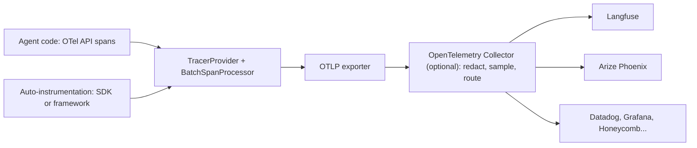

# OpenTelemetry for Agents

## Introduction

The previous page, [Tracing Agent Runs](./8-agents-tracing.mdx), built a small tracer by hand. It worked, but it had its own file format, its own viewer, and no way to send data to the tools your team already uses. Every tracing vendor has the same problem in reverse: if you instrument your agent with one vendor's SDK, switching vendors means re-instrumenting.

**OpenTelemetry** (OTel) solves this. It's an open standard, governed by the Cloud Native Computing Foundation, for producing traces, metrics and logs. You instrument your code once with the OTel API, and an **exporter** sends the data to any compatible backend: Jaeger, Grafana Tempo, Datadog, Honeycomb, or LLM-focused tools such as Langfuse and Arize Phoenix.

For AI systems, OTel adds **GenAI semantic conventions**: agreed names for spans and attributes like `gen_ai.request.model` and `gen_ai.usage.input_tokens`. When everyone uses the same names, a backend can show token usage, model names and tool calls without custom configuration.

Think of it like the standard shipping container. Before containers, every port handled cargo differently. Once everyone agreed on one box size, any ship, crane and truck could move any cargo. OpenTelemetry is the container. The GenAI conventions are the labels on the outside that say what's inside.

:::caution The GenAI conventions are still evolving
The GenAI semantic conventions have **Development** status, which means names can still change. They're now maintained in their own repository, [open-telemetry/semantic-conventions-genai](https://github.com/open-telemetry/semantic-conventions-genai). For example, older instrumentation uses `gen_ai.system` where newer versions use `gen_ai.provider.name`. Check the current spec and pin library versions.
:::

## OpenTelemetry in Five Concepts

| Concept | What it is | In an agent |
|---------|-----------|-------------|
| **Trace** | All the spans for one request, sharing a trace ID | One agent run |
| **Span** | One timed operation with a name, kind, status and attributes | A model call, a tool call |
| **Attributes** | Key-value data on a span | `gen_ai.request.model = "claude-opus-5-5"` |
| **Tracer provider and processor** | The SDK objects that create, batch and hand off spans | Configured once at startup |
| **Exporter** | Sends finished spans somewhere | Console, OTLP to a collector, or a vendor endpoint |

OTel separates the **API** (what your code calls to create spans) from the **SDK** (what decides where spans go). Libraries call the API, and only your application's startup code configures the SDK. If nothing is configured, the API calls do nothing at very low cost.



## The GenAI Semantic Conventions for Agents

The conventions define a few span types that map directly onto an agent loop:

| Span | Name format | Kind | `gen_ai.operation.name` |
|------|-------------|------|-------------------------|
| Agent invocation | `invoke_agent {gen_ai.agent.name}` | `INTERNAL` (or `CLIENT` for a remote agent) | `invoke_agent` |
| Model call | `chat {gen_ai.request.model}` | `CLIENT` | `chat` |
| Tool execution | `execute_tool {gen_ai.tool.name}` | `INTERNAL` | `execute_tool` |

Other operation names cover embeddings, retrieval, agent creation, workflows and memory operations.

Key attributes:

| Attribute | Meaning | Example |
|-----------|---------|---------|
| `gen_ai.operation.name` | The kind of operation | `chat` |
| `gen_ai.provider.name` | The model provider | `anthropic` |
| `gen_ai.request.model` | The model you asked for | `claude-opus-5-5` |
| `gen_ai.response.model` | The model that answered | `claude-opus-5-5` |
| `gen_ai.response.finish_reasons` | Why generation stopped (a list) | `["tool_use"]` |
| `gen_ai.usage.input_tokens` | Input tokens, **including** cached ones | `1250` |
| `gen_ai.usage.output_tokens` | Output tokens | `180` |
| `gen_ai.usage.cache_read.input_tokens` | Input tokens served from cache | `1000` |
| `gen_ai.conversation.id` | Session or thread ID | `conv_42` |
| `gen_ai.agent.name` | Human-readable agent name | `refund-agent` |
| `gen_ai.tool.name` / `gen_ai.tool.call.id` | Which tool, which call | `lookup_order` / `toolu_01` |
| `error.type` | Error class when an operation fails | `timeout` |

Message content has its own **opt-in** attributes: `gen_ai.input.messages`, `gen_ai.output.messages`, `gen_ai.system_instructions`, `gen_ai.tool.definitions`, `gen_ai.tool.call.arguments` and `gen_ai.tool.call.result`. The spec says instrumentations shouldn't capture content by default, and gives `OTEL_INSTRUMENTATION_GENAI_CAPTURE_MESSAGE_CONTENT` as an example of the kind of switch that turns it on. Content can contain personal data, so this is a deliberate choice.

:::note Anthropic token counts
The Anthropic API reports `input_tokens` **excluding** cache reads and cache writes, which are reported separately. The convention's `gen_ai.usage.input_tokens` should **include** cached tokens, so you add them together. Getting this wrong makes cached requests look cheaper or more expensive than they are.
:::

## Manually Instrumenting the Agent Loop

Install the SDK:

```bash
pip install opentelemetry-sdk opentelemetry-exporter-otlp-proto-http
```

Here's the refund agent's loop (from [Mocking LLM Calls in Tests](./5-agents-mocking-llm-calls.mdx)) with OTel spans that follow the conventions. The agent span wraps the run. Each model call is a `chat` span, and each tool call an `execute_tool` span. Because they use `start_as_current_span`, OTel nests them automatically.

```python
# support_agent/otel_agent.py
import json
import os

from opentelemetry import trace
from opentelemetry.trace import SpanKind, Status, StatusCode

from support_agent.agent import MODEL, SYSTEM_PROMPT
from support_agent.tools import TOOLS, execute_tool

tracer = trace.get_tracer("support_agent", "1.0.0")
AGENT_NAME = "refund-agent"
CAPTURE_CONTENT = os.environ.get("OTEL_INSTRUMENTATION_GENAI_CAPTURE_MESSAGE_CONTENT") == "true"


def run_agent_otel(client, user_message: str, db: dict, conversation_id: str,
                   max_turns: int = 8) -> str:
    messages = [{"role": "user", "content": user_message}]
    with tracer.start_as_current_span(
        f"invoke_agent {AGENT_NAME}", kind=SpanKind.INTERNAL,
        attributes={
            "gen_ai.operation.name": "invoke_agent",
            "gen_ai.provider.name": "anthropic",
            "gen_ai.agent.name": AGENT_NAME,
            "gen_ai.conversation.id": conversation_id,
            "gen_ai.request.model": MODEL,
        },
    ) as agent_span:
        for _ in range(max_turns):
            response = _chat(client, messages)
            if response.stop_reason != "tool_use":
                return "".join(b.text for b in response.content if b.type == "text")

            messages.append({"role": "assistant", "content": response.content})
            results = []
            for block in response.content:
                if block.type == "tool_use":
                    content, is_error = _execute_tool(db, block)
                    results.append({"type": "tool_result", "tool_use_id": block.id,
                                    "content": content, "is_error": is_error})
            messages.append({"role": "user", "content": results})

        agent_span.set_status(Status(StatusCode.ERROR, "max_turns reached"))
        agent_span.set_attribute("error.type", "max_turns")
        return ""


def _chat(client, messages):
    with tracer.start_as_current_span(
        f"chat {MODEL}", kind=SpanKind.CLIENT,
        attributes={
            "gen_ai.operation.name": "chat",
            "gen_ai.provider.name": "anthropic",
            "gen_ai.request.model": MODEL,
            "gen_ai.request.max_tokens": 16000,
        },
    ) as span:
        if CAPTURE_CONTENT:  # opt-in: message content may contain personal data
            span.set_attribute("gen_ai.input.messages", json.dumps(messages, default=str))
        try:
            response = client.messages.create(
                model=MODEL, max_tokens=16000, system=SYSTEM_PROMPT,
                tools=TOOLS, messages=messages,
            )
        except Exception as exc:
            span.set_attribute("error.type", type(exc).__name__)
            span.set_status(Status(StatusCode.ERROR, str(exc)))
            raise
        usage = response.usage
        span.set_attributes({
            "gen_ai.response.id": response.id,
            "gen_ai.response.model": response.model,
            "gen_ai.response.finish_reasons": [response.stop_reason],
            # input_tokens here should include cached tokens, per the convention
            "gen_ai.usage.input_tokens": usage.input_tokens
            + (usage.cache_read_input_tokens or 0)
            + (usage.cache_creation_input_tokens or 0),
            "gen_ai.usage.output_tokens": usage.output_tokens,
            "gen_ai.usage.cache_read.input_tokens": usage.cache_read_input_tokens or 0,
        })
        return response


def _execute_tool(db, block):
    with tracer.start_as_current_span(
        f"execute_tool {block.name}", kind=SpanKind.INTERNAL,
        attributes={
            "gen_ai.operation.name": "execute_tool",
            "gen_ai.tool.name": block.name,
            "gen_ai.tool.call.id": block.id,
            "gen_ai.tool.type": "function",
        },
    ) as span:
        if CAPTURE_CONTENT:
            span.set_attribute("gen_ai.tool.call.arguments", json.dumps(block.input))
        content, is_error = execute_tool(db, block.name, block.input)
        if is_error:
            span.set_attribute("error.type", "tool_error")
            span.set_status(Status(StatusCode.ERROR, content[:200]))
        return content, is_error
```

Notice that the agent module only uses the OTel **API**. It doesn't know or care where spans go.

### Seeing the spans locally

Configure the SDK once at startup. For local development, the console exporter prints each finished span as JSON:

```python
# setup_console.py
from opentelemetry import trace
from opentelemetry.sdk.resources import Resource
from opentelemetry.sdk.trace import TracerProvider
from opentelemetry.sdk.trace.export import ConsoleSpanExporter, SimpleSpanProcessor

provider = TracerProvider(resource=Resource.create({"service.name": "support-agent"}))
provider.add_span_processor(SimpleSpanProcessor(ConsoleSpanExporter()))
trace.set_tracer_provider(provider)
```

Running the agent on "Where is order A1001?" with the scripted fake client from the mocking page prints four spans. Here are the `chat` span for the first turn and the root agent span (trimmed):

```text
{
    "name": "chat claude-opus-5-5",
    "context": {
        "trace_id": "0xb39347aa6b3b85190d10d1ffb14bab45",
        "span_id": "0xe9434882499d48d1"
    },
    "kind": "SpanKind.CLIENT",
    "parent_id": "0x506aa31dd7baa90c",
    "attributes": {
        "gen_ai.operation.name": "chat",
        "gen_ai.provider.name": "anthropic",
        "gen_ai.request.model": "claude-opus-5-5",
        "gen_ai.request.max_tokens": 16000,
        "gen_ai.response.id": "msg_test",
        "gen_ai.response.model": "claude-opus-5-5",
        "gen_ai.response.finish_reasons": [
            "tool_use"
        ],
        "gen_ai.usage.input_tokens": 100,
        "gen_ai.usage.output_tokens": 20,
        "gen_ai.usage.cache_read.input_tokens": 0
    },
    "resource": {
        "attributes": {
            "service.name": "support-agent"
        }
    }
}
{
    "name": "invoke_agent refund-agent",
    "kind": "SpanKind.INTERNAL",
    "parent_id": null,
    "attributes": {
        "gen_ai.operation.name": "invoke_agent",
        "gen_ai.provider.name": "anthropic",
        "gen_ai.agent.name": "refund-agent",
        "gen_ai.conversation.id": "conv_42",
        "gen_ai.request.model": "claude-opus-5-5"
    }
}
```

The `parent_id` of the `chat` span matches the agent span's `span_id`, and all spans share one `trace_id`. That's what lets a backend draw them as one tree.

## Exporting to a Backend

In production, replace the console exporter with an **OTLP** exporter and a `BatchSpanProcessor`, which sends spans in the background in batches, so tracing doesn't slow down the agent.

```python
# setup_otlp.py
from opentelemetry import trace
from opentelemetry.exporter.otlp.proto.http.trace_exporter import OTLPSpanExporter
from opentelemetry.sdk.resources import Resource
from opentelemetry.sdk.trace import TracerProvider
from opentelemetry.sdk.trace.export import BatchSpanProcessor

provider = TracerProvider(resource=Resource.create({
    "service.name": "support-agent",
    "service.version": "2.3.0",
    "deployment.environment.name": "production",
}))
# Endpoint and headers come from standard environment variables (see below).
provider.add_span_processor(BatchSpanProcessor(OTLPSpanExporter()))
trace.set_tracer_provider(provider)
```

The exporter reads standard environment variables, so the same code works with any backend:

```bash
# A local OpenTelemetry Collector
export OTEL_EXPORTER_OTLP_ENDPOINT="http://localhost:4318"

# Arize Phoenix running locally (default port 6006)
export OTEL_EXPORTER_OTLP_TRACES_ENDPOINT="http://localhost:6006/v1/traces"

# Langfuse Cloud (EU region shown): HTTP Basic auth with your public and secret keys
export OTEL_EXPORTER_OTLP_ENDPOINT="https://cloud.langfuse.com/api/public/otel"
export OTEL_EXPORTER_OTLP_HEADERS="Authorization=Basic%20$(echo -n 'pk-lf-...:sk-lf-...' | base64)"
```

Endpoints, regions and required headers differ by vendor and change over time, so copy them from the vendor's current OpenTelemetry docs. Langfuse, for example, only accepts OTLP over HTTP, not gRPC.

:::tip Use a Collector in production
An [OpenTelemetry Collector](https://opentelemetry.io/docs/collector/) between your app and the backends lets you redact attributes, apply tail sampling (keep every trace with an error), and send the same data to several backends, all without changing application code.
:::

## Auto-Instrumentation

Writing spans by hand gives you full control. **Auto-instrumentation** libraries patch an SDK or framework so that model calls produce spans automatically. For the Anthropic Python SDK, two widely used options are:

- **OpenInference** (from Arize, used by Phoenix): package `openinference-instrumentation-anthropic`.
- **OpenLLMetry** (from Traceloop): package `opentelemetry-instrumentation-anthropic`.

Usage follows the standard OTel instrumentor pattern:

```python
from openinference.instrumentation.anthropic import AnthropicInstrumentor

from setup_otlp import provider  # the TracerProvider configured above

AnthropicInstrumentor().instrument(tracer_provider=provider)
# From here on, every client.messages.create(...) call produces a span.
```

The official OpenTelemetry Python contrib repository also has GenAI instrumentations for some providers (for example the OpenAI SDK and Vertex AI). Agent frameworks increasingly emit OTel spans too.

Two things to know before relying on auto-instrumentation:

1. **Attribute names can differ.** OpenInference uses its own semantic conventions (for example `llm.*` and `openinference.span.kind` attributes) rather than only `gen_ai.*`. Backends built around one convention may display the other less well.
2. **It only sees what it patches.** Auto-instrumentation of the SDK captures model calls, but not your tool calls, your loop, or the business outcome. Combine it with a few manual spans for the agent run and tool execution, like the ones above.

## Metrics

Traces describe individual runs. **Metrics** describe aggregates over time, which is what dashboards and alerts use. The GenAI conventions define metrics such as `gen_ai.client.operation.duration` (latency of model calls) and agent-level metrics like `gen_ai.invoke_agent.duration`. Token usage metrics are being reworked: older instrumentation emits a single `gen_ai.client.token.usage` histogram, and the current draft splits it into separate input and output histograms such as `gen_ai.client.inference.usage.input_tokens`. Check which names your instrumentation and backend expect. See [Monitoring and Alerting](../13-agents-production/6-agents-monitoring-and-alerting.mdx) for what to alert on.

## Testing Your Instrumentation

Instrumentation is code, so test it. The SDK ships an `InMemorySpanExporter` that collects spans in a list, which works well with the fake client from the mocking page:

```python
# tests/test_otel.py
import pytest
from opentelemetry import trace
from opentelemetry.sdk.trace import TracerProvider
from opentelemetry.sdk.trace.export import SimpleSpanProcessor
from opentelemetry.sdk.trace.export.in_memory_span_exporter import InMemorySpanExporter

from support_agent.otel_agent import run_agent_otel
from tests.fakes import FakeClient, text_response, tool_response

EXPORTER = InMemorySpanExporter()
_provider = TracerProvider()
_provider.add_span_processor(SimpleSpanProcessor(EXPORTER))
trace.set_tracer_provider(_provider)  # the global provider can only be set once per process


@pytest.fixture
def spans():
    EXPORTER.clear()
    yield EXPORTER
    EXPORTER.clear()


def test_spans_follow_genai_conventions(spans):
    db = {"A1002": {"status": "delivered", "total": 899.0, "refunded": False}}
    client = FakeClient([
        tool_response(("issue_refund", {"order_id": "A1002", "amount": 899.0})),
        text_response("I can't refund that amount myself."),
    ])
    run_agent_otel(client, "Refund A1002", db, conversation_id="conv_1")

    finished = {s.name: s for s in spans.get_finished_spans()}
    assert set(finished) == {"invoke_agent refund-agent", "chat claude-opus-5-5",
                             "execute_tool issue_refund"}

    root = finished["invoke_agent refund-agent"]
    assert root.attributes["gen_ai.conversation.id"] == "conv_1"

    tool = finished["execute_tool issue_refund"]
    assert tool.parent.span_id == root.context.span_id       # nested under the agent span
    assert tool.attributes["error.type"] == "tool_error"     # failed tool is visible
    assert tool.status.status_code == trace.StatusCode.ERROR

    chats = [s for s in spans.get_finished_spans() if s.name.startswith("chat")]
    assert [s.attributes["gen_ai.response.finish_reasons"][0] for s in chats] == ["tool_use", "end_turn"]
    assert all(s.kind == trace.SpanKind.CLIENT for s in chats)


def test_message_content_not_captured_by_default(spans):
    client = FakeClient([text_response("Hi")])
    run_agent_otel(client, "my email is dana@example.com", {}, conversation_id="c")
    for span in spans.get_finished_spans():
        assert "gen_ai.input.messages" not in span.attributes
```

Output:

```text
tests/test_otel.py::test_spans_follow_genai_conventions PASSED           [ 50%]
tests/test_otel.py::test_message_content_not_captured_by_default PASSED  [100%]
============================== 2 passed in 0.49s ===============================
```

The second test protects a privacy guarantee: content stays out of spans unless someone opts in.

## Real-World Scenario

Your company already runs its web services on OpenTelemetry, with traces flowing through a Collector into Grafana. The new AI team wants an LLM-focused tool for reviewing agent transcripts and running evals, and they're evaluating Langfuse. The platform team doesn't want a second, separate instrumentation stack.

**The solution.**

1. The agent service uses manual OTel spans following the GenAI conventions (agent, chat, tool), plus OpenInference auto-instrumentation for anything the manual spans miss.
2. The existing Collector gets a second exporter pipeline: all spans still go to Grafana, and spans with `gen_ai.*` attributes also go to Langfuse's OTLP endpoint.
3. A Collector processor deletes `gen_ai.input.messages` and `gen_ai.output.messages` before data reaches Grafana, so message content is only stored in the system approved for it.
4. Because web requests and agent runs share trace context, a slow checkout page can be traced through the API into the agent and down to the slow tool call.

### Why this approach

OTel let the team instrument once and send data to both the general-purpose and the LLM-specific backend. The Collector centralizes redaction and routing, so privacy rules are enforced in one place. Following the GenAI conventions means both backends understand the model and token attributes without custom mapping.

### When to use it and when not to

Use OpenTelemetry when your organization already has OTel infrastructure, when you want to avoid vendor lock-in, or when agents are one part of a larger distributed system. If you're a small team with a single agent and no existing observability stack, a tracing platform's own SDK can be quicker to start with. Many of those SDKs are built on OTel anyway, so you can migrate later.

### Alternatives and trade-offs

| Approach | Pros | Cons | Best for |
|----------|------|------|----------|
| Manual OTel spans (GenAI conventions) | Full control, vendor-neutral, includes tools and outcomes | More code to write | Core agent loop |
| OTel auto-instrumentation | Almost no code | Only covers patched libraries; conventions vary | Model and framework calls |
| Vendor SDK (Langfuse, LangSmith, and so on) | Fast start, rich LLM features | Tighter coupling to one vendor | Small teams, quick setup |
| Framework built-in tracing | Automatic within the framework | Limited outside it | Teams committed to one framework |
| Homemade tracer | No dependencies | You build storage and UI | Learning, tiny tools |

## Common Mistakes

- **Configuring the SDK inside library code.** Only the application's entry point should create the `TracerProvider`. Library code should only use `trace.get_tracer`.
- **Using `SimpleSpanProcessor` in production.** It exports synchronously on every span end. Use `BatchSpanProcessor`.
- **Capturing message content by default.** Keep content opt-in, and redact in the Collector.
- **Wrong token totals with caching.** The convention's input token count includes cached tokens. Anthropic reports them separately, so add them.
- **Assuming the conventions are final.** Pin library versions and check the spec when upgrading. Names have already changed.
- **Mixing conventions without knowing it.** OpenInference and `gen_ai.*` attributes can coexist, but a backend may only understand one well.
- **Not flushing on shutdown.** Short-lived scripts and serverless functions can exit before batched spans are sent. Call `provider.shutdown()` or `force_flush()` before exit.

## Summary

- OpenTelemetry is a vendor-neutral standard for traces, metrics and logs: instrument once, export anywhere.
- The GenAI semantic conventions define `invoke_agent`, `chat` and `execute_tool` spans and attributes such as `gen_ai.request.model`, `gen_ai.usage.input_tokens` and `gen_ai.tool.name`. They're still in Development status.
- Message content goes in opt-in attributes. Keep it off by default and redact centrally.
- Use the OTel API in agent code, configure the SDK once at startup, and export with OTLP and a `BatchSpanProcessor`.
- Auto-instrumentation (OpenInference, OpenLLMetry) covers SDK calls. Add manual spans for the agent run and tools.
- Test instrumentation with `InMemorySpanExporter` and a fake model client.

## Further Learning

**Exercises**

1. Add `gen_ai.output.messages` to the `chat` span when content capture is enabled, and write a test that checks it appears only when the environment variable is set.
2. Run Arize Phoenix or Langfuse locally, point the OTLP exporter at it, and run the refund agent with a real API key. Compare the trace view with the console output.
3. Add an OTel span for a retrieval step (`gen_ai.operation.name = "retrieval"`) to an agent that uses RAG, and check how your backend displays it.
4. Write an OpenTelemetry Collector configuration that deletes `gen_ai.input.messages` before exporting.

**Related pages**

- [Tracing Agent Runs](./8-agents-tracing.mdx)
- [Debugging Agents](./10-agents-debugging.mdx)
- [Monitoring and Alerting](../13-agents-production/6-agents-monitoring-and-alerting.mdx)
- [Data Privacy and PII](../12-agents-safety-and-security/5-agents-data-privacy.mdx)
- [OpenTelemetry documentation](https://opentelemetry.io/docs/) and [GenAI semantic conventions](https://github.com/open-telemetry/semantic-conventions-genai)
