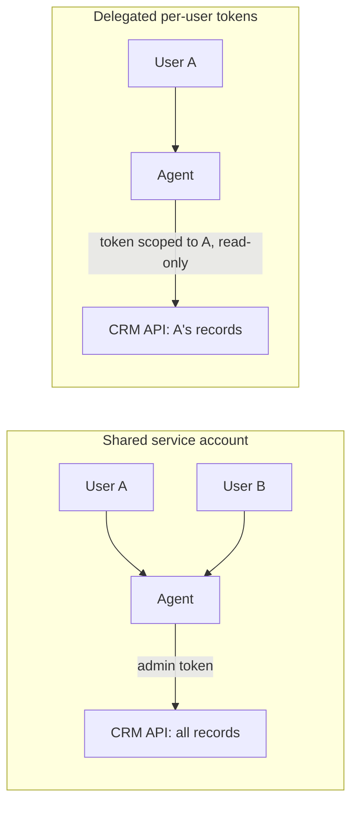

# Least Privilege for Agent Tools

## Introduction

The **principle of least privilege** says every component should have exactly the access it needs to do its job, and nothing more. It is decades old and applies to users, services, and processes. For AI agents it matters even more, because the component making decisions is a model that can be confused, manipulated by [prompt injection](./1-agents-prompt-injection.mdx), or simply wrong.

Here is a helpful way to think about it. When you give an agent a tool, you are not giving it a *suggestion*. You are giving it a *capability*. Whatever the tool can do, assume the agent will eventually do, for good reasons or bad ones. So the real question is never "will the model misuse this?" but "what is the worst thing this tool allows, and can I live with it?"

OWASP names this risk directly: **LLM06:2025 Excessive Agency**. It describes three root causes:

- **Excessive functionality**: the agent has tools, or tool features, it does not need (a "read file" tool that can also delete).
- **Excessive permissions**: tools run with more access than the task needs (a database user that can write when the agent only reads).
- **Excessive autonomy**: high-impact actions happen without any independent check.

The agentic list adds **ASI02 Tool Misuse and Exploitation** (using legitimate tools in harmful ways) and **ASI03 Identity and Privilege Abuse** (agents inheriting or escalating credentials). This page gives you concrete techniques for all of them.

## Narrow Tools Beat Generic Tools

The most common excessive-agency mistake is a generic tool. Compare two ways to let a support agent look up orders.

```python
# Generic: the model writes arbitrary SQL against the production database
run_sql_tool = {
    "name": "run_sql",
    "description": "Run a SQL query against the production database.",
    "input_schema": {
        "type": "object",
        "properties": {"query": {"type": "string"}},
        "required": ["query"],
    },
}

# Narrow: one job, constrained inputs, no SQL in the model's hands
get_order_status_tool = {
    "name": "get_order_status",
    "description": "Get the status of one of the current customer's orders.",
    "input_schema": {
        "type": "object",
        "properties": {
            "order_id": {"type": "string", "pattern": "^A-[0-9]{4,8}$"},
        },
        "required": ["order_id"],
        "additionalProperties": False,
    },
    "strict": True,
}
```

With `run_sql`, the worst case is "anything the database user can do": read every customer's data, update prices, drop tables. With `get_order_status`, the worst case is "read the status of an order", and as you will see below, only an order the current customer owns.

| Generic tool | Narrow replacements |
|--------------|---------------------|
| `run_sql(query)` | `get_order_status(order_id)`, `list_recent_orders(limit)` |
| `run_shell(command)` | `run_tests()`, `format_code(path)` |
| `http_request(method, url, body)` | `get_weather(city)`, `create_ticket(title, body)` |
| `send_email(to, subject, body)` | `reply_to_current_ticket(body)` |
| `file_system(op, path)` | `read_project_file(path)` scoped to one directory |

Narrow tools also make the model's job easier. Fewer, clearer choices lead to fewer mistakes. See [Tool Design Principles](../2-agents-tool-use/7-agents-tool-design-principles.mdx).

:::note When generic tools are fine
A coding agent genuinely needs a shell, and a data-analysis agent may genuinely need SQL. In those cases, keep the generic tool but shrink what it can reach: a [sandbox](./3-agents-sandboxing.mdx) for the shell, a read-only replica and restricted database role for SQL.
:::

## Scope Comes From Your Code, Not From the Model

A narrow tool can still leak data if the model chooses whose data it reads. If `get_order_status` accepts any `order_id`, an attacker can ask about someone else's order. The fix is that **identity and scope come from your application's trusted context**, never from tool arguments the model fills in.

```python
from dataclasses import dataclass

ORDERS = {
    "A-1001": {"customer_id": "C-1", "status": "shipped"},
    "A-2002": {"customer_id": "C-2", "status": "processing"},
}


@dataclass(frozen=True)
class RequestContext:
    """Set by your auth layer for each request. The model never sees or edits it."""
    user_id: str
    customer_id: str
    scopes: frozenset[str]


class ToolDenied(Exception):
    pass


def get_order_status(ctx: RequestContext, order_id: str) -> str:
    if "orders:read" not in ctx.scopes:
        raise ToolDenied("missing scope orders:read")
    order = ORDERS.get(order_id)
    # Same message for "missing" and "not yours", so the tool can't be used to probe IDs
    if order is None or order["customer_id"] != ctx.customer_id:
        raise ToolDenied(f"order {order_id} not found for this customer")
    return f"Order {order_id}: {order['status']}"


ctx = RequestContext(user_id="u-9", customer_id="C-1", scopes=frozenset({"orders:read"}))
for oid in ["A-1001", "A-2002"]:
    try:
        print(get_order_status(ctx, oid))
    except ToolDenied as e:
        print("Denied:", e)
```

Output:

```text
Order A-1001: shipped
Denied: order A-2002 not found for this customer
```

The `RequestContext` is created by your authentication layer and passed into the tool by your dispatcher. The model's tool call contains only `order_id`. Whatever the model is told, it has no argument it could set to read customer C-2's data.

## Act On Behalf of the User

Many agents run under one powerful **service account**: a single API key with access to all customers, all repositories, or the whole workspace. This creates the classic "confused deputy" problem. The agent has more authority than the person talking to it, so any user who can steer the agent (by direct or indirect injection) borrows that authority.

The better model is **delegated, per-user credentials**:



In practice this means:

- Use **OAuth** (or your platform's equivalent) so the agent receives a token for the signed-in user, with the scopes the feature needs. The downstream API enforces that user's permissions.
- Ask for **minimal scopes**: `calendar.readonly` instead of full calendar access, `repo:read` instead of `repo`.
- Prefer **short-lived tokens** that expire after the session.
- Keep the token in the tool layer. The model should never see it. See [Secrets Management for Agents](./4-agents-secrets-management.mdx).
- Record **both identities** in audit logs: which user, and that an agent acted for them.

The [User Authentication and Agent Permissions](../10-agents-integration/5-agents-auth-and-permissions.mdx) page covers the OAuth plumbing. The security rule is simple: **an agent should never be able to do something its user could not do directly.**

## Read-Only by Default, Write by Exception

Start every agent with read-only tools. Add write capabilities one at a time, each with a reason. Then enforce read-only at the lowest layer you can, so a bug in your tool code cannot accidentally write.

For databases, give the agent its own role:

```sql
-- A dedicated role for the analytics agent
CREATE ROLE agent_readonly LOGIN PASSWORD 'from-your-secret-manager';
GRANT CONNECT ON DATABASE shop TO agent_readonly;
GRANT USAGE ON SCHEMA reporting TO agent_readonly;
GRANT SELECT ON ALL TABLES IN SCHEMA reporting TO agent_readonly;
-- No access to the schema with raw customer PII
REVOKE ALL ON SCHEMA customers_raw FROM agent_readonly;
ALTER ROLE agent_readonly SET statement_timeout = '5s';
```

Now even a free-form SQL tool is bounded: the database itself refuses writes, refuses the raw PII schema, and kills slow queries. That is much stronger than a regex that tries to block `DELETE`. The [Agents That Work with Your Database](../10-agents-integration/6-agents-with-databases.mdx) page goes further with views and row-level security.

## Capability Tiers

Not every action needs the same treatment. Classify tools by impact and attach a policy to each tier.

| Tier | Examples | Default policy |
|------|----------|----------------|
| 0: Read, own data | Look up own orders, search public docs | Allow, log |
| 1: Read, sensitive | Read other team members' files, search CRM | Allow only with scope, log with detail |
| 2: Reversible write | Draft an email, create a ticket, add a label | Allow, notify user |
| 3: External or costly | Send email, post publicly, call paid APIs | Require approval or a narrow allowlist |
| 4: Irreversible or destructive | Delete data, transfer money, change permissions | Require approval bound to exact arguments, or do not expose at all |

Here is a small policy engine that applies tiers in the dispatcher, together with the taint idea from the [Prompt Injection](./1-agents-prompt-injection.mdx) page:

```python
from enum import IntEnum


class Tier(IntEnum):
    READ_OWN = 0
    READ_SENSITIVE = 1
    REVERSIBLE_WRITE = 2
    EXTERNAL = 3
    DESTRUCTIVE = 4


TOOL_TIERS = {
    "get_order_status": Tier.READ_OWN,
    "search_crm": Tier.READ_SENSITIVE,
    "create_ticket": Tier.REVERSIBLE_WRITE,
    "send_email": Tier.EXTERNAL,
    "issue_refund": Tier.DESTRUCTIVE,
}


def decide(tool: str, scopes: set[str], session_tainted: bool) -> str:
    tier = TOOL_TIERS.get(tool)
    if tier is None:
        return "deny: unknown tool"
    if tier == Tier.READ_SENSITIVE and "crm:read" not in scopes:
        return "deny: missing scope crm:read"
    if tier >= Tier.EXTERNAL:
        return "approve: human approval required"
    if session_tainted and tier >= Tier.READ_SENSITIVE:
        return "approve: untrusted content in context"
    return "allow"


for tool in TOOL_TIERS:
    print(f"{tool:17} clean -> {decide(tool, {'orders:read'}, False):38} "
          f"tainted -> {decide(tool, {'orders:read'}, True)}")
```

Output:

```text
get_order_status  clean -> allow                                  tainted -> allow
search_crm        clean -> deny: missing scope crm:read           tainted -> deny: missing scope crm:read
create_ticket     clean -> allow                                  tainted -> approve: untrusted content in context
send_email        clean -> approve: human approval required       tainted -> approve: human approval required
issue_refund      clean -> approve: human approval required       tainted -> approve: human approval required
```

The "approve" results hand off to the approval flow described in [Human Approval Gates](./7-agents-approval-gates.mdx).

## Expose Only the Tools the Task Needs

A tool the model cannot see is a tool it cannot misuse. Instead of one agent with every tool, choose the tool list **per request** based on the user's role and the task.

```python
ALL_TOOLS = {
    "get_order_status": {"roles": {"customer", "agent", "admin"}},
    "search_crm": {"roles": {"agent", "admin"}},
    "create_ticket": {"roles": {"customer", "agent", "admin"}},
    "issue_refund": {"roles": {"admin"}},
}

TASK_TOOLS = {
    "order_question": {"get_order_status", "create_ticket"},
    "account_review": {"search_crm", "get_order_status"},
    "refund_request": {"get_order_status", "issue_refund", "create_ticket"},
}


def tools_for(role: str, task: str) -> list[str]:
    allowed_by_task = TASK_TOOLS.get(task, set())
    return sorted(
        name for name, meta in ALL_TOOLS.items()
        if name in allowed_by_task and role in meta["roles"]
    )


print("customer/order_question:", tools_for("customer", "order_question"))
print("customer/refund_request:", tools_for("customer", "refund_request"))
print("admin/refund_request:   ", tools_for("admin", "refund_request"))
```

Output:

```text
customer/order_question: ['create_ticket', 'get_order_status']
customer/refund_request: ['create_ticket', 'get_order_status']
admin/refund_request:    ['create_ticket', 'get_order_status', 'issue_refund']
```

The task label can come from a [routing step](../6-agents-planning-and-reasoning/2-agents-routing.mdx) or from the UI the user clicked. Dynamic tool sets also help with cost and accuracy when an agent has many tools. Still, keep the checks inside each tool too: filtering the tool list is a convenience, while checks in the tool are the enforcement.

## Limit Where Tools Can Reach

Least privilege also applies to the network. A tool that fetches URLs should only reach the hosts it needs. Enforce this outside the model, ideally in a proxy or firewall, and at minimum in the tool itself.

```python
from urllib.parse import urlparse

EGRESS_ALLOWLIST = {"api.weather.example", "docs.example.com"}


def check_egress(url: str) -> None:
    parsed = urlparse(url)
    if parsed.scheme != "https":
        raise PermissionError("only https is allowed")
    host = (parsed.hostname or "").lower()
    if host not in EGRESS_ALLOWLIST:
        raise PermissionError(f"host {host!r} is not on the egress allowlist")


for url in ["https://docs.example.com/a", "https://attacker.example/?d=secret", "http://docs.example.com"]:
    try:
        check_egress(url)
        print("ok     ", url)
    except PermissionError as e:
        print("blocked", url, "-", e)
```

Output:

```text
ok      https://docs.example.com/a
blocked https://attacker.example/?d=secret - host 'attacker.example' is not on the egress allowlist
blocked http://docs.example.com - only https is allowed
```

An application-level check like this is easy to bypass by accident (a library that follows redirects, a DNS trick, a new tool someone adds without the check). A network-level control, such as a sandbox with no default route plus an allowlisting proxy, covers every tool at once. See [Sandboxing Agent Execution](./3-agents-sandboxing.mdx).

## Real-World Scenario

Your company has an internal "ops assistant" in Slack. Engineers ask it things like "why is checkout slow?" or "restart the stuck worker". The prototype used a single cloud credential with admin rights, a `run_shell` tool on a bastion host, and a `run_sql` tool on the production primary. It was great in demos. The security team has asked you to fix it before wider rollout.

**Step 1: List what people actually ask.** Two weeks of logs show most requests are read-only: metrics, logs, recent deploys, query plans. A few are restarts of known services. Almost none need arbitrary shell or writes to the database.

**Step 2: Replace generic tools with narrow ones.**

- `run_sql` becomes `run_readonly_query` against a **read replica**, as a dedicated `agent_readonly` role with a statement timeout and no access to PII schemas.
- `run_shell` is removed. In its place: `get_service_logs(service, minutes)`, `get_metrics(service, metric, minutes)`, `list_recent_deploys(service)`.
- `restart_service(service)` exists, but `service` must be in an allowlist of stateless workers, and it is a tier 3 action with approval from someone in the owning team's on-call rotation.

**Step 3: Use the requester's identity.** The Slack user is mapped to their SSO identity. Tools call internal APIs with a short-lived token for **that engineer**, so an intern cannot restart services they could not restart by hand.

**Step 4: Contain what remains.** Log lines can contain attacker-controlled text (for example, a user agent string), so log-reading taints the session. After that, `restart_service` always needs approval, even for senior engineers.

**Why this approach.** The prototype's risk was "anything an admin can do, triggered by anyone in Slack or by text in a log line". The new design's worst case is "read some metrics you were already allowed to see" plus "restart a stateless worker after a human approved it".

**When to use it / when not to.** Always apply narrow tools and per-user identity to agents that touch production. For a personal agent on your own laptop with your own files, a lighter approach (sandboxing plus approval prompts) may be more practical than designing a dozen narrow tools.

**Alternatives and trade-offs:**

| Approach | Pros | Cons | Best for |
|----------|------|------|----------|
| Generic tools with prompt rules | Fast to build, flexible | No real enforcement | Throwaway prototypes only |
| Generic tools with constrained backend (read-only role, sandbox) | Flexible, enforced by infrastructure | Still broad within the boundary | Data analysis and coding agents |
| Narrow, purpose-built tools | Small blast radius, easier for the model | More tools to build and maintain | Customer-facing and production agents |
| Per-user delegated credentials | Agent can never exceed the user's rights | OAuth plumbing, token refresh | Any multi-user agent |
| Dynamic tool sets per task | Fewer options to misuse, better accuracy | Needs reliable task routing | Agents with many tools |

## Best Practices

- **Start from zero.** Give the agent no tools, then add each one with a written reason and a tier.
- **Enforce in the tool, not the description.** "Only use this for the current customer" in a description is a hint. A check against `RequestContext` is a control.
- **Never let the model choose identity.** User IDs, tenant IDs, and account numbers come from your auth layer.
- **Give each agent its own credentials**, distinct from humans and other services, so you can scope, rotate, and audit them separately.
- **Use the platform's permissions**: database roles, cloud IAM policies, OAuth scopes, and file system permissions are better tested than your own checks.
- **Return uniform denials** so tools cannot be used to probe for the existence of records.
- **Review tool lists regularly.** Tools accumulate. Remove ones that logs show are never used.

## Summary

- Excessive agency (LLM06) comes from too much functionality, too many permissions, or too much autonomy.
- Prefer narrow tools with constrained inputs. When a generic tool is necessary, constrain its backend instead.
- Take identity and scope from trusted request context, and act with per-user, minimally scoped, short-lived credentials.
- Default to read-only and enforce it at the lowest layer possible, such as a database role.
- Classify tools into tiers and attach policies, including approval for external and destructive actions.
- Show the model only the tools a task needs, and restrict network egress to known hosts.

## Exercises

1. Take the `run_sql` tool and design three narrow tools that cover the queries a support agent would really need. Write their JSON schemas with `strict` and `additionalProperties: false`.
2. Extend `decide()` so a tier 2 tool becomes "approve" if the same session has already made five tier 2 calls. What attack does this slow down?
3. Write the database `GRANT` statements for an agent that may read the `orders` and `products` tables but only see the last four digits of payment cards (hint: a view).
4. Map one agent you know to the three LLM06 root causes. Which one is the largest risk, and what single change addresses it?

**Related pages**

- [Tool Security Basics](../2-agents-tool-use/11-agents-tool-security-basics.mdx)
- [Sandboxing Agent Execution](./3-agents-sandboxing.mdx)
- [Human Approval Gates](./7-agents-approval-gates.mdx)
- [User Authentication and Agent Permissions](../10-agents-integration/5-agents-auth-and-permissions.mdx)
- [MCP Security](../7-agents-mcp/8-agents-mcp-security.mdx), for scoping tools that come from MCP servers
