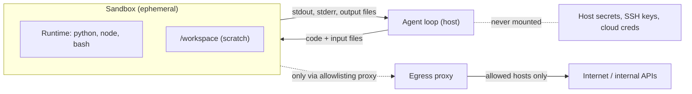
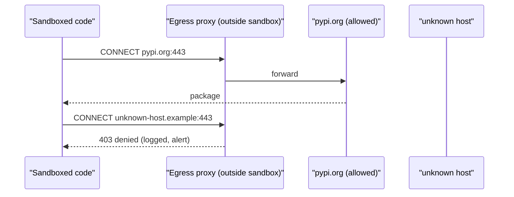

# Sandboxing Agent Execution

## Introduction

Coding agents, data-analysis agents, and many "computer use" agents do something that would make any security engineer nervous: they **write code and then run it**. The code comes from a model that may have read an attacker's web page five steps earlier. OWASP's agentic list calls this **ASI05 Unexpected Code Execution**: untrusted model output becoming executable behavior.

You cannot review every command by hand at agent speed, and you should not trust the model to never write something harmful. The answer is the same one browsers, CI systems, and cloud providers settled on long ago: **run untrusted code in a sandbox**, an isolated environment where the worst case is "the sandbox gets wrecked and you throw it away."

A good mental picture is a lab glovebox. The scientist can do real work inside, mixing and measuring, but nothing inside can get out, and the box has only the materials placed in it for this experiment.

This page covers:

- What a sandbox must isolate (processes, file system, network, resources, credentials)
- The isolation spectrum: subprocess, containers, gVisor, microVMs, hosted sandboxes
- A hardened Docker-based `run_python` tool you can wire into an agent
- Network egress control, the part most teams get wrong
- How to choose between options

## What a Sandbox Must Control

A useful sandbox restricts five things. Missing any one of them leaves a gap.

| Dimension | Threat if uncontrolled | Typical control |
|-----------|------------------------|-----------------|
| File system | Reading SSH keys, `.env` files, other users' data; modifying system files | Mount only a per-task working directory; read-only root file system |
| Network | Exfiltrating data, downloading malware, attacking internal services | No network by default; allowlisting egress proxy |
| Resources | Infinite loops, fork bombs, filling memory or disk, crypto mining | CPU, memory, process count, disk, and wall-clock limits |
| Privileges | Escaping to the host through kernel or runtime bugs | Non-root user, dropped capabilities, stronger isolation (gVisor, microVM) |
| Credentials | Using your cloud or Git credentials | Never mount credentials; inject them outside the sandbox (see [Secrets Management](./4-agents-secrets-management.mdx)) |

Anthropic's engineering write-up on sandboxing Claude Code makes a point worth remembering: **you need both file system and network isolation**. Without network isolation, a compromised agent can send out sensitive files it can read. Without file system isolation, it can tamper with whatever controls its network access and escape that way.



## The Isolation Spectrum

Options range from "barely isolated" to "separate virtual machine". Stronger isolation costs more startup time and operational effort.

### 1. A subprocess is not a sandbox

Running model-written code with `subprocess.run(["python", "-c", code])` on your server is **not** isolation. The code runs as your user, can read every file you can read, can reach every network you can reach, and can see your environment variables, including API keys. Timeouts help with infinite loops and nothing else.

:::warning
Never run model-generated code with `exec()`, `eval()`, or a plain subprocess on a machine that holds secrets or production access. Use one of the options below.
:::

### 2. Containers (Docker, Podman)

Containers use Linux namespaces and cgroups to give a process its own view of the file system, network, and process table, plus resource limits. They are fast (start in well under a second for small images) and familiar. Their weakness is that containers **share the host kernel**, so a kernel vulnerability can allow escape. Treat a container as a good isolation layer when it is hardened, and add a stronger layer for hostile workloads.

A hardened `docker run` for untrusted code:

```bash
docker run --rm \
  --network none \
  --read-only \
  --tmpfs /tmp:rw,size=64m \
  --memory 256m --memory-swap 256m \
  --cpus 0.5 \
  --pids-limit 64 \
  --cap-drop ALL \
  --security-opt no-new-privileges \
  --user 65534:65534 \
  -v "$PWD/task-123:/workspace:rw" \
  -w /workspace \
  python:3.12-slim \
  python /workspace/main.py
```

What each flag buys you:

- `--network none`: no network interfaces except loopback. The single most important flag.
- `--read-only` plus `--tmpfs /tmp`: the image cannot be modified; scratch space is in memory and capped.
- `--memory`, `--cpus`, `--pids-limit`: stops memory bombs, CPU hogging, and fork bombs.
- `--cap-drop ALL` and `no-new-privileges`: removes Linux capabilities and blocks privilege escalation via setuid binaries.
- `--user 65534:65534`: runs as the unprivileged "nobody" user, not root.
- `-v .../task-123:/workspace`: mounts **only** this task's directory, never your home directory or the project root with its `.env`.

### 3. gVisor

[gVisor](https://gvisor.dev) is an application kernel from Google that intercepts the sandboxed program's system calls and handles them in user space, so the program does not talk to the host kernel directly. It plugs into Docker and Kubernetes as an alternative runtime called `runsc`:

```bash
docker run --rm --runtime=runsc --network none python:3.12-slim python -c "print('hello from gVisor')"
```

Trade-offs: much stronger isolation than plain containers with the same container workflow, at the cost of some system-call overhead and occasional compatibility gaps for unusual workloads. Check the gVisor docs for installation and the current compatibility list.

### 4. Firecracker microVMs

[Firecracker](https://firecracker-microvm.github.io) is an open-source virtual machine monitor from AWS that boots minimal virtual machines (microVMs) quickly with a small memory footprint. Each sandbox gets its **own kernel**, protected by hardware virtualization, which is the strongest isolation in this list. AWS built it for multi-tenant serverless workloads, and several agent sandbox services run on it or similar technology.

Trade-offs: strongest isolation, but you need hosts that support KVM and more operational work (images, networking, lifecycle). Most teams consume microVMs through a service instead of operating Firecracker themselves.

### 5. Hosted sandbox services

Services such as E2B, Modal, Daytona, and others give you an API: create a sandbox, run code, read files, destroy it. You get VM-grade isolation without running the infrastructure. LLM providers also offer built-in options, such as Anthropic's server-side code execution tool, which runs code in a sandbox the provider manages (see [Server-Side Tools](../2-agents-tool-use/8-agents-server-tools.mdx)).

A short example with E2B's Python SDK (`pip install e2b`, reads `E2B_API_KEY` from the environment). Note that internet access is **on by default**, so turn it off explicitly:

```python
from e2b import Sandbox

# No outbound internet at all
sandbox = Sandbox.create(allow_internet_access=False)
try:
    result = sandbox.commands.run("python3 -c 'print(sum(range(10)))'")
    print(result.stdout)
finally:
    sandbox.kill()

# Or: deny everything, then allow specific domains
sandbox = Sandbox.create(
    network={
        "allow_out": ["pypi.org", "files.pythonhosted.org"],
        "deny_out": lambda ctx: [ctx.all_traffic],
    }
)
sandbox.kill()
```

Example output:

```text
45
```

SDK details change between versions. Check the E2B documentation for current method names, default timeouts, and network options before relying on this exact code.

### 6. OS-level sandboxes for local agents

For agents running on a developer's own machine (like a coding agent in a terminal), containers can be heavy. Operating systems provide lighter tools: **bubblewrap** on Linux and **Seatbelt** (`sandbox-exec`) on macOS. Anthropic's Claude Code sandbox builds on these, restricting writes to the working directory and routing all network traffic through a proxy outside the sandbox that enforces a domain allowlist. Anthropic reported that in its internal usage, sandboxing reduced permission prompts by 84%, because commands that stay inside the sandbox no longer need a human to approve them. That is a useful lesson: good isolation is not only safer, it can also make agents **less** annoying to use.

### Comparison

| Option | Isolation strength | Startup | Operational effort | Best for |
|--------|-------------------|---------|--------------------|----------|
| Plain subprocess | None | Instant | None | Never for untrusted code |
| Hardened container | Medium (shared kernel) | Fast | Low | Internal tools, semi-trusted code |
| Container + gVisor | High | Fast | Medium | Multi-tenant code execution you host |
| Firecracker microVM | Very high (own kernel) | Fast for a VM | High if self-hosted | Platforms running strangers' code |
| Hosted sandbox service | Very high (provider-managed) | Fast, network round trip | Low | Most product teams |
| OS sandbox (bubblewrap, Seatbelt) | Medium to high | Instant | Low | Local developer agents |

## Building a Sandboxed Code Tool

Here is a `run_python` tool backed by a hardened container. It writes the code to a fresh per-task directory, runs it with strict limits and a wall-clock timeout, truncates output so a runaway print loop cannot flood the model's context, and always cleans up.

```python
import shutil
import subprocess
import tempfile
import uuid
from pathlib import Path

IMAGE = "python:3.12-slim"  # pin a digest in production, e.g. python:3.12-slim@sha256:...
TIMEOUT_SECONDS = 20
MAX_OUTPUT_CHARS = 4000


def build_docker_command(workdir: Path, name: str) -> list[str]:
    return [
        "docker", "run", "--rm", "--name", name,
        "--network", "none",
        "--read-only", "--tmpfs", "/tmp:rw,size=64m",
        "--memory", "256m", "--memory-swap", "256m",
        "--cpus", "0.5", "--pids-limit", "64",
        "--cap-drop", "ALL", "--security-opt", "no-new-privileges",
        "--user", "65534:65534",
        "-v", f"{workdir}:/workspace:rw", "-w", "/workspace",
        IMAGE, "python", "/workspace/main.py",
    ]


def truncate(text: str) -> str:
    if len(text) <= MAX_OUTPUT_CHARS:
        return text
    return text[:MAX_OUTPUT_CHARS] + f"\n...[truncated {len(text) - MAX_OUTPUT_CHARS} chars]"


def run_python(code: str) -> dict:
    """Execute model-written Python in an isolated, network-less container."""
    workdir = Path(tempfile.mkdtemp(prefix="agent-task-"))
    workdir.chmod(0o777)  # writable by the unprivileged container user
    (workdir / "main.py").write_text(code)
    name = f"agent-sbx-{uuid.uuid4().hex[:12]}"
    try:
        proc = subprocess.run(
            build_docker_command(workdir, name),
            capture_output=True, text=True, timeout=TIMEOUT_SECONDS,
        )
        output = proc.stdout + (("\nSTDERR:\n" + proc.stderr) if proc.stderr else "")
        return {"is_error": proc.returncode != 0, "content": truncate(output) or "(no output)"}
    except subprocess.TimeoutExpired:
        subprocess.run(["docker", "kill", name], capture_output=True)
        return {"is_error": True, "content": f"Timed out after {TIMEOUT_SECONDS}s and was stopped."}
    finally:
        shutil.rmtree(workdir, ignore_errors=True)


if __name__ == "__main__":
    print(" ".join(build_docker_command(Path("/tmp/agent-task-demo"), "agent-sbx-demo")))
```

Output:

```text
docker run --rm --name agent-sbx-demo --network none --read-only --tmpfs /tmp:rw,size=64m --memory 256m --memory-swap 256m --cpus 0.5 --pids-limit 64 --cap-drop ALL --security-opt no-new-privileges --user 65534:65534 -v /tmp/agent-task-demo:/workspace:rw -w /workspace python:3.12-slim python /workspace/main.py
```

Some design notes:

- The `--name` lets you `docker kill` the container on timeout. Without it, a timed-out `subprocess.run` stops waiting, but the container may keep running.
- The returned dictionary maps onto a `tool_result` with `is_error`. Returning errors to the model (instead of raising) lets it fix its own bugs, as described in [Handling Tool Errors](../2-agents-tool-use/6-agents-tool-errors.mdx).
- To run under gVisor, add `"--runtime=runsc"` to the command. Nothing else changes.

### Wiring it into an agent loop

The tool definition the model sees, and the dispatch in your loop:

```python
from anthropic import Anthropic

client = Anthropic()

RUN_PYTHON_TOOL = {
    "name": "run_python",
    "description": (
        "Run a self-contained Python 3.12 script in an isolated sandbox. "
        "There is no network access and no access to the user's files. "
        "Only the standard library is available. Print results to stdout."
    ),
    "input_schema": {
        "type": "object",
        "properties": {"code": {"type": "string", "description": "Complete Python script"}},
        "required": ["code"],
        "additionalProperties": False,
    },
}


def agent(task: str, max_turns: int = 8) -> str:
    messages = [{"role": "user", "content": task}]
    for _ in range(max_turns):
        response = client.messages.create(
            model="claude-opus-5-5",
            max_tokens=16000,
            tools=[RUN_PYTHON_TOOL],
            messages=messages,
        )
        messages.append({"role": "assistant", "content": response.content})
        if response.stop_reason != "tool_use":
            return "".join(b.text for b in response.content if b.type == "text")
        results = []
        for block in response.content:
            if block.type == "tool_use" and block.name == "run_python":
                outcome = run_python(block.input["code"])  # from the previous example
                results.append({
                    "type": "tool_result",
                    "tool_use_id": block.id,
                    "content": outcome["content"],
                    "is_error": outcome["is_error"],
                })
        messages.append({"role": "user", "content": results})
    return "Stopped: turn limit reached."
```

Telling the model in the description that there is no network and only the standard library saves wasted turns: it will not try `pip install` and then get confused when it fails. The description is for the model's **convenience**. The container flags are what **enforce** the rules.

## Controlling Network Egress

"No network" is the right default, but many agents need some access: installing packages, calling one API, cloning a repository. Do not flip the switch to "full internet". Instead, give the sandbox a route only to an **egress proxy** that allows specific destinations.



Key properties of a good egress setup:

- **Default deny.** The sandbox has no direct route out. The only reachable address is the proxy.
- **Allowlist by domain**, kept as short as possible and specific to the task type.
- **The proxy lives outside the sandbox**, so code inside cannot change its rules.
- **Log every denied request.** A sandbox trying to reach an unexpected domain is a strong signal of injection or a bad dependency.
- **Block internal addresses**: cloud metadata endpoints (such as `169.254.169.254`), private IP ranges, and localhost services on the host. Server-side request forgery (SSRF) through an agent is a real risk.

Common building blocks are Squid or Envoy as an HTTP(S) proxy, Kubernetes NetworkPolicies, cloud security groups, or the network options built into hosted sandbox services.

## Lifecycle: Ephemeral by Default

- **One sandbox per task or session**, never shared between users. Shared sandboxes leak data between tenants.
- **Destroy it when done.** Persistence across sessions is a feature you add deliberately (for example, saving a workspace snapshot), not a default.
- **Copy results out explicitly.** Collect specific output files, check their size and type, and treat them as untrusted data, because the code that produced them was untrusted.
- **Pin images** by digest and rebuild them regularly, so your sandbox does not quietly pick up a changed base image.
- **Pre-install dependencies** in the image instead of allowing package installs at runtime, when the set of needed packages is known.

## Real-World Scenario

You are adding a "chart my data" feature to a SaaS analytics product. Users upload a CSV, ask a question in plain language, and an agent writes pandas and matplotlib code to answer it and draw a chart. Thousands of customers will use it, and the CSVs can contain anything, including text written by an attacker hoping the agent will read it.

**The design:**

1. Each request gets a **fresh sandbox** from a hosted service with **internet disabled**. You build a custom template image with pandas and matplotlib pre-installed, so no package installs are needed.
2. Your backend uploads **only that user's CSV** into the sandbox working directory. No database credentials, no other files.
3. The agent's `run_python` tool executes in the sandbox with a 30-second timeout. Output is truncated before going back to the model.
4. When the agent finishes, your backend downloads `chart.png` only, checks it is a valid PNG under a size limit, and serves it from your own storage.
5. The sandbox is destroyed. Denied network attempts (if a template ever has a proxy) and timeouts are logged as security events.

**Why this approach.** The code is written by a model that read user-controlled data, and it runs on behalf of many tenants. That combination calls for VM-grade isolation and strict per-tenant separation. A hosted service provides that without your team running Firecracker hosts.

**When to use it / when not to.** Use per-request sandboxes whenever model-written code runs on a server you operate, especially for multiple tenants. If your agent only calls fixed, well-defined tools (no code generation), you do not need a code sandbox at all. Focus on [least privilege](./2-agents-least-privilege.mdx) instead.

**Alternatives and trade-offs:**

| Approach | Pros | Cons | Best for |
|----------|------|------|----------|
| Hosted sandbox service | Strong isolation, no infrastructure to run | Per-use cost, vendor dependency, data leaves your network | Most SaaS products |
| Self-hosted gVisor or Firecracker | Full control, data stays in your network | Significant operations work | Large scale or strict data residency |
| Hardened Docker on dedicated hosts | Simple, cheap, familiar | Shared kernel; weaker for hostile multi-tenant code | Internal tools, single-tenant workloads |
| Provider's built-in code execution tool | Zero setup | Less control over environment, files, and network | Prototypes and simple analysis |
| No code execution (fixed tools only) | Smallest attack surface | Less flexible | Well-understood tasks |

## Common Mistakes

- **Mounting the project root.** It usually contains `.env`, `.git` with credentials, and cloud config. Mount a dedicated task directory.
- **Leaving the network on "temporarily".** Hosted sandboxes often default to internet access. Turn it off explicitly and add allowlisted exceptions.
- **Passing secrets as environment variables** to the sandbox "just for this one API call". Any code in the sandbox can read them. Use a credential-injecting proxy instead.
- **No wall-clock timeout,** or a timeout that does not actually stop the container.
- **Unbounded output** flowing back into the model's context, which costs tokens and can carry injected text.
- **Reusing a sandbox across users** to save startup time.
- **Trusting the sandbox's outputs.** Files and text produced inside are untrusted data. Validate before using them elsewhere.

## Summary

- Model-written code is untrusted code (ASI05). Run it in a sandbox, never in your application process.
- Isolate the file system, network, resources, privileges, and credentials. File system and network isolation are both required.
- Choose isolation strength by risk: hardened containers, gVisor, Firecracker microVMs, hosted services, or OS sandboxes for local agents.
- Default to no network, and allow specific destinations through a proxy outside the sandbox. Block metadata and internal addresses.
- Make sandboxes ephemeral and per-task, copy results out deliberately, and treat them as untrusted.

## Exercises

1. Run the hardened `docker run` command with a script that tries to fetch a URL, write to `/etc`, and start 200 processes. Record which flag stops each attempt.
2. Add a `--runtime=runsc` option to `build_docker_command()` controlled by a parameter, and compare startup time with and without gVisor on your machine.
3. Extend `run_python` to return a list of files created in `/workspace`, rejecting any file larger than 1 MB.
4. Design the egress allowlist for a coding agent that must install npm packages and push to one GitHub repository. Which domains do you need, and how would you keep the Git credential out of the sandbox?

**Related pages**

- [Bash and File Editing Tools](../2-agents-tool-use/9-agents-bash-and-file-tools.mdx)
- [Server-Side Tools: Web Search and Code Execution](../2-agents-tool-use/8-agents-server-tools.mdx)
- [Secrets Management for Agents](./4-agents-secrets-management.mdx)
- [Least Privilege for Agent Tools](./2-agents-least-privilege.mdx)
- [Project: Coding Agent](../14-agents-projects/2-agents-project-coding-agent.mdx)
