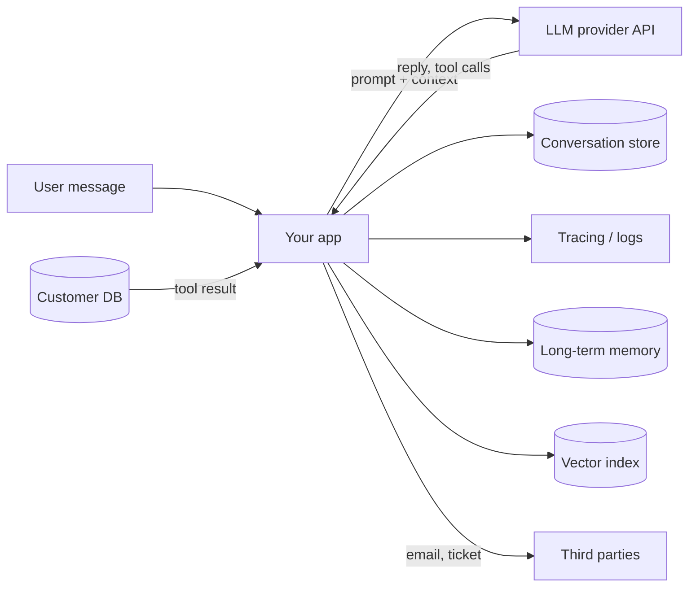

# Data Privacy and PII

## Introduction

**Personally identifiable information (PII)** is any data that can identify a person: names, email addresses, phone numbers, home addresses, account numbers, government IDs, health details, and combinations of harmless-looking fields that together point to one individual. Agents handle a lot of it, because the tasks people want automated (support, scheduling, sales, HR, healthcare intake) are full of personal data.

Privacy in agent systems is harder than in a typical web app for three reasons:

1. **Data spreads.** One user message can end up in the model provider's API, your conversation store, your tracing tool, a vector database, a long-term memory file, and an error report.
2. **Agents pull in more than they need.** A tool that returns a full customer record "just in case" puts every field into the context window.
3. **The model can repeat what it sees.** Anything in context can appear in a reply, a tool call, or a summary sent to someone else. OWASP lists this as **LLM02:2025 Sensitive Information Disclosure**.

A good guiding image is a doctor's office with a front desk. The receptionist needs your name and appointment time, not your full medical history. The nurse sees more, and only the doctor sees everything. Each role gets the data its job needs. Agents should work the same way.

:::info Not legal advice
This page explains engineering practices. Privacy laws such as the EU's GDPR, California's CCPA/CPRA, and the US HIPAA rules for health data impose specific obligations that depend on your situation. Work with your privacy or legal team to decide what applies.
:::

## Map Where Personal Data Flows

Before choosing tools, draw the data flow. Most privacy problems come from a place nobody remembered.



For each arrow, ask:

| Question | Why it matters |
|----------|----------------|
| Which fields cross this arrow? | Minimize at the source |
| Who can read the destination? | Access control, tenant isolation |
| How long is it kept? | Retention limits, deletion requests |
| Which region is it stored in? | Data residency requirements |
| Is it used for training or analytics? | Consent and provider terms |
| Can it be deleted for one person? | Right-to-erasure requests |

Model providers publish data usage and retention policies, and many offer options such as zero data retention for eligible customers, regional processing, or business agreements for regulated data. These terms differ between providers and plans and change over time, so read the current documentation for your provider and account rather than assuming.

## Principle 1: Minimize at the Source

The cheapest PII to protect is PII the model never receives. Design tools to return only the fields the task needs.

```python
CUSTOMER = {
    "id": "C-1042",
    "name": "Maria Keller",
    "email": "maria.keller@example.com",
    "phone": "+49 151 2345678",
    "address": "Hauptstrasse 5, 10115 Berlin",
    "date_of_birth": "1988-04-12",
    "loyalty_tier": "gold",
    "open_orders": ["A-5511"],
    "notes": "Prefers email contact.",
}

# Each tool declares the fields its task needs
TOOL_FIELDS = {
    "get_order_context": ["id", "loyalty_tier", "open_orders"],
    "get_contact_preference": ["id", "notes"],
}


def project(record: dict, tool_name: str) -> dict:
    return {k: record[k] for k in TOOL_FIELDS[tool_name] if k in record}


print(project(CUSTOMER, "get_order_context"))
```

Output:

```text
{'id': 'C-1042', 'loyalty_tier': 'gold', 'open_orders': ['A-5511']}
```

The agent can answer "where is my order?" without ever seeing the customer's birth date, phone number, or address. If a later step needs the email address, for example to send a confirmation, the **tool** that sends the email can look it up by customer ID. The model does not need to handle it.

## Principle 2: Pseudonymize What Must Pass Through

Sometimes personal data is inside the content the agent must process: a support email that mentions a phone number, a document with names. One approach is **reversible pseudonymization**: replace each PII value with a placeholder before the text reaches the model, keep the mapping in your application, and restore real values only in the tool layer when an action needs them.

```python
import re
from dataclasses import dataclass, field

# Order matters: match IBANs before the looser phone pattern grabs their digits
PATTERNS = {
    "EMAIL": re.compile(r"[\w.+-]+@[\w-]+(?:\.[\w-]+)+"),
    "IBAN": re.compile(r"\b[A-Z]{2}\d{2}[A-Z0-9]{11,30}\b"),
    "PHONE": re.compile(r"\+?\d[\d\s-]{7,}\d"),
}


@dataclass
class Pseudonymizer:
    forward: dict[str, str] = field(default_factory=dict)  # real -> token
    reverse: dict[str, str] = field(default_factory=dict)  # token -> real

    def mask(self, text: str) -> str:
        for label, pattern in PATTERNS.items():
            def repl(m: re.Match) -> str:
                value = m.group(0)
                if value not in self.forward:
                    token = f"[{label}_{sum(t.startswith('[' + label) for t in self.reverse) + 1}]"
                    self.forward[value] = token
                    self.reverse[token] = value
                return self.forward[value]
            text = pattern.sub(repl, text)
        return text

    def unmask(self, text: str) -> str:
        for token, value in self.reverse.items():
            text = text.replace(token, value)
        return text


p = Pseudonymizer()
email_body = ("Hi, I'm Maria. Please refund to DE89370400440532013000 and "
              "confirm to maria.keller@example.com or call +49 151 2345678.")
masked = p.mask(email_body)
print("Model sees:  ", masked)

# Later the model proposes a tool call using the placeholder
model_tool_args = {"to": "[EMAIL_1]", "body": "Your refund to [IBAN_1] is being processed."}
real_args = {k: p.unmask(v) for k, v in model_tool_args.items()}
print("Tool sends to:", real_args["to"])
```

Output:

```text
Model sees:   Hi, I'm Maria. Please refund to [IBAN_1] and confirm to [EMAIL_1] or call [PHONE_1].
Tool sends to: maria.keller@example.com
```

The model can reason about "the customer's email" and "the IBAN" and propose actions with them, while the actual values stay in your application. A bonus: since only your code can unmask, an injected instruction cannot make the model leak a value it never saw.

Notice the name "Maria" was **not** masked. Regular expressions handle structured identifiers (emails, phone numbers, card numbers, IBANs) well, but not names, addresses, or free-text health details. For those you need named-entity recognition.

### Using a PII detection library

[Presidio](https://microsoft.github.io/presidio/) is a widely used open-source toolkit for detecting and anonymizing PII. It was created at Microsoft; check the project's GitHub page for its current home and release notes. It combines regex recognizers, checksums, and NLP models (via spaCy) to find entities such as `PERSON`, `EMAIL_ADDRESS`, `PHONE_NUMBER`, and `CREDIT_CARD`.

```bash
pip install presidio-analyzer presidio-anonymizer
python -m spacy download en_core_web_lg
```

```python
from presidio_analyzer import AnalyzerEngine
from presidio_anonymizer import AnonymizerEngine
from presidio_anonymizer.entities import OperatorConfig

analyzer = AnalyzerEngine()
anonymizer = AnonymizerEngine()

text = "Maria Keller called from +49 151 2345678 about order A-5511."
findings = analyzer.analyze(text=text, language="en")

result = anonymizer.anonymize(
    text=text,
    analyzer_results=findings,
    operators={
        "DEFAULT": OperatorConfig("replace", {"new_value": "[REDACTED]"}),
        "PERSON": OperatorConfig("replace", {"new_value": "[PERSON]"}),
    },
)
print(result.text)
```

Example output:

```text
[PERSON] called from [REDACTED] about order A-5511.
```

Things to know before relying on any PII detector:

- **It is probabilistic.** NER models miss entities and flag false positives. Measure recall on samples of **your** data.
- **Language and locale matter.** Default recognizers are tuned mostly for English and US formats. Other languages need suitable models and often custom recognizers.
- **Context changes meaning.** "Jordan" can be a person or a country. Domain-specific identifiers (patient numbers, internal account IDs) need custom patterns.
- **It costs latency.** Run it once per input, cache results, and avoid running large NER models on every token of a stream.

You can also use an LLM as a PII detector, which handles messy text well, but then the raw text has already gone to that model. Choose a detector that runs where the data is allowed to go.

### Special categories need extra care

Some personal data is more sensitive than the rest: health information, financial account details, government ID numbers, precise location, biometric data, and information about children. Many laws treat these categories more strictly, and a leak causes more harm. For agents that may encounter them:

- Decide explicitly whether the agent is **allowed** to process each category at all. If not, detect and block or route to a human.
- Never write special-category data to long-term memory by default.
- Keep these fields out of embeddings and search indexes unless the feature truly requires it.
- Review provider terms for regulated data (for example, health data may require a specific business agreement with the provider).

## Principle 3: Isolate Memory and Retrieval by Tenant

Agents with [long-term memory](../4-agents-memory-and-context/5-agents-long-term-memory.mdx) or [RAG](../5-agents-rag/0-agents-rag-introduction.mdx) store personal data in new places. The classic failure is **cross-tenant leakage**: user A's question retrieves a chunk from user B's documents because they live in one shared index and the filter was optional, or chosen by the model. OWASP covers this under **LLM08:2025 Vector and Embedding Weaknesses**.

The fix mirrors [least privilege](./2-agents-least-privilege.mdx): the tenant filter comes from your request context and is applied inside the retrieval function, every time.

```python
from dataclasses import dataclass


@dataclass(frozen=True)
class Ctx:
    tenant_id: str
    user_id: str


CHUNKS = [
    {"tenant": "acme", "text": "Acme refund policy: 30 days."},
    {"tenant": "globex", "text": "Globex customer list: ..."},
    {"tenant": "acme", "text": "Acme shipping: 2-4 business days."},
]


def search_knowledge(ctx: Ctx, query: str, k: int = 2) -> list[str]:
    """The model provides only `query`. The tenant filter is not optional."""
    candidates = [c for c in CHUNKS if c["tenant"] == ctx.tenant_id]
    scored = sorted(candidates, key=lambda c: -sum(w in c["text"].lower() for w in query.lower().split()))
    return [c["text"] for c in scored[:k]]


print(search_knowledge(Ctx("acme", "u1"), "customer list refund"))
```

Output:

```text
['Acme refund policy: 30 days.', 'Acme shipping: 2-4 business days.']
```

In production, use your vector database's metadata filtering or namespaces (or a separate index per tenant for strict isolation), and test that a query from one tenant can never return another tenant's chunk. The same applies to memory files: key them by user, and never let the model pick the key.

## Principle 4: Keep Logs and Traces Clean

Observability tools are a quiet privacy risk. A trace of an agent run typically contains every prompt, every tool result, and every reply, which is the most complete copy of personal data in your whole system.

- **Redact before export.** Run the same pseudonymization or PII detection on trace payloads before they leave your process. Most tracing SDKs support span processors or hooks for this. See [Tracing Agent Runs](../11-agents-evaluation-and-testing/8-agents-tracing.mdx).
- **Separate metadata from content.** Keep timings, token counts, tool names, and error codes in long-lived traces; keep full message content for a short period and with tighter access.
- **Restrict access.** Not every engineer needs to read customer conversations to debug latency.
- **Mind your vendors.** A third-party tracing service is another data processor that may need to be covered by your agreements.

## Principle 5: Retention and Deletion

Decide up front how long each store keeps personal data, and make deletion possible per person.

```python
from datetime import datetime, timedelta, timezone

RETENTION = {
    "conversation_content": timedelta(days=30),
    "trace_payloads": timedelta(days=7),
    "trace_metadata": timedelta(days=180),
    "long_term_memory": None,  # kept until the user deletes it or the account closes
}


def expired(store: str, created_at: datetime, now: datetime) -> bool:
    limit = RETENTION[store]
    return limit is not None and now - created_at > limit


now = datetime(2026, 10, 10, tzinfo=timezone.utc)
created = datetime(2026, 9, 1, tzinfo=timezone.utc)
for store in RETENTION:
    print(f"{store:22} expired={expired(store, created, now)}")
```

Output:

```text
conversation_content   expired=True
trace_payloads         expired=True
trace_metadata         expired=False
long_term_memory       expired=False
```

For deletion requests, keep an index of where each user's data lives (conversations, memory entries, vector chunks, traces) so a single "delete my data" action can reach all of them. Embeddings derived from personal text are personal data too: delete the vectors, not just the source documents.

## Real-World Scenario

You run customer support for an online furniture retailer with customers in the EU. You are launching an agent that answers order questions by email and chat, can schedule deliveries, and can start returns. The privacy team asks how personal data will be handled.

**What you design:**

1. **Minimized tools.** `get_order_context` returns order status, items, and delivery window, not addresses or payment details. `schedule_delivery` looks up the address itself from the order ID.
2. **Pseudonymized inbound text.** Emails and chat messages pass through a detector (regex for structured IDs plus an NER model for names and addresses) before the model sees them. The mapping lives in the session and is discarded when the session ends.
3. **Unmasking only in tools.** When the agent proposes "send confirmation to `[EMAIL_1]`", the send tool restores the real address. Outbound messages are checked for unmasked PII of **other** customers before sending.
4. **Provider configuration.** Your account uses the provider's data retention and regional options that your privacy team approved, documented with links to the provider's current terms.
5. **Clean observability.** Traces keep tool names, timings, and token counts for six months. Message content is kept for seven days with restricted access, already pseudonymized.
6. **Deletion.** A customer deletion request removes conversations, memory notes, and trace payloads tied to their customer ID.

**Why this approach.** Most tasks need very little personal data, so minimization removes most of the risk cheaply. Pseudonymization handles the unavoidable cases while keeping real values under your control. Clean traces and retention rules address the less obvious copies that usually cause audit findings.

**When to use it / when not to.** Apply minimization and tenant isolation to every agent that touches customer data. Full pseudonymization adds complexity and can reduce answer quality (for example, the model cannot notice that a name is misspelled). For an internal agent over non-personal data, skip it.

**Alternatives and trade-offs:**

| Approach | Pros | Cons | Best for |
|----------|------|------|----------|
| Send raw data, rely on provider terms | Simplest, best model understanding | Most exposure, every copy holds full PII | Low-sensitivity data with approved provider terms |
| Field-level minimization in tools | Cheap, deterministic, large reduction | Does not help with free text | Every agent |
| Regex pseudonymization | Fast, predictable, reversible | Misses names and unstructured PII | Structured identifiers |
| NER-based detection (e.g. Presidio) | Catches names, locations, more entity types | Probabilistic, language-dependent, slower | Free-text inputs |
| Self-hosted model for sensitive steps | Data never leaves your infrastructure | Operations cost, possibly lower quality | Strict regulatory or residency needs |

## Common Mistakes

- **Returning whole records from tools.** `SELECT *` into the context window is the most common privacy leak in agents.
- **One shared vector index with an optional filter.** Tenant filters must be mandatory and applied by your code.
- **Forgetting about traces.** Teams carefully redact the database, then ship every raw prompt to a logging vendor.
- **Letting the model write memory freely.** An agent that "remembers" a user's medical condition because it came up once creates data you did not plan to store. Decide what categories memory may hold.
- **Treating PII detection as perfect.** Measure it on your data and combine it with minimization.
- **No path for deletion.** If you cannot list every place a user's data lives, you cannot delete it.

## Summary

- Personal data spreads across provider calls, conversation stores, traces, memory, and vector indexes. Map the flow first.
- Minimize at the source: tools return only the fields the task needs.
- Pseudonymize free text when you must pass it through, and unmask only in the tool layer.
- Use PII detectors such as Presidio for unstructured text, but measure their accuracy and do not treat them as complete.
- Enforce tenant isolation in retrieval and memory with filters from trusted context (LLM08).
- Redact traces, set retention per store, support per-person deletion, and check your provider's current data terms.

## Exercises

1. Extend `Pseudonymizer` with a pattern for your own internal customer IDs, and add a check that refuses to unmask a token that was not created in the current session.
2. Write a test that creates chunks for two tenants and asserts that `search_knowledge` never returns another tenant's text, for 100 random queries.
3. Take a trace from an agent you have built and list every personal data field it contains. Which could be dropped or pseudonymized without hurting debugging?
4. Design a "delete my data" function for an agent with a conversation table, a memory directory, a vector index, and a tracing backend. What identifier links them all?

**Related pages**

- [Secrets Management for Agents](./4-agents-secrets-management.mdx)
- [Input and Output Guardrails](./6-agents-guardrails.mdx), for scanning outputs for PII
- [Long-Term Memory](../4-agents-memory-and-context/5-agents-long-term-memory.mdx)
- [Agents That Work with Your Database](../10-agents-integration/6-agents-with-databases.mdx)
