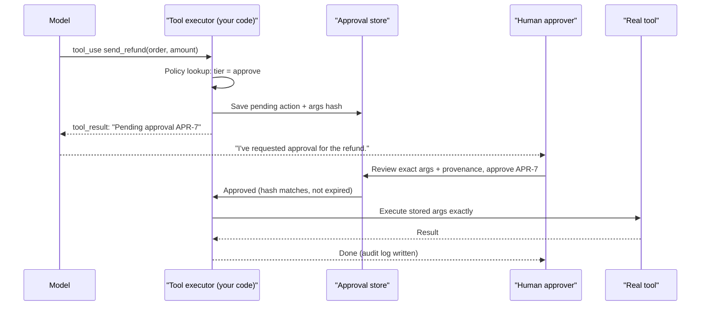

# Human Approval Gates

## Introduction

Some actions are too important to leave to a model alone: sending money, deleting data, emailing a customer, merging code, changing permissions. A **human approval gate** pauses the agent before such an action, shows a person exactly what is about to happen, and continues only if that person says yes.

The general human-in-the-loop pattern, including when to ask for clarification or review, is covered in [Human-in-the-Loop](../6-agents-planning-and-reasoning/9-agents-human-in-the-loop.mdx). This page looks at approval gates **as a security control**, which raises different questions:

- Who decides that an action needs approval: the model or your code?
- What exactly is the human approving, and can it change after they click "approve"?
- Can an attacker manipulate the human into approving, through the agent?
- How do you keep approvals meaningful when there are hundreds a day?

Think of the two-person rule used for bank wire transfers. One person prepares the transfer, a second person checks the exact amount and recipient, and the bank's system makes sure the transfer that goes out is the one that was checked. An approval gate for an agent should have the same three properties: a clear proposal, an informed reviewer, and a guarantee that what runs is what was approved.

## Risk Tiers: What Needs a Gate?

Gate too little and the agent can do damage. Gate too much and people start clicking "approve" without reading, which is just as bad. Classify actions by impact and reversibility.

| Tier | Policy | Examples |
|------|--------|----------|
| Auto | Run immediately, log | Read own data, search docs, draft text |
| Notify | Run immediately, tell the user afterwards, allow undo | Create a ticket, add a calendar hold, label an email |
| Approve | Pause until a human approves the exact action | Send an external email, issue a refund, merge a PR, run a migration |
| Forbidden | Never available to the agent | Change user roles, delete accounts, disable audit logs |

Two factors often move an action **up** a tier:

- **Untrusted content in context.** If the session has read web pages, inbound emails, or other third-party content, an action that is normally "notify" may become "approve". This is the taint-tracking idea from [Prompt Injection](./1-agents-prompt-injection.mdx) and Meta's Agents Rule of Two: when a session has untrusted input, sensitive data, and the ability to act externally, it should not act without supervision.
- **Size and scope.** A refund under a small threshold might be "notify", above it "approve". A file edit in a feature branch might be "auto", the same edit on `main` "approve".

## The Gate Must Live in Your Code

The most important rule: **the decision to require approval is made by your tool-execution layer, not by the model.** A system prompt that says "always ask the user before sending emails" is a request the model will usually follow, until a prompt injection or a misunderstanding makes it skip the question. If the gate is in code, the model cannot skip it, no matter what it has been told.



Notice that the model never calls the real tool directly. It proposes; your executor decides; the human approves a **stored** action; the executor runs exactly that stored action.

## Building an Approval Gate

The following code implements the core of a secure gate:

- A policy table maps each tool to a tier, with an escalation rule for tainted sessions.
- Pending actions are stored with a **hash of the exact arguments**, so the action that runs is byte-for-byte the one that was approved.
- Approvals **expire**, and each can be used **only once**.
- Every decision is written to an audit log.

```python
import hashlib
import json
import time
import uuid
from dataclasses import dataclass, field

POLICY = {
    "search_orders": "auto",
    "create_ticket": "notify",
    "send_customer_email": "approve",
    "issue_refund": "approve",
}
APPROVAL_TTL_SECONDS = 15 * 60
AUDIT_LOG: list[dict] = []


def args_hash(tool: str, args: dict) -> str:
    canonical = json.dumps({"tool": tool, "args": args}, sort_keys=True, separators=(",", ":"))
    return hashlib.sha256(canonical.encode()).hexdigest()


@dataclass
class PendingAction:
    id: str
    tool: str
    args: dict
    digest: str
    requested_by: str
    provenance: list[str]
    created_at: float
    status: str = "pending"  # pending | approved | rejected | executed | expired
    decided_by: str | None = None


@dataclass
class ApprovalStore:
    items: dict[str, PendingAction] = field(default_factory=dict)

    def create(self, tool: str, args: dict, user: str, provenance: list[str]) -> PendingAction:
        action = PendingAction(
            id=f"APR-{uuid.uuid4().hex[:6]}", tool=tool, args=json.loads(json.dumps(args)),
            digest=args_hash(tool, args), requested_by=user, provenance=provenance,
            created_at=time.time(),
        )
        self.items[action.id] = action
        return action


def audit(event: str, **details) -> None:
    AUDIT_LOG.append({"ts": round(time.time()), "event": event, **details})


def effective_tier(tool: str, session_tainted: bool) -> str:
    tier = POLICY.get(tool, "forbidden")
    if session_tainted and tier == "notify":
        return "approve"
    return tier
```

Next, the executor that the agent loop calls for every tool use. For gated tools it does **not** run anything. It stores the request and returns a `tool_result` that tells the model what happened, so the model can inform the user.

```python
def run_tool(tool: str, args: dict) -> str:
    # Stand-in for the real implementations
    return f"{tool} executed with {args}"


def execute_tool_use(store: ApprovalStore, tool_use_id: str, tool: str, args: dict,
                     user: str, provenance: list[str]) -> dict:
    tier = effective_tier(tool, session_tainted=bool(provenance))
    if tier == "forbidden":
        audit("denied", tool=tool, user=user)
        return {"type": "tool_result", "tool_use_id": tool_use_id, "is_error": True,
                "content": f"The tool {tool} is not available."}
    if tier == "approve":
        action = store.create(tool, args, user, provenance)
        audit("approval_requested", id=action.id, tool=tool, user=user)
        return {"type": "tool_result", "tool_use_id": tool_use_id,
                "content": (f"Action {action.id} is waiting for human approval and has NOT run yet. "
                            "Tell the user it needs approval. Do not retry it.")}
    result = run_tool(tool, args)
    audit("executed", tool=tool, user=user, tier=tier)
    return {"type": "tool_result", "tool_use_id": tool_use_id, "content": result}
```

Finally, the approval path, which runs in a separate request when a human clicks the button. It re-checks everything instead of trusting that nothing changed.

```python
class ApprovalError(Exception):
    pass


def approve_and_execute(store: ApprovalStore, action_id: str, approver: str,
                        shown_digest: str) -> str:
    action = store.items.get(action_id)
    if action is None:
        raise ApprovalError("unknown approval id")
    if action.status != "pending":
        raise ApprovalError(f"action is already {action.status}")
    if time.time() - action.created_at > APPROVAL_TTL_SECONDS:
        action.status = "expired"
        raise ApprovalError("approval request expired; ask the agent to propose it again")
    if approver == action.requested_by and action.tool == "issue_refund":
        raise ApprovalError("refunds need a second person")
    if shown_digest != action.digest or args_hash(action.tool, action.args) != action.digest:
        raise ApprovalError("arguments changed since they were shown to the approver")
    action.status, action.decided_by = "approved", approver
    result = run_tool(action.tool, action.args)
    action.status = "executed"
    audit("approved_and_executed", id=action.id, approver=approver, digest=action.digest[:12])
    return result


store = ApprovalStore()
r = execute_tool_use(store, "toolu_1", "issue_refund", {"order_id": "A-1001", "amount_eur": 49.0},
                     user="agent:u-17", provenance=["inbound_email:msg-881"])
print(r["content"])

pending = next(iter(store.items.values()))
print(approve_and_execute(store, pending.id, approver="lead:u-3", shown_digest=pending.digest))
try:
    approve_and_execute(store, pending.id, approver="lead:u-3", shown_digest=pending.digest)
except ApprovalError as e:
    print("Second use blocked:", e)
print([entry["event"] for entry in AUDIT_LOG])
```

Example output (the ID is random):

```text
Action APR-3f9c1a is waiting for human approval and has NOT run yet. Tell the user it needs approval. Do not retry it.
issue_refund executed with {'order_id': 'A-1001', 'amount_eur': 49.0}
Second use blocked: action is already executed
['approval_requested', 'approved_and_executed']
```

Some design choices worth noting:

- **`shown_digest`** is the hash your approval UI received when it rendered the request. If anything changed between display and click, the approval fails. This stops "approve one thing, execute another" bugs and attacks.
- **Single use**: the status check prevents replaying an approval to run the action twice. Many APIs also accept an idempotency key; pass the approval ID as that key for extra safety.
- **Separation of duties**: for the riskiest actions, the person who triggered the agent cannot approve their own request.
- **The agent loop continues** after a pending result. The model tells the user that approval is needed. When approval arrives later, you can resume the conversation with a new user turn reporting the outcome, which works well for [background agents](../10-agents-integration/3-agents-background-jobs.mdx).

### Resuming the conversation after a decision

Approvals often arrive minutes or hours later. You do not keep the agent loop waiting. Save the conversation, and when the human decides, add a new user turn that reports the outcome from your trusted store, then call the model again:

```python
def resume_after_decision(messages: list[dict], action: PendingAction) -> list[dict]:
    """Append a trusted status update so the agent can finish the task."""
    if action.status == "executed":
        note = f"System update: action {action.id} ({action.tool}) was approved by a human and has completed."
    elif action.status == "rejected":
        note = f"System update: action {action.id} ({action.tool}) was rejected. Do not attempt it again."
    else:
        note = f"System update: action {action.id} is {action.status}."
    return messages + [{"role": "user", "content": note}]
```

The status text comes from your approval store, not from the model, so the agent cannot be told by injected content that something was approved when it was not.

## What the Approver Should See

An approval is only as good as the information behind it. Show the approver:

1. **The exact action and raw arguments**, rendered by your code from the stored data. Not the model's summary of them.
2. **Provenance**: which user started the session, and which untrusted sources were in context (for example "read inbound email msg-881 from an unknown sender").
3. **The effect in plain terms**, computed by your code: "Refund 49.00 EUR to the card ending 4242 for order A-1001 (order total 49.00 EUR)."
4. **What is unusual**, flagged by rules: new recipient, amount above the usual, first time this tool has run today.

```python
def render_approval_card(action: PendingAction) -> str:
    lines = [
        f"Approval {action.id}  (expires in {APPROVAL_TTL_SECONDS // 60} min)",
        f"Requested by: {action.requested_by}",
        f"Action:       {action.tool}",
        "Arguments (exact):",
    ]
    lines += [f"  {k} = {json.dumps(v)}" for k, v in sorted(action.args.items())]
    if action.provenance:
        lines.append("WARNING: untrusted content was in context:")
        lines += [f"  - {p}" for p in action.provenance]
    lines.append(f"Fingerprint: {action.digest[:12]}")
    return "\n".join(lines)


demo = ApprovalStore().create("send_customer_email",
                              {"to": "maria@example.com", "subject": "Your refund",
                               "body": "Hi Maria, your refund of 49.00 EUR is on its way."},
                              user="agent:u-17", provenance=["inbound_email:msg-881"])
print(render_approval_card(demo))
```

Example output:

```text
Approval APR-b71e02  (expires in 15 min)
Requested by: agent:u-17
Action:       send_customer_email
Arguments (exact):
  body = "Hi Maria, your refund of 49.00 EUR is on its way."
  subject = "Your refund"
  to = "maria@example.com"
WARNING: untrusted content was in context:
  - inbound_email:msg-881
Fingerprint: 4e0a91c7d2b3
```

### Why not show the model's explanation?

OWASP's agentic list includes **ASI09 Human Agent Trust Exploitation**: an agent (possibly steered by an attacker) persuading a human to approve something harmful. If the approval screen shows "The customer asked for their order history to be sent to their new address, this is routine", the human is approving the model's **story**, which an attacker may have written. Show the raw facts first. If you include the model's rationale at all, label it clearly as the agent's explanation and place it below the facts.

## Approval Fatigue

The biggest practical threat to approval gates is not a clever attacker. It is a tired human clicking "approve" on the 200th request of the day. Ways to keep approvals meaningful:

- **Gate fewer things.** Move low-risk actions to "notify with undo". Narrow the tools so that fewer actions are risky in the first place, as in [Least Privilege](./2-agents-least-privilege.mdx).
- **Use [sandboxes](./3-agents-sandboxing.mdx) to make actions safe instead of approved.** Anthropic reported that sandboxing in Claude Code cut permission prompts by 84% in its internal use, because commands confined to the sandbox no longer needed approval.
- **Batch related actions** into one reviewable plan ("send these 12 replies") with per-item opt-out.
- **Use rules to pre-approve narrow patterns**, such as "emails to the original sender with no attachments", and keep humans for the rest.
- **Highlight anomalies** so reviewers know where to look.
- **Measure approval rates and review time.** If 99.9% of requests are approved in under two seconds, the gate is not doing much. Either the action is safe enough to automate, or reviewers need better information.

## Real-World Scenario

Your finance team uses an accounts-payable agent. It reads vendor invoices that arrive by email, matches them to purchase orders, and prepares payments. Payments are made through your bank's API.

**The risk:** invoice emails come from outside. A fraudster can send a convincing invoice, or an email that says "our bank details have changed, please update the vendor record". This is classic business email compromise, now aimed at an agent.

**The gates you design:**

1. **Forbidden for the agent:** changing vendor bank details. That workflow stays human-only, with out-of-band verification (a phone call to a known number).
2. **Approve:** every payment, with the approval card showing vendor, amount, the bank account **from the vendor master record** (not from the email), matching purchase order, and the source email ID marked as untrusted.
3. **Two-person rule** above a threshold: a second approver from a different team.
4. **Anomaly flags:** first payment to this vendor, amount differs from the PO, invoice sender domain differs from the vendor's known domain.
5. **Binding and expiry:** approvals are bound to the argument hash and expire after one business day. The payment call uses the approval ID as its idempotency key.
6. **Audit:** every proposal, approval, rejection, and execution is logged with both the agent identity and the human identity.

**Why this approach.** The agent saves time on the tedious work (reading invoices, matching POs, preparing payments), while the irreversible step (money leaving) is controlled by humans who see facts from trusted systems. An injected email can make the agent propose a bad payment, but it cannot change where money goes or bypass the reviewer.

**When to use it / when not to.** Use code-enforced gates for irreversible, financial, external, or permission-changing actions. Do not gate actions that are easily undone or confined to a sandbox; there, notifications, undo, and monitoring give better safety per minute of human attention.

**Alternatives and trade-offs:**

| Approach | Pros | Cons | Best for |
|----------|------|------|----------|
| Prompt asks model to confirm with user | Trivial to build | Not enforced; injection can skip it | Low-risk UX nicety only |
| Code-enforced gate per action | Reliable, auditable | Human time; fatigue at volume | Irreversible or external actions |
| Gate bound to argument hash with expiry | Prevents swap and replay | More engineering | Payments, deletions, permission changes |
| Plan-level approval (approve a batch) | Fewer interruptions | Reviewers may skim long plans | Bulk operations with similar items |
| Notify plus undo window | Fast, low friction | Harm may occur before undo | Reversible actions |
| Policy rules auto-approve narrow cases | Scales well | Rules need maintenance and review | High-volume, well-understood actions |

## Common Mistakes

- **Approval in the prompt, not in code.** If the model can skip it, it is not a gate.
- **Approving the summary instead of the action.** Render the stored arguments from data, and keep the model's explanation secondary.
- **Re-generating the action after approval.** If the model "redoes" the call after the human approves, the executed arguments can differ. Execute the stored action.
- **Approvals that never expire or can be reused.** Bind to a hash, expire them, and mark them used.
- **Letting the model see or set approval status.** Approval state lives in your store and is changed only by authenticated humans through your UI or API.
- **Gating everything.** Fatigue turns approvals into a rubber stamp.
- **No audit trail** linking the agent's proposal, the content that triggered it, and the human decision.

## Summary

- Approval gates are a security control for high-impact actions, enforced in the tool-execution layer.
- Classify tools into auto, notify, approve, and forbidden tiers, and escalate when untrusted content is in context.
- Store the pending action, bind approval to a hash of the exact arguments, expire it, allow one use, and execute the stored action.
- Show approvers raw arguments, provenance, and computed effects. Treat the model's explanation as untrusted (ASI09).
- Fight approval fatigue by gating less, sandboxing more, batching, and measuring.
- Log every step for audit and incident response.

## Exercises

1. Extend `effective_tier()` so that `issue_refund` is "notify" below 20 EUR when the session is not tainted, and "approve" otherwise. Write tests for all four combinations.
2. Add a `reject()` function that records a reason and returns a message the agent can relay to the user. Should the model be allowed to propose the same action again immediately?
3. Modify `approve_and_execute()` to pass the approval ID as an idempotency key to `run_tool()`, and simulate a network retry to show the payment is not duplicated.
4. Design the approval card for a "merge pull request" action by a coding agent. Which facts should come from GitHub's API rather than from the agent?

**Related pages**

- [Human-in-the-Loop](../6-agents-planning-and-reasoning/9-agents-human-in-the-loop.mdx)
- [Least Privilege for Agent Tools](./2-agents-least-privilege.mdx)
- [Prompt Injection](./1-agents-prompt-injection.mdx)
- [Running Agents as Background Jobs](../10-agents-integration/3-agents-background-jobs.mdx)
- [Project: Email and Calendar Assistant](../14-agents-projects/6-agents-project-personal-assistant.mdx)
