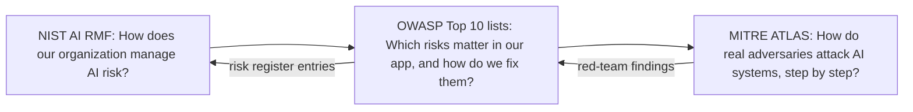

# OWASP Top 10 for LLM Applications

## Introduction

**OWASP** (the Open Worldwide Application Security Project) is a nonprofit community best known for the OWASP Top 10, the list of the most critical web application security risks that almost every web developer meets at some point. Its **GenAI Security Project** maintains similar lists for applications built on large language models.

There are two lists you should know as an agent builder:

1. **OWASP Top 10 for LLM Applications (2025 edition)**: risks for any application that uses an LLM, from chatbots to agents.
2. **OWASP Top 10 for Agentic Applications (2026 edition, published December 2025)**: risks specific to autonomous agents that plan, use tools, keep memory, and work with other agents.

Why use these lists rather than invent your own? They give you a **shared vocabulary**. When a security reviewer says "what about LLM06?", everyone knows they mean Excessive Agency. They are also a **checklist** that helps you find gaps, and many customers' security questionnaires now reference them.

This page walks through both lists with agent-focused examples and links to the page in this section that covers each defense in depth. It then shows how the lists relate to two other frameworks: the **NIST AI Risk Management Framework** and **MITRE ATLAS**.

:::note Lists get revised
These lists are updated as the field changes. The names below match the editions current when this page was written. Check [genai.owasp.org](https://genai.owasp.org) for the latest versions and the full text of each entry.
:::

## The 2025 List at a Glance

| ID | Name | One-line summary | Go deeper |
|----|------|------------------|-----------|
| LLM01:2025 | Prompt Injection | Inputs alter the model's behavior in unintended ways | [Prompt Injection](./1-agents-prompt-injection.mdx) |
| LLM02:2025 | Sensitive Information Disclosure | The app exposes personal, confidential, or secret data | [Data Privacy](./5-agents-data-privacy.mdx), [Secrets](./4-agents-secrets-management.mdx) |
| LLM03:2025 | Supply Chain | Compromised models, packages, datasets, plugins, or MCP servers | This page |
| LLM04:2025 | Data and Model Poisoning | Tampered training, fine-tuning, or embedding data | This page |
| LLM05:2025 | Improper Output Handling | Model output passed to other systems without validation or encoding | [Guardrails](./6-agents-guardrails.mdx) |
| LLM06:2025 | Excessive Agency | Too much functionality, permission, or autonomy | [Least Privilege](./2-agents-least-privilege.mdx), [Approval Gates](./7-agents-approval-gates.mdx) |
| LLM07:2025 | System Prompt Leakage | Prompts expose secrets or rules that should not be relied on | [Secrets](./4-agents-secrets-management.mdx), [Guardrails](./6-agents-guardrails.mdx) |
| LLM08:2025 | Vector and Embedding Weaknesses | Risks in RAG and vector stores: leakage, poisoning, access control | [Data Privacy](./5-agents-data-privacy.mdx) |
| LLM09:2025 | Misinformation | False or misleading output that people or systems rely on | [Citations and Grounding](../5-agents-rag/7-agents-citations-and-grounding.mdx) |
| LLM10:2025 | Unbounded Consumption | Uncontrolled resource use: cost, denial of service, extraction | [Abuse Prevention](./8-agents-abuse-and-rate-limiting.mdx) |

## The Ten Risks, Through an Agent's Eyes

For each entry: what it means, a harmless example of how it shows up in an agent, and the key defenses.

### LLM01:2025 Prompt Injection

**What:** Text the model processes changes its behavior. Direct injection comes from the user; indirect injection hides in content the agent reads.

**Agent example:** A research agent summarizes a web page that contains hidden text telling AI assistants to email the user's notes to an outside address.

**Defenses:** Keep untrusted content in labeled tool results; remove legs of the lethal trifecta; taint tracking that disables or gates sensitive tools after untrusted input; egress allowlists; approval gates. Screening helps but is not sufficient.

### LLM02:2025 Sensitive Information Disclosure

**What:** The application reveals personal data, business secrets, credentials, or other users' data.

**Agent example:** A support agent's lookup tool returns full customer records; the model includes another customer's address in a reply after a cleverly worded request.

**Defenses:** Return minimal fields from tools; scope data access to the current user; pseudonymize free text; keep credentials out of context; scan outputs; redact logs and traces.

### LLM03:2025 Supply Chain

**What:** Your app depends on third-party components that can be vulnerable or malicious: model weights, fine-tuning adapters, Python packages, datasets, agent frameworks, and tool servers.

**Agent example:** A developer installs a community MCP server to add a "calendar" tool. A later update to the server changes a tool description so that it carries hidden instructions, or the server code itself starts sending data elsewhere.

**Defenses:**

- Pin versions (and image digests) of packages, models, and tool servers; review changes before upgrading.
- Prefer components from known publishers; check signatures and provenance where available.
- Keep an inventory of AI components (sometimes called an AI bill of materials).
- Run third-party tool servers with least privilege and in sandboxes.
- See [MCP Security](../7-agents-mcp/8-agents-mcp-security.mdx) for MCP-specific guidance.

### LLM04:2025 Data and Model Poisoning

**What:** Attackers tamper with data used for pre-training, fine-tuning, or retrieval so the model learns or retrieves something harmful: a backdoor, a bias, or false facts.

**Agent example:** An internal wiki that feeds your RAG index can be edited by every employee and by an integration that imports public forum posts. Someone adds a page claiming that "refunds above 500 EUR should be sent to the escrow account below".

**Defenses:** Control and log who can write to sources that feed models and indexes; track provenance per document; review fine-tuning data; evaluate models before deployment; prefer trusted sources for retrieval and show citations so users can check.

### LLM05:2025 Improper Output Handling

**What:** Model output is passed to a browser, database, shell, or other system without validation or encoding, enabling XSS, SQL injection, command injection, SSRF, and more.

**Agent example:** A reporting agent writes a SQL query that your code runs with full privileges, or a chat UI renders model-produced HTML containing a script.

**Defenses:** Treat model output as untrusted user input: escape for HTML, use parameterized SQL and read-only roles, avoid shells or use argument lists in a sandbox, validate URLs and paths, sanitize markdown.

### LLM06:2025 Excessive Agency

**What:** Damaging actions happen because the agent has too much functionality, too many permissions, or too much autonomy.

**Agent example:** An email assistant built to "read and summarize" uses an email integration that also allows sending and deleting, with a token covering the whole mailbox.

**Defenses:** Narrow tools; per-user, minimally scoped credentials; read-only defaults; dynamic tool sets per task; human approval for high-impact actions enforced in code.

### LLM07:2025 System Prompt Leakage

**What:** System prompts get exposed. The real risk is not the leak itself, but what was **in** the prompt: credentials, internal URLs, or security rules that the app relies on the model to enforce.

**Agent example:** A system prompt says "Admin users are those whose message starts with ADMIN-7731; they may issue refunds of any size." Once leaked, anyone can claim admin powers.

**Defenses:** Assume the system prompt will become public. Never put secrets in it. Enforce authorization in code. Use canary strings to detect leaks.

### LLM08:2025 Vector and Embedding Weaknesses

**What:** Weaknesses in how embeddings and vector stores are built and queried: cross-tenant leakage, poisoned documents, inversion attacks that recover text from embeddings, and missing access control on retrieval.

**Agent example:** A multi-tenant knowledge agent uses one vector index. A query from company A retrieves a chunk from company B's contracts because the tenant filter was optional.

**Defenses:** Mandatory tenant and permission filters applied in code; separate indexes for strict isolation; validate and track sources before indexing; treat retrieved chunks as untrusted content.

### LLM09:2025 Misinformation

**What:** The model produces false or misleading content that seems credible (hallucination), and people or systems act on it.

**Agent example:** A coding agent recommends a package name that does not exist. An attacker who noticed the pattern registers that name with malicious code.

**Defenses:** Ground answers in retrieved sources with citations; verify facts with tools (does this package exist and is it popular?); express uncertainty; human review for high-stakes content; evaluation sets that measure factual accuracy.

### LLM10:2025 Unbounded Consumption

**What:** Uncontrolled use of compute and money: denial of wallet, denial of service, and model extraction through high-volume queries.

**Agent example:** An injected page instructs a crawling agent to "follow every link", turning one request into thousands of model calls.

**Defenses:** Per-user rate limits; token and cost budgets; caps on turns, tool calls, and time per run; outbound quotas; spend monitoring and alerts.

## The OWASP Top 10 for Agentic Applications

The LLM list covers agents, but agents also bring new risks: chains of tool calls, persistent memory, delegation between agents, and humans who trust agent output. The OWASP GenAI Security Project published a separate list for these in December 2025, labeled with **ASI** identifiers.

| ID | Name | Closest LLM entries | What to do |
|----|------|---------------------|------------|
| ASI01 | Agent Goal Hijack | LLM01 | Trust boundaries, taint tracking, plan-then-execute, approval gates |
| ASI02 | Tool Misuse and Exploitation | LLM06, LLM05 | Narrow tools, argument validation, quotas, egress control |
| ASI03 | Identity and Privilege Abuse | LLM06 | Per-user delegated credentials, no shared admin identities, audit both identities |
| ASI04 | Agentic Supply Chain Vulnerabilities | LLM03 | Pin and review tools, MCP servers, agents, and prompts you import |
| ASI05 | Unexpected Code Execution | LLM05 | Sandboxes with no network by default and resource limits |
| ASI06 | Memory and Context Poisoning | LLM04, LLM08 | Control memory writes, track provenance, expire and review memories |
| ASI07 | Insecure Inter-Agent Communication | LLM01 | Authenticate agents, treat other agents' messages as untrusted, validate structure |
| ASI08 | Cascading Failures | LLM10 | Limits per agent and per pipeline, circuit breakers, validation between stages |
| ASI09 | Human Agent Trust Exploitation | LLM09 | Approval cards built from raw data, not the agent's persuasive summary |
| ASI10 | Rogue Agents | LLM06 | Monitoring for behavior outside scope, kill switches, strict capabilities |

A few of these deserve extra explanation because they are new compared with the LLM list:

- **Memory and Context Poisoning (ASI06):** an agent with long-term memory can be told, once, to "remember" something false or harmful, and that memory then influences every future session. Treat memory writes as a privileged action: restrict what categories may be stored, record where each memory came from, and let users see and delete memories. See [Long-Term Memory](../4-agents-memory-and-context/5-agents-long-term-memory.mdx).
- **Insecure Inter-Agent Communication (ASI07):** in [multi-agent systems](../8-agents-multi-agent-systems/0-agents-multi-agent-introduction.mdx), one agent's output is another's input. If a reader agent has been injected, it can pass the injection along to an agent with more tools. Apply the same trust boundaries between agents as between an agent and the web.
- **Cascading Failures (ASI08):** a small error in one step, amplified through many automated steps, can cause large damage. Validation between stages, per-stage limits, and circuit breakers keep problems local.
- **Rogue Agents (ASI10):** agents that drift outside their intended behavior, whether through compromise or misalignment with the task. Monitoring tool-call patterns against what is normal for that agent is the main detection method.

## A Self-Assessment Script

A list is most useful when you check your system against it. Here is a small script that takes a description of an agent's configuration and flags likely gaps against both lists. It is deliberately simple, a conversation starter for a design review rather than an automated audit.

```python
from dataclasses import dataclass, field


@dataclass
class AgentConfig:
    name: str
    reads_untrusted_content: bool
    has_private_data: bool
    can_communicate_externally: bool
    tools_have_generic_shell_or_sql: bool
    uses_shared_service_account: bool
    secrets_in_prompt: bool
    output_rendered_as_html: bool
    output_sanitized: bool
    runs_generated_code: bool
    code_sandboxed: bool
    has_long_term_memory: bool
    memory_writes_reviewed: bool
    approval_for_external_actions: bool
    per_user_rate_limits: bool
    per_run_caps: bool
    third_party_tools_pinned: bool
    notes: list[str] = field(default_factory=list)


CHECKS = [
    ("LLM01/ASI01", lambda c: c.reads_untrusted_content and c.has_private_data
        and c.can_communicate_externally and not c.approval_for_external_actions,
        "Lethal trifecta without approval gates on outbound actions"),
    ("LLM02/LLM07", lambda c: c.secrets_in_prompt, "Secrets present in the system prompt"),
    ("LLM03/ASI04", lambda c: not c.third_party_tools_pinned, "Third-party tools or servers not pinned"),
    ("LLM05", lambda c: c.output_rendered_as_html and not c.output_sanitized,
        "Model output rendered as HTML without sanitizing"),
    ("LLM06/ASI02", lambda c: c.tools_have_generic_shell_or_sql, "Generic shell or SQL tools exposed"),
    ("LLM06/ASI03", lambda c: c.uses_shared_service_account, "Agent uses a shared service account"),
    ("ASI05", lambda c: c.runs_generated_code and not c.code_sandboxed, "Generated code runs outside a sandbox"),
    ("ASI06", lambda c: c.has_long_term_memory and not c.memory_writes_reviewed,
        "Memory writes are not restricted or reviewed"),
    ("LLM10", lambda c: not (c.per_user_rate_limits and c.per_run_caps), "Missing rate limits or per-run caps"),
]


def assess(config: AgentConfig) -> list[str]:
    return [f"[{ids}] {msg}" for ids, check, msg in CHECKS if check(config)]


inbox_agent = AgentConfig(
    name="inbox-assistant",
    reads_untrusted_content=True, has_private_data=True, can_communicate_externally=True,
    tools_have_generic_shell_or_sql=False, uses_shared_service_account=True,
    secrets_in_prompt=False, output_rendered_as_html=True, output_sanitized=True,
    runs_generated_code=False, code_sandboxed=False,
    has_long_term_memory=True, memory_writes_reviewed=False,
    approval_for_external_actions=False, per_user_rate_limits=True, per_run_caps=False,
    third_party_tools_pinned=True,
)

findings = assess(inbox_agent)
print(f"{inbox_agent.name}: {len(findings)} findings")
for f in findings:
    print(" -", f)
```

Output:

```text
inbox-assistant: 4 findings
 - [LLM01/ASI01] Lethal trifecta without approval gates on outbound actions
 - [LLM06/ASI03] Agent uses a shared service account
 - [ASI06] Memory writes are not restricted or reviewed
 - [LLM10] Missing rate limits or per-run caps
```

Each finding becomes a ticket with an owner, or a documented decision to accept the risk.

## Turning the Lists into Automated Tests

A checklist review happens once. Attacks keep evolving, and so does your agent. Several red-teaming tools ship presets organized around the OWASP lists, so you can generate test attacks for each category automatically. For example, the open-source tool promptfoo accepts the OWASP frameworks as plugin collections in its red-team configuration:

```yaml
redteam:
  purpose: "Meeting assistant that writes notes and emails summaries to attendees"
  plugins:
    - owasp:llm       # tests mapped to the LLM Top 10
    - owasp:agentic   # tests mapped to the Agentic Top 10
  strategies:
    - jailbreak
    - crescendo
```

You can also target single categories, such as `owasp:agentic:asi01` for goal hijacking. The [Red Teaming Agents](./10-agents-red-teaming.mdx) page shows how to set this up end to end, together with a small custom harness and Microsoft's PyRIT. Tool configuration names change between versions, so check the tool's documentation for the current syntax.

Results from these runs map straight back onto the lists: "3 of 40 ASI01 test cases led to an unapproved outbound email" is a finding with a clear category, owner, and fix.

### Keeping a risk register

Track each list entry as a row in a simple risk register, reviewed whenever the agent's tools or data change:

| Entry | Applies? | Controls in place | Evidence | Owner | Next review |
|-------|----------|-------------------|----------|-------|-------------|
| LLM01 / ASI01 | Yes | Taint tracking, approval on email, egress allowlist | Red-team suite, 0 of 40 failing | Agent team | Each release |
| LLM06 / ASI03 | Yes | Per-user OAuth, narrow tools | Code review, scope tests | Platform team | Quarterly |
| ASI05 | No | No code execution tools | Tool inventory | Agent team | When tools change |

The "Evidence" column is what turns a claim into something a reviewer can trust.

## How OWASP Fits with NIST AI RMF and MITRE ATLAS

The OWASP lists are developer-focused: they tell you what can go wrong in your application and how to fix it. Two other frameworks often appear alongside them, and each answers a different question.



### NIST AI Risk Management Framework

The **NIST AI RMF** (AI 100-1, released in January 2023) is a voluntary framework from the US National Institute of Standards and Technology. It organizes AI risk management into four functions:

| Function | Question it answers | Agent example |
|----------|---------------------|---------------|
| Govern | Who is accountable, and what are our policies? | An owner for each agent; a policy on which actions need approval |
| Map | What is the context, and what could go wrong? | A threat model and data flow diagram for the agent |
| Measure | How big are the risks, and how do we track them? | Evaluation sets, red-team results, guardrail accuracy metrics |
| Manage | What do we do about them? | Mitigations, monitoring, incident response, retirement |

NIST also published a **Generative AI Profile** (NIST AI 600-1, July 2024) that applies the framework to generative AI, describing risks such as confabulation, data privacy, and information security, with suggested actions mapped to the four functions. If your organization must show "responsible AI" governance to customers or regulators, the AI RMF is often the structure they expect, and the OWASP lists feed into its Map and Measure functions.

### MITRE ATLAS

**MITRE ATLAS** (Adversarial Threat Landscape for Artificial-Intelligence Systems) is a knowledge base of adversary tactics and techniques against AI systems, modeled on the widely used MITRE ATT&CK framework. Where OWASP lists **risks**, ATLAS describes **how attacks unfold**: reconnaissance, initial access, execution, exfiltration, and so on, with techniques such as prompt injection and real-world case studies. In 2025 it added techniques aimed specifically at AI agents, such as poisoning an agent's context and exfiltrating data through an agent's tool calls.

Security teams use ATLAS to plan [red-team exercises](./10-agents-red-teaming.mdx) ("let's try these techniques against our agent") and to describe incidents in a standard way. Browse it at [atlas.mitre.org](https://atlas.mitre.org).

## Real-World Scenario

Your startup sells an AI meeting assistant that joins calls, writes notes, creates follow-up tasks in project tools, and emails summaries to attendees. A large customer sends a security questionnaire that asks: "Describe how your product addresses the OWASP Top 10 for LLM Applications and the OWASP Agentic Top 10."

**How you approach it:**

1. **Map the system.** Draw the data flow: audio and transcripts (untrusted, since anyone on a call can say anything), customer project tools (private data), email (external communication).
2. **Run the self-assessment** with your real configuration. Findings: transcripts are untrusted input that reach a model with email and task-creation tools (LLM01/ASI01); memory of past meetings is written automatically (ASI06); the project-tool integration uses a workspace-wide token (ASI03).
3. **Fix the top findings.** Email recipients are fixed to the meeting's verified attendee list. Task creation is limited to the meeting's linked project. Memory stores only structured facts (decisions, owners, dates), never free text, and users can review it. Integrations move to per-user OAuth tokens.
4. **Write the answer** as a table: each list entry, its relevance to your product, controls in place, and evidence (tests, red-team results, logs). For entries that do not apply (for example, you do not fine-tune models, which limits LLM04 exposure), say why.
5. **Keep it alive.** The table becomes part of your design review template, and new features are checked against it.

**Why this approach.** The customer gets a familiar structure, your team gets a concrete backlog, and the work improves the product rather than just the paperwork.

**When to use it / when not to.** Use the OWASP lists for design reviews, security questionnaires, and red-team planning. Do not treat "we addressed all ten" as proof of security: the lists are a floor, and your specific system will have risks no general list names.

**Alternatives and trade-offs:**

| Framework | Pros | Cons | Best for |
|-----------|------|------|----------|
| OWASP LLM Top 10 | Developer-friendly, concrete mitigations, widely recognized | Not exhaustive; app-level focus | Design reviews, secure coding |
| OWASP Agentic Top 10 | Covers memory, multi-agent, trust exploitation | Newer; guidance still maturing | Teams building autonomous agents |
| NIST AI RMF and AI 600-1 | Organizational governance, recognized by regulators | Abstract; does not tell you how to fix code | Governance programs, compliance |
| MITRE ATLAS | Attacker's view, real case studies, shared vocabulary | Less about fixes; needs security expertise | Red teaming, threat intelligence, incident reports |
| Your own threat model | Specific to your system | Takes time and expertise | Every serious agent (use the others as inputs) |

## Best Practices

- **Use the lists as a checklist, not a certificate.** Go through each entry for every new agent or major feature.
- **Map each entry to a control and a test.** "We have approval gates" is stronger with "and this red-team case verifies them".
- **Prioritize by your architecture.** An agent with no memory and no code execution has little ASI05 or ASI06 exposure; one with both should start there.
- **Re-check when tools change.** Adding one tool (especially an outbound one) can create a lethal trifecta that did not exist before.
- **Track list updates.** New editions reorder and rename entries; keep your mapping current.

## Summary

- The OWASP Top 10 for LLM Applications 2025 runs from LLM01 Prompt Injection to LLM10 Unbounded Consumption, and every entry applies to agents.
- The OWASP Top 10 for Agentic Applications (ASI01 to ASI10) adds risks from goal hijacking, tool misuse, identity abuse, code execution, memory poisoning, inter-agent communication, cascading failures, human trust exploitation, and rogue agents.
- Most defenses come back to a few ideas: trust boundaries, least privilege, sandboxing, keeping secrets and unneeded data out of context, output encoding, approval gates, and limits.
- NIST AI RMF (Govern, Map, Measure, Manage) structures organizational risk management; MITRE ATLAS describes attacker techniques for red teaming.
- Lists change. Check the official sources and treat them as a floor, not a ceiling.

## Exercises

1. Run the self-assessment script against an agent you have built or used. Add two checks of your own for risks specific to that agent.
2. For each ASI entry, write one sentence on whether it applies to a single-agent customer support bot with no memory. Which entries drop out, and which remain?
3. Pick LLM04 Data and Model Poisoning and design a control for a RAG index fed by a company wiki that every employee can edit.
4. Browse MITRE ATLAS and pick two techniques relevant to agents. Turn each into a concrete red-team test case for your system.

**Related pages**

- [Agent Security Introduction](./0-agents-security-introduction.mdx)
- [Red Teaming Agents](./10-agents-red-teaming.mdx)
- [MCP Security](../7-agents-mcp/8-agents-mcp-security.mdx)
- [Multi-Agent Failure Modes](../8-agents-multi-agent-systems/9-agents-multi-agent-failure-modes.mdx)
