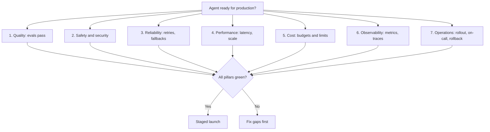
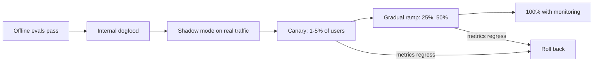

# Production Readiness Checklist

## Introduction

Getting an agent to work on your laptop takes an afternoon. Getting it to work for ten thousand users, every day, at a cost you can predict, takes much longer. Most of that extra time goes into things that never show up in a demo: limits, retries, dashboards, rollback plans, and the boring question "what happens when this breaks at 3 a.m.?"

A cooking analogy helps. Cooking dinner at home and running a restaurant kitchen use the same recipes. The restaurant also needs health inspections, stock control, a fire extinguisher, a way to handle a rush of orders, and a manager who knows what to do when the fridge fails. The food is the easy part. The **kitchen** is the hard part.

This page is the kitchen inspection for agents. It gives you a checklist you can run before launch, explains why each item matters, and points to the page in this section that goes deeper. The rest of the section covers each area in detail:

- [Deployment Architectures](./1-agents-deployment-architectures.mdx): where the agent runs
- [Scaling and Concurrency](./2-agents-scaling.mdx): how many runs at once, and rate limits
- [Latency Optimization](./3-agents-latency-optimization.mdx) and [Cost Optimization](./4-agents-cost-optimization.mdx)
- [Reliability and Fallbacks](./5-agents-reliability-and-fallbacks.mdx) and [Monitoring and Alerting](./6-agents-monitoring-and-alerting.mdx)
- [Versioning](./7-agents-versioning.mdx), [Model Migration](./8-agents-model-migration.mdx), [Incident Response](./9-agents-incident-response.mdx), and [AgentOps](./10-agents-agentops-best-practices.mdx)

## Why Agents Need Their Own Checklist

You may already have a production checklist for web services. It still applies. Agents add five properties that ordinary services do not have, and each one adds checklist items.

| Property | What it means in production | Checklist consequence |
|---|---|---|
| Non-deterministic | The same input can produce different steps and answers | You need evals and quality monitoring, not only unit tests |
| Pay per token | Every turn costs money, and loops multiply it | You need budgets, cost metrics, and spend alerts |
| Long-running | A single task can take seconds or many minutes | You need timeouts, checkpoints, and graceful shutdown |
| Acts on the world | Tools send emails, write rows, issue refunds | You need permissions, approval gates, and idempotency |
| Depends on an external model | A provider outage or rate limit is your outage | You need retries, fallbacks, and concurrency limits |

A normal API endpoint that returns the wrong answer is a bug. An agent that returns the wrong answer **and** calls `issue_refund` forty times is an incident. The checklist below is built around that difference.

## The Seven Pillars

Group readiness into seven areas. If any pillar is missing, the agent is not ready, however good the demo looks.



### Pillar 1: Quality

| Item | Why it matters |
|---|---|
| An eval set of real tasks (at least a few dozen) with pass criteria | Without it you cannot tell a regression from an improvement |
| A measured pass rate on the exact model, prompt, and tool versions you will ship | Changing any one of them changes behavior |
| Trajectory checks for risky tools (was the right tool called, with the right arguments?) | A correct final answer can hide a dangerous path |
| A regression suite that runs in CI on every prompt or tool change | Prompts are code and deserve the same gate |
| A defined "task success" signal you can measure in production | You will need it for cost per completed task and for alerts |

See [Agent Evaluation Introduction](../11-agents-evaluation-and-testing/0-agents-evaluation-introduction.mdx) and [Regression Testing for Agents](../11-agents-evaluation-and-testing/6-agents-regression-testing.mdx).

### Pillar 2: Safety and Security

| Item | Why it matters |
|---|---|
| Each tool has the least privilege it needs | A prompt-injected agent can only misuse what it can reach |
| High-impact tools (payments, deletes, external email) require human approval or hard limits | Mistakes at scale are expensive |
| Secrets come from a secret manager, never from the prompt or the image | Prompts and logs leak |
| PII handling is documented: what is sent to the model, what is logged, how long it is kept | Legal and customer trust |
| Untrusted content (web pages, emails, documents) is treated as data, not instructions | Prompt injection is the top agent risk |
| Code execution runs in a sandbox | Generated code is untrusted code |

See the [Safety and Security](../12-agents-safety-and-security/0-agents-security-introduction.mdx) section, especially [Least Privilege](../12-agents-safety-and-security/2-agents-least-privilege.mdx) and [Human Approval Gates](../12-agents-safety-and-security/7-agents-approval-gates.mdx).

### Pillar 3: Reliability

| Item | Why it matters |
|---|---|
| API calls have timeouts and bounded retries with backoff and jitter | 429, 500, and 529 responses happen in normal operation |
| Retries respect the `retry-after` header | Retrying early just fails again |
| Tools with side effects are idempotent (an idempotency key per action) | A retried step must not charge a card twice |
| The agent loop handles every `stop_reason`: `tool_use`, `end_turn`, `max_tokens`, `pause_turn`, `refusal` | Unhandled stop reasons cause silent failures or infinite loops |
| Long tasks checkpoint their state | A pod restart should resume work, not restart it |
| A fallback exists for each critical dependency (another model, a degraded answer, or a human) | Outages will happen |

### Pillar 4: Performance

| Item | Why it matters |
|---|---|
| You know your p50 and p95 latency per route | Users judge the slow tail, not the average |
| A concurrency limit protects you from your own rate limits | Unbounded fan-out turns a spike into a wall of 429s |
| You have estimated peak load against your provider rate limits (requests, input tokens, output tokens per minute) | Capacity planning |
| Interactive routes stream output | Perceived latency matters as much as real latency |

### Pillar 5: Cost

| Item | Why it matters |
|---|---|
| A per-task budget: maximum turns, maximum tokens, or both | A looping agent can burn money for hours |
| Cost per completed task is measured, not guessed | Per-token prices do not predict real cost |
| Prompt caching is on for stable prefixes, and cache hits are verified from `usage` | Usually the largest cost lever |
| Offline work uses a batch API | Batch processing is discounted |
| A spend limit is set at the provider and alerts fire before it is reached | The last line of defense |

### Pillar 6: Observability

| Item | Why it matters |
|---|---|
| Every run has a trace: each model call, tool call, tokens, latency | Debugging agents without traces is guesswork |
| Metrics for requests, errors, latency, tokens, cost, turns, and task success | Dashboards and alerts need numbers |
| Logs carry a run ID, the agent version, and the provider request ID | Correlation during incidents |
| Alerts route to a person who knows what to do | An alert nobody acts on is noise |

### Pillar 7: Operations

| Item | Why it matters |
|---|---|
| The release is a versioned bundle: prompt, tools, model, parameters | You must know exactly what is running |
| A staged rollout plan (internal, then a small percentage, then everyone) | Limits the blast radius |
| A tested rollback path that takes minutes, not hours | The fastest fix is usually "go back" |
| A kill switch that disables the agent or its riskiest tools | Stops damage while you investigate |
| An on-call owner and a short runbook | Someone must be responsible |

## Turning the Checklist into Code

Checklists on wiki pages get forgotten. A better approach is to encode the important limits in configuration and check them automatically. Start with a single configuration object that every run uses.

```python
from dataclasses import dataclass, field


@dataclass(frozen=True)
class AgentConfig:
    """Everything that defines one deployable version of the agent."""
    name: str
    version: str
    model: str
    effort: str = "medium"
    max_tokens: int = 16000
    max_turns: int = 15                  # hard stop for the agent loop
    max_task_tokens: int = 400_000       # total input + output per task
    request_timeout_s: float = 60.0
    max_retries: int = 3
    high_risk_tools: tuple = ("issue_refund", "delete_account")
    tools_requiring_approval: tuple = ("issue_refund", "delete_account")
    prompt_caching: bool = True
    eval_pass_rate: float | None = None  # filled in by CI
    owners: tuple = field(default_factory=tuple)


support_agent = AgentConfig(
    name="support-agent",
    version="2026.10.3",
    model="claude-sonnet-5-5",
    effort="medium",
    eval_pass_rate=0.93,
    owners=("team-support-eng",),
)
print(support_agent.name, support_agent.version, support_agent.model)
```

Output:

```text
support-agent 2026.10.3 claude-sonnet-5-5
```

Making the dataclass `frozen` is deliberate. A running agent should never change its own limits.

### A Pre-Launch Gate

Next, write a small script that fails the deployment pipeline if the configuration breaks the rules you agreed on. This is the same idea as a linter, applied to operational settings.

```python
from dataclasses import dataclass


@dataclass(frozen=True)
class AgentConfig:
    name: str
    version: str
    model: str
    max_turns: int
    max_task_tokens: int
    request_timeout_s: float
    max_retries: int
    high_risk_tools: tuple
    tools_requiring_approval: tuple
    prompt_caching: bool
    eval_pass_rate: float | None
    owners: tuple


def readiness_report(cfg: AgentConfig, min_pass_rate: float = 0.9) -> list[tuple[str, bool, str]]:
    checks = []

    def check(name: str, ok: bool, detail: str) -> None:
        checks.append((name, ok, detail))

    check("eval pass rate measured", cfg.eval_pass_rate is not None,
          f"pass_rate={cfg.eval_pass_rate}")
    check("eval pass rate meets bar",
          cfg.eval_pass_rate is not None and cfg.eval_pass_rate >= min_pass_rate,
          f"required >= {min_pass_rate}")
    check("loop has a turn limit", 0 < cfg.max_turns <= 50, f"max_turns={cfg.max_turns}")
    check("task has a token budget", cfg.max_task_tokens > 0,
          f"max_task_tokens={cfg.max_task_tokens}")
    check("requests time out", 0 < cfg.request_timeout_s <= 600,
          f"timeout={cfg.request_timeout_s}s")
    check("retries are bounded", 0 < cfg.max_retries <= 5, f"max_retries={cfg.max_retries}")
    unguarded = set(cfg.high_risk_tools) - set(cfg.tools_requiring_approval)
    check("high-risk tools are gated", not unguarded,
          f"unguarded={sorted(unguarded) or 'none'}")
    check("prompt caching enabled", cfg.prompt_caching, "")
    check("has an owner", len(cfg.owners) > 0, f"owners={list(cfg.owners)}")
    return checks


cfg = AgentConfig(
    name="support-agent", version="2026.10.3", model="claude-sonnet-5-5",
    max_turns=15, max_task_tokens=400_000, request_timeout_s=60, max_retries=3,
    high_risk_tools=("issue_refund", "delete_account"),
    tools_requiring_approval=("issue_refund",),
    prompt_caching=True, eval_pass_rate=0.93, owners=("team-support-eng",),
)

results = readiness_report(cfg)
for name, ok, detail in results:
    print(f"[{'PASS' if ok else 'FAIL'}] {name} {detail}")

failed = [r for r in results if not r[1]]
print(f"\n{len(results) - len(failed)}/{len(results)} checks passed")
if failed:
    print("Not ready for production.")
```

Output:

```text
[PASS] eval pass rate measured pass_rate=0.93
[PASS] eval pass rate meets bar required >= 0.9
[PASS] loop has a turn limit max_turns=15
[PASS] task has a token budget max_task_tokens=400000
[PASS] requests time out timeout=60s
[PASS] retries are bounded max_retries=3
[FAIL] high-risk tools are gated unguarded=['delete_account']
[PASS] prompt caching enabled 
[PASS] has an owner owners=['team-support-eng']

8/9 checks passed
Not ready for production.
```

The gate caught a real problem: `delete_account` is marked high risk but has no approval step. In CI you would end the script with `sys.exit(1)` when anything fails, so the deployment stops.

:::tip
Not every checklist item can be automated. "Has someone read the runbook?" is a human check. Keep those in a short pull request template and automate the rest.
:::

### Enforcing Limits Inside the Loop

Configuration only helps if the agent loop respects it. Here is the skeleton of a loop that enforces the turn limit and token budget and handles every stop reason. The model call is passed in as a function so you can test the loop without calling an API.

```python
from typing import Callable


class BudgetExceeded(Exception):
    pass


def run_agent(call_model: Callable, execute_tools: Callable, messages: list,
              max_turns: int, max_task_tokens: int) -> dict:
    tokens_used = 0
    for turn in range(1, max_turns + 1):
        response = call_model(messages)
        usage = response["usage"]
        tokens_used += (usage["input_tokens"] + usage.get("cache_read_input_tokens", 0)
                        + usage.get("cache_creation_input_tokens", 0) + usage["output_tokens"])
        if tokens_used > max_task_tokens:
            raise BudgetExceeded(f"used {tokens_used} tokens in {turn} turns")

        messages.append({"role": "assistant", "content": response["content"]})
        stop = response["stop_reason"]

        if stop == "tool_use":
            results = execute_tools(response["content"])   # all results, one user message
            messages.append({"role": "user", "content": results})
        elif stop == "pause_turn":
            continue                                     # server tool paused; send again
        elif stop == "end_turn":
            return {"status": "completed", "turns": turn, "tokens": tokens_used}
        elif stop == "refusal":
            return {"status": "refused", "turns": turn, "tokens": tokens_used}
        elif stop == "max_tokens":
            return {"status": "truncated", "turns": turn, "tokens": tokens_used}
        else:
            return {"status": f"unexpected:{stop}", "turns": turn, "tokens": tokens_used}
    return {"status": "turn_limit", "turns": max_turns, "tokens": tokens_used}


# A fake model that asks for one tool, then finishes.
script = iter([
    {"stop_reason": "tool_use", "content": [{"type": "tool_use", "id": "t1", "name": "lookup", "input": {}}],
     "usage": {"input_tokens": 1200, "output_tokens": 80}},
    {"stop_reason": "end_turn", "content": [{"type": "text", "text": "Done."}],
     "usage": {"input_tokens": 1350, "output_tokens": 40}},
])
fake_tools = lambda content: [{"type": "tool_result", "tool_use_id": "t1", "content": "ok"}]

print(run_agent(lambda m: next(script), fake_tools, [{"role": "user", "content": "hi"}],
                max_turns=10, max_task_tokens=50_000))
```

Output:

```text
{'status': 'completed', 'turns': 2, 'tokens': 2670}
```

Every outcome is a named status. That matters later: your dashboards will count `completed`, `refused`, `truncated`, and `turn_limit` separately, and an alert on a rising `turn_limit` rate catches looping agents early. The full loop is covered in [Building a Manual Agent Loop](../2-agents-tool-use/3-agents-manual-agent-loop.mdx), and budgets in [Stopping Conditions and Budgets](../6-agents-planning-and-reasoning/10-agents-stopping-conditions.mdx).

## The Launch Sequence

Readiness is not a single yes or no. Even when the checklist is green, you launch in stages so that problems surface while few users are affected.



- **Internal dogfood**: employees use the agent for real work. They find the confusing behavior that evals miss.
- **Shadow mode**: the agent runs on real inputs but its output is not shown or acted on. You compare it to what humans did. This is the safest way to measure quality on real traffic, but it costs money because every task runs twice.
- **Canary**: a small slice of real users gets the agent. Compare their success rate, escalation rate, and cost with the control group.
- **Ramp**: increase the share only while the metrics hold.

For each stage, write down **in advance** the numbers that would make you stop. For example: "roll back if task success drops more than 3 points, or p95 latency exceeds 20 seconds, or cost per completed task rises more than 25%". Deciding the thresholds before you see the data keeps the decision honest.

## Real-World Scenario

Your team runs a SaaS helpdesk product. You have built an agent that reads a customer ticket, looks up the account, searches the knowledge base, and either drafts a reply or issues a small credit (up to $20). The demo impressed leadership, who now want it "live next week" for all 4,000 customers.

You run the checklist and find these gaps:

1. **Quality**: the eval set has 15 hand-written tickets. You pull 60 real, anonymized tickets from last month, label the correct outcomes with the support lead, and get a pass rate of 88%. Most failures are tickets that should have been escalated.
2. **Safety**: `issue_credit` has no limit per customer per day. You add a hard limit in the tool itself (not just in the prompt) and require approval above $20.
3. **Reliability**: there is no idempotency key, so a retry after a timeout could issue a second credit. You add one, derived from the ticket ID and the action.
4. **Cost**: there is no turn limit. One test ticket looped 40 turns trying to find a missing invoice. You set `max_turns=15` and route the "turn limit hit" status to a human queue.
5. **Observability**: the logs record the final reply only. You add tracing for every model call and tool call, plus Prometheus metrics for task status, latency, tokens, and cost.
6. **Operations**: there is no kill switch. You add a feature flag that disables `issue_credit` without a deploy, and a second flag that turns the whole agent into "draft only" mode.

Then you launch in stages: one week of internal use by the support team, one week of shadow mode on all tickets, and a canary to 5% of customers with automatic rollback thresholds.

**Why this approach fits.** The agent touches money and customer communication, so the cost of a mistake at scale is high. The staged launch turns "will it work?" into a series of small, measurable questions. Each gap you closed maps to a specific failure you can now detect or prevent.

**When to use it, and when not to.** Use the full checklist for agents that act on real systems, serve external users, or spend significant money. For an internal prototype used by three engineers, a lighter version (turn limit, spend limit, basic logging) is enough. Do not let the checklist stop you from learning; let it stop you from *scaling* something you do not understand.

### Alternatives and Trade-offs

| Approach | Pros | Cons | Best for |
|---|---|---|---|
| Big-bang launch to all users | Fast, simple | Maximum blast radius, no comparison group | Low-risk internal tools |
| Internal dogfood only | Cheap, friendly testers | Employees are not typical users | Early validation |
| Shadow mode | Real inputs, zero user risk | Doubles model cost during the trial, needs a way to compare outputs | Agents that act on money or data |
| Canary with automatic rollback | Real impact measured on a small group | Needs good metrics and feature flags | Most customer-facing agents |
| Human-in-the-loop first (agent drafts, human sends) | Very safe, builds a labeled dataset | Less automation, slower | High-stakes domains, first launches |

## Common Mistakes

- **Treating the demo as the eval.** Five hand-picked examples prove the agent *can* work, not that it *usually* works.
- **Limits only in the prompt.** "Never refund more than $20" in the system prompt is a suggestion. Put hard limits in the tool code.
- **No definition of success.** If you cannot say whether a run succeeded, you cannot compute cost per task, set alerts, or compare versions.
- **Unbounded loops.** Every loop needs a maximum number of turns and a token budget.
- **Ignoring stop reasons.** Code that only checks for `tool_use` will misbehave on `max_tokens` or `refusal`.
- **Launching without a rollback.** If going back requires a code change and a full deploy, it is too slow.
- **No owner.** An agent without an on-call owner drifts until something breaks loudly.

## Summary

- Agents add non-determinism, per-token cost, long runs, real-world actions, and an external dependency on top of normal service concerns.
- Check seven pillars before launch: quality, safety, reliability, performance, cost, observability, and operations.
- Encode limits in a frozen configuration and check it automatically in CI.
- Enforce turn and token budgets inside the loop, and give every outcome a named status.
- Launch in stages (dogfood, shadow, canary, ramp) with rollback thresholds decided in advance.

## Exercises

1. Take an agent you have built (or the toy loop above) and fill in every row of the seven pillar tables. Mark each item as done, missing, or not applicable, and write one sentence explaining each "not applicable".
2. Extend `readiness_report` with two new checks: "model ID is not a retired model" (keep a small list of retired IDs) and "effort is one of the allowed values". Make the script exit with a non-zero code when anything fails.
3. Write the rollback thresholds for a canary of your agent: which metrics, which values, and who decides.
4. Read [Monitoring and Alerting](./6-agents-monitoring-and-alerting.mdx) and list the metrics you would need to evaluate those thresholds automatically.

Related pages: [When Should You Build an Agent?](../0-agents-fundamentals/7-agents-when-to-build.mdx), [Agent Limitations and Failure Modes](../0-agents-fundamentals/9-agents-limitations.mdx), and [Human-in-the-Loop](../6-agents-planning-and-reasoning/9-agents-human-in-the-loop.mdx).
