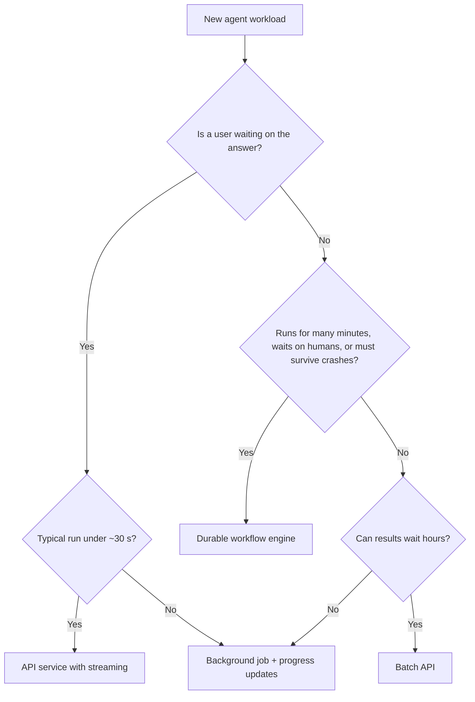
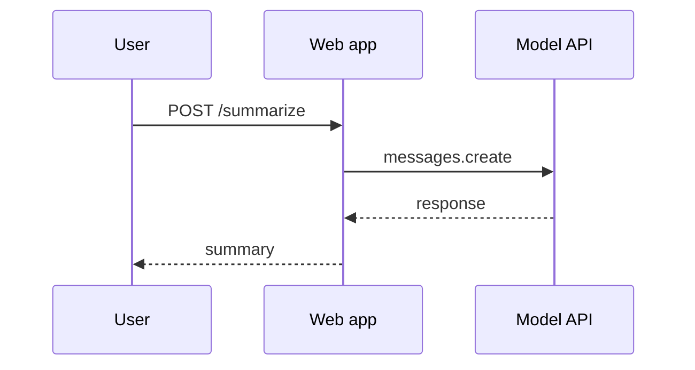
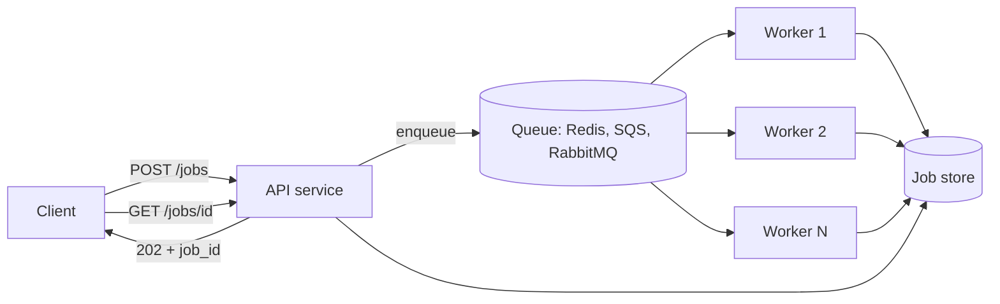

# Deployment Architectures

## Introduction

Once your agent works, you have to decide **where it runs** and **how requests reach it**. This choice shapes almost everything else: how you scale, what happens when a server restarts halfway through a task, how users see progress, and how much it costs to operate.

The right architecture depends mostly on one question: **how long does a task take, and is someone waiting for it?**

- A support chat reply that takes 5 seconds, with a user watching, needs a fast request/response service with streaming.
- A research report that takes 10 minutes needs a background job, so the user can close the tab.
- A contract review that takes hours, waits for human approval, and calls a dozen systems needs something that survives crashes and restarts.

Think of it like shipping goods. A letter goes by courier (fast, synchronous). A pallet goes by freight with a tracking number (queued, asynchronous). A container ship crossing an ocean needs a manifest, insurance, and port checkpoints (durable, resumable). Same goal, different machinery.

This page walks through six common architectures, from simplest to most robust, with Docker and Kubernetes examples. If you are new to containers, start with the site's [Docker Introduction](../../../devops/docker/0-docker-fundamentals/0-docker-introduction.mdx) and [Kubernetes Introduction](../../../devops/kubernetes/0-kubernetes-fundamentals/0-kubernetes-introduction.mdx).

## The Decision at a Glance



The thresholds are rules of thumb, not laws. The point is to ask the questions in this order.

## Architecture 1: In-Process (Embedded)

The simplest option: your existing web application calls the model API directly inside the request handler.



**Good for:** single-call features and very short agents (one or two tool calls), such as "summarize this ticket" or "suggest tags".

**Watch out for:** web servers usually have request timeouts (often 30 to 60 seconds) and a limited pool of worker threads. A slow agent call holds a worker the whole time. If ten users trigger a 40-second agent at once, the rest of your site can stall. See [Integrating Agents into Existing Applications](../10-agents-integration/0-agents-integration-overview.mdx).

## Architecture 2: Agent as an API Service

Move the agent into its own service with its own deployment, scaling, and limits. Other parts of your system call it over HTTP. This isolates agent load from the rest of the application and gives one team clear ownership.

Here is a minimal FastAPI service with the pieces production needs: health endpoints, a concurrency limit, and a timeout.

```python
import asyncio
import os

from anthropic import AsyncAnthropic
from fastapi import FastAPI, HTTPException
from pydantic import BaseModel

app = FastAPI()
client = AsyncAnthropic(timeout=60.0, max_retries=3)   # reads ANTHROPIC_API_KEY
MODEL = os.environ.get("AGENT_MODEL", "claude-sonnet-5-5")
MAX_CONCURRENT = int(os.environ.get("MAX_CONCURRENT_RUNS", "20"))
slots = asyncio.Semaphore(MAX_CONCURRENT)
ready = True


class AskRequest(BaseModel):
    question: str


@app.get("/healthz")
async def healthz():
    # Liveness: the process is running. Never call the model API here.
    return {"status": "ok"}


@app.get("/readyz")
async def readyz():
    # Readiness: should this pod receive traffic? False while shutting down.
    if not ready:
        raise HTTPException(status_code=503, detail="draining")
    return {"status": "ready"}


@app.post("/ask")
async def ask(req: AskRequest):
    if slots.locked():
        # Backpressure: tell the caller to retry instead of queuing forever.
        raise HTTPException(status_code=503, detail="busy, retry later")
    async with slots:
        response = await client.messages.create(
            model=MODEL,
            max_tokens=4000,
            messages=[{"role": "user", "content": req.question}],
        )
    text = "".join(b.text for b in response.content if b.type == "text")
    return {"answer": text, "stop_reason": response.stop_reason}
```

Two details are worth calling out:

- **Liveness must not call the model.** If the provider has a brief outage and your liveness probe calls it, Kubernetes will restart every pod at once, which makes things worse.
- **Return 503 when full.** Rejecting fast with a retryable status is kinder to callers than letting requests pile up until they time out. [Scaling and Concurrency](./2-agents-scaling.mdx) explains how to size the limit.

For streaming to a browser, see [Streaming Agent Output to a Frontend](../10-agents-integration/2-agents-streaming-to-frontend.mdx). For the full service design, see [Exposing an Agent as an API Service](../10-agents-integration/1-agents-as-api-service.mdx).

### Packaging with Docker

A small, reproducible image matters because you will deploy often. A multi-stage build keeps build tools out of the final image, and running as a non-root user limits the damage if a tool is abused.

```dockerfile
# ---- build stage ----
FROM python:3.12-slim AS build
WORKDIR /app
COPY requirements.txt .
RUN pip install --no-cache-dir --prefix=/install -r requirements.txt

# ---- runtime stage ----
FROM python:3.12-slim
WORKDIR /app
COPY --from=build /install /usr/local
COPY app/ ./app/
RUN useradd --create-home agent
USER agent
ENV PYTHONUNBUFFERED=1
EXPOSE 8000
CMD ["uvicorn", "app.main:app", "--host", "0.0.0.0", "--port", "8000"]
```

Note what is **not** in the image: the API key. Secrets come from the environment at runtime. The site's [multi-stage build guide](../../../devops/docker/1-docker-configuration/12-docker-multistage.mdx) covers the pattern in depth.

### Running on Kubernetes

A Kubernetes Deployment adds replicas, rolling updates, probes, and secret injection.

```yaml
apiVersion: apps/v1
kind: Deployment
metadata:
  name: support-agent
  labels:
    app: support-agent
spec:
  replicas: 3
  selector:
    matchLabels:
      app: support-agent
  template:
    metadata:
      labels:
        app: support-agent
        agent-version: "2026.10.3"
    spec:
      terminationGracePeriodSeconds: 120   # let in-flight runs finish
      containers:
        - name: agent
          image: registry.example.com/support-agent:2026.10.3
          ports:
            - containerPort: 8000
          env:
            - name: AGENT_MODEL
              value: "claude-sonnet-5-5"
            - name: MAX_CONCURRENT_RUNS
              value: "20"
            - name: ANTHROPIC_API_KEY
              valueFrom:
                secretKeyRef:
                  name: anthropic-credentials
                  key: api-key
          readinessProbe:
            httpGet:
              path: /readyz
              port: 8000
            periodSeconds: 5
          livenessProbe:
            httpGet:
              path: /healthz
              port: 8000
            periodSeconds: 10
          resources:
            requests:
              cpu: "250m"
              memory: "512Mi"
            limits:
              memory: "1Gi"
```

The setting people most often miss is `terminationGracePeriodSeconds`. During a rolling update, Kubernetes sends `SIGTERM` and waits this long before killing the pod. The default is 30 seconds, which can cut off agent runs mid-task. Set it longer than your typical run, flip readiness to "not ready" on `SIGTERM` so no new work arrives, and let in-flight runs finish. See [Kubernetes Probes](../../../devops/kubernetes/1-kubernetes-core-concepts/11-kubernetes-probes.mdx), [Pod Lifecycle](../../../devops/kubernetes/1-kubernetes-core-concepts/12-kubernetes-lifecycle.mdx), and [Kubernetes Secrets](../../../devops/kubernetes/1-kubernetes-core-concepts/5-kubernetes-secrets.mdx).

:::caution
Kubernetes Secrets are only base64-encoded by default. For production, enable encryption at rest or use an external secret manager. See [Secrets Management for Agents](../12-agents-safety-and-security/4-agents-secrets-management.mdx).
:::

## Architecture 3: Queue and Workers

When tasks take longer than a user wants to wait, or traffic arrives in bursts, put a queue between the caller and the agent. The API accepts the request, stores a job, and returns a job ID immediately. Worker processes pull jobs and run the agent.



Benefits:

- **Smoothing spikes.** A burst of 5,000 jobs waits in the queue instead of hitting the model API at once and triggering rate limits.
- **Independent scaling.** You scale workers on queue length, not on HTTP traffic.
- **Retries for free.** A job that fails can go back on the queue, or to a dead-letter queue after N attempts.

Here is a minimal worker using a Redis list. It uses `BLMOVE` to move each job atomically into a "processing" list, so a crashed worker does not lose the job.

```python
import json

import redis

r = redis.Redis(host="localhost", port=6379, decode_responses=True)
QUEUE, PROCESSING, DEAD = "agent:jobs", "agent:processing", "agent:dead"
MAX_ATTEMPTS = 3


def run_agent_task(payload: dict) -> dict:
    """Your agent loop goes here. Must be safe to run more than once."""
    return {"summary": f"processed {payload['doc_id']}"}


def work_forever() -> None:
    while True:
        raw = r.blmove(QUEUE, PROCESSING, timeout=5, src="RIGHT", dest="LEFT")
        if raw is None:
            continue
        job = json.loads(raw)
        try:
            result = run_agent_task(job["payload"])
            r.hset(f"agent:result:{job['id']}", mapping={"status": "done",
                                                          "result": json.dumps(result)})
        except Exception as exc:
            job["attempts"] = job.get("attempts", 0) + 1
            target = DEAD if job["attempts"] >= MAX_ATTEMPTS else QUEUE
            r.lpush(target, json.dumps(job))
            r.hset(f"agent:result:{job['id']}", mapping={"status": "retrying"
                   if target == QUEUE else "failed", "error": str(exc)})
        finally:
            r.lrem(PROCESSING, 1, raw)


if __name__ == "__main__":
    work_forever()
```

This is deliberately small. A real system also needs a "reaper" that returns stuck items from the processing list to the queue after a timeout. Libraries such as Celery, RQ, Dramatiq, or a cloud queue (SQS, Pub/Sub) give you this out of the box. [Running Agents as Background Jobs](../10-agents-integration/3-agents-background-jobs.mdx) covers job status and progress reporting.

:::warning
Queues deliver **at least once**. A job may run twice if a worker crashes after doing the work but before acknowledging it. Any tool with side effects (sending email, charging money) needs an idempotency key. See [Reliability and Fallbacks](./5-agents-reliability-and-fallbacks.mdx).
:::

On Kubernetes, scale workers on queue length rather than CPU. Agent workers spend most of their time waiting on network calls, so CPU stays low even when they are overloaded. [Scaling and Concurrency](./2-agents-scaling.mdx) shows a KEDA example.

## Architecture 4: Durable Workflows

A queue worker that crashes in the middle of a 30-step task has to start over, paying for every model call again. For long tasks, especially ones that wait for human approval or external events, use a **durable execution** engine such as Temporal, or a cloud equivalent (AWS Step Functions, Azure Durable Functions, Restate, Inngest, and others).

The idea: the engine records the result of every step. If the worker dies, another worker replays the workflow from the history, skips the steps that already finished, and continues. Anthropic's engineering team describes the same need in [How we built our multi-agent research system](https://www.anthropic.com/engineering/multi-agent-research-system): restarting long agent runs from the beginning is expensive and frustrating, so they built systems that resume from where an error occurred.

In Temporal, the orchestration loop is a **workflow** (deterministic code) and every model call and tool call is an **activity** (code with side effects that Temporal records and retries).

```python
from dataclasses import dataclass
from datetime import timedelta

from temporalio import activity, workflow
from temporalio.common import RetryPolicy

with workflow.unsafe.imports_passed_through():
    from anthropic import AsyncAnthropic


@dataclass
class ModelTurn:
    messages: list
    model: str


@activity.defn
async def call_model(turn: ModelTurn) -> dict:
    client = AsyncAnthropic(max_retries=0)   # let Temporal own the retries
    response = await client.messages.create(
        model=turn.model, max_tokens=8000, messages=turn.messages, tools=TOOLS,
    )
    return response.model_dump()


@activity.defn
async def run_tool(call: dict) -> dict:
    result = TOOL_IMPLS[call["name"]](**call["input"])   # your tool code
    return {"type": "tool_result", "tool_use_id": call["id"], "content": str(result)}


@workflow.defn
class ResearchAgentWorkflow:
    @workflow.run
    async def run(self, question: str) -> str:
        messages = [{"role": "user", "content": question}]
        retry = RetryPolicy(initial_interval=timedelta(seconds=2),
                            backoff_coefficient=2.0, maximum_attempts=5)
        for _ in range(20):                                # turn limit
            resp = await workflow.execute_activity(
                call_model, ModelTurn(messages, "claude-opus-5-5"),
                start_to_close_timeout=timedelta(minutes=5), retry_policy=retry,
            )
            messages.append({"role": "assistant", "content": resp["content"]})
            if resp["stop_reason"] != "tool_use":
                return "".join(b.get("text", "") for b in resp["content"]
                               if b["type"] == "text")
            calls = [b for b in resp["content"] if b["type"] == "tool_use"]
            results = [await workflow.execute_activity(
                run_tool, c, start_to_close_timeout=timedelta(minutes=2),
                retry_policy=retry) for c in calls]
            messages.append({"role": "user", "content": results})
        return "Stopped: turn limit reached"


TOOLS: list = []        # tool definitions, omitted for brevity
TOOL_IMPLS: dict = {}   # name -> function
```

Things to notice:

- The workflow code never calls the network directly. All side effects live in activities, which is what makes replay safe.
- The SDK's own retries are turned off (`max_retries=0`) so there is one retry policy, not two stacked on each other.
- If the worker crashes after turn 12, the replacement worker replays turns 1 to 12 from recorded results (no new model calls) and continues with turn 13.
- Workflow history has size limits. For long conversations, store large payloads (documents, big tool results) in object storage and pass references.

Temporal's own blog post [Durable Execution meets AI](https://temporal.io/blog/durable-execution-meets-ai-why-temporal-is-the-perfect-foundation-for-ai) describes this pattern, and integrations for several agent frameworks wrap model calls in activities automatically. Check the [Temporal Python docs](https://docs.temporal.io/develop/python) for the current APIs, worker setup, and testing tools.

## Architecture 5: Serverless Functions

AWS Lambda, Google Cloud Run functions, and similar platforms run code on demand and scale to zero. They are attractive for spiky, low-volume agents.

The limits to check: maximum execution time per invocation, cold-start latency, connection reuse between invocations, and whether streaming responses are supported. A serverless function works well for a short agent triggered by a webhook. For long agents, combine it with a queue or durable workflow so no single invocation has to hold the whole task. See [Event-Driven Agents and Webhooks](../10-agents-integration/4-agents-event-driven.mdx).

## Architecture 6: Managed Agent Platforms

Several providers now host the agent loop for you: you define the agent, its tools, and its environment, and the platform runs sessions, sandboxes, and state. Examples include Anthropic's Claude Managed Agents and similar offerings from other cloud providers. You trade control for less infrastructure to run. Read [Managed Agent Platforms](../9-agents-frameworks/9-agents-managed-agent-platforms.mdx) for the trade-offs.

## Offline Work: The Batch API

Some agent work has no user waiting at all: nightly classification of yesterday's tickets, back-filling summaries, running an eval set. Most major providers offer a **batch API** that accepts many requests at once, processes them asynchronously, and charges less. Anthropic's Message Batches API, for example, is priced at 50% of standard rates, and most batches finish within an hour (24 hours at most). Batch requests are single-shot, so a multi-turn tool loop does not fit directly. You can pre-fetch the inputs a tool would have fetched and send one request per item. [Cost Optimization](./4-agents-cost-optimization.mdx) shows the code.

## Real-World Scenario

Your company processes insurance claims. You are building an agent that reads a claim packet (forms, photos, a police report), checks the policy, queries two internal systems, and writes a recommendation. A typical run takes 4 to 15 minutes. About 5% of claims need a human adjuster to answer a question before the agent can finish, and that answer can take a day. Volume is about 3,000 claims a day, with a spike on Monday mornings.

**What you choose:**

- An **API service** on Kubernetes accepts claims and returns a claim run ID immediately.
- A **Temporal workflow** per claim runs the agent loop. Every model call and every internal-system call is an activity with its own timeout and retry policy.
- When the agent needs a human answer, the workflow waits on a **signal**. It can wait a day without holding a worker or a connection.
- **Workers** run as a Kubernetes Deployment and scale on the Temporal task queue backlog.
- A nightly **batch job** re-scores the previous day's recommendations with a grader model, at batch prices, to feed quality dashboards.

**Why this approach fits.** Runs are long and expensive, so losing progress to a pod restart costs real money. The human-in-the-loop wait rules out anything that holds a connection open. The Monday spike is absorbed by the task queue rather than by rate limit errors.

**When not to use it.** If your agent answers chat messages in under ten seconds, a durable workflow engine is pure overhead: another cluster to run, another set of concepts for the team. A stateless API service with streaming is simpler and better there.

### Alternatives and Trade-offs

| Approach | Pros | Cons | Best for |
|---|---|---|---|
| In-process call | Simplest, no new services | Blocks web workers, shares failure domain | One or two quick model calls |
| Agent API service | Isolated scaling and ownership, streaming | Must handle long requests and shutdown carefully | Interactive agents under ~30 s |
| Queue + workers | Absorbs spikes, easy retries, scale on backlog | At-least-once delivery, progress must be polled or pushed | Minutes-long background tasks |
| Durable workflow (Temporal and similar) | Survives crashes, resumes mid-task, waits for humans | New infrastructure and programming model | Long, multi-step, high-value tasks |
| Serverless | Scales to zero, little ops | Time limits, cold starts | Short, spiky, event-triggered agents |
| Managed agent platform | Least infrastructure, built-in sandboxes and sessions | Less control, vendor coupling | Teams that want to ship fast |
| Batch API | Discounted, high throughput | Hours of latency, single-shot requests | Offline classification, evals, backfills |

## Common Mistakes

- **Liveness probes that call the model API.** A provider blip restarts your whole fleet.
- **Default 30-second termination grace period.** Rolling deploys kill in-flight runs.
- **Long agent runs inside web request handlers.** Timeouts at the load balancer, the web server, and the client all have to agree, and they usually do not.
- **Two retry layers stacked.** SDK retries inside workflow retries inside queue retries can turn one failure into dozens of calls.
- **Keeping conversation state in pod memory.** A restart loses it. Store state in a database, cache, or workflow history.
- **Adopting a workflow engine for a 5-second task.** Match the machinery to the problem.

## Summary

- Choose architecture by task duration and whether a user is waiting.
- Short interactive agents fit an API service with streaming, health probes, and a concurrency limit.
- Minutes-long work belongs in a queue with workers that scale on backlog, with idempotent tools.
- Long, high-value, human-in-the-loop work benefits from durable execution, where model and tool calls are recorded activities.
- Offline, non-urgent work fits a batch API at a lower price.
- In Kubernetes, set probes, resource requests, secrets, and a long enough termination grace period.

## Exercises

1. Containerize the FastAPI service above and run it locally with `docker run -e ANTHROPIC_API_KEY=...`. Add a `SIGTERM` handler that sets `ready = False` and confirm `/readyz` returns 503 after you send the signal.
2. Add a reaper to the Redis worker that moves jobs older than 15 minutes from the processing list back to the queue. What extra data must each job carry?
3. Sketch (on paper or in a diagram) how you would move the claims agent from a queue-and-worker design to a durable workflow. Which steps become activities?
4. Pick three agent features from your own product and place each one in the decision flowchart at the top of this page.

Next, read [Scaling and Concurrency](./2-agents-scaling.mdx) to size workers and stay within rate limits. Related: [Kubernetes Deployments](../../../devops/kubernetes/1-kubernetes-core-concepts/2-kubernetes-deployments.mdx), [Kubernetes Jobs](../../../devops/kubernetes/6-kubernetes-advanced-deployments/8-kubernetes-jobs.mdx), and [Session Persistence](../4-agents-memory-and-context/10-agents-session-persistence.mdx).
