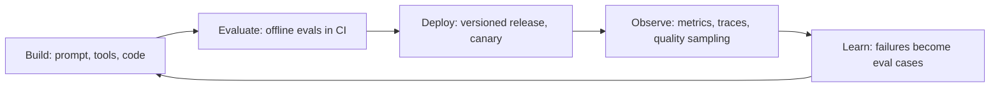
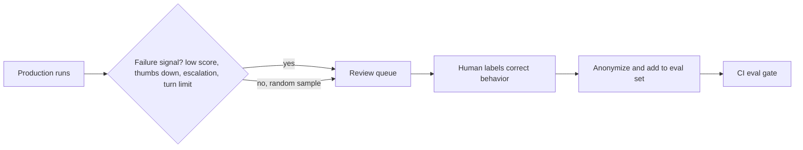

# AgentOps Best Practices

## Introduction

**AgentOps** is the practice of running AI agents reliably over time: building, evaluating, deploying, observing, and improving them as a continuous loop. It borrows from DevOps (automation, CI/CD, monitoring), SRE (reliability targets, incident response), and MLOps (evaluation, data feedback loops), and adds a few concerns specific to agents, such as prompt and tool versioning, per-token cost, and actions taken on real systems.

The earlier pages in this section each covered one piece. This page ties them together into habits a team can adopt. Think of it as the difference between knowing how to fix a car and running a garage: the garage needs schedules, checklists, records, and a way to learn from every repair.

The core loop:



Everything below is a way to make one of these arrows faster, safer, or cheaper.

## Practice 1: Make Evals the Gate for Every Change

Every change that can alter behavior (prompt, tool description, tool code, model, effort, retrieval data) should pass an eval before it reaches users. This is the single habit that most separates teams that improve their agents steadily from teams that go in circles.

Here is a small CI gate script. It compares a candidate's eval results with the current baseline and fails the build on a meaningful regression, overall or in any important category.

```python
import json
import sys


def load(path_or_data):
    return path_or_data if isinstance(path_or_data, dict) else json.load(open(path_or_data))


def gate(baseline: dict, candidate: dict, max_drop: float = 0.02,
         max_cost_increase: float = 0.15, critical: tuple = ("refunds", "security")) -> list[str]:
    problems = []
    if candidate["pass_rate"] < baseline["pass_rate"] - max_drop:
        problems.append(f"overall pass rate {candidate['pass_rate']:.2f} "
                        f"< baseline {baseline['pass_rate']:.2f} - {max_drop}")
    for cat in critical:
        b, c = baseline["by_category"].get(cat), candidate["by_category"].get(cat)
        if b is not None and c is not None and c < b:
            problems.append(f"critical category '{cat}' regressed: {c:.2f} < {b:.2f}")
    if candidate["usd_per_completed"] > baseline["usd_per_completed"] * (1 + max_cost_increase):
        problems.append(f"cost per completed task up more than {max_cost_increase:.0%}")
    return problems


baseline = {"pass_rate": 0.91, "usd_per_completed": 0.052,
            "by_category": {"refunds": 0.95, "security": 1.0, "how_to": 0.88}}
candidate = {"pass_rate": 0.92, "usd_per_completed": 0.049,
             "by_category": {"refunds": 0.90, "security": 1.0, "how_to": 0.93}}

problems = gate(load(baseline), load(candidate))
if problems:
    print("EVAL GATE FAILED")
    for p in problems:
        print(" -", p)
    # sys.exit(1) in CI
else:
    print("EVAL GATE PASSED")
```

Output:

```text
EVAL GATE FAILED
 - critical category 'refunds' regressed: 0.90 < 0.95
```

Notice that the overall pass rate went **up** and the cost went **down**, yet the gate failed. The candidate got better at how-to questions and worse at refunds. Averages hide this kind of trade; per-category gates catch it. Decide which categories are critical with the people who own the business outcome.

Practical tips:

- Run a **fast smoke eval** (10 to 20 cases) on every pull request, and the **full suite** before release.
- Account for **noise**: model outputs vary run to run. Use repeated trials for close calls, and do not block on a one-case swing.
- Keep eval runs **cheap**: cache shared prefixes, and use a batch API for large nightly suites.

See [Regression Testing for Agents](../11-agents-evaluation-and-testing/6-agents-regression-testing.mdx) and [Agents in CI/CD Pipelines](../10-agents-integration/9-agents-in-ci-cd.mdx).

### Wiring the Gate into CI

Here is how the pieces fit in a typical CI pipeline. The example uses GitHub Actions, but the same steps work in GitLab CI, Jenkins, or any other system. The API key comes from the CI secret store, and the full suite runs only when agent files change, to control cost.

```yaml
name: agent-evals
on:
  pull_request:
    paths:
      - "agents/support/**"
jobs:
  eval:
    runs-on: ubuntu-latest
    steps:
      - uses: actions/checkout@v4
      - uses: actions/setup-python@v5
        with:
          python-version: "3.12"
      - run: pip install -r requirements.txt
      - name: Check release fingerprint
        run: python scripts/check_fingerprint.py agents/support/release.yaml
      - name: Run smoke evals
        env:
          ANTHROPIC_API_KEY: ${{ secrets.ANTHROPIC_API_KEY }}
        run: python scripts/run_evals.py agents/support --suite smoke --out candidate.json
      - name: Compare with baseline
        run: python scripts/eval_gate.py baselines/support.json candidate.json
```

Store the baseline results in the repository (or an artifact store) and update them only when a release is promoted, so every pull request is compared with what is actually running in production.

## Practice 2: Turn Production Into Your Best Test Data

Your eval set should grow from real usage. Every serious failure in production is a test case you did not have.

- **Capture failures.** Runs with low grader scores, negative feedback, escalations, turn-limit hits, and incident-related runs go into a review queue.
- **Review and label.** A person decides the correct behavior and adds the case (anonymized) to the eval set.
- **Watch for drift.** If users start asking new kinds of questions, sample them into the eval set so it keeps representing reality.



Be careful with privacy: production inputs can contain personal data. Anonymize before storing cases, and follow your data retention rules. See [Building Evaluation Datasets](../11-agents-evaluation-and-testing/1-agents-building-eval-sets.mdx) and [Data Privacy and PII](../12-agents-safety-and-security/5-agents-data-privacy.mdx).

## Practice 3: Version Everything, Change One Thing at a Time

- Treat prompt + tools + model + parameters as a **versioned release bundle** with a content fingerprint. See [Versioning Prompts, Tools and Models](./7-agents-versioning.mdx).
- **Change one variable per release** when you can. If you change the prompt, the model, and a tool in one release and quality drops, you have three suspects.
- Keep a **changelog** that says what changed and why, with the eval results attached.
- Pin conversations to their release, and keep old releases deployable until their sessions end.

## Practice 4: Release Progressively

Every release follows the same path: CI evals, then a canary of new sessions, then a ramp, with rollback thresholds defined beforehand. Model upgrades add shadow traffic. See [Migrating to a New Model](./8-agents-model-migration.mdx).

Make rollback a routing change that takes seconds. If rollback requires a build and deploy, people hesitate to use it, and incidents last longer.

## Practice 5: Observe What Matters

The minimum observability for any production agent:

- **Outcome metrics**: runs by status (completed, turn limit, refused, escalated, error)
- **Latency** at p50 and p95, split into model time and tool time
- **Tokens and cost**, with cache hit ratio and cost per completed task
- **Tool metrics**: calls, errors, and latency per tool, plus a rate alert on each high-impact tool
- **Quality**: sampled grader scores and user feedback
- **A `version` label** on all of the above
- **Traces** for every run, with tool inputs, linked from logs by run ID

See [Monitoring and Alerting](./6-agents-monitoring-and-alerting.mdx) and [OpenTelemetry for Agents](../11-agents-evaluation-and-testing/9-agents-opentelemetry.mdx).

## Practice 6: Govern Cost Like a Feature

Cost is a product property, not just a bill.

- **Attribute spend.** Use separate API keys or workspaces per agent or team, and tag every call with route and version, so you know who spends what.
- **Set budgets at every level**: per task (turn and token limits), per tenant (quotas), per workspace (provider spend limits), and per month (forecast with alerts).
- **Review cost per completed task** in the same meeting as quality. A change that improves quality by one point and doubles cost needs a conscious decision.
- **Apply free wins by default**: caching on, batch for offline work, lean prompts. Then make trade-offs deliberately against evals. See [Cost Optimization](./4-agents-cost-optimization.mdx).

## Practice 7: Make Ownership Explicit

Every production agent needs:

- **An owning team** and an **on-call rotation** that knows the agent
- **Runbooks** linked from every alert
- **An agent card**: a short document describing what the agent does, its tools and their risk levels, the data it touches, its models, its limits, its eval suite, and its owners

```yaml
# agent-card.yaml: a one-page summary for reviewers and on-call engineers
name: support-agent
owner: team-support-eng
on_call: support-eng-primary
purpose: Answer billing and account questions; issue credits up to $20.
models:
  primary: claude-sonnet-5-5
  fallback: claude-haiku-5-5
tools:
  - name: lookup_account
    risk: low
  - name: issue_credit
    risk: high
    controls: [daily_cap_per_customer, idempotency_key, approval_above_20_usd, kill_switch]
data:
  sends_to_model: [ticket text, account plan, last 3 invoices]
  never_sends: [payment card numbers, passwords]
limits: {max_turns: 15, max_task_tokens: 400000}
evals: {suite: evals/support.jsonl, min_pass_rate: 0.90, critical: [refunds, security]}
slo: {task_success: 0.92, p95_latency_s: 12}
```

Agent cards make security reviews, onboarding, and incident response much faster, and they force the team to write down decisions that otherwise live in people's heads.

## Practice 8: Secure by Default, Review Regularly

- **Least privilege** for every tool, **hard limits in code**, **approval gates** for high-impact actions. See [Least Privilege for Agent Tools](../12-agents-safety-and-security/2-agents-least-privilege.mdx).
- Treat all external content as untrusted. See [Prompt Injection](../12-agents-safety-and-security/1-agents-prompt-injection.mdx).
- **Red team** before launch and after major changes. See [Red Teaming Agents](../12-agents-safety-and-security/10-agents-red-teaming.mdx).
- Review tool permissions and secrets on a schedule; agents accumulate capabilities over time.

## Practice 9: Plan for Change in the Model Layer

The model layer changes faster than most of your stack:

- **Track deprecation dates** for every model you use, with calendar reminders well ahead of retirement.
- **Re-run evals on new models** when they appear; a newer model can be cheaper and better.
- **Re-audit prompts** after a model change; techniques that helped an older model can hurt a newer one.
- **Keep provider-specific code thin**, behind a small interface, if you may need fallbacks or a second provider. Do not over-abstract: features such as caching and structured outputs differ between providers, and a lowest-common-denominator wrapper gives up real benefits.

## Practice 10: Learn From Every Incident

Blameless postmortems with tracked action items. The common agent action items are worth making standard: move limits from prompts into code, add eval cases, add per-tool rate alerts, and add controls that do not need a deploy. See [Incident Response for Agents](./9-agents-incident-response.mdx).

## A Weekly AgentOps Review

A short, regular review keeps the loop turning. A simple report generated from your metrics store is enough to start:

```python
def weekly_report(this_week: dict, last_week: dict) -> None:
    def delta(key: str, fmt: str = "{:.1%}") -> str:
        a, b = this_week[key], last_week[key]
        arrow = "up" if a > b else ("down" if a < b else "flat")
        return f"{fmt.format(a)} ({arrow} from {fmt.format(b)})"

    print("Agent: support-agent")
    print("  Task success:          ", delta("success"))
    print("  Escalation rate:       ", delta("escalation"))
    print("  p95 latency (s):       ", delta("p95_s", "{:.1f}"))
    print("  Cost per completed ($):", delta("usd_per_completed", "{:.3f}"))
    print("  Cache hit ratio:       ", delta("cache_hit"))
    print("  New eval cases added:  ", this_week["new_eval_cases"])
    print("  Open postmortem items: ", this_week["open_action_items"])


weekly_report(
    this_week={"success": 0.923, "escalation": 0.061, "p95_s": 9.8, "usd_per_completed": 0.047,
               "cache_hit": 0.81, "new_eval_cases": 14, "open_action_items": 2},
    last_week={"success": 0.915, "escalation": 0.066, "p95_s": 10.4, "usd_per_completed": 0.051,
               "cache_hit": 0.79, "new_eval_cases": 9, "open_action_items": 4},
)
```

Output:

```text
Agent: support-agent
  Task success:           92.3% (up from 91.5%)
  Escalation rate:        6.1% (down from 6.6%)
  p95 latency (s):        9.8 (down from 10.4)
  Cost per completed ($): 0.047 (down from 0.051)
  Cache hit ratio:        81.0% (up from 79.0%)
  New eval cases added:   14
  Open postmortem items:  2
```

In the meeting, look at the trends, pick the top failure category from the review queue, and decide the one or two changes to make next week. Keep it short; the value comes from doing it every week.

## A Starter Checklist for Each New Agent

When a team starts a new agent, these items set it up for the practices above from day one. Each takes hours, not weeks:

| Item | Practice it supports |
|---|---|
| Release bundle file with model, parameters, prompt, and tools | Versioning |
| 20 to 30 real eval cases with pass criteria, including the hardest ones you know | Eval gates |
| Turn limit, token budget, and a workspace spend limit | Cost governance |
| Shared runtime library or the standard metrics, with a `version` label | Observability |
| Kill switch and per-tool switches for any write tool | Incident response |
| Agent card with owner and on-call | Ownership |
| Calendar entry for the model's deprecation date (once announced) | Model lifecycle |

Starting with these costs little. Adding them after an incident costs much more.

## An AgentOps Maturity Model

Use this to see where you are and what to do next. Most teams do not need level 3 for every agent.

| Level | Name | What it looks like | Next step |
|---|---|---|---|
| 0 | Ad hoc | Prompts edited live, no evals, logs only, no limits | Add turn limits, spend limits, and basic logging of `usage` |
| 1 | Repeatable | Prompts in Git, a small eval set run by hand, basic metrics, a kill switch | Run evals in CI, add tracing and a dashboard |
| 2 | Managed | Release bundles with versions, CI eval gates, canaries, alerts with runbooks, cost per task tracked | Production-to-eval feedback loop, quality sampling, SLOs |
| 3 | Optimized | Continuous online evals, automated canary analysis, cost and quality reviewed weekly, game days, migrations planned ahead | Share the platform across teams |

## Real-World Scenario

Your company started with one support agent built by two engineers. Eighteen months later there are nine agents across five teams: support, sales, finance operations, an internal IT helpdesk, and a code review bot. Each team built its own logging, its own retry code, and its own way of storing prompts. Costs are hard to attribute, two teams had similar incidents a month apart, and nobody knows which agents still use a model that retires next quarter.

**What the platform team introduces:**

1. **A shared agent runtime library** with the turn and token limits, error classification, retries, idempotency helpers, runtime controls, and Prometheus metrics already wired in.
2. **A standard release bundle format** and a CI template that runs the eval gate and computes fingerprints.
3. **An LLM gateway** that holds API keys, enforces per-team rate and spend limits, and tags every request with team, agent, and version.
4. **A shared Grafana dashboard template** and a standard alert set, with runbook templates.
5. **Agent cards** for all nine agents, reviewed by security.
6. **A model inventory** generated from the gateway logs, with retirement dates, which triggers migration planning a quarter ahead.
7. **A monthly cross-team review** of incidents and postmortem action items, so lessons spread.

Teams keep ownership of their prompts, tools, and evals. The platform owns the plumbing.

**Why this approach fits.** At nine agents, duplicated infrastructure and inconsistent practices cost more than a shared platform. The gateway solves attribution and limits in one place, and the shared runtime turns hard-won lessons (idempotency, controls, metrics) into defaults.

**When not to use it.** With one or two agents, a platform team and gateway are overhead. Start with the habits (evals in CI, versioning, metrics, runbooks) and extract shared pieces once the third or fourth agent appears.

### Alternatives and Trade-offs

| Approach | Pros | Cons | Best for |
|---|---|---|---|
| Each team runs its own stack | Full autonomy, fast start | Duplicated work, inconsistent safety and cost control | One or two agents |
| Shared runtime library | Consistent defaults, low overhead | Library upgrades across teams | Several agents in one language |
| LLM gateway | Central keys, limits, attribution, logging | Another critical service | Many teams and agents |
| Commercial agent observability or ops platform | Fast setup, agent-specific views and evals | Vendor cost and data sharing | Teams without platform capacity |
| Managed agent platform | Runtime, sandboxing, and sessions handled for you | Less control, vendor coupling | Teams that prefer to buy over build |

## Common Mistakes

- **Shipping changes without evals** because "it's just a prompt tweak".
- **Eval sets that never grow.** Production failures should become test cases.
- **Changing several variables at once**, then guessing which one mattered.
- **No owner or on-call** for an agent that acts on real systems.
- **Cost reviewed separately from quality**, so trade-offs are never decided deliberately.
- **Forgetting model retirement dates.**
- **Over-building early.** A platform for one agent slows you down; add structure as the number of agents and the stakes grow.

## Summary

- AgentOps is a loop: build, evaluate, deploy, observe, learn, and back to build.
- Gate every behavior-changing change on evals, including per-category checks for critical areas.
- Feed production failures back into the eval set, respecting privacy.
- Version release bundles, change one thing at a time, and release progressively with fast rollback.
- Observe outcomes, latency, cost, tools, and quality with a version label; govern cost alongside quality.
- Make ownership explicit with on-call, runbooks, and agent cards; plan for model changes; learn from incidents.
- Use the maturity model to pick the next improvement, not to build everything at once.

## Exercises

1. Place each agent you run (or plan to run) on the maturity model. Write down the single next step for each.
2. Write an agent card for an agent from earlier in this tutorial, such as the one in [Project: Customer Support Agent](../14-agents-projects/0-agents-project-customer-support.mdx).
3. Adapt the eval gate script to read baseline and candidate results from JSON files and exit non-zero on failure. Add it to a CI pipeline.
4. Set up the weekly report from real metrics (or your eval runs) and hold a 15-minute review. What did you decide to change?

This page closes the Agents in Production section. To put it all into practice, continue with the [Agent Projects](../14-agents-projects/0-agents-project-customer-support.mdx), especially [Capstone: Production-Ready Agent](../14-agents-projects/11-agents-project-capstone.mdx). To revisit the start of this section, see the [Production Readiness Checklist](./0-agents-production-readiness.mdx).
