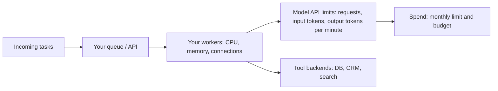

# Scaling and Concurrency

## Introduction

Scaling a normal web service usually means "add more servers". Scaling an agent is different, because the bottleneck is rarely your servers. It is the **model provider's rate limits**, the **cost** of each run, and the **downstream systems** your tools call.

Picture a busy restaurant where the kitchen can cook only 60 dishes per minute. Hiring more waiters does not help. If the waiters keep shouting orders faster than the kitchen can cook, the kitchen starts refusing orders, and the waiters waste time re-shouting. The fix is to manage the flow of orders: a ticket rail (a queue), a limit on how many orders are in progress (a concurrency limit), and polite waiting when the kitchen says "not now" (backoff).

For agents, the "kitchen" is the model API. This page shows you how to:

- Estimate how much concurrency you need
- Understand provider rate limits and what counts against them
- Limit concurrency inside one process and across many pods
- Handle `429 Too Many Requests` correctly
- Autoscale workers on the right signal

## Where the Bottlenecks Are



In practice, agents hit limits in this order:

1. **Model rate limits.** Each agent run makes several model calls, each with thousands of input tokens. A modest number of concurrent runs can exhaust input-tokens-per-minute.
2. **Tool backends.** Your agent might call the CRM ten times per run. Fifty concurrent runs means 500 CRM calls in a short burst. Internal APIs often fall over before the model API does.
3. **Budget.** Even within rate limits, running more tasks costs more money. Scaling up is a financial decision as well as a technical one.
4. **Your own compute.** Usually last. Agent workers spend most of their time waiting on the network, so CPU stays low.

## Estimating Concurrency with Little's Law

A useful formula from queueing theory, **Little's Law**, says:

> concurrent runs = arrival rate x average run duration

If 2 tasks arrive per second and each takes 20 seconds, you have about 40 runs in progress at any moment. Now translate that into model load.

```python
def estimate_load(tasks_per_minute: float, avg_run_seconds: float, calls_per_run: float,
                  input_tokens_per_call: float, output_tokens_per_call: float,
                  cache_hit_ratio: float) -> dict:
    concurrent = tasks_per_minute / 60 * avg_run_seconds
    requests_per_min = tasks_per_minute * calls_per_run
    total_input = requests_per_min * input_tokens_per_call
    # For most current Claude models, cache reads do not count toward the
    # input-tokens-per-minute limit. Check your provider's docs.
    uncached_input = total_input * (1 - cache_hit_ratio)
    output = requests_per_min * output_tokens_per_call
    return {
        "concurrent_runs": round(concurrent),
        "requests_per_min": round(requests_per_min),
        "input_tokens_per_min_counted": round(uncached_input),
        "output_tokens_per_min": round(output),
    }


peak = estimate_load(tasks_per_minute=120, avg_run_seconds=25, calls_per_run=6,
                     input_tokens_per_call=12_000, output_tokens_per_call=600,
                     cache_hit_ratio=0.0)
cached = estimate_load(tasks_per_minute=120, avg_run_seconds=25, calls_per_run=6,
                       input_tokens_per_call=12_000, output_tokens_per_call=600,
                       cache_hit_ratio=0.8)
print("no caching: ", peak)
print("80% cached: ", cached)
```

Output:

```text
no caching:  {'concurrent_runs': 50, 'requests_per_min': 720, 'input_tokens_per_min_counted': 8640000, 'output_tokens_per_min': 432000}
80% cached:  {'concurrent_runs': 50, 'requests_per_min': 720, 'input_tokens_per_min_counted': 1728000, 'output_tokens_per_min': 432000}
```

Notice how the input token count dominates. Agent loops resend the whole conversation on every turn, so input tokens grow fast. Prompt caching changes the picture: on Anthropic's API, for most current models, tokens read from the cache do not count toward the input-tokens-per-minute limit, so a good cache hit rate raises your effective throughput as well as cutting cost. See [Prompt Caching](../4-agents-memory-and-context/4-agents-prompt-caching.mdx).

## Understanding Provider Rate Limits

Every provider limits usage, and the details differ. Anthropic's Messages API, for example, measures three limits **per model**:

| Limit | What it counts | Notes |
|---|---|---|
| RPM | Requests per minute | Each turn of an agent loop is one request |
| ITPM | Input tokens per minute | For most current models, only uncached input and cache writes count |
| OTPM | Output tokens per minute | Counts tokens actually generated, not `max_tokens` |

Other facts from Anthropic's [rate limits documentation](https://platform.claude.com/docs/en/api/rate-limits) that shape your design:

- Limits use a **token bucket**: capacity refills continuously rather than resetting each minute. A limit of 60 RPM may be enforced as about one request per second, so short bursts can trip it.
- Limits depend on your **usage tier** and are set per organization. You can set lower limits per **workspace** to stop one product from starving another.
- A sudden sharp increase in traffic can hit **acceleration limits**. Ramp up gradually.
- Responses include headers such as `anthropic-ratelimit-requests-remaining`, `anthropic-ratelimit-input-tokens-remaining`, and `retry-after` on a 429.
- A 429 can also mean your organization hit its **monthly spend cap**. That response has no `retry-after` header and carries the error code `enforced_spend_limit_reached`; retrying will not help until the limit changes.

Exact numbers change over time and by tier, so read them from your provider's console or docs rather than hard-coding them. OpenAI, Google, and self-hosted servers such as vLLM have similar request and token limits with different header names.

## Concurrency Limits Inside One Process

The first defense is a cap on how many model calls a single process makes at once. In async Python, `asyncio.Semaphore` is the standard tool.

```python
import asyncio
import random
import time

MAX_IN_FLIGHT = 5
semaphore = asyncio.Semaphore(MAX_IN_FLIGHT)
in_flight = 0
peak_in_flight = 0


async def fake_model_call(task_id: int) -> str:
    await asyncio.sleep(random.uniform(0.05, 0.15))   # stands in for network time
    return f"result-{task_id}"


async def limited_call(task_id: int) -> str:
    global in_flight, peak_in_flight
    async with semaphore:
        in_flight += 1
        peak_in_flight = max(peak_in_flight, in_flight)
        try:
            return await fake_model_call(task_id)
        finally:
            in_flight -= 1


async def main() -> None:
    start = time.perf_counter()
    results = await asyncio.gather(*(limited_call(i) for i in range(40)))
    print(f"{len(results)} calls, peak in flight = {peak_in_flight}, "
          f"took {time.perf_counter() - start:.1f}s")


asyncio.run(main())
```

Example output:

```text
40 calls, peak in flight = 5, took 0.8s
```

Forty tasks were started, but no more than five ever ran at the same time. With the real API, replace `fake_model_call` with `await client.messages.create(...)` on an `AsyncAnthropic` client.

A semaphore limits **concurrency**, not **rate**. Five concurrent calls that each take one second produce about 300 requests per minute. If you need to stay under a rate, add a rate limiter as well.

## A Token Bucket Rate Limiter

A token bucket gives each process a steady budget that refills over time. Because the provider counts tokens as well as requests, a useful limiter charges each call by its estimated input tokens.

```python
import asyncio
import time


class TokenBucket:
    """Allow up to `rate_per_min` units per minute, with bursts up to `capacity`."""

    def __init__(self, rate_per_min: float, capacity: float):
        self.rate = rate_per_min / 60.0
        self.capacity = capacity
        self.tokens = capacity
        self.updated = time.monotonic()
        self.lock = asyncio.Lock()

    async def acquire(self, amount: float) -> None:
        while True:
            async with self.lock:
                now = time.monotonic()
                self.tokens = min(self.capacity, self.tokens + (now - self.updated) * self.rate)
                self.updated = now
                if self.tokens >= amount:
                    self.tokens -= amount
                    return
                wait = (amount - self.tokens) / self.rate
            await asyncio.sleep(wait)


async def demo() -> None:
    # 60,000 input tokens per minute, bursts up to 20,000.
    bucket = TokenBucket(rate_per_min=60_000, capacity=20_000)
    start = time.perf_counter()
    for i in range(4):
        await bucket.acquire(8_000)       # estimated input tokens for this call
        print(f"call {i} allowed at t={time.perf_counter() - start:.1f}s")


asyncio.run(demo())
```

Example output:

```text
call 0 allowed at t=0.0s
call 1 allowed at t=0.0s
call 2 allowed at t=4.0s
call 3 allowed at t=12.0s
```

The first two calls fit in the burst capacity. After that, calls are spaced out to match the refill rate. Use the token-counting endpoint or a rough estimate (characters divided by four is a common first approximation for English) to size `amount`.

## Limits Across Many Pods

A semaphore in each pod is not enough when you run 20 pods: each one allows 5 calls, so the fleet allows 100. Options:

| Option | How it works | Trade-off |
|---|---|---|
| Divide the budget | Each pod gets `total / replicas` | Simple; wastes capacity when some pods are idle; must update when scaling |
| Shared limiter in Redis | Pods take tokens from a central bucket | Accurate; adds a network hop and a dependency |
| Central gateway | All model calls go through one proxy (an "LLM gateway") that enforces limits | One place for limits, keys, logging; another service to run |
| Queue with fixed worker count | Concurrency = number of workers x slots per worker | Easiest to reason about; less flexible for interactive traffic |

A shared limiter can be as simple as a Redis counter per time window. This fixed-window version is easy to understand. It allows bursts at window edges, which is why production systems often use a sliding window or a Lua-scripted token bucket instead.

```python
import time

import redis

r = redis.Redis(host="localhost", port=6379)


def try_acquire(key: str, limit_per_minute: int) -> bool:
    window = int(time.time() // 60)
    bucket_key = f"ratelimit:{key}:{window}"
    pipe = r.pipeline()
    pipe.incr(bucket_key)
    pipe.expire(bucket_key, 120)
    count, _ = pipe.execute()
    return count <= limit_per_minute


# Usage inside a worker:
# if not try_acquire("claude-sonnet-5-5:requests", 900):
#     requeue_with_delay(job); return
```

Set your own limit a little **below** the provider's limit (for example 80 to 90%). That leaves headroom for retries and for other services sharing the same organization.

## Handling 429 and Overload Errors

Even with limiters, you will see `429` (rate limited) and, on Anthropic's API, `529` (overloaded) responses. Both are retryable. The rules:

1. **Respect `retry-after`.** If the server says wait 12 seconds, retrying after 1 second is guaranteed to fail.
2. **Back off exponentially with jitter.** Without randomness, all your workers retry at the same instant and collide again (the "thundering herd").
3. **Bound the retries.** After a few attempts, fail the task or send it back to the queue.
4. **Do not retry the spend-cap 429.** Check for `enforced_spend_limit_reached` and alert a human.

The Anthropic Python SDK already retries connection errors, 408, 409, 429, and 5xx responses with exponential backoff (2 retries by default). Configure it with `max_retries`. Add your own wrapper only when you need different behavior, such as longer waits for batch workers.

```python
import random
import time

import anthropic

client = anthropic.Anthropic(max_retries=0)   # we handle retries ourselves here


def create_with_backoff(max_attempts: int = 6, base: float = 1.0, cap: float = 60.0, **kwargs):
    for attempt in range(max_attempts):
        try:
            return client.messages.create(**kwargs)
        except anthropic.RateLimitError as e:
            body = e.body if isinstance(e.body, dict) else {}
            code = body.get("error", {}).get("details", {}).get("error_code")
            if code == "enforced_spend_limit_reached":
                raise                                # retrying cannot help
            retry_after = e.response.headers.get("retry-after")
            delay = float(retry_after) if retry_after else min(cap, base * 2 ** attempt)
        except anthropic.APIStatusError as e:
            if e.status_code < 500:                  # 400, 401, 403, 404: do not retry
                raise
            delay = min(cap, base * 2 ** attempt)
        except anthropic.APIConnectionError:
            delay = min(cap, base * 2 ** attempt)
        delay = delay * random.uniform(0.5, 1.0) if attempt else delay  # jitter
        print(f"attempt {attempt + 1} failed, sleeping {delay:.1f}s")
        time.sleep(delay)
    raise RuntimeError("model call failed after retries")
```

The order of the `except` clauses matters: `RateLimitError` is a subclass of `APIStatusError`, so it must come first. See [Error Handling and Retries](../1-agents-llm-apis/9-agents-api-error-handling.mdx) for the full error table.

### Reading Rate Limit Headers Proactively

You can slow down **before** you hit a 429 by reading the remaining-capacity headers. The SDK's `with_raw_response` gives you the headers along with the parsed message.

```python
import anthropic

client = anthropic.Anthropic()

raw = client.messages.with_raw_response.create(
    model="claude-haiku-5-5",
    max_tokens=200,
    messages=[{"role": "user", "content": "Say hello."}],
)
message = raw.parse()
remaining_requests = int(raw.headers.get("anthropic-ratelimit-requests-remaining", "0"))
remaining_input = int(raw.headers.get("anthropic-ratelimit-input-tokens-remaining", "0"))
print(message.content[0].text, remaining_requests, remaining_input)

if remaining_input < 50_000:
    print("Low on input-token capacity: slow down or shed low-priority work")
```

Export these values as gauges (see [Monitoring and Alerting](./6-agents-monitoring-and-alerting.mdx)) so you can see how close you run to the limit.

## Priorities and Load Shedding

Not all traffic is equal. A user waiting in a chat window matters more than a nightly re-indexing job. When capacity is tight:

- Use **separate queues** (or separate workspaces with their own limits) for interactive and background work.
- Give background workers a **lower share** of the rate budget, and let them pause when remaining capacity drops.
- **Shed load** at the edge: return `503` with a `Retry-After` header when the interactive queue is too deep, rather than accepting work you cannot finish in time.
- Move truly offline work to a **batch API**, which has its own separate limits on Anthropic's platform.

## Autoscaling Workers

CPU-based autoscaling (the default for a Kubernetes HorizontalPodAutoscaler) is a poor fit for agent workers, because they are I/O bound. Scale on **queue depth** instead. [KEDA](https://keda.sh/) is a popular Kubernetes add-on that scales Deployments on external signals such as a Redis list length, an SQS queue, or a Prometheus query.

```yaml
apiVersion: keda.sh/v1alpha1
kind: ScaledObject
metadata:
  name: agent-worker-scaler
spec:
  scaleTargetRef:
    name: agent-worker            # the worker Deployment
  minReplicaCount: 1
  maxReplicaCount: 12             # cap: more pods would only hit rate limits
  triggers:
    - type: redis
      metadata:
        address: redis.default.svc.cluster.local:6379
        listName: agent:jobs
        listLength: "20"          # target backlog per replica
```

The most important line is `maxReplicaCount`. Unlike a normal web service, adding pods past your rate limit does **not** increase throughput. It only increases 429s. Compute the maximum from your rate budget: if each worker runs 5 concurrent tasks and your budget supports about 60 concurrent tasks, cap at 12 replicas.

For background, see the site's guides on the [Horizontal Pod Autoscaler](../../../devops/kubernetes/6-kubernetes-advanced-deployments/10-kubernetes-horizontalpodautoscaler.mdx) and [scaling on custom metrics with Prometheus](../../../observability/prometheus/8-prometheus-and-kubernetes/10-hpa-horizontal-pod-autoscaler.mdx).

## Real-World Scenario

You run a document-processing SaaS. Customers upload contracts, and an agent extracts key clauses, checks them against a policy, and flags risks. Normal load is 30 documents per minute. At the end of each quarter, a few large customers upload 20,000 documents in an hour, and the system falls over: thousands of 429 errors, workers retrying in lockstep, and interactive users of the "ask a question about this contract" feature getting timeouts.

**What you change:**

1. **Split traffic.** Interactive Q&A goes to an API service with its own workspace limit. Bulk extraction goes to a queue.
2. **Cap concurrency.** Each worker uses a semaphore of 4. KEDA scales workers on queue length with `maxReplicaCount` derived from the bulk workspace's rate budget.
3. **Shared limiter.** Workers draw from a Redis token bucket sized at 85% of the bulk workspace's input-token limit.
4. **Backoff with jitter** that honors `retry-after`, with jobs sent to a dead-letter queue after 5 attempts.
5. **Caching.** The long policy document moves to a cached system prompt prefix. Cache hits stop counting toward input-token limits, so if two-thirds of each request's input is read from the cache, the counted input tokens fall to about a third of what they were. Measure the real hit rate from `usage` before relying on it.
6. **Batch for the backlog.** Uploads over 1,000 documents go through the batch API overnight, at lower cost and outside the real-time limits.
7. **Per-tenant fairness.** Each customer gets a maximum share of the bulk queue, so one big upload cannot starve everyone else.

**Why this approach fits.** The real constraint is the model rate limit, so every change either reduces counted tokens (caching), spreads load over time (queue, batch), or prevents self-inflicted collisions (limiter, jitter). Adding servers would not have helped.

**When not to use it.** For an internal tool with ten users, a semaphore and the SDK's built-in retries are enough. A distributed limiter and KEDA add moving parts that only pay off at scale.

### Alternatives and Trade-offs

| Approach | Pros | Cons | Best for |
|---|---|---|---|
| SDK retries only | Zero code | No coordination across processes | Small apps, prototypes |
| Per-process semaphore | Simple, effective | Fleet-wide total grows with pods | Single service with fixed replicas |
| Shared Redis limiter | Accurate fleet-wide limit | Extra dependency and latency | Many workers sharing one budget |
| LLM gateway / proxy | Central limits, keys, logging, routing | Another critical service to operate | Organizations with many agent teams |
| Queue + capped workers | Easy to reason about, absorbs spikes | Adds queueing latency | Background and bulk work |
| Batch API | Discounted, separate limits | Hours of latency, no tool loops | Offline and backfill jobs |
| Request a higher tier | More capacity with no code changes | Takes time, costs more | Sustained growth |

## Common Mistakes

- **Scaling pods past the rate limit.** More replicas, same throughput, more errors.
- **Retrying without jitter.** Synchronized retries create repeated collisions.
- **Ignoring `retry-after`.** The server is telling you exactly when to come back.
- **Retrying the spend-cap 429.** It will keep failing; alert a person instead.
- **Counting only requests.** Agent loops usually hit input-token limits first.
- **One pool for everything.** Bulk jobs starve interactive users unless you separate them.
- **Forgetting tool backends.** Your CRM may have a much lower limit than the model API. Rate-limit tool calls too.

## Summary

- Use Little's Law to estimate concurrent runs, then convert to requests and tokens per minute.
- Provider rate limits (requests, input tokens, output tokens) are usually the true bottleneck; prompt caching can raise effective input throughput.
- Combine a concurrency cap (semaphore) with a rate limiter (token bucket), and coordinate across pods with a shared limiter, gateway, or capped worker pool.
- Handle 429 and 529 with bounded, jittered exponential backoff that honors `retry-after`; never retry a spend-cap error.
- Autoscale workers on queue depth and cap replicas at what your rate budget allows.

## Exercises

1. Use `estimate_load` with your own agent's numbers. At what cache hit ratio does your peak load fit under your input-token limit?
2. Modify `TokenBucket` to track two budgets at once (requests and input tokens) and wait until both allow the call.
3. Write a test for `create_with_backoff` using a fake client that raises a rate limit error twice and then succeeds. Assert the number of sleeps.
4. Design a fairness rule so that no single tenant can use more than 25% of the bulk queue's throughput. Where in the system would you enforce it?

Next: [Latency Optimization](./3-agents-latency-optimization.mdx). Related: [Parallel Tool Calls](../2-agents-tool-use/5-agents-parallel-tool-calls.mdx), [Abuse Prevention and Rate Limiting](../12-agents-safety-and-security/8-agents-abuse-and-rate-limiting.mdx), and [Parallel Agents](../8-agents-multi-agent-systems/4-agents-parallel-agents.mdx).
