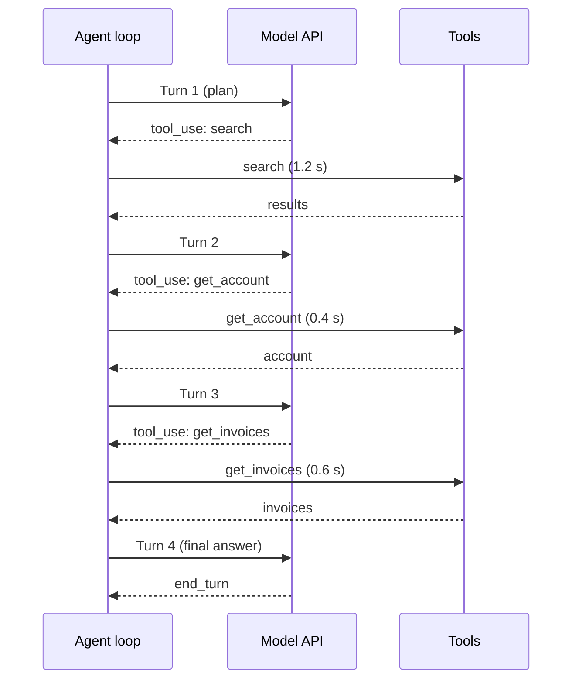

# Latency Optimization

## Introduction

Users forgive a lot, but they do not forgive waiting without knowing why. An agent that answers in 4 seconds feels helpful. The same agent at 40 seconds feels broken, even if the answer is better.

Agents are slow for a structural reason: they are **loops**. A single chat completion is one model call. An agent that searches, reads, checks, and answers might make six model calls and eight tool calls, one after another. Each model call has its own startup time and generation time, and each tool call waits on some other system. Total latency is roughly:

> agent latency = sum over turns of (model time + tool time) + your own overhead

So the biggest wins usually come from **doing fewer sequential steps**, not from shaving milliseconds off each one. Think of a trip to the hardware store. You can drive faster, but the real fix is to write a shopping list so you make one trip instead of four.

This page covers how to measure latency properly, then the main techniques in rough order of impact.

:::note
Anthropic's [latency guide](https://platform.claude.com/docs/en/test-and-evaluate/strengthen-guardrails/reduce-latency) gives good advice: first build a prompt that works well, then optimize latency. Optimizing too early can hide what the best quality looks like.
:::

## Measuring Latency the Right Way

Two numbers matter for each model call:

- **Time to first token (TTFT):** how long until the first output token arrives. This drives *perceived* speed when you stream.
- **Total duration:** how long until the response is complete. This drives how quickly the agent can take its next step.

For the whole run, track:

- **End-to-end time** per task, at p50 and p95 (the slow tail is what users remember)
- **Number of turns** (model calls) per task
- **Time split** between model calls, tool calls, and everything else



In this trace, `get_account` and `get_invoices` did not depend on each other, yet they took two separate turns. That pattern, sequential steps that could have been parallel, is the most common latency problem in agents.

### A Timing Helper That Measures TTFT

Streaming lets you measure TTFT directly. This helper records both numbers for any call.

```python
import time

import anthropic

client = anthropic.Anthropic()


def timed_call(**kwargs) -> tuple:
    start = time.perf_counter()
    ttft = None
    with client.messages.stream(**kwargs) as stream:
        for event in stream:
            if ttft is None and event.type == "content_block_delta":
                ttft = time.perf_counter() - start
        message = stream.get_final_message()
    total = time.perf_counter() - start
    return message, {"ttft_s": round(ttft or total, 2), "total_s": round(total, 2),
                     "output_tokens": message.usage.output_tokens}


message, timing = timed_call(
    model="claude-haiku-5-5",
    max_tokens=1000,
    messages=[{"role": "user", "content": "Give me three tips for writing clear commit messages."}],
)
print(timing)
```

Example output (your numbers will differ):

```text
{'ttft_s': 0.62, 'total_s': 2.41, 'output_tokens': 138}
```

### Breaking Down a Whole Run

Wrap each step of your loop with a timer and print a breakdown. You cannot optimize what you have not measured, and the breakdown often surprises people: a "slow model" turns out to be a slow database query inside a tool.

```python
import time
from collections import defaultdict
from contextlib import contextmanager


class RunTimer:
    def __init__(self):
        self.totals = defaultdict(float)
        self.counts = defaultdict(int)

    @contextmanager
    def step(self, kind: str):
        start = time.perf_counter()
        try:
            yield
        finally:
            self.totals[kind] += time.perf_counter() - start
            self.counts[kind] += 1

    def report(self) -> None:
        grand = sum(self.totals.values())
        for kind, secs in sorted(self.totals.items(), key=lambda kv: -kv[1]):
            print(f"{kind:<12} {self.counts[kind]:>2} calls {secs:5.2f}s {secs / grand:6.1%}")
        print(f"{'total':<12} {'':>8} {grand:5.2f}s")


timer = RunTimer()
for seconds, kind in [(0.30, "model"), (0.25, "tool:crm"), (0.28, "model"),
                      (0.05, "tool:search"), (0.33, "model")]:
    with timer.step(kind):
        time.sleep(seconds)        # stands in for real work
timer.report()
```

Example output:

```text
model         3 calls  0.91s  75.2%
tool:crm      1 calls  0.25s  20.7%
tool:search   1 calls  0.05s   4.1%
total                  1.21s
```

In production, the same data comes from traces. See [Tracing Agent Runs](../11-agents-evaluation-and-testing/8-agents-tracing.mdx) and [OpenTelemetry for Agents](../11-agents-evaluation-and-testing/9-agents-opentelemetry.mdx).

## Technique 1: Take Fewer Turns

Every turn you remove saves a full model round trip. Ways to remove turns:

- **Design coarser tools.** A `get_customer_overview(customer_id)` tool that returns account, plan, and recent invoices replaces three separate calls. See [Tool Design Principles](../2-agents-tool-use/7-agents-tool-design-principles.mdx).
- **Pre-fetch what you know you need.** If every support ticket needs the customer's account, fetch it in code before the agent starts and put it in the first message. Deterministic steps do not need the model to decide them.
- **Use a workflow where the path is fixed.** If the steps are always the same, a [prompt chain](../6-agents-planning-and-reasoning/1-agents-prompt-chaining.mdx) or plain code is faster than an agent deciding each step.
- **Encourage parallel tool calls.** Current models can request several tools in one turn. Tell the model in the system prompt that independent lookups should be requested together.

## Technique 2: Run Tool Calls in Parallel

When the model returns several `tool_use` blocks in one response, run them concurrently, then return **all** results in one user message.

```python
import asyncio
import time


async def get_account(customer_id: str) -> dict:
    await asyncio.sleep(0.4)
    return {"plan": "pro"}


async def get_invoices(customer_id: str) -> list:
    await asyncio.sleep(0.6)
    return [{"id": "inv_1", "status": "unpaid"}]


async def search_kb(query: str) -> list:
    await asyncio.sleep(1.2)
    return ["How to update billing details"]


TOOLS = {"get_account": get_account, "get_invoices": get_invoices, "search_kb": search_kb}


async def run_tool_calls(tool_uses: list) -> list:
    async def run_one(block: dict) -> dict:
        try:
            result = await asyncio.wait_for(TOOLS[block["name"]](**block["input"]), timeout=10)
            return {"type": "tool_result", "tool_use_id": block["id"], "content": str(result)}
        except Exception as exc:
            return {"type": "tool_result", "tool_use_id": block["id"],
                    "content": f"Error: {exc}", "is_error": True}
    return await asyncio.gather(*(run_one(b) for b in tool_uses))


blocks = [
    {"id": "t1", "name": "get_account", "input": {"customer_id": "c_42"}},
    {"id": "t2", "name": "get_invoices", "input": {"customer_id": "c_42"}},
    {"id": "t3", "name": "search_kb", "input": {"query": "update card"}},
]
start = time.perf_counter()
results = asyncio.run(run_tool_calls(blocks))
print(f"{len(results)} results in {time.perf_counter() - start:.1f}s (sequential would be 2.2s)")
```

Example output:

```text
3 results in 1.2s (sequential would be 2.2s)
```

Parallel execution cuts this step from the sum of the tool times to the slowest one. Keep the per-tool timeout: one hung tool should not hold the whole run. See [Parallel Tool Calls](../2-agents-tool-use/5-agents-parallel-tool-calls.mdx).

:::caution
Only run tools in parallel when they are independent and safe to run together. Two tools that write to the same record should run in order.
:::

## Technique 3: Stream Everything the User Sees

Streaming does not make the model faster, but it changes what the user experiences. A response that starts appearing after half a second feels much faster than one that appears all at once after eight seconds.

For agents, stream more than the final text:

- Show **progress events**: "Searching the knowledge base...", "Checking your invoices...".
- Stream the **final answer** token by token.
- For long background tasks, push status updates over WebSockets or server-sent events.

See [Streaming Responses](../1-agents-llm-apis/5-agents-streaming.mdx) and [Streaming Agent Output to a Frontend](../10-agents-integration/2-agents-streaming-to-frontend.mdx).

## Technique 4: Choose the Right Model and Effort per Step

Larger models are generally slower per token, and higher reasoning effort means more thinking tokens before the answer. Not every step needs the most capable model at the highest effort.

- **Route by difficulty.** Use a fast, small model (for example Claude Haiku 5.5) for classification, extraction, and routing. Use a larger model only for steps that need deep reasoning. See [Routing](../6-agents-planning-and-reasoning/2-agents-routing.mdx).
- **Tune effort.** On current Claude models, `output_config={"effort": "low"}` makes responses faster and cheaper; `high` or `xhigh` buys more thorough reasoning at the cost of time. The right level is workload-specific, so measure it on your eval set. See [Reasoning, Thinking and Effort](../1-agents-llm-apis/7-agents-thinking-and-effort.mdx).

```python
import anthropic

client = anthropic.Anthropic()

# Fast path: classify the ticket with a small model at low effort.
triage = client.messages.create(
    model="claude-haiku-5-5",
    max_tokens=1000,
    output_config={"effort": "low"},
    messages=[{"role": "user", "content": "Classify this ticket as billing, bug, or how-to: "
               "'I was charged twice this month.'"}],
)
label = next(b.text for b in triage.content if b.type == "text").strip().lower()
print("triage label:", label)

# Slow path only when needed: a larger model for the complex category.
if "bug" in label:
    answer = client.messages.create(
        model="claude-opus-5-5",
        max_tokens=16000,
        output_config={"effort": "high"},
        messages=[{"role": "user", "content": "Investigate this bug report: ..."}],
    )
```

Some providers also offer premium low-latency modes. Anthropic, for example, offers a "fast mode" research preview on some Opus models at a higher price. Check the current docs for availability and pricing before relying on it.

## Technique 5: Cache Long, Stable Prefixes

Agents resend the system prompt, tool definitions, and conversation history on every turn. With **prompt caching**, the provider reuses its processed version of the unchanged prefix, which reduces time to first token for long prompts as well as cost.

```python
import anthropic

client = anthropic.Anthropic()
LONG_POLICY = "...thousands of tokens of support policy..."

response = client.messages.create(
    model="claude-sonnet-5-5",
    max_tokens=4000,
    system=[{"type": "text", "text": LONG_POLICY,
             "cache_control": {"type": "ephemeral"}}],   # cache the stable prefix
    cache_control={"type": "ephemeral"},                 # auto-cache the growing conversation
    messages=[{"role": "user", "content": "Can I get a refund for last month?"}],
)
u = response.usage
print(u.cache_read_input_tokens, u.cache_creation_input_tokens, u.input_tokens)
```

The rules that make caching work: keep the system prompt and tools byte-for-byte identical across requests (no timestamps or user names in the system prompt), and do not change the model or tool list mid-conversation. Details are in [Prompt Caching](../4-agents-memory-and-context/4-agents-prompt-caching.mdx) and [Cost Optimization](./4-agents-cost-optimization.mdx).

## Technique 6: Send and Generate Fewer Tokens

- **Trim context.** Large tool results that stay in the conversation slow down every later turn. Return only the fields the model needs. Use [compaction](../4-agents-memory-and-context/2-agents-compaction-and-summarization.mdx) for very long runs.
- **Ask for concise output.** Specify the format ("three bullet points", "one paragraph") and give an example. Output tokens are generated one at a time, so they are often the largest part of model time.
- **Use structured outputs** for machine-readable steps so the model does not write explanations nobody reads. See [Structured Outputs](../1-agents-llm-apis/6-agents-structured-outputs.mdx).
- **Treat `max_tokens` as a safety limit**, not a speed knob. A response cut off by `max_tokens` is usually a failed step, and the retry costs more time than you saved.

## Technique 7: Remove Overhead Around the Model

- **Reuse the client.** Create one SDK client per process, not one per request, so HTTP connections are reused.
- **Put workers near their data.** A tool that makes 20 database queries from another region adds seconds.
- **Cache tool results.** If many runs look up the same exchange rate or policy page, cache it in Redis for a few minutes.
- **Set timeouts at every layer**, so a slow dependency fails fast instead of holding the run.

## Real-World Scenario

Your company's in-app assistant answers billing questions. Users complain it is slow. Your traces show p50 of 11 seconds and p95 of 27 seconds, with an average of 5.2 model calls per task. The product goal is a p95 under 10 seconds.

The breakdown from traces shows:

- 62% of time in model calls, mostly turns that each request one lookup tool
- 25% in a `search_kb` tool that queries a slow search cluster
- The final answer averages 450 output tokens, but users read only the first paragraph

**The plan, in order of expected impact:**

1. **Pre-fetch the account and last three invoices** in code before the agent starts. This removes two turns from nearly every run.
2. **Merge lookup tools** into `get_billing_overview`, and add a system prompt line asking the model to request independent lookups together. Execute parallel tool calls with `asyncio.gather`.
3. **Cache `search_kb` results** for common queries for 10 minutes, and add a 3-second timeout.
4. **Stream progress events** and the final answer, so users see activity within a second.
5. **Ask for a two-paragraph answer** with a link to details, cutting output tokens roughly in half.
6. **Cache the system prompt and tool definitions.**
7. **Sweep effort** on the eval set. In this workload, `low` and `medium` score the same, so you choose `low`.

Turns drop from 5.2 to about 2.3 per task, and the p95 meets the goal. Quality, measured on the eval set after each change, stays flat.

**Why this approach fits.** The trace data showed the time was in sequential turns and one slow tool, so the fixes target exactly those. Each change was measured on its own, so you know which ones helped.

**When not to use it.** Aggressive latency work on a background agent that nobody waits for is wasted effort. Optimize cost or quality there instead.

### Alternatives and Trade-offs

| Approach | Pros | Cons | Best for |
|---|---|---|---|
| Fewer turns (coarser tools, pre-fetch) | Biggest win, also cuts cost | Requires redesign of tools and prompts | Most agents |
| Parallel tool execution | Simple, large gain when tools are independent | Must avoid conflicting writes | Lookup-heavy agents |
| Streaming and progress events | Big perceived speedup, no quality cost | Frontend work, does not reduce real time | Any interactive agent |
| Smaller model or lower effort | Faster and cheaper | Possible quality loss; must be measured | Routine steps, high-volume routes |
| Prompt caching | Faster TTFT on long prompts, cheaper | Requires stable prefixes | Long system prompts, long conversations |
| Premium fast modes | Faster without changing the model | Higher price, limited availability | Latency-critical premium features |
| Replace agent with workflow | Fastest and most predictable | Loses flexibility | Fixed, well-understood paths |

## Common Mistakes

- **Optimizing averages.** Users feel the p95. Track percentiles.
- **Guessing instead of tracing.** The slow part is often a tool, not the model.
- **Running dependent tools in parallel.** Faster, but wrong.
- **Cutting `max_tokens` to go faster.** Truncated responses fail and get retried.
- **Putting the current time in the system prompt.** It breaks caching on every request; put dynamic values in the latest user message instead.
- **Downgrading the model without an eval.** A faster model that fails more often makes the run slower overall when you count retries and escalations.

## Summary

- Agent latency is the sum of sequential model and tool steps, so removing steps beats speeding them up.
- Measure TTFT, total time, turns per task, and the time split between model and tools, at p50 and p95.
- Pre-fetch deterministic data, design coarser tools, and execute independent tool calls in parallel.
- Stream progress and answers for perceived speed.
- Route simple steps to faster models and tune effort, measuring quality each time.
- Cache stable prefixes, trim context, and ask for concise output.

## Exercises

1. Add `RunTimer` to an agent you have built and produce a breakdown for 20 tasks. Which step dominates?
2. Change the parallel tool example so that tools marked `writes=True` always run sequentially after the read-only tools.
3. Measure TTFT with and without a cached 5,000-token system prompt (send the same request twice and compare the second call).
4. Write a system prompt instruction that encourages parallel tool requests, then count the average tool calls per turn before and after on your eval set.

Next: [Cost Optimization](./4-agents-cost-optimization.mdx). Related: [Choosing the Right Model](../1-agents-llm-apis/10-agents-model-selection.mdx) and [Prompting for Better Tool Use](../3-agents-prompt-engineering/4-agents-prompting-for-tool-use.mdx).
