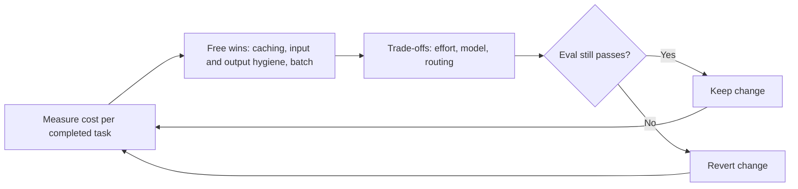

# Cost Optimization

## Introduction

The first bill for a production agent is often a surprise. A demo that cost a few cents per run turns into thousands of dollars a month once real traffic arrives, and nobody can say exactly where the money went.

The most important idea on this page is the **unit of measurement**. Do not optimize cost per token or even cost per API call. Optimize **cost per completed task**: the total spend divided by the number of tasks the agent actually finished successfully.

Why? Because the cheapest model per token is not always the cheapest per task. Imagine two plumbers. One charges $50 an hour and fixes the leak in one hour. The other charges $30 an hour, takes three hours, and the leak comes back next week, so you pay for a second visit. The "cheaper" plumber cost more. Agents work the same way: a cheaper model that takes more turns, fails, and gets retried (or escalated to a human) can cost more than a stronger model that finishes on the first try.

This page follows an order that matters:

1. **Measure** the baseline cost per completed task.
2. Apply **free wins** that cut cost without touching quality: prompt caching, input hygiene, loop hygiene, output hygiene, and batch processing.
3. Only then try **trade-offs** that exchange capability for cost: lower effort, cheaper models, and routing. Each one is checked against an eval.

This order follows Anthropic's own guidance on cost optimization, and it is sound advice for any provider.



## Step 1: Measure Cost per Completed Task

Every response from the Messages API includes a `usage` object. On Anthropic's API, input tokens are split into three parts, each billed at a different rate:

| Field | Meaning | Billing (relative to base input price) |
|---|---|---|
| `input_tokens` | Uncached input, after the last cache breakpoint | 1x |
| `cache_creation_input_tokens` | Tokens written to the cache | Higher than 1x (a premium, larger for the longer cache duration) |
| `cache_read_input_tokens` | Tokens served from the cache | A small fraction of 1x |
| `output_tokens` | Generated tokens, including thinking | Output price, several times the input price |

Prices change and differ by model, so keep them in configuration and look them up on your provider's [pricing page](https://platform.claude.com/docs/en/about-claude/pricing). The numbers below are **illustrative placeholders**, not real prices.

```python
from dataclasses import dataclass

# Illustrative prices in USD per million tokens. Replace with current values
# from your provider's pricing page.
PRICES = {
    "big-model":   {"input": 5.00, "output": 25.00, "cache_write": 6.25, "cache_read": 0.50},
    "small-model": {"input": 1.00, "output": 5.00,  "cache_write": 1.25, "cache_read": 0.10},
}


@dataclass
class Usage:
    input_tokens: int
    output_tokens: int
    cache_creation_input_tokens: int = 0
    cache_read_input_tokens: int = 0


def call_cost(model: str, u: Usage) -> float:
    p = PRICES[model]
    return (u.input_tokens * p["input"] + u.output_tokens * p["output"]
            + u.cache_creation_input_tokens * p["cache_write"]
            + u.cache_read_input_tokens * p["cache_read"]) / 1_000_000


def cost_per_completed_task(runs: list[dict]) -> dict:
    total = sum(sum(call_cost(r["model"], u) for u in r["calls"]) for r in runs)
    completed = sum(1 for r in runs if r["status"] == "completed")
    return {"runs": len(runs), "completed": completed, "total_usd": round(total, 4),
            "usd_per_run": round(total / len(runs), 4),
            "usd_per_completed_task": round(total / completed, 4) if completed else None}


runs = [
    {"model": "big-model", "status": "completed",
     "calls": [Usage(9000, 400), Usage(10500, 300), Usage(11200, 500)]},
    {"model": "big-model", "status": "completed",
     "calls": [Usage(9000, 350), Usage(10100, 450)]},
    {"model": "big-model", "status": "turn_limit",
     "calls": [Usage(9000 + 1500 * i, 300) for i in range(15)]},
]
print(cost_per_completed_task(runs))
```

Output:

```text
{'runs': 3, 'completed': 2, 'total_usd': 1.874, 'usd_per_run': 0.6247, 'usd_per_completed_task': 0.937}
```

Look at the third run. It hit the turn limit after 15 calls, produced nothing useful, and cost more than the two successful runs combined. The two successful runs cost about 0.18 and 0.12 together, yet that one failure pushed the cost per completed task to 0.94. **Failed and looping runs are often the biggest cost driver**, and you only see that when you measure per completed task.

Log `response.usage` for every call, tagged with a run ID, model, route, and agent version. The [Monitoring and Alerting](./6-agents-monitoring-and-alerting.mdx) page turns this into Prometheus metrics. If you have an admin key, Anthropic's Usage and Cost Admin API also reports token usage and cost by model and workspace, which you can use to check your own numbers.

:::tip
Separate traffic classes before you average. A cost per task that blends an interactive chat route with a nightly batch job is meaningless. Measure each route on its own.
:::

## Step 2: Free Wins

These levers reduce cost without reducing what the model can do. Apply them first.

### Prompt Caching (Usually the Largest Lever)

Every turn of an agent loop resends the system prompt, the tool definitions, and the whole conversation so far. A 20-turn task sends its first message 20 times. Prompt caching does not stop the resending, but it reprices the repeated prefix at the much cheaper cache-read rate.

```python
import anthropic

client = anthropic.Anthropic()

SYSTEM = [{"type": "text",
           "text": "You are a support agent for Acme... (long, stable instructions)",
           "cache_control": {"type": "ephemeral"}}]     # explicit breakpoint on the stable prefix


def agent_turn(messages: list, tools: list):
    return client.messages.create(
        model="claude-sonnet-5-5",
        max_tokens=16000,
        system=SYSTEM,
        tools=tools,
        messages=messages,
        cache_control={"type": "ephemeral"},            # automatic caching for the growing tail
    )
```

This is the pattern Anthropic recommends for agent loops: one explicit breakpoint on the static system prefix (tools render before the system prompt, so they are cached with it), plus automatic caching for the conversation. Key rules:

- **Keep the prefix byte-identical.** No timestamps, request IDs, or user names in the system prompt. Put dynamic values in the latest user message.
- **Serialize tools deterministically.** Sort them by name; do not build the list from a `set`.
- **Do not switch models, tools, or effort mid-conversation.** Each of these invalidates some or all of the cache.
- **Check the minimum length.** Prefixes shorter than the model's minimum cacheable size silently do not cache.
- **Pick the right duration.** The default cache lives about 5 minutes and is refreshed on every hit. A 1-hour option costs more to write and only pays off when gaps between turns are longer than 5 minutes (for example, waiting for a human reply).

**Verify from usage, not from code review.** On a warmed-up loop, `cache_read_input_tokens` should be much larger than `input_tokens`. A later code change that adds a timestamp to the system prompt can silently break caching for months, so add an automated check or a dashboard panel for cache hit ratio. See [Prompt Caching](../4-agents-memory-and-context/4-agents-prompt-caching.mdx) for details.

### Input Hygiene

Send the model what the task needs, and let it fetch the rest.

- **Large reference documents in every prompt**: move them behind a retrieval tool so the model reads only the relevant section. Skip this if most calls need most of the document anyway; cached, it may be cheap enough.
- **Tool descriptions repeated in the system prompt**: delete the repetition. Tool schemas are already sent.
- **Many tool schemas**: load rarely used tools on demand. See [Working with Large Toolsets](../2-agents-tool-use/10-agents-large-toolsets.mdx).
- **Broad data-dump tools**: prefer `get_invoice(invoice_id)` over `get_all_invoices()`, and give list tools `limit` and `fields` parameters.
- **Full-resolution images**: downscale to what the task needs; image tokens scale with pixel count.
- **Old prompts on new models**: prompts written for an older model often make a newer one over-work. Review prompts after every model change.

Validate each change against your eval. Removing context can make the model spend extra turns fetching it, which costs more than it saves.

### Loop Hygiene

- **Turn limits and token budgets**: the turn-limit run above shows why. Every loop needs a hard stop.
- **Compaction** for very long sessions: summarize older history server-side or client-side so later turns do not carry everything. It pays off only for sessions long enough to need it. See [Compaction and Summarization](../4-agents-memory-and-context/2-agents-compaction-and-summarization.mdx).
- **Subagents for bulky steps**: a subagent can read 50 pages and return a one-paragraph summary, keeping the main conversation small. See [Subagents and Context Isolation](../8-agents-multi-agent-systems/8-agents-subagents-and-context-isolation.mdx).

### Output Hygiene

- **Specify the output shape**, ideally with an example. "Reply in at most three sentences" is cheaper than an essay.
- **Do not use `max_tokens` as a cost knob.** A response cut off mid-thought is a failed attempt, and the retry costs more. Set it generously as a safety limit.
- **Use structured outputs** for machine-consumed steps, so the model does not write prose nobody reads.

### Batch Processing for Offline Work

If nobody is waiting for the result, use a batch API. Anthropic's Message Batches API charges 50% of standard prices, and the discount stacks with caching. Most batches finish within an hour, with a 24-hour maximum. Good fits: nightly ticket classification, evaluation runs, backfills, and re-scoring.

```python
import anthropic
from anthropic.types.message_create_params import MessageCreateParamsNonStreaming
from anthropic.types.messages.batch_create_params import Request

client = anthropic.Anthropic()

tickets = {"t-101": "My invoice is wrong", "t-102": "App crashes on login"}

batch = client.messages.batches.create(
    requests=[
        Request(
            custom_id=ticket_id,
            params=MessageCreateParamsNonStreaming(
                model="claude-haiku-5-5",
                max_tokens=1000,
                messages=[{"role": "user",
                           "content": f"Classify as billing, bug, or how-to. Ticket: {text}"}],
            ),
        )
        for ticket_id, text in tickets.items()
    ]
)
print(batch.id, batch.processing_status)

# Later (for example, from a scheduled job), collect results:
# for result in client.messages.batches.results(batch.id):
#     if result.result.type == "succeeded":
#         print(result.custom_id, result.result.message.content[0].text)
```

Batch requests are single-shot: there is no multi-turn tool loop inside a batch. If your offline agent normally calls a lookup tool, fetch that data in code first and include it in the request.

## Step 3: Trade-offs (Measure Every One)

From here on, every lever can reduce quality. Change one thing at a time, run your eval, and keep the change only if quality holds. See [Building Evaluation Datasets](../11-agents-evaluation-and-testing/1-agents-building-eval-sets.mdx).

### Tune Effort Before Changing Models

On current Claude models, the `effort` setting (`low`, `medium`, `high`, `xhigh`, `max`) controls how much the model thinks and how thoroughly it works. Lower effort means fewer output tokens and fewer tool calls. Sweep it on your eval:

```python
import statistics


def run_eval(config: dict, cases: list) -> dict:
    """Stand-in: run every case with `config` and return pass/fail plus cost."""
    fake = {"low": (0.86, 0.031), "medium": (0.91, 0.048), "high": (0.92, 0.083)}
    pass_rate, cost = fake[config["effort"]]
    return {"pass_rate": pass_rate, "usd_per_task": cost}


cases = list(range(50))
for effort in ["low", "medium", "high"]:
    r = run_eval({"model": "claude-sonnet-5-5", "effort": effort}, cases)
    per_completed = r["usd_per_task"] / r["pass_rate"]
    print(f"{effort:<7} pass={r['pass_rate']:.0%}  usd/task={r['usd_per_task']:.3f}  "
          f"usd/completed={per_completed:.3f}")
```

Output (illustrative numbers from the stand-in function):

```text
low     pass=86%  usd/task=0.031  usd/completed=0.036
medium  pass=91%  usd/task=0.048  usd/completed=0.053
high    pass=92%  usd/task=0.083  usd/completed=0.090
```

Read the curve. Here `high` buys one point of pass rate for 70% more cost, so `medium` is the better choice unless that one point matters a lot. Whether the curve is flat or steep depends entirely on your workload, so you must measure it. Run each setting in its own session, because changing effort mid-conversation can invalidate the cache and distort the comparison.

A useful pattern when you have an automatic checker (tests pass, JSON validates): **run everything at low effort, then re-run only the failures at higher effort.**

### Choose Cheaper Models per Route

Different parts of your product have different needs. A router sends each request to the cheapest model that handles it well.

```python
ROUTES = {
    # route: (model, effort)
    "classify_ticket":   ("claude-haiku-5-5", "low"),
    "draft_simple_reply": ("claude-sonnet-5-5", "low"),
    "billing_dispute":   ("claude-sonnet-5-5", "medium"),
    "complex_debugging": ("claude-opus-5-5", "high"),
}


def pick_model(route: str) -> tuple[str, str]:
    return ROUTES.get(route, ("claude-sonnet-5-5", "medium"))


for route in ["classify_ticket", "billing_dispute", "unknown_route"]:
    print(route, "->", pick_model(route))
```

Output:

```text
classify_ticket -> ('claude-haiku-5-5', 'low')
billing_dispute -> ('claude-sonnet-5-5', 'medium')
unknown_route -> ('claude-sonnet-5-5', 'medium')
```

Guidelines for model choice:

- **Compare on cost per completed task on your own traffic.** Per-token price lists do not predict the ranking.
- **Price the tail, not the median.** On easy tasks all models look similar. The bill is decided by the hard tasks where the cheap model fails, retries, or escalates.
- **Check for a newer model in the same tier** before stepping down a tier. A newer model at lower effort can be both cheaper and better. That is still a migration, so follow [Migrating to a New Model](./8-agents-model-migration.mdx).
- **Switch models between conversations, not inside one.** Caches are per model, so a mid-conversation switch starts cold.

The same ideas apply to other providers: OpenAI, Google, and open-weight models served with vLLM or Ollama all have smaller, cheaper models and similar reasoning-depth controls. See [Choosing the Right Model](../1-agents-llm-apis/10-agents-model-selection.mdx) and [Routing](../6-agents-planning-and-reasoning/2-agents-routing.mdx).

### Budgets and Guardrails on Spend

Budgets do not reduce cost per task, but they cap the damage when something goes wrong:

- **Per-task**: maximum turns and tokens, enforced in the loop.
- **Per-tenant or per-user**: daily token quotas, so one customer (or one abusive user) cannot run up the bill.
- **Per-workspace or per-key**: provider-side spend limits and rate limits. Anthropic lets you set workspace limits below the organization's.
- **Alerts**: fire when daily spend exceeds a forecast, long before the monthly limit. See [Monitoring and Alerting](./6-agents-monitoring-and-alerting.mdx).

## Real-World Scenario

Your SaaS helpdesk agent handles 40,000 tickets a month. The monthly model bill has grown faster than ticket volume, and finance wants it cut by a third without hurting resolution rates.

**Step 1: measure.** You add `usage` logging per call, tagged with route and status. You find:

- Cost per completed ticket is much higher than cost per run, because about 6% of runs hit the turn limit and each of those costs several times a normal run.
- `cache_read_input_tokens` is near zero. Someone added `Today is {date} {time}` to the top of the system prompt three months ago.
- Each request includes a 12,000-token refund policy, but only billing tickets use it.
- A nightly job that re-tags all tickets runs on the interactive API.

**Step 2: free wins, one at a time, each checked against a 60-ticket eval.**

1. Move the timestamp into the user message. Cache reads jump and input cost per call drops sharply.
2. Move the refund policy behind a `get_refund_policy(section)` tool. Non-billing tickets get lighter; billing tickets fetch only the section they need.
3. Investigate the turn-limit runs. Most were searching for a missing invoice. You make the invoice tool return a clear "not found" message, so the agent stops searching and escalates.
4. Move the nightly re-tagging job to the batch API with the small model.

**Step 3: trade-offs.** You sweep effort on the main route. `medium` matches `high` on your eval, so you switch to `medium`. You test moving ticket classification to the smallest model; it passes, so you keep it. You test moving the whole agent to the smallest model; resolution drops 7 points, so you revert.

**Why this approach fits.** The free wins removed waste the team did not know about, without any quality risk. The trade-offs were applied only where the eval proved them safe.

**When not to use it.** If your agent costs $40 a month, the engineering time is worth more than the savings. A sensible minimum (caching on, turn limits, spend alerts) is enough.

### Alternatives and Trade-offs

| Lever | Pros | Cons | Best for |
|---|---|---|---|
| Prompt caching | Large savings, no quality loss, higher effective rate limits | Needs stable prefixes and monitoring | Every agent with a stable system prompt or long loops |
| Input hygiene (retrieve, trim, narrow tools) | Smaller requests, often faster | Model may take extra turns to fetch context | Large prompts and broad tools |
| Turn limits and failure fixes | Removes the most expensive runs | Needs good failure analysis | Agents with looping or stuck runs |
| Batch API | Big discount, separate limits | Hours of latency, single-shot | Offline jobs, evals, backfills |
| Lower effort | Fewer tokens, faster | Possible quality loss | Routine tasks with flat effort curves |
| Cheaper model per route | Large savings on simple routes | Quality risk on hard cases | High-volume, checkable tasks |
| Self-hosted open models | No per-token fee, data stays in house | GPU cost, ops work, usually lower capability | Very high volume, strict data rules |

## Common Mistakes

- **Optimizing cost per token instead of per completed task.** Cheap failures are expensive.
- **Dynamic data at the top of the system prompt.** It silently disables caching.
- **Applying many changes at once.** You cannot tell which one hurt quality.
- **Downgrading the model first.** It is the riskiest lever. Do the free wins first.
- **Using `max_tokens` to save money.** Truncated outputs are wasted outputs.
- **Blending traffic classes** in one cost number.
- **No eval.** Without one, a saving and a regression look the same.

## Summary

- Measure cost per completed task, per route, using every field of `usage`.
- Apply free wins first: prompt caching, input hygiene, loop hygiene, output hygiene, and batch processing for offline work.
- Then try trade-offs one at a time against an eval: lower effort first, then cheaper models per route.
- Failed and looping runs are often the hidden cost driver; fix them with budgets and better tools.
- Cap damage with per-task, per-tenant, and provider-side spend limits, plus alerts.

## Exercises

1. Add `usage` logging to your agent and compute cost per completed task for one day of traffic (or 50 eval runs). Which status (`completed`, `turn_limit`, `refused`) costs the most in total?
2. Write an integration test that sends the same request twice and fails if the second response has `cache_read_input_tokens == 0`.
3. Find one prompt in your codebase with dynamic content in the system prompt and move it into the user turn. Measure the cache hit ratio before and after.
4. Run an effort sweep on your eval with three settings and plot pass rate against cost per completed task. Which setting would you choose, and why?

Related: [Understanding API Costs](../1-agents-llm-apis/11-agents-api-cost-basics.mdx), [Prompt Caching](../4-agents-memory-and-context/4-agents-prompt-caching.mdx), [Stopping Conditions and Budgets](../6-agents-planning-and-reasoning/10-agents-stopping-conditions.mdx), and [Scaling and Concurrency](./2-agents-scaling.mdx).
