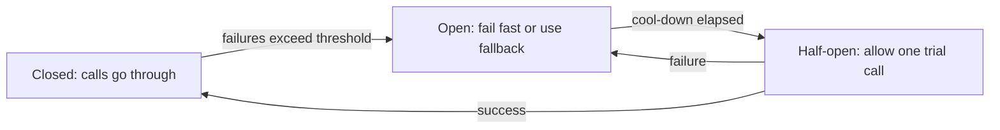

# Reliability and Fallbacks

## Introduction

An agent run is a chain of steps, and every link can break. The model API can be overloaded. A tool can time out. A pod can be restarted halfway through. The model itself can refuse, run out of output tokens, or call a tool with bad arguments. In a 20-step run, even small per-step failure rates add up: if each step succeeds 99% of the time, the whole run succeeds only about 82% of the time.

Anthropic's engineering team put it plainly when describing their research agent: for agents, minor system failures can be catastrophic, because errors compound across long, stateful runs. Their answer combined the model's ability to adapt with deterministic safeguards such as retry logic and checkpoints.

Think of a long train journey with connections. Reliable travel does not mean nothing goes wrong. It means you have a plan for each thing that can: a later train if you miss one (retry), a bus if the line is closed (fallback), a ticket that is still valid after a delay (idempotency), and a way to continue from the station you reached instead of going home and starting over (checkpointing).

This page covers:

- A taxonomy of agent failures and how to classify errors
- Safe retries and idempotent tools
- Timeouts and circuit breakers
- Checkpointing and resuming long runs
- Fallbacks: other models, other providers, degraded answers, and humans

## A Taxonomy of Agent Failures

| Category | Examples | Retry? | Typical response |
|---|---|---|---|
| Transient API errors | 429 rate limit, 500, 529 overloaded, connection reset, timeout | Yes, with backoff | Retry, then fall back |
| Permanent request errors | 400 invalid request, 401, 403, 404 unknown model, 413 too large | No | Fix the code or config; alert |
| Account limits | 429 with spend limit reached | No | Alert a human; degrade gracefully |
| Model outcome problems | `stop_reason` of `refusal` or `max_tokens`, malformed tool input | Sometimes | Handle explicitly; retry with changes or route elsewhere |
| Agent behavior problems | Loops, wrong tool, gives up, hallucinated result | No (same input fails again) | Turn limits, validation, escalate |
| Tool failures | Backend down, timeout, permission denied | Depends on tool | Return `is_error` to the model, retry idempotent tools |
| Infrastructure failures | Pod killed, deploy mid-run, network partition | Resume | Checkpoints or durable execution |

The first job of reliable code is to **put each failure in the right bucket**. Retrying a 400 wastes money; not retrying a 529 drops work you could have finished.

## Classifying API Errors

The Anthropic Python SDK raises typed exceptions. Catch the most specific ones first.

```python
import anthropic


def classify(exc: Exception) -> str:
    """Return 'retry', 'fallback', or 'fatal' for an exception from the SDK."""
    if isinstance(exc, anthropic.RateLimitError):
        body = exc.body if isinstance(exc.body, dict) else {}
        code = body.get("error", {}).get("details", {}).get("error_code")
        return "fatal" if code == "enforced_spend_limit_reached" else "retry"
    if isinstance(exc, anthropic.APIStatusError):
        if exc.status_code == 529 or exc.status_code >= 500:
            return "retry"
        if exc.status_code == 404:
            return "fallback"        # model not available: try the next one
        return "fatal"               # 400, 401, 403, 413: retrying will not help
    if isinstance(exc, (anthropic.APIConnectionError, anthropic.APITimeoutError)):
        return "retry"
    return "fatal"
```

The SDK already retries transient errors (connection errors, 408, 409, 429, and 5xx) with exponential backoff, twice by default. Set `max_retries` and `timeout` on the client to match your needs, and avoid stacking several retry layers on top of each other. See [Error Handling and Retries](../1-agents-llm-apis/9-agents-api-error-handling.mdx) and the retry code in [Scaling and Concurrency](./2-agents-scaling.mdx).

## Handling Model Outcomes, Not Just Errors

A response with HTTP 200 can still be a failure. Check `stop_reason` on every response:

- `end_turn`: the model finished. Validate the answer if you can.
- `tool_use`: execute tools and continue.
- `max_tokens`: the output was cut off. Do not treat partial output as complete. Retry with a larger limit or a request for shorter output, and count it as a failure in your metrics.
- `pause_turn`: a long-running server-side tool paused. Send the conversation back to continue.
- `refusal`: the model declined. Retrying the same request will usually give the same result. Route to a human or to a different flow.

Some providers also offer server-side fallbacks for refusals. Anthropic, for example, has a beta `fallbacks` parameter on some models that re-runs a declined request on a fallback model within the same call. Availability varies by model and platform, so check the current docs before relying on it.

## Safe Retries Need Idempotent Tools

Retries are only safe if repeating an action has the same effect as doing it once. Reading data is naturally idempotent. Sending an email, charging a card, or creating a ticket is not.

Consider this timeline: the agent calls `issue_refund`, the payment system processes it, but the response times out. The tool layer retries, and the customer gets two refunds. The fix is an **idempotency key**: a unique ID for the *intended action*, sent with every attempt, so the backend can recognize a repeat.

```python
import hashlib
import json


class RefundService:
    """Stand-in for a payment API that supports idempotency keys."""

    def __init__(self):
        self.processed: dict[str, dict] = {}
        self.refunds_issued = 0

    def refund(self, order_id: str, amount: float, idempotency_key: str) -> dict:
        if idempotency_key in self.processed:
            return self.processed[idempotency_key]         # replay: same result, no new refund
        self.refunds_issued += 1
        result = {"refund_id": f"rf_{self.refunds_issued}", "order_id": order_id, "amount": amount}
        self.processed[idempotency_key] = result
        return result


def idempotency_key(run_id: str, tool_name: str, tool_input: dict) -> str:
    raw = json.dumps({"run": run_id, "tool": tool_name, "input": tool_input}, sort_keys=True)
    return hashlib.sha256(raw.encode()).hexdigest()[:32]


service = RefundService()
args = {"order_id": "A-1001", "amount": 15.0}
key = idempotency_key("run_789", "issue_refund", args)

first = service.refund(**args, idempotency_key=key)
retry = service.refund(**args, idempotency_key=key)     # e.g. after a timeout
print(first, retry, "refunds issued:", service.refunds_issued)
```

Output:

```text
{'refund_id': 'rf_1', 'order_id': 'A-1001', 'amount': 15.0} {'refund_id': 'rf_1', 'order_id': 'A-1001', 'amount': 15.0} refunds issued: 1
```

Deriving the key from the run ID, tool name, and arguments means a retry of the *same* call reuses the key, while a deliberate second refund in a different run gets a new one. Many payment and messaging APIs (Stripe is a well-known example) accept idempotency keys directly. For your own services, store processed keys in a database with a unique constraint.

## Timeouts at Every Layer

A call without a timeout can hang forever and hold a worker, a connection, and a concurrency slot. Set timeouts on:

- **Model calls**: the SDK default is long (10 minutes) to allow big outputs. For interactive routes, set a shorter one with `Anthropic(timeout=...)` or per call with `client.with_options(timeout=...)`. Use streaming for long outputs.
- **Each tool call**: wrap with `asyncio.wait_for` or the HTTP client's timeout.
- **The whole run**: a wall-clock limit, in addition to the turn limit.

Timeouts should **shrink** as you go inward. If the user-facing request times out at 30 seconds, a model call allowed to run for 60 seconds is wasted work.

## Circuit Breakers

When a dependency is down, retrying every request makes things worse: you wait for timeouts, burn retries, and add load to a struggling system. A **circuit breaker** notices repeated failures and "opens", failing fast (or going straight to a fallback) for a cool-down period. After the cool-down it lets one trial request through ("half-open"). If that succeeds, it closes again.



```python
import time


class CircuitBreaker:
    def __init__(self, failure_threshold: int = 5, cooldown_s: float = 30.0):
        self.failure_threshold = failure_threshold
        self.cooldown_s = cooldown_s
        self.failures = 0
        self.opened_at: float | None = None

    def allow(self) -> bool:
        if self.opened_at is None:
            return True
        if time.monotonic() - self.opened_at >= self.cooldown_s:
            return True                       # half-open: let a trial call through
        return False

    def record_success(self) -> None:
        self.failures = 0
        self.opened_at = None

    def record_failure(self) -> None:
        self.failures += 1
        if self.failures >= self.failure_threshold:
            self.opened_at = time.monotonic()


breaker = CircuitBreaker(failure_threshold=3, cooldown_s=0.2)
for i in range(5):
    if not breaker.allow():
        print(f"call {i}: circuit open, using fallback")
        continue
    breaker.record_failure()                  # pretend the call failed
    print(f"call {i}: failed (failures={breaker.failures})")
time.sleep(0.25)
print("after cool-down, allowed:", breaker.allow())
```

Output:

```text
call 0: failed (failures=1)
call 1: failed (failures=2)
call 2: failed (failures=3)
call 3: circuit open, using fallback
call 4: circuit open, using fallback
after cool-down, allowed: True
```

Keep one breaker per dependency (per model, per tool backend), and export its state as a metric so you can see it on a dashboard.

## Fallback Chains

When the primary path fails, what happens next? Design the answer before you need it. Common fallbacks, from closest to furthest from the original:

1. **Same model, retry later** (backoff), already covered.
2. **Another model from the same provider**, for example a different tier, which has its own rate limit pool.
3. **The same model on another platform.** Claude models are also offered through cloud platforms such as Amazon Bedrock, Google Cloud Vertex AI, and Microsoft Foundry, each with its own capacity and quotas.
4. **Another provider's model.** This needs prompts and tools tested on that model, because behavior differs.
5. **A degraded answer**: a cached response, a search result list, or a templated reply.
6. **A human**: create a ticket or hand off to a support agent.

```python
from typing import Callable


class AllFallbacksFailed(Exception):
    pass


def with_fallbacks(attempts: list[tuple[str, Callable[[], str]]],
                   classify: Callable[[Exception], str]) -> tuple[str, str]:
    errors = []
    for name, attempt in attempts:
        try:
            return name, attempt()
        except Exception as exc:
            kind = classify(exc)
            errors.append(f"{name}: {type(exc).__name__} ({kind})")
            if kind == "fatal":
                break                         # a bad request fails everywhere; stop early
    raise AllFallbacksFailed("; ".join(errors))


class Overloaded(Exception):
    pass


def primary():
    raise Overloaded("529 overloaded")


def secondary():
    raise TimeoutError("timed out")


def degraded():
    return "We're experiencing high demand. Here are help articles that may answer your question: ..."


simple_classify = lambda e: "retry" if isinstance(e, (Overloaded, TimeoutError)) else "fatal"
source, answer = with_fallbacks(
    [("primary-model", primary), ("secondary-model", secondary), ("static-help", degraded)],
    simple_classify,
)
print(source, "->", answer[:40])
```

Output:

```text
static-help -> We're experiencing high demand. Here are
```

In the real version, `primary` and `secondary` call different models with the SDK's own retries already applied, and each attempt is recorded in metrics with a `fallback_used` label so you can see how often you degrade.

:::caution
Switching models in the **middle** of an agent conversation has costs. Caches are per model, so the next call starts cold. On current Claude models, thinking blocks produced by one model may not be accepted or used by another. Prefer to fall back at the **start** of a task or a new conversation. If you must switch mid-task, consider starting the fallback model with a summary of progress rather than the raw transcript, and test that path.
:::

A fallback model is only useful if it works. Run your eval set against each fallback configuration on a schedule, so you do not discover during an outage that the fallback prompt broke two months ago.

## Checkpointing Long Runs

If a worker dies at turn 14 of a 20-turn task, you want to resume at turn 14, not start over and pay for 13 turns again. Save the conversation and run state after every turn.

```python
import json
from pathlib import Path


class CheckpointStore:
    """Saves run state after each turn. Use Redis or a database in production."""

    def __init__(self, directory: str = "checkpoints"):
        self.dir = Path(directory)
        self.dir.mkdir(exist_ok=True)

    def save(self, run_id: str, state: dict) -> None:
        tmp = self.dir / f"{run_id}.tmp"
        tmp.write_text(json.dumps(state))
        tmp.replace(self.dir / f"{run_id}.json")      # atomic rename

    def load(self, run_id: str) -> dict | None:
        path = self.dir / f"{run_id}.json"
        return json.loads(path.read_text()) if path.exists() else None


def run_with_checkpoints(run_id: str, task: str, step_fn, store: CheckpointStore,
                         max_turns: int = 10) -> dict:
    state = store.load(run_id) or {"turn": 0, "messages": [{"role": "user", "content": task}],
                                   "done": False}
    if state["turn"]:
        print(f"resuming {run_id} at turn {state['turn']}")
    while not state["done"] and state["turn"] < max_turns:
        state = step_fn(state)                        # one model call + tools
        state["turn"] += 1
        store.save(run_id, state)
    return state


def fake_step(state: dict) -> dict:
    state["messages"].append({"role": "assistant", "content": f"step {state['turn']}"})
    state["done"] = state["turn"] >= 2
    return state


store = CheckpointStore()
result = run_with_checkpoints("run_42", "Summarize Q3 incidents", fake_step, store)
print("turns:", result["turn"], "done:", result["done"])
result = run_with_checkpoints("run_42", "Summarize Q3 incidents", fake_step, store)
```

Output (first run in a fresh directory):

```text
turns: 3 done: True
resuming run_42 at turn 3
```

The second call loaded the finished state and did no new work. Two important details:

- Checkpoint **after** tool side effects are recorded, and make those tools idempotent. If the worker dies between executing a tool and saving, the tool will run again on resume.
- Keep the saved transcript **append-only**. Editing earlier messages before resuming breaks prompt caching and, on current Claude models, can invalidate earlier thinking blocks.

For complex, long-running workflows, a durable execution engine such as Temporal handles checkpointing, retries, and timers for you. See [Deployment Architectures](./1-agents-deployment-architectures.mdx) and [Agent State Management](../4-agents-memory-and-context/9-agents-state-management.mdx).

## Graceful Degradation

Plan what the product does in each degraded state, and make it visible to users:

- **Agent unavailable**: show a clear message and offer the old non-agent flow (a form, search, or a human).
- **Tool unavailable**: tell the model, using `is_error: True` in the `tool_result`, so it can explain or try another path. See [Handling Tool Errors](../2-agents-tool-use/6-agents-tool-errors.mdx).
- **Read-only mode**: disable write tools via a feature flag but keep answering questions.
- **Draft-only mode**: the agent drafts, a human approves and sends.

## Real-World Scenario

You run an e-commerce support agent that answers order questions and can issue small refunds. Last month, three things went wrong: a 40-minute provider capacity problem left customers with spinning loaders, a deploy restarted pods and dropped 200 in-flight conversations, and a payment API timeout caused 14 duplicate refunds.

**What you build:**

1. **Error classification** using the SDK's typed exceptions, with the SDK's own retries set to 3 and no extra retry layer.
2. **A circuit breaker per model.** When the primary model's breaker opens, new conversations start on a secondary model tier that you evaluate weekly. Conversations already in progress continue to retry the primary with backoff.
3. **A degraded mode.** If both models are unavailable, the chat shows order status from the database (no model needed) and offers a "talk to a person" button.
4. **Idempotency keys** on `issue_refund`, derived from the run ID and arguments, passed to the payment provider.
5. **Checkpoints in Redis** after every turn, plus a 120-second termination grace period on the Kubernetes Deployment so deploys drain cleanly.
6. **Metrics** for fallback usage, breaker state, and idempotent replays, with an alert when fallback usage stays above 5% for 10 minutes.

**Why this approach fits.** Each fix maps to a failure that actually happened, and each one turns a customer-visible problem into a measured, bounded degradation.

**When not to use it.** A multi-provider fallback is expensive to maintain: every prompt and tool must be evaluated on each model. For an internal tool, "retry, then show a friendly error" is enough.

### Alternatives and Trade-offs

| Approach | Pros | Cons | Best for |
|---|---|---|---|
| SDK retries with backoff | Free, handles most transient errors | Does not help in long outages | Everyone, always |
| Secondary model, same provider | Simple to add, separate rate limits | Shares the provider's wider incidents; quality differs | Overload and per-model capacity issues |
| Same model, another cloud platform | Same behavior, separate capacity | Separate accounts, quotas, and feature differences | High-availability requirements |
| Another provider | Independent failure domain | Prompts and tools need separate tuning and evals | Critical paths with strict uptime targets |
| Degraded non-LLM answer | Always available, cheap | Lower quality | User-facing features that must never be blank |
| Human handoff | Highest quality for hard cases | Expensive, slow, limited capacity | High-stakes or failed runs |
| Durable execution | Automatic checkpoint, retry, resume | New infrastructure | Long, expensive runs |

## Common Mistakes

- **Retrying non-retryable errors.** A 400 will fail every time; fix the request.
- **Retries without idempotency.** Duplicate emails, tickets, and refunds.
- **Stacked retries.** Three layers of 3 retries each can turn one failure into 27 calls.
- **Treating HTTP 200 as success.** Check `stop_reason` and validate outputs.
- **Untested fallbacks.** A fallback that has never run is a hope, not a plan.
- **Switching models mid-conversation casually.** Caches go cold and reasoning context may be lost.
- **Editing the saved transcript before resuming.** Keep history append-only.

## Summary

- Classify every failure: retry transient errors, fix permanent ones, and alert on account limits.
- Check `stop_reason` on every response; `max_tokens` and `refusal` are failures to handle, not answers.
- Make side-effecting tools idempotent before enabling retries.
- Use timeouts at every layer and circuit breakers per dependency.
- Design a fallback chain (other model, other platform, degraded answer, human) and evaluate it regularly.
- Checkpoint long runs after every turn, with append-only history, or use a durable execution engine.

## Exercises

1. Write unit tests for `classify` using fake exceptions for 429 (normal and spend-limit), 500, 529, 400, and 404.
2. Extend `CircuitBreaker` with a `state` property that returns `closed`, `open`, or `half_open`, and expose it as a Prometheus gauge.
3. Add idempotency to a tool in your own agent. How will the backend store and expire processed keys?
4. Kill your agent process in the middle of a run (or simulate it in a test), restart it, and confirm it resumes from the checkpoint without repeating side effects.

Next: [Monitoring and Alerting](./6-agents-monitoring-and-alerting.mdx). Related: [Agent Limitations and Failure Modes](../0-agents-fundamentals/9-agents-limitations.mdx), [Multi-Agent Failure Modes](../8-agents-multi-agent-systems/9-agents-multi-agent-failure-modes.mdx), and [Session Persistence](../4-agents-memory-and-context/10-agents-session-persistence.mdx).
