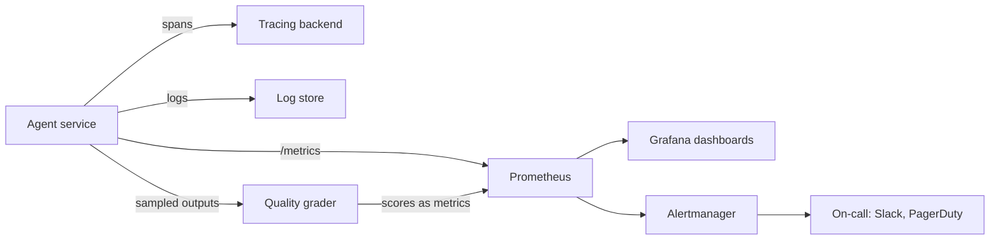

# AI Agents Monitoring and Alerting

## Introduction

A traditional web service is healthy when it is up, fast, and not returning errors. An agent can be up, fast, and error-free, and still be failing: giving wrong answers, looping until the turn limit, escalating every ticket to a human, or quietly costing three times what it did last week.

So agent monitoring needs two layers:

1. **Operational health**, the classic signals: traffic, errors, latency, and saturation.
2. **Agent health**, signals specific to agents: task success, turns per task, tokens and cost, cache hit rate, tool errors, refusals, and output quality.

Think of a hospital patient monitor. Heart rate and blood pressure (operational signals) tell you the patient is alive. They do not tell you whether the treatment is working. For that, doctors also run lab tests (quality checks) on a schedule. You need both.

This page shows how to instrument an agent with Prometheus metrics, which queries and dashboards to build in Grafana, how to sample quality, and how to write alerts that someone can act on. If you are new to these tools, start with the site's [Prometheus Introduction](../../../observability/prometheus/0-prometheus-fundamentals/0-prometheus-introduction.mdx) and [Grafana Introduction](../../../observability/grafana/0-grafana-fundamentals/0-grafana-introduction.mdx).

## Metrics, Traces, Logs, and Evals

Each tool answers a different question:

| Signal | Answers | Example |
|---|---|---|
| Metrics | How much, how often, how fast, across all runs? | p95 latency, cost per hour, task success rate |
| Traces | What happened in *this* run, step by step? | Turn 3 called `search_kb` and got an empty result |
| Logs | What exactly was said or returned? | The tool error message, the provider request ID |
| Online evals | Was the output actually good? | A grader scored 4 of 50 sampled answers as wrong |

Metrics tell you **that** something is wrong; traces and logs tell you **why**. This page focuses on metrics and alerts. For traces, see [Tracing Agent Runs](../11-agents-evaluation-and-testing/8-agents-tracing.mdx) and [OpenTelemetry for Agents](../11-agents-evaluation-and-testing/9-agents-opentelemetry.mdx).



## What to Measure

| Metric | Type | Labels | Why |
|---|---|---|---|
| `agent_runs_total` | Counter | `agent`, `version`, `route`, `status` | Traffic and outcome mix (`completed`, `turn_limit`, `refused`, `error`, `escalated`) |
| `agent_run_duration_seconds` | Histogram | `agent`, `route` | End-to-end latency percentiles |
| `agent_turns_per_run` | Histogram | `agent`, `route` | Rising turns signal loops or tool problems |
| `llm_requests_total` | Counter | `model`, `outcome` | Model call volume and error rate (`ok`, `rate_limited`, `overloaded`, `server_error`, `client_error`) |
| `llm_request_duration_seconds` | Histogram | `model` | Model latency |
| `llm_tokens_total` | Counter | `model`, `type` | Tokens by type: `input`, `output`, `cache_read`, `cache_write` |
| `llm_cost_usd_total` | Counter | `model`, `route` | Spend, computed from usage and your price table |
| `tool_calls_total` | Counter | `tool`, `outcome` | Which tools fail |
| `tool_call_duration_seconds` | Histogram | `tool` | Slow tools |
| `llm_ratelimit_remaining` | Gauge | `model`, `kind` | Headroom before 429s |
| `agent_quality_score` | Gauge or Histogram | `agent`, `grader` | Sampled quality from online evals |

OpenTelemetry also defines standard names for generative AI metrics, such as `gen_ai.client.token.usage` and `gen_ai.client.operation.duration`. If you use OpenTelemetry, prefer those names; parts of the GenAI conventions are still marked as in development, so check the [current specification](https://opentelemetry.io/docs/specs/semconv/gen-ai/gen-ai-metrics/).

:::warning
Keep label values to a small, fixed set. Never use `user_id`, `run_id`, ticket IDs, or prompt text as labels. Each unique value creates a new time series, and high-cardinality labels can overwhelm Prometheus. Put those values in traces and logs instead. See [Prometheus Labels](../../../observability/prometheus/1-prometheus-metrics/5-prometheus-labels.mdx).
:::

## Instrumenting an Agent with `prometheus_client`

The official Python client makes this straightforward. Define metrics once at module level, update them from your agent loop, and expose an HTTP endpoint for Prometheus to scrape.

```python
from prometheus_client import Counter, Gauge, Histogram, start_http_server

RUNS = Counter("agent_runs_total", "Agent runs by outcome",
               ["agent", "version", "route", "status"])
RUN_SECONDS = Histogram("agent_run_duration_seconds", "End-to-end run time",
                        ["agent", "route"], buckets=[1, 2, 5, 10, 20, 30, 60, 120, 300])
TURNS = Histogram("agent_turns_per_run", "Model calls per run", ["agent", "route"],
                  buckets=[1, 2, 3, 5, 8, 13, 20, 30])
LLM_REQUESTS = Counter("llm_requests_total", "Model API calls", ["model", "outcome"])
LLM_SECONDS = Histogram("llm_request_duration_seconds", "Model call latency", ["model"],
                        buckets=[0.25, 0.5, 1, 2, 4, 8, 16, 32, 64])
TOKENS = Counter("llm_tokens_total", "Tokens by type", ["model", "type"])
COST = Counter("llm_cost_usd_total", "Estimated spend in USD", ["model", "route"])
TOOL_CALLS = Counter("tool_calls_total", "Tool calls", ["tool", "outcome"])
RATELIMIT_REMAINING = Gauge("llm_ratelimit_remaining", "Remaining rate limit capacity",
                            ["model", "kind"])

# Example prices in USD per million tokens. Prices change: load current values

# from config, sourced from the provider's pricing page.
PRICES = {"claude-sonnet-5-5": {"input": 2.0, "output": 10.0,
                                "cache_write": 2.5, "cache_read": 0.20}}


def record_usage(model: str, route: str, usage) -> None:
    parts = {
        "input": usage.input_tokens,
        "output": usage.output_tokens,
        "cache_write": getattr(usage, "cache_creation_input_tokens", 0) or 0,
        "cache_read": getattr(usage, "cache_read_input_tokens", 0) or 0,
    }
    price = PRICES.get(model, {})
    for kind, count in parts.items():
        TOKENS.labels(model=model, type=kind).inc(count)
        COST.labels(model=model, route=route).inc(count * price.get(kind, 0) / 1_000_000)


def record_run(agent: str, version: str, route: str, status: str,
               seconds: float, turns: int) -> None:
    RUNS.labels(agent=agent, version=version, route=route, status=status).inc()
    RUN_SECONDS.labels(agent=agent, route=route).observe(seconds)
    TURNS.labels(agent=agent, route=route).observe(turns)


if __name__ == "__main__":
    start_http_server(9100)    # metrics at http://localhost:9100/metrics
```

Then wrap each model call:

```python
import time

import anthropic

client = anthropic.Anthropic()


def instrumented_call(route: str, **kwargs):
    model = kwargs["model"]
    start = time.perf_counter()
    try:
        raw = client.messages.with_raw_response.create(**kwargs)
        response = raw.parse()
        LLM_REQUESTS.labels(model=model, outcome="ok").inc()
        record_usage(model, route, response.usage)
        remaining = raw.headers.get("anthropic-ratelimit-input-tokens-remaining")
        if remaining is not None:
            RATELIMIT_REMAINING.labels(model=model, kind="input_tokens").set(float(remaining))
        return response
    except anthropic.RateLimitError:
        LLM_REQUESTS.labels(model=model, outcome="rate_limited").inc()
        raise
    except anthropic.APIStatusError as e:
        outcome = "overloaded" if e.status_code == 529 else (
            "server_error" if e.status_code >= 500 else "client_error")
        LLM_REQUESTS.labels(model=model, outcome=outcome).inc()
        raise
    except anthropic.APIConnectionError:
        LLM_REQUESTS.labels(model=model, outcome="connection_error").inc()
        raise
    finally:
        LLM_SECONDS.labels(model=model).observe(time.perf_counter() - start)
```

(This snippet assumes the metric objects from the previous block are in the same module.) A scrape of `/metrics` then looks like this:

```text
agent_runs_total{agent="support",route="billing",status="completed",version="2026.10.3"} 1832.0
agent_runs_total{agent="support",route="billing",status="turn_limit",version="2026.10.3"} 41.0
llm_tokens_total{model="claude-sonnet-5-5",type="cache_read"} 9.1874e+07
llm_tokens_total{model="claude-sonnet-5-5",type="input"} 6.2311e+06
```

In Kubernetes, the Prometheus Operator discovers this endpoint with a `ServiceMonitor`. See [ServiceMonitor Custom Resources](../../../observability/prometheus/8-prometheus-and-kubernetes/1-servicemonitor-custom-resources.mdx).

## Useful PromQL Queries

These queries become your Grafana panels. See [PromQL introduction](../../../observability/prometheus/2-promql-prometheus-query-language/0-promql-introduction.mdx) in the Prometheus tutorial for the syntax.

```text
# Task success rate over the last 30 minutes, per route
sum by (route) (rate(agent_runs_total{status="completed"}[30m]))
  / sum by (route) (rate(agent_runs_total[30m]))

# p95 end-to-end latency per route
histogram_quantile(0.95, sum by (le, route) (rate(agent_run_duration_seconds_bucket[5m])))

# Model error rate (anything that is not "ok")
sum(rate(llm_requests_total{outcome!="ok"}[5m])) / sum(rate(llm_requests_total[5m]))

# Cache hit ratio: share of input tokens served from the cache
sum(rate(llm_tokens_total{type="cache_read"}[1h]))
  / sum(rate(llm_tokens_total{type=~"input|cache_read|cache_write"}[1h]))

# Spend per hour, per route
sum by (route) (increase(llm_cost_usd_total[1h]))

# Cost per completed task over the last day
sum(increase(llm_cost_usd_total[1d]))
  / sum(increase(agent_runs_total{status="completed"}[1d]))

# Average turns per run (watch for upward drift)
sum(rate(agent_turns_per_run_sum[1h])) / sum(rate(agent_turns_per_run_count[1h]))
```

## A Grafana Dashboard Layout

Organize the dashboard from "is it OK?" at the top to "why?" at the bottom:

1. **Top row (stat panels):** task success rate, p95 latency, spend today vs. forecast, model error rate, and active alerts.
2. **Outcomes:** stacked time series of runs by `status`. A growing `turn_limit` or `escalated` band is an early warning.
3. **Latency:** p50 and p95 per route; model latency vs. tool latency.
4. **Tokens and cost:** tokens by type, cache hit ratio, cost per completed task, spend by route.
5. **Dependencies:** model requests by outcome, rate limit headroom, tool error rates and latency per tool.
6. **Quality:** online eval scores, user feedback (thumbs up and down), escalation rate.
7. **Versions:** the same success and cost panels split by `version` label, so a canary is easy to compare.

Add a Grafana **annotation** for every deploy and every prompt or model change. Most agent regressions line up with a change, and annotations make that obvious. See [Creating Dashboards](../../../observability/grafana/3-grafana-dashboards/1-creating-dashboards.mdx) and [Dashboard Annotations](../../../observability/grafana/3-grafana-dashboards/7-dashboard-annotations.mdx).

## Monitoring Quality in Production

Operational metrics cannot tell you whether answers are correct. Add quality signals:

- **Online evaluation by sampling.** Send a small random sample of completed runs (for example 1 to 5%) to a grader: rule-based checks where possible, an LLM judge with a rubric where not. Run the grader asynchronously, or with a batch API, so it never slows users down. Export the scores as metrics.
- **User feedback.** Thumbs up and down, "was this helpful?", or whether the user re-asked the same question.
- **Business outcomes.** Ticket reopen rate, escalation rate, refund reversals, task abandonment.
- **Drift checks.** Compare the mix of routes and inputs this week with last week. A new kind of request can lower quality without any code change.

```python
import random


def maybe_sample_for_grading(run: dict, sample_rate: float = 0.02) -> bool:
    """Decide whether to send a completed run to the async quality grader."""
    if run["status"] != "completed":
        return False
    if run.get("route") in {"refund", "account_deletion"}:
        return True                    # always grade high-risk routes
    return random.random() < sample_rate


runs = [{"status": "completed", "route": "billing"} for _ in range(1000)]
runs += [{"status": "completed", "route": "refund"} for _ in range(20)]
random.seed(7)
picked = sum(maybe_sample_for_grading(r) for r in runs)
print(f"sampled {picked} of {len(runs)} runs for grading")
```

Example output:

```text
sampled 43 of 1020 runs for grading
```

Grading every high-risk run while sampling the rest keeps grader cost proportional to risk. Remember that sending production outputs to a grader is still processing user data; follow your privacy rules. See [Grading Methods](../11-agents-evaluation-and-testing/2-agents-grading-methods.mdx) and [Data Privacy and PII](../12-agents-safety-and-security/5-agents-data-privacy.mdx).

## Alerts That Someone Can Act On

A good alert is **urgent, actionable, and rare**. Alert on symptoms users feel (success rate, latency, spend) rather than on every internal blip. Write each alert with a link to a runbook that says what to do.

```yaml
groups:
  - name: agent-alerts
    rules:
      - alert: AgentTaskSuccessLow
        expr: |
          sum(rate(agent_runs_total{status="completed"}[15m]))
            / sum(rate(agent_runs_total[15m])) < 0.85
        for: 10m
        labels:
          severity: page
        annotations:
          summary: "Agent task success below 85% for 10 minutes"
          runbook_url: "https://wiki.example.com/runbooks/agent-success-low"

      - alert: AgentLoopingRuns
        expr: |
          sum(rate(agent_runs_total{status="turn_limit"}[30m]))
            / sum(rate(agent_runs_total[30m])) > 0.05
        for: 15m
        labels:
          severity: ticket
        annotations:
          summary: "More than 5% of runs are hitting the turn limit"

      - alert: AgentSpendAboveForecast
        expr: sum(increase(llm_cost_usd_total[1h])) > 40
        for: 5m
        labels:
          severity: page
        annotations:
          summary: "Agent spend over $40 in the last hour (forecast is about $15)"

      - alert: LLMErrorRateHigh
        expr: |
          sum(rate(llm_requests_total{outcome!="ok"}[5m]))
            / sum(rate(llm_requests_total[5m])) > 0.10
        for: 10m
        labels:
          severity: page
        annotations:
          summary: "More than 10% of model calls failing"

      - alert: PromptCacheHitRatioDropped
        expr: |
          sum(rate(llm_tokens_total{type="cache_read"}[1h]))
            / sum(rate(llm_tokens_total{type=~"input|cache_read|cache_write"}[1h])) < 0.5
        for: 1h
        labels:
          severity: ticket
        annotations:
          summary: "Prompt cache hit ratio below 50%; check recent prompt changes"
```

The thresholds here are examples. Set yours from your own baseline: look at two weeks of data, then set thresholds that would have caught real problems without firing on normal days. The cache-hit alert deserves special mention. A broken cache causes no errors and no latency spike; the only symptom is a bigger bill. Without an alert, it can go unnoticed for months.

Route `page` alerts to on-call (for example, via PagerDuty) and `ticket` alerts to a team channel. See [Prometheus Alerting Rules](../../../observability/prometheus/4-prometheus-alerting/1-prometheus-alerting-rules.mdx), [Alertmanager](../../../observability/prometheus/4-prometheus-alerting/2-prometheus-alert-manager.mdx), and [Grafana Alerting](../../../observability/grafana/6-grafana-alerting/0-alerting-overview.mdx).

### SLOs and Burn Rates

For mature services, define a **service level objective** such as "95% of support tasks complete successfully over 28 days". The remaining 5% is your **error budget**. Alert when you are spending the budget too fast (a "burn rate" alert) instead of on any single bad minute. This reduces noisy pages while still catching both sudden outages and slow regressions. The Google SRE workbook's chapter on [alerting on SLOs](https://sre.google/workbook/alerting-on-slos/) explains the method.

## Real-World Scenario

Your team runs a DevOps assistant agent that answers questions about deployments and can restart services. It has been live for two months with only basic HTTP metrics. Last week, a prompt change caused the agent to call `get_logs` repeatedly; average turns per run went from 4 to 11, cost tripled, and nobody noticed for five days because there were no errors.

**What you add:**

1. The metrics in the table above, exported with `prometheus_client`, scraped via a `ServiceMonitor`.
2. A Grafana dashboard with the layout above, including a "turns per run" panel and deploy annotations.
3. Alerts for task success, looping runs, hourly spend, model error rate, and cache hit ratio, each with a runbook link.
4. Online grading: every run that calls `restart_service` is graded, plus 3% of the rest, with scores exported as a metric.
5. The `version` label on run metrics, so the next prompt change can be compared side by side during its canary.

With these in place, the same regression would show up within an hour as a jump in the turns panel and a looping-runs alert, and the version split would point straight at the prompt change.

**Why this approach fits.** The incident was invisible to error-based monitoring. Agent-specific signals (turns, cost, outcome mix) are exactly what moved.

**When not to use it.** For a prototype, logging `usage` and outcomes to a file and checking a weekly summary is fine. Build the full stack when real users or real money depend on the agent.

### Alternatives and Trade-offs

| Approach | Pros | Cons | Best for |
|---|---|---|---|
| Prometheus + Grafana (self-hosted) | Free, flexible, standard in Kubernetes | You operate it; cardinality limits | Teams already running it |
| OpenTelemetry to a vendor backend | One pipeline for traces, metrics, logs | Vendor cost; GenAI conventions still evolving | Organizations standardizing on OTel |
| LLM observability platforms | Built-in trace views, token and cost tracking, eval tooling | Another vendor; data leaves your systems | Teams wanting agent-specific views fast |
| Provider console usage pages | Zero setup, authoritative billing data | Delayed, not per route or per task | Checking your own numbers |
| Logs only | Simple | Hard to alert on, expensive to query | Prototypes |

## Common Mistakes

- **Only monitoring HTTP errors.** Agents fail silently: loops, wrong answers, cost spikes.
- **High-cardinality labels** like user or run IDs on metrics.
- **No version label.** You cannot compare a canary with the stable version.
- **Alerts without runbooks.** The person paged at 3 a.m. needs to know what to do.
- **Too many alerts.** If alerts fire daily and get ignored, the important one will be ignored too.
- **No cost or cache alerts.** Billing surprises are the most common agent "incident".
- **No quality sampling.** Operational green, answers wrong.

## Summary

- Monitor two layers: operational health (traffic, errors, latency, saturation) and agent health (success, turns, tokens, cost, cache hits, tool errors, quality).
- Instrument with Prometheus counters, histograms, and gauges, using low-cardinality labels including the agent version.
- Build Grafana dashboards from "is it OK?" down to "why?", with deploy annotations.
- Sample outputs for online quality grading, always grading high-risk actions.
- Write few, actionable alerts with runbooks, including spend and cache-hit alerts; consider SLO burn-rate alerts as you mature.

## Exercises

1. Add the `prometheus_client` metrics to an agent you have built, run it locally, and open `/metrics` in a browser. Run ten tasks and check the counters.
2. Write a PromQL query for "tool error rate per tool over the last hour" and a matching alert rule.
3. Build a Grafana panel that shows cost per completed task split by `version`.
4. Pick one alert from this page and write its runbook: what it means, how to confirm it, the first three things to check, and how to mitigate.

Next: [Versioning Prompts, Tools and Models](./7-agents-versioning.mdx). Related: [Debugging Agents](../11-agents-evaluation-and-testing/10-agents-debugging.mdx) and the site's [Prometheus histograms guide](../../../observability/prometheus/1-prometheus-metrics/3-prometheus-histograms.mdx).
