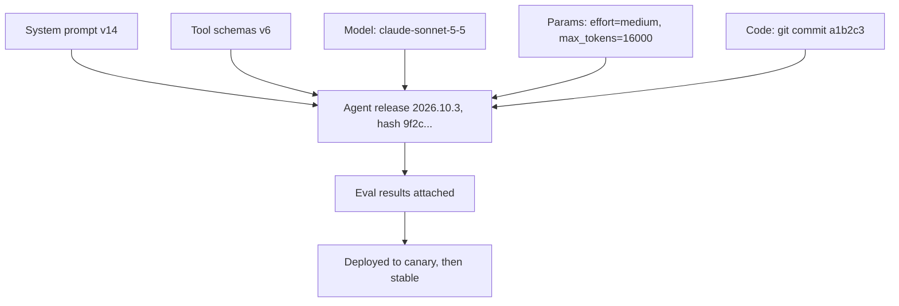
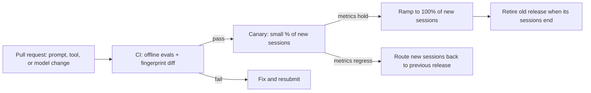

# Versioning Prompts, Tools and Models

## Introduction

In ordinary software, the version of your code mostly determines behavior. In an agent, behavior depends on several things that change on different schedules:

- The **system prompt** and any prompt templates
- The **tool definitions**: names, descriptions, and input schemas
- The **model ID** and its parameters (effort, thinking settings, `max_tokens`)
- The **code** around the loop: limits, validation, tool implementations
- **Data the agent sees**: retrieval indexes, knowledge base content, few-shot examples

Change any one of these and the agent may behave differently. A one-word edit to a tool description can change how often the tool is called. If you cannot say exactly which combination was running when a bad answer happened, you cannot reproduce it, compare it, or roll it back.

Think of a recipe in a restaurant chain. The dish depends on the recipe card, the ingredients supplier, and the oven model. When a customer complains, the chain needs to know which recipe version, which supplier batch, and which oven. Agents need the same traceability.

This page shows how to:

- Treat a prompt + tools + model + parameters as one **release bundle** with a version and a content hash
- Store and review prompts like code
- Pin each conversation to one version
- Change tool schemas without breaking running conversations
- Record the version everywhere, so metrics and traces can be split by it
- Roll forward and back safely

For prompt-specific practices, also read [Versioning and Managing Prompts](../3-agents-prompt-engineering/8-agents-prompt-versioning.mdx).

## The Release Bundle

The core idea: **an agent version is the full set of inputs that shape its behavior**, frozen together.



Here is a simple, file-based way to define a bundle and compute a fingerprint for it.

```python
import hashlib
import json
from dataclasses import asdict, dataclass


@dataclass(frozen=True)
class AgentRelease:
    name: str
    version: str
    model: str
    effort: str
    max_tokens: int
    system_prompt: str
    tools: tuple          # tool definitions as JSON strings, sorted by name

    def fingerprint(self) -> str:
        """Hash of everything that affects behavior. Same hash = same behavior inputs."""
        payload = json.dumps(asdict(self) | {"version": None}, sort_keys=True)
        return hashlib.sha256(payload.encode()).hexdigest()[:12]


def tool_json(tool: dict) -> str:
    return json.dumps(tool, sort_keys=True)


lookup_order = {
    "name": "lookup_order",
    "description": "Look up an order by ID. Returns status, items, and shipping dates.",
    "input_schema": {"type": "object",
                     "properties": {"order_id": {"type": "string"}},
                     "required": ["order_id"]},
}

release_a = AgentRelease(
    name="support-agent", version="2026.10.3", model="claude-sonnet-5-5",
    effort="medium", max_tokens=16000,
    system_prompt="You are a support agent for Acme. Be concise and accurate.",
    tools=tuple(sorted([tool_json(lookup_order)])),
)
release_b = AgentRelease(**(asdict(release_a) | {
    "version": "2026.10.4",
    "system_prompt": "You are a support agent for Acme. Be concise, accurate, and friendly.",
}))

print(release_a.version, release_a.fingerprint())
print(release_b.version, release_b.fingerprint())
```

Example output:

```text
2026.10.3 37a3d49ffd04
2026.10.4 eeb3ba95acb8
```

Why a fingerprint as well as a version number? Because people forget to bump version numbers. The fingerprint changes whenever *anything* that matters changes, so you can detect "same version label, different content" in CI and in production logs.

The `version` field is excluded from the hash on purpose, so relabeling without changing content does not look like a behavior change.

## Store Prompts and Tool Schemas as Code

Keep prompts and tool definitions in your Git repository, in files that are easy to diff:

```text
agents/support/
  release.yaml          # model, params, which prompt and tools files to use
  prompts/system.md     # the system prompt, reviewed in pull requests
  tools/lookup_order.json
  tools/issue_refund.json
  evals/cases.jsonl     # the eval set this release must pass
```

```yaml
# agents/support/release.yaml
name: support-agent
version: 2026.10.4
model: claude-sonnet-5-5
params:
  effort: medium
  max_tokens: 16000
limits:
  max_turns: 15
  max_task_tokens: 400000
system_prompt: prompts/system.md
tools:
  - tools/lookup_order.json
  - tools/issue_refund.json
eval:
  suite: evals/cases.jsonl
  min_pass_rate: 0.90
```

Benefits of this approach:

- **Review**: prompt changes go through pull requests, with a reviewer who reads the diff.
- **History**: `git blame` tells you who changed a line and why.
- **CI**: every change runs the eval suite before merging. See [Regression Testing for Agents](../11-agents-evaluation-and-testing/6-agents-regression-testing.mdx).
- **Reproducibility**: checking out a commit gives you the exact bundle.

Some teams use a **prompt registry** (a database or a hosted prompt-management tool) so non-engineers can edit prompts without a deploy. That is a valid choice, but the same rules apply: every change gets a version, an eval run, and a staged rollout. A registry without those controls lets anyone change production behavior instantly, which is how many agent incidents start.

## Pin Each Conversation to One Version

When you deploy a new version, some conversations are already in progress. Do not switch them mid-conversation. There are three reasons:

1. **Consistency.** The conversation history was produced under the old prompt and tools. Mixing versions makes behavior hard to reason about and hard to debug.
2. **Caching.** Prompt caching is a prefix match. Changing the system prompt or the tool list changes the prefix, so every cached turn of every in-flight conversation is lost and re-billed at full price.
3. **Reasoning continuity.** On current Claude models, thinking blocks are tied to the conversation that produced them. Editing the system prompt, tools, or earlier messages of an existing conversation can invalidate those blocks, and on some models and accounts the API rejects the request until they are removed.

The fix is to store the release version with the session and load that release for every turn.

```python
RELEASES = {
    "2026.10.3": {"model": "claude-sonnet-5-5", "system": "v14 prompt...", "tools": ["v6"]},
    "2026.10.4": {"model": "claude-sonnet-5-5", "system": "v15 prompt...", "tools": ["v6"]},
}
STABLE = "2026.10.4"
sessions: dict[str, dict] = {}


def get_release_for(session_id: str) -> tuple[str, dict]:
    session = sessions.setdefault(session_id, {"release": STABLE})   # pinned at creation
    version = session["release"]
    if version not in RELEASES:
        raise RuntimeError(f"release {version} was removed while sessions still use it")
    return version, RELEASES[version]


sessions["old-chat"] = {"release": "2026.10.3"}        # started before the deploy
for sid in ["old-chat", "new-chat"]:
    version, rel = get_release_for(sid)
    print(sid, "->", version, rel["system"])
```

Output:

```text
old-chat -> 2026.10.3 v14 prompt...
new-chat -> 2026.10.4 v15 prompt...
```

This means you must **keep old releases deployable** until their sessions end. Anthropic describes the same idea for its research agent as "rainbow deployments": old and new versions run side by side while traffic shifts gradually, so agents in the middle of a task are not disrupted. Set a session lifetime (for example 24 hours of inactivity) so old releases can eventually be retired.

:::tip
If you truly need to change instructions mid-conversation (for example, to switch modes), do it by **appending** content rather than editing the system prompt. Some current Claude models accept a `role: "system"` message inside `messages` for exactly this purpose, which keeps the cached prefix intact. Check model support in the docs.
:::

## Evolving Tool Schemas Safely

Tools are an API contract between the model and your code. Treat schema changes like API changes:

| Change | Compatible? | Notes |
|---|---|---|
| Add an optional parameter | Yes | Old calls still validate |
| Improve a description | Behavior change | No code breaks, but tool usage may shift: run evals |
| Add a new tool | Behavior change | The model may now pick it over others |
| Make an optional parameter required | Breaking | Old-style calls fail validation |
| Rename a tool or parameter | Breaking | Conversations with old `tool_use` blocks reference the old name |
| Change the meaning of a parameter | Breaking, and dangerous | Same name, different effect; prefer a new name |
| Remove a tool | Breaking | In-flight conversations may still try to call it |

For breaking changes, use the expand-and-contract pattern familiar from database migrations:

1. **Expand**: add the new tool (`lookup_order_v2`) alongside the old one in the tool *implementation* layer. New releases expose only the new one to the model.
2. **Migrate**: new sessions use the new release; old sessions keep the old one.
3. **Contract**: once no session uses the old release, delete the old implementation.

Validate tool inputs in code no matter what. Even with a compatible schema, the model can send unexpected values. Strict tool schemas (`strict: True` on Claude tools) help guarantee the arguments match the schema. See [Tool Input Schemas](../2-agents-tool-use/2-agents-tool-input-schemas.mdx).

## Versioning the Model

The model is the largest single input to behavior. A few rules:

- **Pin the exact model ID** in the release bundle. Do not read it from a shared environment variable that someone else can change.
- **Know how your provider names models.** Some providers use dated snapshot IDs that never change; others offer aliases that move to newer snapshots. Anthropic's current model IDs (such as `claude-opus-5-5`) have no date suffix. Read your provider's models documentation to know whether an ID can change behavior under you.
- **Record which model actually served each request.** The response's `model` field tells you. Log it with the run.
- **Track deprecation dates.** Providers retire old models on a published schedule; requests to retired models fail. Put the dates in your team calendar.
- **Treat a model change as a migration**, not a config tweak. See [Migrating to a New Model](./8-agents-model-migration.mdx).

## Versioning Data, Examples, and Guardrails

Prompts, tools, and models are the obvious parts. Three less obvious inputs also change behavior and deserve versions:

- **Retrieval indexes and knowledge bases.** If the agent answers from a document index, re-indexing with a new chunk size or embedding model changes what it sees. Give each index build an ID (for example `kb-2026-10-07-chunk800`) and record it in the release bundle. Keep the previous index available so rollback restores the old answers too. See [Building a Retrieval Pipeline](../5-agents-rag/4-agents-retrieval-pipeline.mdx).
- **Few-shot examples and templates.** These are part of the prompt even when they live in separate files. Include them in the fingerprint.
- **Guardrail rules and thresholds.** A stricter input filter or a new output check can block answers that used to pass. Version the rule set and record it with each run. See [Input and Output Guardrails](../12-agents-safety-and-security/6-agents-guardrails.mdx).

A practical test: if changing a file could change what a user sees, that file belongs in the bundle and in the fingerprint.

```yaml
# Additional entries in release.yaml
retrieval:
  index: kb-2026-10-07-chunk800
  embedding_model: text-embedding-example-v3
few_shot: prompts/examples/billing.jsonl
guardrails: guardrails/v9.yaml
```

## Record the Version Everywhere

A version is only useful if you can see it in the data. Attach the release version and fingerprint to:

- **Metrics**: a `version` label on run counters and histograms (low cardinality: only a few versions are live at once)
- **Traces**: span attributes such as `agent.version` and `agent.fingerprint`
- **Logs**: every log line for the run
- **Stored outputs**: saved answers, tickets, and actions, so you can find everything a bad version touched

```python
import json
import logging

logging.basicConfig(level=logging.INFO, format="%(message)s")
log = logging.getLogger("agent")


def log_event(event: str, run_id: str, release_version: str, fingerprint: str, **fields) -> None:
    log.info(json.dumps({"event": event, "run_id": run_id, "agent_version": release_version,
                         "agent_fingerprint": fingerprint, **fields}))


log_event("run_completed", "run_123", "2026.10.4", "eeb3ba95acb8",
          status="completed", turns=3, model_served="claude-sonnet-5-5")
```

Output:

```text
{"event": "run_completed", "run_id": "run_123", "agent_version": "2026.10.4", "agent_fingerprint": "eeb3ba95acb8", "status": "completed", "turns": 3, "model_served": "claude-sonnet-5-5"}
```

During an incident, the first question is often "what changed?". With versions in every log and metric, the answer takes seconds. See [Incident Response for Agents](./9-agents-incident-response.mdx).

## Release Flow



Rollback for agents means **routing new sessions to the previous release**. Because releases are immutable and still deployed, this is a configuration change that takes effect in seconds. Use feature flags or a routing table so you do not need a full deploy to switch. The site's [canary deployment guide for Kubernetes](../../../devops/kubernetes/6-kubernetes-advanced-deployments/4-kubernetes-canary.mdx) covers infrastructure-level canaries; for agents, session-level routing in application code is usually more precise.

## Real-World Scenario

Your company has a sales-assistant agent used by 300 account managers. Three teams change it: the prompt team edits the system prompt in a hosted prompt tool, the platform team updates tool schemas, and an engineer bumped the model last month by changing an environment variable. Last Tuesday, answers about discount rules got worse. Nobody can say what changed, because the prompt tool has no history, the tool schemas live in a different repo, and the model change was not recorded anywhere.

**What you change:**

1. **One release bundle** in Git: `release.yaml`, the system prompt file, tool JSON files, and the eval set. The hosted prompt tool becomes an editor that opens pull requests instead of writing to production.
2. **A fingerprint** computed in CI and logged with every run.
3. **Session pinning**: each chat stores the release version at creation, and old releases stay deployed for 48 hours.
4. **A `version` label** on all agent metrics and an `agent.version` attribute on traces.
5. **A release flow**: CI evals, then a 10% canary of new sessions for one day, then full rollout, with rollback by routing table.
6. **Model IDs** only in `release.yaml`, reviewed like any other change.

Two weeks later, a tool description edit drops the use of the `get_discount_rules` tool. The canary dashboard shows the success rate for the new version falling against the old one within hours, and the team rolls back new sessions with a one-line routing change.

**Why this approach fits.** Multiple teams changing different parts of the agent is exactly when an explicit bundle pays off. The fingerprint catches untracked changes, and session pinning avoids breaking active chats.

**When not to use it.** A solo developer with one prompt in one file can rely on Git commits and a version string. Add bundles, fingerprints, and session pinning when more people, more traffic, or longer conversations make mismatches likely.

### Alternatives and Trade-offs

| Approach | Pros | Cons | Best for |
|---|---|---|---|
| Prompts in code, deployed with the app | Simple, reviewed, reproducible | Every prompt change needs a deploy | Most engineering-led teams |
| Release bundle files in Git with fingerprints | Full traceability across prompt, tools, model | More structure to maintain | Agents changed by several people |
| Hosted prompt registry with versions | Non-engineers can edit; fast iteration | Can bypass review and evals if not controlled | Content-heavy prompts owned by domain experts |
| Database-stored prompts, edited live | Instant changes | Weak history, easy to break production | Rarely a good idea for production agents |
| Feature-flag routing between releases | Instant rollback and canaries | Flag hygiene needed | Any agent with real traffic |

## Common Mistakes

- **Changing the model with an environment variable.** It skips review and evals and leaves no record.
- **Editing the system prompt of live conversations.** It breaks caching and can invalidate reasoning history.
- **Renaming tools in place.** In-flight conversations reference the old name.
- **Version numbers without content hashes.** Content drifts while the label stays the same.
- **No version in metrics or logs.** You cannot compare a canary or find what a bad version touched.
- **Deleting old releases at deploy time.** Sessions pinned to them break.

## Summary

- An agent's behavior depends on prompt, tools, model, parameters, code, and data; version them together as a release bundle.
- Compute a content fingerprint so changes cannot slip in under the same version label.
- Store prompts and tool schemas in Git, reviewed and evaluated like code.
- Pin each conversation to its release; keep old releases deployed until their sessions end.
- Evolve tool schemas with compatible changes or expand-and-contract.
- Record the version in metrics, traces, logs, and stored outputs, and roll back by routing new sessions.

## Exercises

1. Write a script that loads `release.yaml`, reads the referenced prompt and tool files, builds an `AgentRelease`, and prints its fingerprint. Run it in CI and fail if the fingerprint changed but the version did not.
2. Classify five recent changes to an agent you know (or invent them) using the tool schema compatibility table.
3. Implement session pinning in a small FastAPI app: store the release version in the session record and use it for every turn.
4. Add a `version` label to your run metrics and build a Grafana panel that compares success rate between two versions.

Next: [Migrating to a New Model](./8-agents-model-migration.mdx). Related: [Prompt Templates](../3-agents-prompt-engineering/7-agents-prompt-templates.mdx), [Defining Tools](../2-agents-tool-use/1-agents-defining-tools.mdx), and [Agents in CI/CD Pipelines](../10-agents-integration/9-agents-in-ci-cd.mdx).
